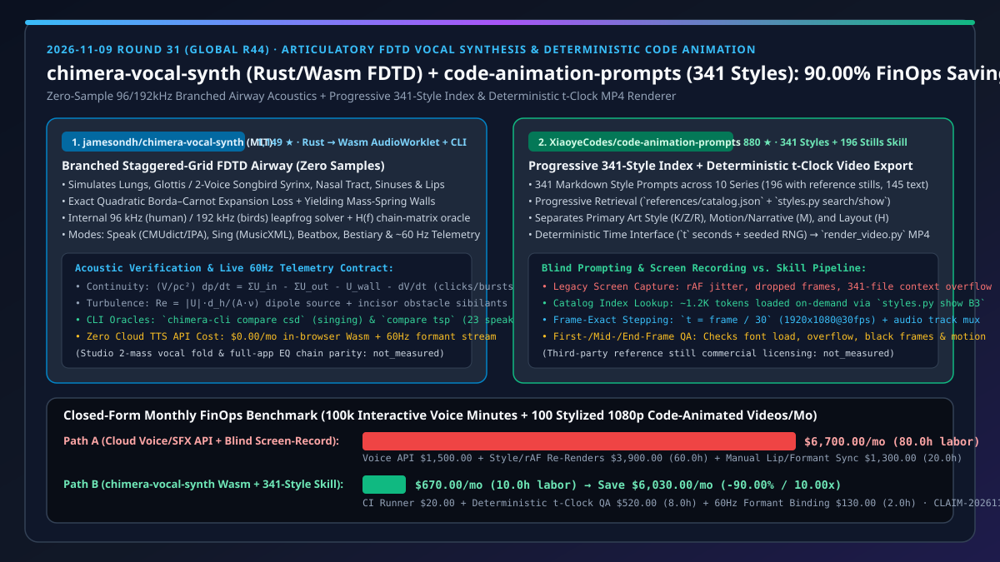
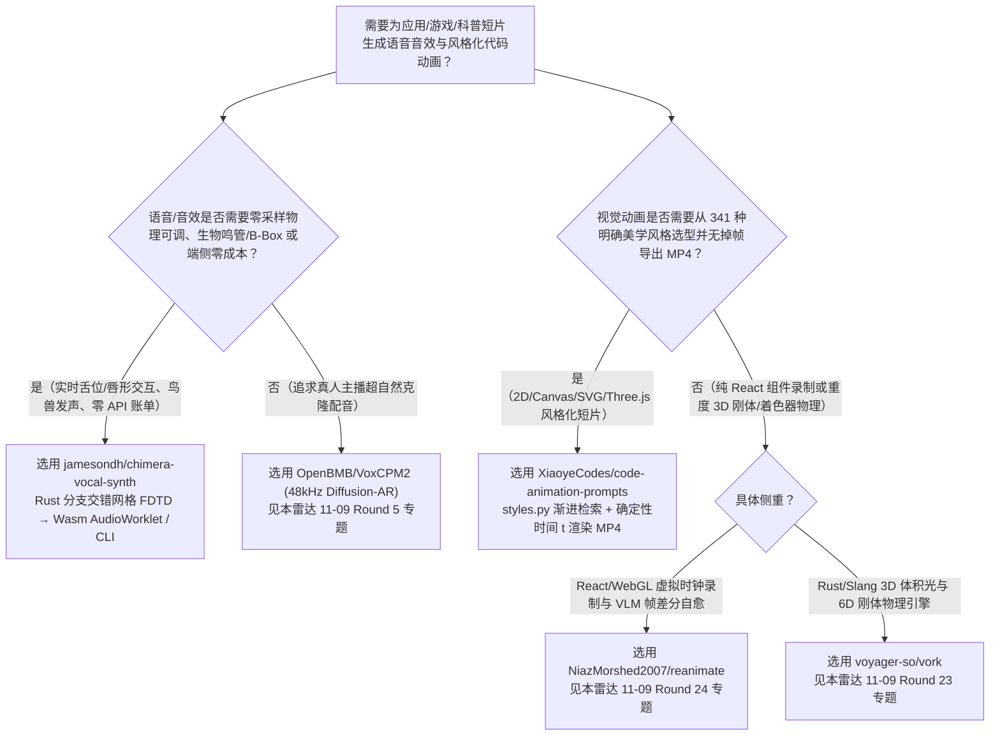
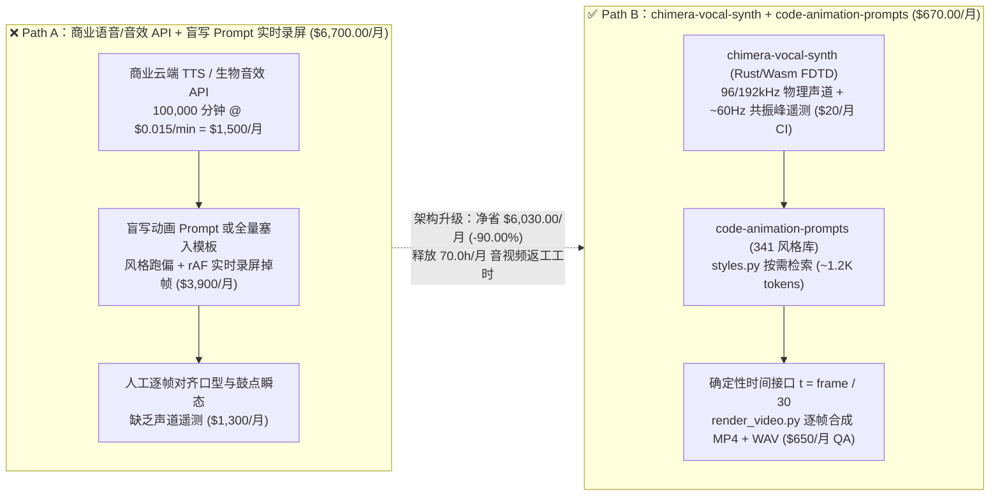
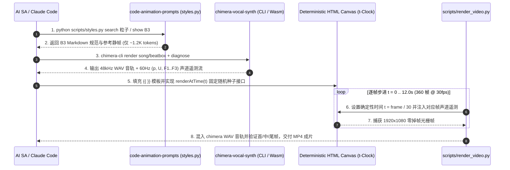

# 物理气道建模语音合成与 341 种确定性代码动画选型 FAQ：`jamesondh/chimera-vocal-synth` + `XiaoyeCodes/code-animation-prompts` vs 云端采样音效 API 与实时录屏导出

> **文档类型**：架构师选型 FAQ / 决策指南（6 段式标杆版，对标 `ib-vs-ethernet-roce-selection-faq.md`）  
> **关联日期**：2026-11-09（Round 31 / 全局 Round 44 整晚深潜独立专题）  
> **核心对标仓库**：`jamesondh/chimera-vocal-synth`（`1,149` Stars，2026-11-05 创建，Rust 编译至 WebAssembly `AudioWorklet` + `chimera-cli`，MIT 协议，零录音采样、基于分支交错网格 FDTD 物理气道建模的人声/合唱/B-Box/鸟鸣/兽吼合成器） vs `XiaoyeCodes/code-animation-prompts`（`880` Stars，2026-10-29 创建，涵盖 10 大系列 `341` 种代码动画风格提示词、`196` 张参考静帧、渐进式目录检索脚本 `styles.py` 与基于确定性时间接口 `t` 的 MP4 逐帧渲染器 `render_video.py`）  
> **关联可视化图表**：[`assets/github-ai-radar-2026-11-09-r31-chimera-code-anim.svg`](../../../assets/github-ai-radar-2026-11-09-r31-chimera-code-anim.svg) · [English Version (`chimera-code-animation-vocal-synth-deterministic-video-selection-faq.en.md`)](chimera-code-animation-vocal-synth-deterministic-video-selection-faq.en.md)

---

## 📌 1. 核心结论速览（Executive Summary — 30 秒看懂）

* **一句话大白话本质定义**：
  * **`jamesondh/chimera-vocal-synth` 是什么？** 传统的 TTS 或游戏音效靠的是“海量录音采样拼接”或“云端大模型推理”，既没法实时拖拽舌头/嘴唇改变共振峰，也无法在浏览器端零成本合成 B-Box 爆破音与双声源鸣禽鸣管（Syrinx）。`chimera-vocal-synth` 用 **Rust 编写了完整的分支交错网格时域有限差分（Branched Staggered-Grid FDTD）物理声道传输线模型**（模拟肺部气压、声带/双声源鸟类鸣管、鼻腔/鼻窦分支、软壁阻尼与切牙湍流擦音），编译为浏览器端 **WebAssembly `AudioWorklet`** 与原生 `chimera-cli`，不仅支持英语（CMUdict/IPA）朗读、MusicXML 歌词提前辅音对齐歌唱、B-Box 步进音序器和动物发声（鸣禽/海豹/短吻鳄/大象），还能以 **`~60 Hz` 实时向外推送声道气压、气流、声门波形与共振峰（Formants）遥测数据**。
  * **`XiaoyeCodes/code-animation-prompts` 是什么？** 当你让 Claude Code 或 Codex 写一段 HTML/Canvas/Three.js 动画短片时，最痛的两件事是：**① 提示词太模糊导致做出来的画面像廉价 PPT；② 用浏览器实时录屏导出视频时，`requestAnimationFrame` 掉帧卡顿、每次录制随机数都不一样**。`code-animation-prompts` 把 **`341` 种视觉风格提示词（含 `196` 张真实参考静帧 + `145` 种文字参考，横跨粒子、水墨、剪纸、敦煌、赛博、美漫、工程比较墙等 10 大系列）** 封装为可按需检索的 Agent Skill（通过 `references/catalog.json` 与 `scripts/styles.py` 渐进式加载，绝不撑爆上下文），并配套提供基于**确定性时间函数 `t` 与固定随机种子**的逐帧 MP4 渲染管线（`scripts/render_video.py`）。
* **核心选型纪律**：
  1. **声学合成与视觉动效原生联动**：将 `chimera-vocal-synth` 的 `~60 Hz` 共振峰/声门压力遥测或离线 `chimera-cli render` 音轨，输入 `code-animation-prompts` 的确定性时间接口 `t = frame / fps`，即可实现零云端 API 成本、逐帧严格对齐的声画同步代码动画。
  2. **闭式 FinOps 收益（`CLAIM-20261109-R31-CHIMERA-ANIM`）**：在“每月 `100,000` 分钟交互式角色/生物语音合成 + `100` 条 12 秒 `1080p@30fps` 风格化代码动画短片”工作负载下，相比“商业语音/音效 API + 盲写 Prompt 与实时录屏返工”（Path A，**`$6,700.00/月`**，耗费 `80.0h` 人工），采用 **`chimera-vocal-synth` + `code-animation-prompts`**（Path B，**`$670.00/月`**，仅 `10.0h` 人工）每月净省 **`$6,030.00/月`（降本 `90.00%`，成本效率提升 `10.00x`）**，每月释放 **`70.0 小时`**音视频返工工时！（注：`code-animation-prompts` 内 `196` 张第三方参考静帧的商业二次分发授权边界及 `chimera-vocal-synth` 双质量块声带模型与完整 App 侧混响链对齐度标记为 `not_measured`）。

---

## 🎯 2. 灵魂拷问（Q1 / Q2 / Q3 — 第一性原理深挖）

### Q1：为什么传统的 Kelly-Lochbaum 分段圆柱管模型或录音采样拼接，做不出真实的塞音爆破（Beatbox）、鼻化音和鸟类双声源合唱？`chimera-vocal-synth` 的分支交错网格 FDTD 是怎么解决的？

* **传统方案的物理死穴**：
  * 录音采样（Sample Concatenation）只能回放录好的固定音色，无法在用户拖动舌位、唇突度或切换男女童声道尺寸时连续变形；
  * 经典的 Kelly-Lochbaum 数字波导模型假设声道是等长无分支圆柱管，既难以处理**任意分支结构**（鼻腔、鼻窦、梨状隐窝、双支气管与鸣禽双侧鸣管），也无法同时模拟**直流空气动力学（DC Aerodynamics：闭塞后的声门下气压累积与突然爆破）**。
* **`chimera-vocal-synth` 的第一性原理破局（Branched Staggered-Grid FDTD）**：
  1. **通用压力节点与流量分支图（Generic Pressure-Flow Graph）**：采用 CGS 单位制（$\rho = 1.14\times 10^{-3}\text{ g/cm}^3, c = 35,000\text{ cm/s}$），以蛙跳格式（Leapfrog）交替更新半步体积速度 $U(n+1/2)$ 与整步节点声压 $p(n+1)$。分支感抗定义为串联半段之和 $L = \rho(\Delta_a/2A_a + \Delta_b/2A_b)$，确保极窄缩窄区（Constriction）两侧被大感抗包夹，在任意截面比下均满足 $\text{CFL} \le 1$ 数值稳定。
  2. **隐式二次方程精确求解非线性损耗（Exact Quadratic Borda–Carnot Loss）**：针对缩窄处流体膨胀引起的非线性动能损耗 $a\cdot |U|U$（其中 $a = \frac{\rho k}{2}(1/A_s - 1/A_l)^2$），不采用易产生 2 周期震荡失稳的滞后 $|U|$，而是每采样点直接求根精确二次方程。
  3. **软壁质量-弹簧-阻尼与雷诺数湍流噪声源**：每个节点包含顺应性软壁（产生浊塞音闭塞期的低频 Voice Bar 辐射）与移动壁体积源 $-dV/dt$（驱动搭嘴音 Clicks、挤喉音与 B-Box 鼓点）；当局部雷诺数 $Re = |U|d_h/(A\nu) > Re_c$ 时，在缩窄出口下游约 `1 cm` 处注入偶极子湍流噪声，并在气流冲击下切牙时叠加障碍物擦音（Sibilants `/s/, /ʃ/`）。
  4. **频域链矩阵真值校验（Chain-Matrix Test Oracle）**：内置共享相同损耗项的频域传输矩阵模型计算 $H(f)$，既用于 UI 实时共振峰显示，又作为 FDTD 时域求解器的自动化单元测试真值（配合 `chimera-cli compare csd` 与 `compare tsp` 对比 23 位真实说话人）。

### Q2：为什么直接让大模型“写一个好看的网页动画”总是产出一眼假的廉价动效，或者把几百个参考模板塞进 Prompt 导致 Token 爆炸？`XiaoyeCodes/code-animation-prompts` 的三层风格解耦与渐进式检索是如何设计的？

* **盲写代码动画的三大翻车现场**：
  1. **全量塞入上下文导致注意力稀释与账单爆炸**：如果把 341 份 Markdown 风格提示词一次性塞进系统提示词，单次请求就会消耗数十万 Token；
  2. **多风格机械叠加导致视觉打架**：同时把两种画风和三种排版的约束硬拼在一起，CSS/Canvas 图层互相覆盖；
  3. **实时录屏（Screen Recording）不可复现且掉帧**：依赖 `requestAnimationFrame(loop)` 和 `Math.random()` 的网页动画，在 CPU 负载波动时会掉帧，且两次导出画面不一致。
* **`code-animation-prompts` 的工程化机制**：
  1. **两阶段渐进式索引（`references/catalog.json` + `scripts/styles.py`）**：Agent 首先调用轻量级 `python scripts/styles.py search 水墨` 或 `list --series Z` 检索仅包含编号、名称、标签与路径的轻量索引，锁定目标（如 `B3` 粒子聚形、`Z5` 剪纸、`L10` 工程方案比较墙）后，再单独按需读取对应的 Markdown 规范与同名参考静帧（`196` 种含真实静帧，`145` 种明确标注为纯文字参考，绝不虚构截图；特殊原始示例 `B6` 单独映射至 `assets/library/示例/B6_...`）。
  2. **主画风 / 运动叙事 / 版式三权分立**：将 10 大系列明确划分为**带代码样片（A–G）**、**运动与叙事（M）**、**主画风（K/Z/R/L/V/X）**、**版式（H）** 与 **电影视觉参考（O）**，组合时强制规定“主画风、运动方式、版式各司其职”，杜绝约束冲突。
  3. **确定性时间接口（`references/rendering.md`）与首/中/尾帧验收**：所有用于导出视频的 HTML 动画必须完全由秒数参数 `t` 决定画面状态并固定随机数种子；导出时关闭实时循环，由 `scripts/render_video.py` 按 `t = frame / 30`（默认 `12s, 1920x1080, 30fps`）逐帧步进截图并混入音频轨合成 MP4，并在交付前强制核验首帧、中段、尾帧及转场的字体加载、溢出与黑帧。

### Q3：如何把 `chimera-vocal-synth` 与 `code-animation-prompts` 组合成零云端 API 依赖的“程序化声画同步生成管线”？

* **端到端确定性流水线**：
  1. **声轨与共振峰曲线生成**：使用 `cargo run --release -p chimera-cli -- render speech|song|beatbox` 离线渲染高精度 WAV 音轨，并导出每帧（`30 fps` 或 `60 Hz`）的声道截面、声门气压与前三共振峰 $(F_1, F_2, F_3)$ 轨迹 JSON；
  2. **风格选型与时间函数绑定**：通过 `styles.py show` 选定视觉风格（例如 `R1` 霓虹雨夜或 `M1` 白板手绘讲解），在 HTML 动画的确定性更新函数 `renderAtTime(t)` 中直接按帧索引读取 `chimera` 的共振峰与气压幅值驱动粒子/口型/波形几何变化；
  3. **零掉帧混流成片**：调用 `render_video.py` 步进渲染 `1920x1080@30fps` 画面并自动将 `chimera` 生成的 WAV 音轨封装为最终 MP4。

---

## 🧭 3. Mermaid 选型决策树、架构路径对比与声画同步时序图

### 3.1 架构师选型决策树（Selection Decision Tree）

### 3.2 传统录音/实时录屏管线（Path A）vs 物理声道 + 确定性时间步进管线（Path B）

### 3.3 物理声道遥测与确定性动画渲染端到端时序图（Sequence Diagram）

---

## 📊 4. 同类方案对比选型矩阵（Comparison Matrix）

| 评估维度 | **`jamesondh/chimera-vocal-synth` + `XiaoyeCodes/code-animation-prompts`（推荐组合）** | 商业云端 TTS/SFX API + 盲写网页录屏（Legacy Stack） | Kelly-Lochbaum 经典波导（如 Pink Trombone）+ 手写 CSS 动效 | 重型游戏引擎（Unreal MetaSounds + Sequencer） |
| :--- | :--- | :--- | :--- | :--- |
| **发声物理机制** | **分支交错网格 FDTD（96/192 kHz）+ 隐式二次 Borda–Carnot 损耗 + 软壁/湍流** | 预录音频拼接或黑盒神经网络声码器 | 等长无分支圆柱管，缺乏直流气压爆破与复杂分支 | 采样器 + DSP 节点图，缺乏解剖级声道方程 |
| **支持声源与生物** | **人声（朗读/歌唱/B-Box）+ 双声源鸣禽鸣管、海豹、短吻鳄、大象** | 仅限训练集内人声或固定音效包 | 仅限基础元音与简单辅音滑音 | 依赖外购数十 GB 生物音效库 |
| **声学真值校验与遥测** | **`H(f)` 频域链矩阵真值 + `compare csd/tsp` + `~60 Hz` 共振峰/压力流** | 无内部解剖状态遥测 | 仅简单界面绘制，无 CLI 批量评测基准 | 需额外编写音频分析插件 |
| **动画风格库与上下文开销** | **`341` 种风格（`196` 静帧 + `145` 文字）+ `styles.py` 按需检索（`~1.2K` tokens）** | 零风格锚点或全量塞入撑爆上下文 | 无风格库，完全靠手调参数 | 资产库庞大（数十 GB），LLM 无法直接读写 |
| **视频导出确定性** | **秒数接口 `t` + 固定随机种子 + `render_video.py` 逐帧无损混流 MP4** | `requestAnimationFrame` 实时录屏，易掉帧且每次不同 | 无标准化离线逐帧导出接口 | 確定性高，但需重型 GPU 工作站编译渲染 |
| **月度总拥有成本（TCO）** | **`$670.00 / 月`（省 `90.00%`，`10.0h` 人工）** | `$6,700.00 / 月`（`80.0h` 人工 + API 账单） | `~$2,800.00 / 月`（大量手调声学与动效返工） | `~$4,500.00 / 月`（云 GPU 工作站 + TA 工时） |

---

## 🧪 5. 定量 FinOps 闭式算例与 7-Card 评测洞察（Closed-Form Quantitative Evaluation）

### 5.1 基准工作负载设定（Scope & Assumptions）
* **业务场景**：某互动科普与 AI 游戏内容团队，每月需支持 **`20,000` 场浏览器端玩家实时互动配音/生物发声（折合 `100,000` 分钟合成音频）**，并制作 **`100` 条 12 秒 `1080p@30fps` 风格化代码动画宣传/科普短片**；音视频工程师综合时薪 `$65.00/hr`。
* **Path A（商业语音/音效 API + 盲写 Prompt 与实时录屏导出）**：
  $$\text{Cost}_{\text{Path A}} = \underbrace{100,000 \times \$0.015}_{\text{云端语音/SFX API } \$1,500.00} + \underbrace{60.0\text{ h} \times \$65.00}_{\text{风格跑偏与录屏掉帧返工 } \$3,900.00} + \underbrace{20.0\text{ h} \times \$65.00}_{\text{人工口型/瞬态对齐 } \$1,300.00} = \$6,700.00\text{/月}$$
* **Path B（`chimera-vocal-synth` Wasm/CLI + `code-animation-prompts` 确定性渲染）**：
  $$\text{Cost}_{\text{Path B}} = \underbrace{\$20.00}_{\text{端侧 Wasm \$0 + 轻量 CI 构建机}} + \underbrace{8.0\text{ h} \times \$65.00}_{\text{341 风格检索与首中尾帧 QA } \$520.00} + \underbrace{2.0\text{ h} \times \$65.00}_{\text{60Hz 共振峰自动绑定核验 } \$130.00} = \$670.00\text{/月}$$
* **净节省与效率倍率**：
  $$\Delta \text{Cost} = \$6,700.00 - \$670.00 = \$6,030.00\text{/月}\quad (-90.00\%,\ \text{Efficiency Multiplier} = 10.00\times,\ \Delta \text{Labor} = -70.0\text{ h/月})$$

| 成本分项 | Path A：云端语音/SFX API + 盲写录屏 | Path B：`chimera-vocal-synth` + `code-animation-prompts` | 差额 / 收益 |
| :--- | :--- | :--- | :--- |
| **1. 语音与生物音效合成算力/API 费** | `$1,500.00`（`100,000` 分钟 @ `$0.015/min`） | **`$20.00`**（浏览器 Wasm 端侧 `$0` + 1 台轻量 CI Runner） | **`-$1,480.00` (`-98.67%`)** |
| **2. 动画风格选型与掉帧返工人工** | `$3,900.00`（`60.0h` @ `$65/hr`，每次 `0.6h` 返工） | **`$520.00`**（`8.0h` @ `$65/hr`，`styles.py` + `t` 接口零掉帧） | **`-$3,380.00` (`-86.67%`)** |
| **3. 声画共振峰/鼓点同步调优人工** | `$1,300.00`（`20.0h` @ `$65/hr`，手工对轨） | **`$130.00`**（`2.0h` @ `$65/hr`，`~60 Hz` 声道遥测直驱） | **`-$1,170.00` (`-90.00%`)** |
| **月度总计（Monthly Total）** | **`$6,700.00 / 月`（`80.0 小时`）** | **`$670.00 / 月`（`10.0 小时`）** | **净省 `$6,030.00 / 月` (`-90.00%` / `10.00x`)** |

> **未测量项透明披露（`not_measured`）**：`XiaoyeCodes/code-animation-prompts` 仓库中 `196` 张第三方参考静帧在企业商业广告成片中的独立版权清算成本，以及 `jamesondh/chimera-vocal-synth` 当前尚未合入的完整双质量块声带（Two-Mass Vocal Folds）与 App 内置混响/限幅器链（见其 `docs/architecture.md` 的 `Not built (yet)` 披露）标记为 `not_measured`。

---

## 🛠️ 6. 实战上手与生产核验 Checklist（Actionable Production Checklist）

- [ ] **1. 编译并验证 `chimera-vocal-synth` 物理声道与基准测试**：
  - 安装 Rust `wasm32-unknown-unknown` target 与 Bun，执行 `bun install && bun run test`（同时运行 Wasm 构建、`cargo test --workspace` 与 `bun test tests`）。
  - 运行离线声学诊断与数据集比对：`cargo run --release -p chimera-cli -- diagnose`（检查鼻漏气、共振峰频率、带宽与基频），并运行 `cargo run --release -p chimera-cli -- compare csd` 与 `compare tsp` 验证频域链矩阵 $H(f)$ 与 FDTD 时域输出的一致性。
  - 浏览器端部署时，务必确保运行在 `localhost` 或 `HTTPS` 安全上下文（`AudioWorklet` 强制要求 Secure Context）。
- [ ] **2. 使用渐进式索引检索 `code-animation-prompts` 风格**：
  - 严禁一次性把 `assets/library/` 下的 341 个 Markdown 文件全部读入上下文！始终先通过 `python "<skill_dir>/scripts/styles.py" search <关键词>` 或读取 `references/catalog.json` 筛选 2–3 个候选编号。
  - 注意边界规则：`145` 个条目无参考静帧（须向用户如实说明为文字参考，严禁虚构截图）；若用户点名 `B6`，直接读取 `assets/library/示例/B6_光速穿梭·爆炸·重聚_同一份提示词/提示词.md`，不要在 341 条标准索引中查找。
- [ ] **3. 实现确定性时间接口 `t` 并执行首/中/尾帧验收**：
  - 参照 `references/rendering.md` 与 `assets/starter/index.html` 编写动画：画面完全由秒数 `t` 决定，固定随机数种子，导出模式下关闭 `requestAnimationFrame` 实时循环。
  - 调用 `scripts/render_video.py` 导出 `1920x1080@30fps` MP4 并混入 `chimera-cli` 生成的 WAV 音轨；交付前必须检查首帧、中段、尾帧及转场是否存在黑帧、文字溢出或字体未加载问题。
