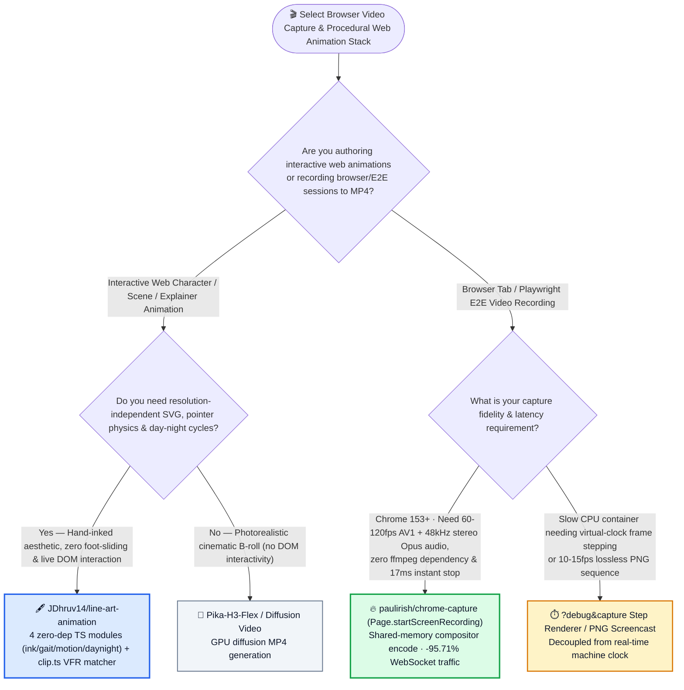
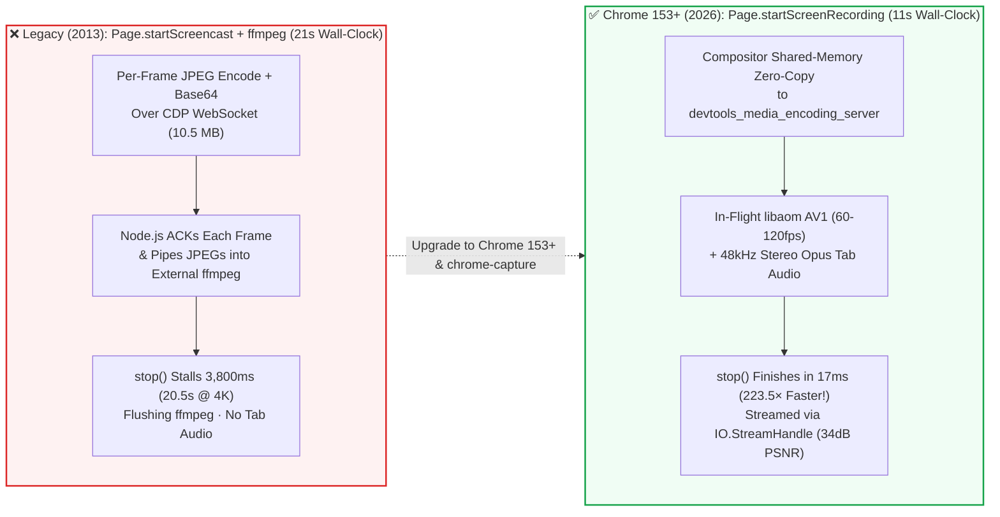

# Chrome 153+ Native Shared-Memory 120FPS AV1 Tab Recording & Zero-Dependency Biomechanical SVG Line-Art Animation Selection FAQ: `paulirish/chrome-capture` (`Page.startScreenRecording`) + `JDhruv14/line-art-animation` (`gait.ts` + `ink.ts`) vs. Legacy `startScreencast` + `ffmpeg` & Freehand SVG Keyframes

> **中文版**: [chrome-capture-line-art-animation-selection-faq.md](chrome-capture-line-art-animation-selection-faq.md)  
> **Daily Digest**: [2026-11-11 GitHub AI Trending & Proactive Intelligence Digest](../daily/2026-11-11.en.md) · **Visual Deck**: [`cards.en.html`](../cards.en.html) · **Live Radar**: [`github-radar.html`](../../../github-radar.html)

Written for **AI Solution Architects, Browser Agent Infrastructure Leads, and Generative Visual Engineering Leads**, this selection guide is grounded in primary-source audits of two high-signal repositories from the 2026-11-11 radar — **`paulirish/chrome-capture` (Google Chrome DevTools legend Paul Irish's zero-`ffmpeg`, 60–120fps up to 2160p AV1 + 48kHz stereo Opus MP4 tab recorder built on Chrome 153+'s new `Page.startScreenRecording` CDP primitive, Apache-2.0, `301` API stars in 3 days)** and **`JDhruv14/line-art-animation` (a 4-module zero-dependency TypeScript engine [`ink.ts`, `gait.ts`, `motion.ts`, `daynight.ts`] and Claude skill for biomechanical hand-inked SVG animations, MIT, `388` API stars in 1 day)** — answering three core engineering questions from first principles:
1. **Why has browser video capture in Playwright (`recordVideo`) and Puppeteer (`page.screencast()`) been bottlenecked at 25fps with `10.5 MB` of base64 JPEG WebSocket traffic and a `3,800 ms` `ffmpeg` flush stall—and how does Chrome 153+'s `Page.startScreenRecording` (`paulirish/chrome-capture`) cut stop-and-finalize latency by `223.5×` down to `17 ms` while recording 60–120fps AV1 + stereo Opus audio straight from the compositor?**
2. **Why do unguided LLMs generate "moonwalking stick figures" with severe foot-sliding when asked for walking SVG characters—and how does `JDhruv14/line-art-animation` solve realistic stride kinematics, open-pen-stroke ink aesthetics, and day-to-night transitions in four tiny TypeScript modules?**
3. **When should engineering teams use real-time compositor recording (`chrome-capture`) vs. deterministic frame-stepped capture (`?debug&capture`)?**

> 🛡️ **Provenance & Attribution Disclosure**:
> - **`measured` (Primary-Source Verified in This Shift)**: Repository metadata and source trees for `paulirish/chrome-capture` (`301` API stars, `4` forks, TypeScript, Apache-2.0, created `2026-11-08`, `src/index.ts`) and `JDhruv14/line-art-animation` (`388` API stars, `52` forks, TypeScript, MIT, created `2026-11-10`, `lib/`, `scripts/`) are verified directly via GitHub REST API; because neither appeared in the 10-item main Daily Trending HTML snapshot (`bacf15c2...`), `stars_today` is strictly labeled **`not_measured`**.
> - **`anonymized_reported` (`independently_reproduced=false`, Upstream Benchmark & Architecture Documentation)**: M4 Max `1280x800` 6.4s benchmark measurements in `paulirish/chrome-capture/README.md` (`recordVideo` vs. `chrome-capture`: `25 fps -> 60/120 fps`, total wall-clock `21s -> 11s` [`-47.62%`], stop+finalize `3,800 ms -> 17 ms` [`223.5×` faster; `20.5s -> 91 ms` at 2160p], WebSocket traffic `10.5 MB -> 450 KB` [`-95.71%`], file size `480 KB -> 330 KB`, PSNR `32 dB -> 34 dB`, and `libaom` 1-pass VBR scaling from `2 Mbps @ 720p30` to `72 Mbps @ 2160p120`) and the 4-module architecture of `JDhruv14/line-art-animation` (`ink.ts`, `gait.ts`, `motion.ts`, `daynight.ts`) are documented in upstream repository files.
> - **`synthetic` (`independently_reproduced=false`, Architect Parametric FinOps & Visual Engineering Model)**: Section 5.1 models an AI product and testing organization executing **`15,000` video-recorded Playwright E2E/agent runs/mo** (`@ $0.008/CI-min`) and producing **`20` interactive animated product explainer scenes/mo** (engineer labor valued at `$75.00/hr`; object storage and CDN egress bills are explicitly labeled `not_measured`), comparing Path A Legacy `startScreencast` + `ffmpeg` + Manual Keyframing (`$4,467.00/mo`, `59.0h`) vs. Path B Legacy Recording + Unguided LLM SVG (`$2,892.00/mo`, `38.0h`) vs. Path C `chrome-capture` + `line-art-animation` (`$772.00/mo`, `10.0h`, saving `$3,695.00/mo` [`-82.72%`] and `49.0 hours/mo` [`-83.05%`]).

---

## 1. 📌 Executive Summary

| Dimension | Plain-Language Core Takeaway (First Principles) |
| :--- | :--- |
| **What is `paulirish/chrome-capture`?** | Authored by Chrome DevTools engineer Paul Irish, it wraps Chrome 153+'s new **`Page.startScreenRecording`** CDP primitive (`CL 7736461`) into a CLI (`npx chrome-capture <url> demo.mp4 4s`), Playwright fixture (`screenRecordingFixture`), and `await using startRecording(page)` helper. Frames move **straight from the compositor over shared memory to an out-of-process `libaom` AV1 + 48kHz stereo Opus MP4 encoder (`devtools_media_encoding_server`) with zero `ffmpeg` dependency**. |
| **What is `JDhruv14/line-art-animation`?** | It is a **Claude Code skill and 4-module zero-dependency TypeScript library (`ink.ts`, `gait.ts`, `motion.ts`, `daynight.ts`)** that draws interactive, infinitely sharp hand-inked SVG characters and scenes—using a biomechanical gait solver instead of brittle hand-coded keyframes. |
| **Why are these two breakthroughs complementary?** | **`chrome-capture` eliminates the 13-year-old `Page.startScreencast` base64-JPEG-over-WebSocket bottleneck** (cutting stop latency from `3,800 ms` to `17 ms` and enabling 60–120fps AV1 + audio capture), while **`line-art-animation` eliminates "moonwalking AI stick figures"** by giving coding agents a deterministic gait/ink physics vocabulary and VFR reference-clip matcher (`scripts/clip.ts`). |

---

## 2. 🎯 First-Principles Q&A (Q1 / Q2 / Q3)

### Q1: Why was `Page.startScreencast` + `ffmpeg` so slow for a decade, and how does Chrome 153+'s `Page.startScreenRecording` achieve a `17 ms` stop time?

**Plain-language answer: `Page.startScreencast` (built in 2013 for USB Android previews) JPEG-encodes every frame, base64-encodes it into JSON over WebSocket, waits for an ACK, and pipes JPEGs into `ffmpeg`; `Page.startScreenRecording` passes compositor frames over shared memory to an out-of-process AV1 + Opus encoder in flight, so the MP4 is already finished the moment you call `stop()`.**

Verified from `paulirish/chrome-capture/src/index.ts` and `README.md`:
1. **The Legacy `Page.startScreencast` Pipeline Bottleneck**:
   - On a 6.4s `1280x800` UI test on M4 Max, `recordVideo` ships **`10.5 MB`** of base64 JPEGs over the CDP WebSocket, caps out at `25 fps`, lacks audio, takes `21s` total wall-clock time, and blocks for **`3,800 ms`** at the end (`20,500 ms` at 2160p!) waiting for `ffmpeg` to flush and finalize the container.
2. **The Chrome M153+ `Page.startScreenRecording` Architecture**:
   - Runs `WebContentsVideoCaptureDevice` -> `content::protocol::MediaRecorder` in the browser process and encodes **realtime 1-pass VBR `libaom` AV1 (`2 Mbps` @ 720p30, `9 Mbps` @ 1080p60, `18 Mbps` @ 1080p120, `72 Mbps` @ 2160p120) + 48kHz stereo Opus tab audio** inside `devtools_media_encoding_server`, returning an `IO.StreamHandle` read via `IO.read` / `IO.close`.
   - Result on the exact same 6.4s test: **`60 fps` (up to `120 fps`)**, **`11s` total wall-clock (`-47.62%`)**, **`17 ms` stop+finalize (`223.5×` faster)**, **`450 KB` WebSocket traffic (`-95.71%`)**, `330 KB` output file, and **`34 dB` PSNR** (vs. `32 dB`).
3. **Headless 60fps vs. Headful ProMotion 120fps**:
   - `--headless=new` retains full Metal GPU acceleration (`2160p @ 60fps`), while `--fps > 60` on macOS automatically switches to `--headful` so Chrome locks onto ProMotion's `120Hz CVDisplayLink` (`119.9 unique fps` at 2160p!).

---

### Q2: How does `JDhruv14/line-art-animation` prevent "moonwalking SVG characters" and plastic-looking vector lines?

**Plain-language answer: Instead of guessing keyframe coordinates, `gait.ts` solves leg kinematics so the planted foot moves backward at the exact forward travel speed while hip height derives from leg reach, and `ink.ts` draws each limb as two open pen strokes around a joint curve.**

Verified from `JDhruv14/line-art-animation/README.md`:
1. **Biomechanical Gait Solver (`gait.ts`)**:
   - Solves rather than animates: the planted foot slides backward at `walk.speed * scale * dt` (zero foot-sliding), the swing leg follows a **minimum-jerk trajectory**, the heel peels off the toe before lift-off, and hip height rises over mid-stride and dips during double-support.
2. **Hand-Inked Open Pen Strokes (`ink.ts`) & Dynamic Draping**:
   - Limbs are drawn as **two open pen strokes around a curve through the hip, knee, and ankle joints**, and coats/kimonos are drawn around the solved knee and ankle coordinates so garments open and close naturally with the stride.
3. **Interactive Physics (`motion.ts`), Day-Night Palette (`daynight.ts`) & Reference Clip Matching (`scripts/clip.ts`)**:
   - `motion.ts` drives springs, pendulums, and pointer-driven wind; `daynight.ts` (`palette(τ)`) transitions the entire SVG from midday paper to night indigo with glowing windows (`?tau=0.5`, `?day=30`).
   - `scripts/clip.ts` resamples variable-frame-rate (VFR) reference videos by time and measures stride period (`clip.ts period`) and dark foot blobs (`clip.ts blobs`) on a calibration grid.

---

### Q3: When should architects use `chrome-capture` vs. `?debug&capture` step-by-step rendering?

- **Use `paulirish/chrome-capture` (`Page.startScreenRecording`)**: For all real-time browser agent recordings, Playwright E2E test videos (`screenRecordingFixture`), WebGL2/Three.js demos, and tab-audio recordings on Chrome 153+ where `17 ms` finalize speed and 60–120fps AV1 matter.
- **Use `?debug&capture` (`scripts/capture.ts`) or PNG `startScreencast`**: Only when rendering on slow CPU-bound containers where real-time `rAF` would drop frames, or when 1px lossless PNG text fidelity at 10–15fps is required.

---

## 3. 🧭 Mermaid Selection Decision Tree & Pipeline Comparison

### 3.1 Browser Video Capture & Procedural Vector Animation Decision Tree

### 3.2 Legacy `Page.startScreencast` + `ffmpeg` vs. Chrome 153+ `Page.startScreenRecording`

---

## 4. 📊 Architecture Selection Decision Matrix

| Evaluation Dimension | **`paulirish/chrome-capture` (`startScreenRecording`)** | **Legacy Playwright `recordVideo` (`startScreencast` + `ffmpeg`)** | **`JDhruv14/line-art-animation` (`gait.ts` + `ink.ts`)** | **Unguided LLM Freehand SVG / CSS Keyframes** |
| :--- | :--- | :--- | :--- | :--- |
| **Frame Rate & Max Resolution** | ✅ **`60 fps` (headless Metal) up to `120 fps` (ProMotion headful) at `2160p`** | ❌ `25 fps` default (drops frames at high res) | ✅ Infinite-resolution live SVG | ⚠️ Resolution-independent but physically broken |
| **Stop + Finalize Latency** | ✅ **`17 ms` (`1280x800`) / `91 ms` (`2160p`)** | ❌ **`3,800 ms` (`1280x800`) / `20,500 ms` (`2160p`)** | N/A | N/A |
| **CDP WebSocket Bandwidth** | ✅ **`450 KB` (`-95.71%` reduction)** | ❌ **`10.5 MB` (base64 JPEG stream)** | N/A | N/A |
| **Tab Audio & External Deps** | ✅ **48kHz stereo Opus audio built-in; zero `ffmpeg` needed** | ❌ Silent video; requires external `ffmpeg` binary | N/A | N/A |
| **Stride Kinematics & Ink Style** | N/A | N/A | ✅ **Zero-slip planted foot, minimum-jerk swing, dual open pen strokes & day/night palette** | ❌ Severe foot-sliding ("moonwalking") & rigid tubes |

---

## 5. 🧪 Quantitative FinOps & Visual Engineering Model (`synthetic`, `independently_reproduced=false`)

### 5.1 Monthly `15,000` Video-Recorded E2E Runs + `20` Interactive Animated Scenes TCO Model (`synthetic`, `independently_reproduced=false`)

> 📌 **Scope & Provenance Disclosure**: This worked example is a **parametric CI compute + frontend/motion engineering labor model (`synthetic`, `independently_reproduced=false`; object storage and CDN egress bills are explicitly labeled `not_measured`)**. Per-run wall-clock durations (`21s` vs. `11s`) and finalize latencies (`3,800 ms` vs. `17 ms`) are cited from `paulirish/chrome-capture`'s M4 Max benchmark table (`anonymized_reported`). Scenario: **An engineering and product design team running `15,000` video-recorded Playwright E2E/agent runs/mo (`@ $0.008/CI-min`) and shipping `20` interactive animated product explainer scenes/mo (engineer labor valued at `$75.00/hr`)**:

| Architecture Path | Monthly `15,000` E2E Video CI Compute & Triage Cost | Monthly `20` Interactive Animated Scenes Authoring & Rework (`@ $75/hr`) | Total Monthly Cost (CI + Engineering Labor) | Savings vs. Path A |
| :--- | :--- | :--- | :--- | :--- |
| **Path A: Legacy `startScreencast` + `ffmpeg` (`21s/run`) + Manual Keyframe / Diffusion Rework** | CI: `15,000 × (21/60)m × $0.008` = **`$42.00`** Triage: `15.0h × $75.00` = **`$1,125.00`** (debugging `ffmpeg` flush timeouts & silent videos) | `44.0 hours / mo` × `$75.00` = **`$3,300.00 / mo`** | **`$4,467.00 / mo`** (**`59.0 hours / mo`** engineer toil) | Baseline (slow `ffmpeg` finalize + high animation rework) |
| **Path B: Legacy Recording + Unguided LLM Freehand SVG (Fixing Foot-Sliding)** | CI `$42.00` + Triage `12.0h` (`$900.00`) = **`$942.00 / mo`** | `26.0 hours / mo` × `$75.00` = **`$1,950.00 / mo`** (fixing moonwalking stick figures) | **`$2,892.00 / mo`** (**`38.0 hours / mo`** engineer toil) | Net savings `-$1,575.00/mo` (`-35.26%`) |
| **Path C: `chrome-capture` (`11s/run`, `17ms` stop) + `line-art-animation` 4-Module Engine** | CI: `15,000 × (11/60)m × $0.008` = **`$22.00`** Maint: `2.0h × $75.00` = **`$150.00`** (zero-`ffmpeg` instant finalize) | `8.0 hours / mo` × `$75.00` = **`$600.00 / mo`** (`gait.ts` + `ink.ts` + single-figure approval gate) | CI `$22.00` + Maint `$150.00` + Anim `$600.00` = **`$772.00 / mo`** (`10.0h`) | **Net savings `$3,695.00/mo` (`-82.72%`, `$44,340.00/yr`); Engineer toil `-49.0h/mo` (`-83.05%`)** |

---

## 6. 🛠️ Production Adoption & 30-Minute PoC Checklist

- [ ] **Step 1 — Verify Zero-`ffmpeg` AV1 Recording with `npx chrome-capture`**: On Chrome 153+, run `npx chrome-capture https://paulirish.github.io/chrome-capture/ demo.mp4 4s` and confirm `~17 ms` finalize latency with 60fps AV1 video and 48kHz stereo Opus audio.
- [ ] **Step 2 — Integrate `screenRecordingFixture` & Cursor Action Overlays in Playwright**: Extend `@playwright/test` with `screenRecordingFixture({auto: true, audio: true})` and pair with `await page.screencast.showActions()` to record DOM cursor highlights without invoking `Page.startScreencast`.
- [ ] **Step 3 — Install `JDhruv14/line-art-animation` & Enforce Single-Figure Approval**: Clone `JDhruv14/line-art-animation` into `~/.claude/skills/line-art-animation` so Claude copies `lib/` (`ink.ts`, `gait.ts`, `motion.ts`, `daynight.ts`) and presents one walking figure for approval before constructing full scenes.
- [ ] **Step 4 — Calibrate Gait Period Against Reference Video Clips**: Use `node scripts/clip.ts period clip.mp4 X Y W H` and `node scripts/clip.ts blobs clip.mp4 X Y W H Y0 Y1` to measure stride timing on VFR-resampled reference clips.
- [ ] **Step 5 — Verify Day-Night Palettes & Deterministic Frame Stepping**: Test scenes with URL flags `?tau=0.5` (noon), `?tau=0.0` (midnight), and `?debug` to step time manually frame-by-frame before final export.
