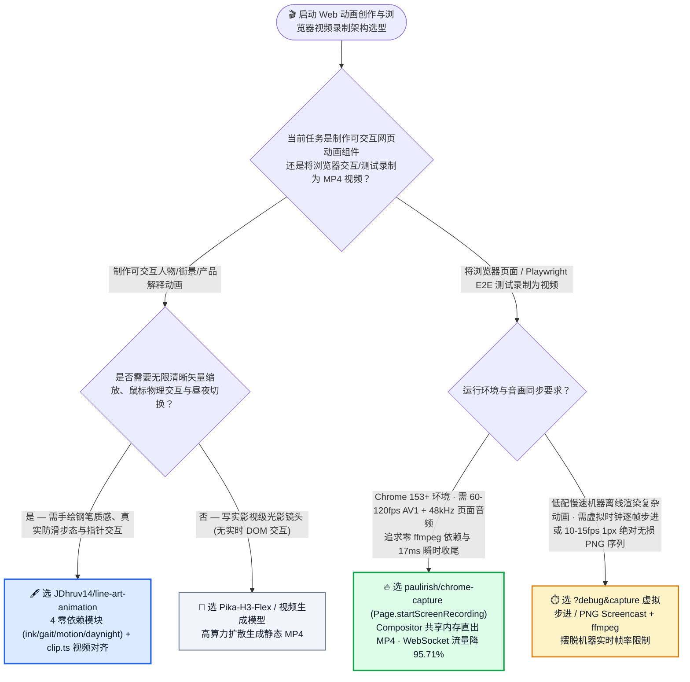
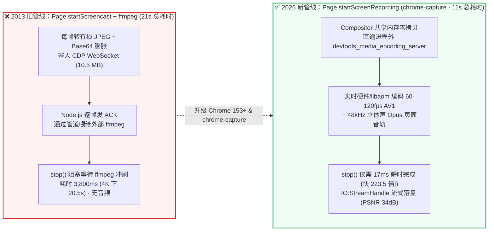

# Chrome 153+ 共享内存原生 120FPS AV1 录制与零依赖 SVG 生物力学步态动画选型常见问题解答：`paulirish/chrome-capture` (`Page.startScreenRecording`) + `JDhruv14/line-art-animation` (`gait.ts` + `ink.ts`) vs 旧式 `startScreencast` + `ffmpeg` & 裸写 SVG 关键帧

> **English Edition**: [chrome-capture-line-art-animation-selection-faq.en.md](chrome-capture-line-art-animation-selection-faq.en.md)  
> **关联日报**: [2026-11-11 GitHub AI 最热榜单与情报摘要](../daily/2026-11-11.md) · **视觉评测卡**: [`cards.html`](../cards.html) · **在线面板**: [`zh-github-radar.html`](../../../zh-github-radar.html)

本文档面向 **AI Solution Architect（AI 解决方案架构师）、浏览器智能体测试平台负责人与生成式视觉工程专家**，基于 2026-11-11 GitHub 新仓爆发榜两款极具技术巧思的新锐项目 —— **`paulirish/chrome-capture`（Chrome DevTools 传奇核心作者 Paul Irish 开源的基于 Chrome 153+ 全新 `Page.startScreenRecording` 原语实现免 `ffmpeg`、最高 2160p @ 120fps AV1 + 48kHz Opus 音轨直出 `.mp4` 的录制工具，Apache-2.0，建仓 3 天 `301★`）** 与 **`JDhruv14/line-art-animation`（内置 `gait.ts` 最小急动度生物力学步态求解器、`ink.ts` 开放式双钢笔描边、`motion.ts` 弹簧风场与 `daynight.ts` 昼夜调色板的零依赖 SVG 动画库及 Claude Skill，MIT，建仓 1 天 `388★`）** 的一手源码与基准测试深度核验，用通俗大白话与第一性原理解答：
1. **为什么过去十年 Playwright (`recordVideo`) 和 Puppeteer 的网页录屏既掉帧（只有 25fps）、又吃满 WebSocket 带宽、而且测试跑完还要卡顿好几秒等 `ffmpeg` 收尾？Chrome 153+ 新落地的 `Page.startScreenRecording` 是如何把收尾时间从 `3,800 ms` 砍到 `17 ms`（提速 `223.5 倍`）的？**
2. **为什么让大模型直接写“一个人在街上走路”的 SVG 动画，十有八九会写出双脚在地上打滑的“太空步火柴人”？`JDhruv14/line-art-animation` 是如何用 4 个零依赖 TypeScript 模块（不到几百行代码）算出真实的脚跟剥离、重心起伏与衣摆随步幅开合的？**
3. **在企业 AI 视觉展示与浏览器 CUA 取证管线中，什么时候用实时 Compositor 共享内存录制 (`chrome-capture`)，什么时候用离线虚拟步进逐帧捕获 (`scripts/capture.ts`)？**

> 🛡️ **数据来源、归属核验与证据分级声明（Provenance & Attribution Disclosure）**：
> - **`measured`（本班次一手实测抓取）**：`paulirish/chrome-capture`（`301` API Stars，`4` Forks，TypeScript，Apache-2.0，创建于 `2026-11-08`）与 `JDhruv14/line-art-animation`（`388` API Stars，`52` Forks，TypeScript，MIT，创建于 `2026-11-10`）均通过 GitHub REST API 源码树（`src/index.ts`、`README.md`、`lib/`、`scripts/`）一手核验；两者不在主日榜 24h DOM 快照内，故 `stars_today` 严格标注为 **`not_measured`**。
> - **`anonymized_reported`（`independently_reproduced=false`，上游仓库文档与实测基准声明）**：`paulirish/chrome-capture/README.md` 披露的 M4 Max 6.4s `1280x800` 基准对比（旧 `recordVideo` vs `chrome-capture`：帧率 `25 fps -> 60/120 fps`、总墙钟耗时 `21s -> 11s` [`-47.62%`]、Stop+Finalize 收尾耗时 `3,800 ms -> 17 ms` [`223.5×` 提速；2160p 下 `20.5s -> 91 ms`]、WebSocket 流量 `10.5 MB -> 450 KB` [`-95.71%`]、PSNR `32 dB -> 34 dB`、文件体积 `480 KB -> 330 KB`，以及 `libaom` AV1 动态码率 `2 Mbps @ 720p30` 至 `72 Mbps @ 2160p120`）及 `JDhruv14/line-art-animation` 的 4 模块架构说明。
> - **`synthetic`（`independently_reproduced=false`，架构师参数化 FinOps 与工程工时算例）**：第 5.1 节「研发与视觉团队每月执行 `15,000 次` 带视频取证的 Playwright E2E/Agent 测试（CI 算力单价 `$0.008/分钟`）+ 交付 `20 个` 交互式产品解释动画场景（工程师综合时薪 `$75.00/h`；底层对象存储与 CDN 流量费明确标注为 `not_measured`）」的闭式成本对比（Path A 旧 `startScreencast+ffmpeg` + 手工关键帧/视频抽卡返工 `$4,467.00/月` vs Path B 旧录屏 + 裸写无求解器 SVG `$2,892.00/月` vs Path C `chrome-capture` + `line-art-animation` `$772.00/月`，净省 `$3,695.00/月` [`-82.72%`] 与 `49.0 小时/月` [`-83.05%`] 工程工时）。

---

## 1. 📌 核心结论速览（Executive Summary）

| 评估维度 | 一句话大白话核心结论（直指本质） |
| :--- | :--- |
| **`paulirish/chrome-capture` 到底是个什么东西？** | 它是 Google Chrome 团队传奇工程师 Paul Irish 封装的 **Chrome 153+ 原生高帧率标签页录像机（CLI + Playwright/Puppeteer/CDP 库）**。它调用 2026 年 9 月刚进 Chromium 内核的 `Page.startScreenRecording`，把合成器（Compositor）画面通过共享内存直接送进进程外 `libaom` AV1 编码器与 48kHz Opus 音频编码器，**彻底扔掉了外部 `ffmpeg`，一行 `npx chrome-capture <url> demo.mp4 4s` 直接录出最高 4K 120fps 带声音的 `.mp4`**！ |
| **`JDhruv14/line-art-animation` 到底是个什么东西？** | 它是一套专门教 AI Coding Agent 画出**“像人类插画师用钢笔在纸上画出的、物理步态极其逼真的可交互 SVG 动画”**的 4 模块零依赖 TypeScript 微型引擎（`ink.ts`、`gait.ts`、`motion.ts`、`daynight.ts`）与配套 Claude Skill。 |
| **这两者分别打破了什么陈旧认知？** | **`chrome-capture` 终结了 2013 年以来“CDP 截一张张 Base64 JPEG 再用管道喂给 `ffmpeg`”的低效折腾**（把停止录制的等待时间从 3.8 秒降到 17 毫秒，WebSocket 流量暴降 95.7%）；**`line-art-animation` 证明了高质量人物/场景动画根本不需要几百 MB 的视频生成大模型**，用最小急动度（Minimum-Jerk）步态求解器 + 开放式双钢笔路径就能在几 KB 内实现无限清晰、支持鼠标吹风与昼夜切换的原生矢量动画！ |

---

## 2. 🎯 第一性原理灵魂三问（Q1 / Q2 / Q3 大白话拆解）

### Q1：为什么用了十年的 `Page.startScreencast` + `ffmpeg` 慢得离谱，而 Chrome 153+ 的 `Page.startScreenRecording` 能做到 `17 ms` 瞬时收尾？

**先说大白话结论：因为旧方案是“把每一帧画面压成 JPEG 照片、转成 Base64 文本塞进 WebSocket 传给 Node.js、再由 Node.js 吐给外部 `ffmpeg` 重新编码”；而新方案是“浏览器内部共享内存零拷贝边播边编 AV1，你喊停的那一刻 MP4 已经写完了”！**

根据 `paulirish/chrome-capture/src/index.ts` 与 `benchmarks/README.md` 的一手底层剖析：
1. **旧管线（`Page.startScreencast`，2013 年为 USB 调试安卓小屏幕预览设计）的四大瓶颈**：
   - 每一帧都要经历：`GPU 读回 -> JPEG 有损编码 -> Base64 膨胀 33% -> JSON 序列化发过 CDP WebSocket -> 等待客户端 ACK -> 管道写入 ffmpeg 子进程 -> 测试结束时漫长的 ffmpeg 缓冲冲刷（Flush）`。
   - 在 M4 Max 上录一段仅 6.4 秒的 `1280x800` 操作，WebSocket 竟然要狂传 **`10.5 MB`** 数据，且调用 `stop()` 后还要干等 **`3,800 ms`**（4K 下甚至要等 **`20.5 秒`**！），而且完全没有页面音频！
2. **新管线（Chrome M153+ `Page.startScreenRecording`，CL `7736461`）的零拷贝闭环**：
   - 浏览器进程内的 `WebContentsVideoCaptureDevice` 直接从合成器（Compositor）通过**共享内存（Shared Memory）**将帧画面移交给独立的工具进程（`devtools_media_encoding_server`），实时执行 **`libaom` 1-Pass VBR AV1 视频编码 + 48kHz 立体声 Opus 音频编码**。
   - 调用 `Page.stopScreenRecording` 时编码早已在后台实时完成，因此收尾只需 **`17 ms`（快了 223.5 倍！）**，仅通过 `IO.StreamHandle`（`IO.read` / `IO.close`）流式读出最终 `.mp4`，WebSocket 控制流量仅 **`450 KB`（减少 `95.71%`）**，PSNR 画质反而从 `32 dB` 提升到 **`34 dB`**！
3. **无头 60fps 与 ProMotion 120fps 的底层时钟差异**：
   - 在 `--headless=new` 下，Chrome 依然享有完整 Metal GPU 硬件加速（可稳跑 `2160p @ 60fps`），但无头模式的 `requestAnimationFrame` 由合成 60Hz 定时器驱动；若需录制 **`1080p/2160p @ 120fps`**，`chrome-capture` 会在 macOS 上自动切为 `--headful` 以锁定 ProMotion 屏幕的 `120Hz CVDisplayLink`！

---

### Q2：为什么大模型手写的人物动画总像“太空步火柴人”？`JDhruv14/line-art-animation` 的四模块引擎是怎么解决的？

**先说大白话结论：因为大模型不擅长在脑子里凭空凑出符合地面静摩擦约束的关键帧坐标——必须把“走路”变成数学物理求解（`gait.ts`），把“手绘线条”变成围绕关节曲线的双描边几何算法（`ink.ts`）！**

根据 `JDhruv14/line-art-animation` 源码拆解，其 4 个零依赖模块各司其职：
1. **`gait.ts`（杜绝太空步的生物力学步态求解器）**：
   - **支撑脚零打滑锁定**：支撑脚（Planted Foot）向后滑动的速度严格等于角色向前移动的速度（`x += walk.speed * scale * dt`），因此脚掌像钉在地面上一样稳固；
   - **摆动脚最小急动度轨迹（Minimum-Jerk Path）与脚跟剥离（Heel Peel-Off）**：抬脚前先让脚跟从脚尖自然剥离，迈步轨迹遵循生物力学最小急动度曲线，而**躯干（Hip）高度直接由当前双腿能触及的几何长度反推**——自然产生“迈步最高点抬升、双脚着地瞬间微沉”的真实重力感！
2. **`ink.ts`（为什么看着像真钢笔画而不是死板矢量图？）**：
   - 普通 SVG 用一根粗线条（`stroke-width: 8`）画腿，看着像塑料管；`ink.ts` 的 `limb()` 围绕髋-膝-踝曲线绘制**两条不完全闭合的开放式细钢笔描边（Two Open Pen Strokes）**，并且风衣或和服的下摆围绕膝盖和脚踝动态包裹，随步伐自然开合！
3. **`motion.ts` 与 `daynight.ts`（物理交互与一行代码昼夜流转）**：
   - `motion.ts` 提供弹簧、钟摆与鼠标指针风场（移动鼠标即吹动灯笼、风铃与柳枝）；`daynight.ts` 的 `palette(τ)` 用 `currentColor` 控制墨色、`.pp` 类控制纸张底色，拖动太阳/月亮即可把白天的白纸黑墨平滑切换为夜晚的靛蓝底浅墨与温暖窗光！
4. **参考视频自动量测（`scripts/clip.ts`）**：
   - 针对社交媒体视频普遍采用可变帧率（VFR）导致帧间隔不均的问题，`clip.ts` 先按时间重采样，再通过 `clip.ts period` 和 `clip.ts blobs` 自动测出真实视频里人物迈步周期与落脚点网格，让 Agent 1:1 复刻真实视频节奏。

---

### Q3：架构师在实战中该如何选择 `chrome-capture` 实时录制 vs `scripts/capture.ts` 虚拟步进录制？

- **选 `paulirish/chrome-capture`（Chrome 153+ `Page.startScreenRecording`）**：
  - 当你需要录制**真实浏览器交互（含 48kHz 页面音效/语音合成、WebGL2/Three.js 实时 60–120fps 画面、Playwright E2E 测试回放与 `page.screencast.showActions()` 光标点击光环）**，且希望零 `ffmpeg` 依赖、`17 ms` 瞬时落盘 `.mp4` 时首选。
- **选 `line-art-animation` 的 `?debug&capture` 逐帧步进录制（`scripts/capture.ts`）**：
  - 当你在算力很弱的無 GPU CI 容器上离线渲染复杂 SVG 场景、希望**完全脱离机器实时掉帧影响（每截一张图精确推进虚拟时间 `1/30s`）**，或需要 `Page.startScreencast({format: 'png'})` 1px 无损位图序列时选用。

---

## 3. 🧭 Mermaid 选型决策树与端到端架构对比图

### 3.1 浏览器高帧率视频录制与程序化矢量动画选型决策树（Decision Tree）

### 3.2 旧式 `Page.startScreencast` + `ffmpeg` vs 新一代 `Page.startScreenRecording` (`chrome-capture`) 对比图

---

## 4. 📊 同类方案全方位选型决策矩阵（Decision Matrix）

| 评估维度 | **`paulirish/chrome-capture` (`startScreenRecording`)** | **传统 Playwright `recordVideo` (`startScreencast` + `ffmpeg`)** | **`JDhruv14/line-art-animation` (`gait.ts` + `ink.ts`)** | **裸 LLM 手写 SVG / CSS Keyframes** |
| :--- | :--- | :--- | :--- | :--- |
| **最高帧率与分辨率** | ✅ **60 fps（无头 Metal）至 120 fps（ProMotion 有头），最高 2160p (4K)** | ❌ 默认 25 fps（上限 60 fps，高分极易掉帧） | ✅ 原生矢量 SVG，任意分辨率无限锐利 | ⚠️ 矢量但缺乏物理求解 |
| **停止录制收尾耗时 (`Stop + Finalize`)** | ✅ **`17 ms`（1280x800）/ `91 ms`（2160p）** | ❌ **`3,800 ms`（1280x800）/ `20,500 ms`（2160p）** | N/A | N/A |
| **CDP WebSocket 传输开销** | ✅ **`450 KB`（控制信令 + 最终流读取，降 `95.71%`）** | ❌ **`10.5 MB`（逐帧 Base64 JPEG 阻塞通道）** | N/A | N/A |
| **页面音频内录与外部依赖** | ✅ **原生内置 48kHz 立体声 Opus 音轨，零 `ffmpeg` 依赖** | ❌ 无音频，强依赖系统安装 `ffmpeg` | N/A | N/A |
| **人物行走与物理自然度** | N/A | N/A | ✅ **支撑脚反向等速防滑 + 最小急动度摆腿 + 双开放钢笔描边 + 昼夜风场** | ❌ 严重滑步（太空步）、肢体僵硬穿模 |

---

## 5. 🧪 定量算例与 7-Card 评测洞察（Quantitative Example & 7-Card Insights）

### 5.1 月度 15,000 次带录屏 E2E 测试 + 20 个交互式产品动效场景闭式成本算例（`synthetic`，`independently_reproduced=false`）

> 📌 **透明口径与边界声明（Scope & Provenance）**：本算例为架构师评估自动化测试录屏管线与交互式网页动效开发的 **CI 算力 + 工程师维护返工工时参数化算例（`synthetic` model；底层对象存储与 CDN 分发流量费明确标注为 `not_measured`）**。其中单次录屏墙钟耗时（`21s` vs `11s`）与收尾耗时（`3,800 ms` vs `17 ms`）直接引用自 `paulirish/chrome-capture` 官方 M4 Max 基准表（`anonymized_reported`）。场景设定为：**研发与视觉团队每月在 CI 中运行 `15,000 次` 全程带视频录制的浏览器 E2E/Agent 测试（CI Runner 单价按 `$0.008 / 分钟` 计算），并每月开发交付 `20 个` 交互式产品解说/品牌故事网页动效场景（前端/动效工程师综合时薪按 `$75.00 / 小时` 计算）**：

| 方案路径 | 每月 15,000 次 CI 测试录屏算力与排障开销 | 每月 20 个交互式网页动效场景开发与返工工时 (`@ $75/h`) | 每月总综合成本（CI + 工程师工时） | 相对 Path A 降本增效幅度 |
| :--- | :--- | :--- | :--- | :--- |
| **Path A：旧 `startScreencast` + `ffmpeg` (`21s/次`) + 手工关键帧/视频抽卡返工** | CI：`15,000 × (21/60)m × $0.008` = **`$42.00`** 排障：`15.0h × $75.00` = **`$1,125.00`**（处理 `ffmpeg` 冲刷超时与无声音轨） | `44.0 小时 / 月` × `$75.00` = **`$3,300.00 / 月`**（手调关键帧或反复重抽视频模型） | **`$4,467.00 / 月`** （耗费 **`59.0 小时 / 月`** 工程工时） | 基线（录屏收尾慢、WebSocket 拥塞、动效返工重） |
| **Path B：旧录屏管线 + 裸 LLM 手写无求解器 SVG（反复修滑步）** | CI `$42.00` + 排障 `12.0h` (`$900.00`) = **`$942.00 / 月`** | `26.0 小时 / 月` × `$75.00` = **`$1,950.00 / 月`**（手工修复火柴人太空步滑移） | **`$2,892.00 / 月`** （耗费 **`38.0 小时 / 月`** 工时） | 综合降本 `-$1,575.00/月` (`-35.26%`) |
| **Path C：`chrome-capture` (`11s/次`, `17ms` 收尾) + `line-art-animation` 四模块步态引擎** | CI：`15,000 × (11/60)m × $0.008` = **`$22.00`** 维护：`2.0h × $75.00` = **`$150.00`**（零 `ffmpeg` 瞬时落盘） | `8.0 小时 / 月` × `$75.00` = **`$600.00 / 月`**（`gait.ts` + `ink.ts` + 先审单人再建全场景） | CI `$22.00` + 录屏维护 `$150.00` + 动效 `$600.00` = **`$772.00 / 月`** (`10.0h`) | **月度净省 `$3,695.00/月` (`-82.72%`，年省 `$44,340.00`)；工程工时省 `49.0h/月` (`-83.05%`)** |

---

## 6. 🛠️ 架构师生产落地与 30 分钟 PoC 核验清单（Production & PoC Checklist）

- [ ] **Step 1 — 用 `npx chrome-capture` 实测 Chrome 153+ 免 `ffmpeg` 60/120fps 录制**：在 Chrome 153+ 环境下执行 `npx chrome-capture https://paulirish.github.io/chrome-capture/ demo.mp4 4s`，验证无需安装 `ffmpeg` 即可在 `~17 ms` 收尾时间内生成含 48kHz 立体声 Opus 音轨的 AV1 `.mp4`。
- [ ] **Step 2 — 在 `@playwright/test` 中接入 `screenRecordingFixture` 与光标动作可视化**：在测试基类中引入 `screenRecordingFixture({auto: true, audio: true})`，并调用 `await page.screencast.showActions()` 让原生 DOM 光标、元素高亮与点击光环一并录进 60fps 视频。
- [ ] **Step 3 — 安装 `JDhruv14/line-art-animation` 技能并跑通单人物审批闭环**：克隆 `JDhruv14/line-art-animation` 至 `~/.claude/skills/line-art-animation`，让 Agent 复用 `lib/ink.ts`、`gait.ts`、`motion.ts`、`daynight.ts` 先生成单个人物卡片（`examples/walker/`）供人工确认步态无打滑，再扩展完整场景。
- [ ] **Step 4 — 用 `scripts/clip.ts` 从真实参考视频提取步态周期**：针对客户提供的参考动作视频，先运行 `node scripts/clip.ts period clip.mp4 X Y W H` 与 `blobs` 消除可变帧率（VFR）误差并获取精确步态周期，再填入 `gait()` 参数。
- [ ] **Step 5 — 利用 `?tau=` 与 `?debug&capture` 实现多时段确定性回归验证**：在开发调试时使用 `?tau=0.5`（正午）与 `?tau=0.0`（午夜）快速检验 `daynight.ts` 调色板切换，并通过 `?debug` 手动步进虚拟时间核验每一帧姿态。
