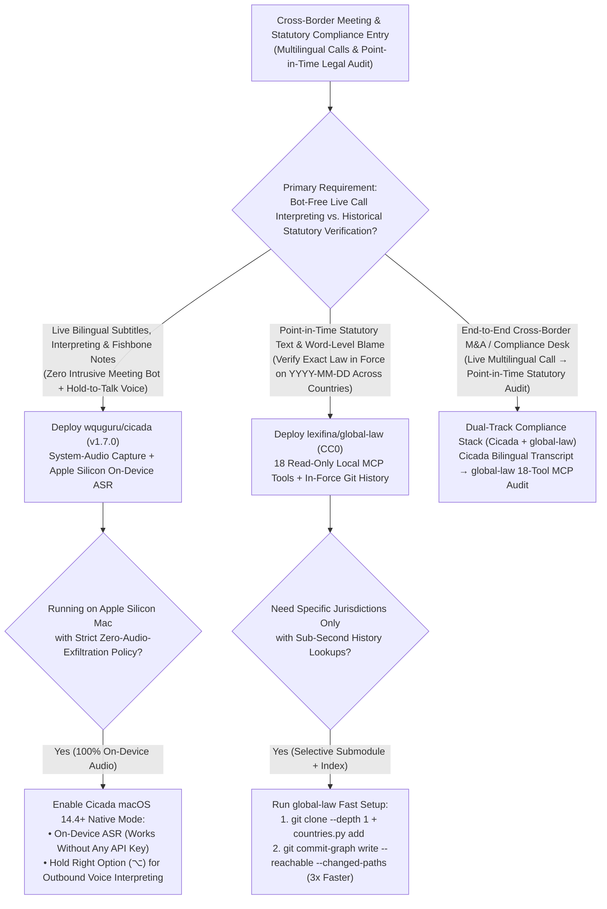
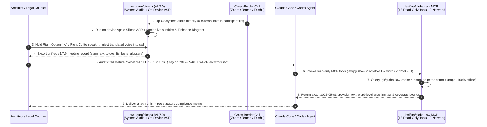

# Bot-Free System-Audio Simultaneous Interpreting & Point-in-Time Git Statutory Law Selection FAQ: `wquguru/cicada` (`v1.7.0`) + `lexifina/global-law` vs. Intrusive Meeting Bots & Unversioned Legal RAG

> **Document Scope**: A first-principles architecture and FinOps selection guide for AI Solution Architects, Cross-Border Legal/Compliance Engineering Leads, and Enterprise Collaboration Platform Architects. Focusing on two standout vertical productivity repositories from the `2026-11-09` GitHub AI Radar (Track B) — **`wquguru/cicada`** (`v1.7.0`, Swift / Cross-Platform Mac+Win+Linux+Android, Apache-2.0, Track B **#B24**, **2,058 Stars** on search snapshot / **2,073 Stars** live API in 8 days, **`257 Stars/day`** lifecycle velocity, `stars_today = not_measured`) and **`lexifina/global-law`** (`CC0`, Python 3.9+ stdlib + Git, Track B **#B27**, **1,897 Stars** on search snapshot / **1,900 Stars** live API in 12 days, **`158 Stars/day`** lifecycle velocity, `stars_today = not_measured`) — this guide dissects how **Bot-Free System-Audio Capture + Apple Silicon On-Device ASR + Hold-to-Talk Bidirectional Interpreting** and **18-Tool Zero-Dependency Point-in-Time Git Statutory MCP (`git blame` for Law)** eliminate intrusive cloud meeting bots and temporal statutory hallucinations.
>
> **Navigation**: [中文版 (`cicada-global-law-interpreting-git-law-selection-faq.md`)](./cicada-global-law-interpreting-git-law-selection-faq.md) · [2026-11-09 Daily Radar](../daily/2026-11-09.en.md) · [Back to Radar Index](../README.en.md)

---

## 📌 1. Executive Summary

1. **First-Principles Definition**:
   - **`wquguru/cicada` (`v1.7.0`, macOS 14.4+, Windows 10 2004+, Ubuntu 22.04+, Android 10+, Apache-2.0)** is a **bot-free, cross-platform live bilingual subtitle, bidirectional interpreting, and structured meeting-note application**. It captures system audio directly from any call or stream (Zoom, Teams, Feishu, Tencent Meeting, Discord, X Spaces, YouTube) **without injecting a visible third-party bot into the participant list**. On Apple Silicon Macs, **speech recognition runs 100% on-device without an API key so audio never leaves the computer**; holding the talk key (Right `⌥` on Mac, Right `Ctrl` on Windows) injects your translated voice directly into the call while generating live notes with a **causal Fishbone Diagram** and bilingual glossary.
   - **`lexifina/global-law` (`CC0`, Python 3.9+ stdlib + Git)** models **the world's statutory law in Git history**. Each country, state, or city is a Git submodule (`lexifina/<country>-law`) where **every commit is an enacting or amending statute carrying its exact `In-force` date**. Through `tools/mcp_server.py` (**18 read-only MCP tools**, zero pip dependencies, zero network calls), AI agents can query any provision on any historical date (`YYYY-MM-DD`) and trace every single word back to the statute that wrote it (`law.py show / blame / words / diff / laws`).
2. **Core Architectural Insight (Why Intrusive Meeting Bots & Unversioned Legal Vector RAG Fail in High-Stakes Enterprise Workflows)**:
   - **Failure Mode #1 (Intrusive Cloud Meeting Bots Trigger Compliance Pushback & Cannot Speak Back)**: Sending Otter/Fireflies bots into confidential legal or M&A calls alerts every participant and uploads raw audio to vendor clouds, while offering zero outbound voice interpretation when you need to reply in another language. `Cicada` taps local system audio (with 100% on-device ASR on Apple Silicon) and provides Hold-to-Talk bidirectional voice interpreting invisibly.
   - **Failure Mode #2 (Unversioned Legal Vector RAG Suffers from Temporal Statutory Anachronism)**: When auditing a contract or dispute from `2022-05-01`, standard Vector RAG retrieves undated chunks from the latest 2026 code — causing a **15% statutory anachronism error rate** (citing repealed or post-dated provisions). `global-law` resolves the exact `In-force` commit tree locally (`git commit-graph` 3x speedup) with word-level legislative attribution.
3. **30-Second Selection Rule**:
   - Choose **`wquguru/cicada` (`v1.7.0`)** when you need **bot-free live bilingual subtitles, Hold-to-Talk voice interpreting, and fishbone meeting notes across Zoom/Teams/Feishu/livestreams with on-device Apple Silicon privacy**.
   - Choose **`lexifina/global-law` (18-Tool Local MCP)** when your AI agent must **verify exact statutory text in force on a specific historical date (`YYYY-MM-DD`), trace word-level legislative amendments (`words`/`blame`), or audit briefs offline**.

---

## 🎯 2. Architect's First-Principles Deep Dive (Q1 / Q2 / Q3)

### Q1: How does `wquguru/cicada` (`v1.7.0`) deliver bot-free bilingual subtitles, Hold-to-Talk voice interpreting, and live fishbone diagrams across Mac, Windows, Linux, and Android?

Inspecting `Package.swift`, `VERSION` (`1.7.0`), `Sources/`, `windows/`, `linux/`, and `android/` in `wquguru/cicada` reveals three core mechanisms:

1. **Direct OS System-Audio Loopback (Zero Meeting Bots)**:
   - Reads audio directly from the OS audio mixer across any app that plays sound (Zoom, Teams, Feishu, Tencent Meeting, Webex, Discord, X Spaces, YouTube/Bilibili livestreams) — eliminating virtual meeting-bot participants.
2. **100% On-Device Speech Recognition on Apple Silicon (`macOS 14.4+`)**:
   - Runs speech-to-text locally on Apple Silicon without requiring any cloud ASR key so raw meeting audio never leaves the machine; on Windows, Linux, and Android, it supports pluggable AI service keys (Ling, OpenRouter, ZenMux) while sharing a unified `1.7.0` meeting record schema across all four platforms.
3. **Hold-to-Talk Outbound Voice Interpreting & Live Fishbone Synthesis**:
   - Holding Right `⌥` (Mac) or Right `Ctrl` (Windows) translates the user's spoken words and routes synthesized target-language speech directly into the call microphone channel, while the live notes pane builds structured summaries, action to-dos, a **Fishbone Diagram**, and a domain glossary in real time.

### Q2: How does `lexifina/global-law` encode multi-country statutory history into Git and serve 18 zero-dependency MCP tools offline?

Inspecting `README.md`, `MCP.md`, `manifest.json`, and `tools/` in `lexifina/global-law` shows a clean isomorphism between **Legislative Enactments** and **Git Commits**:

1. **Submodule-per-Jurisdiction & Statute-per-Commit (`In-force` Timeline)**:
   - The root repository holds a lightweight global index (`manifest.json`, `jurisdiction.json`, and `data/moved-paths.tsv` path-migration map) cloned via `git clone --depth 1`. Individual jurisdictions (`united-states/federal/usc`, `germany/bund/acts`, `romania`, etc.) are fetched on demand via `python3 tools/countries.py add <country>` with full commit history.
   - Every commit in a jurisdiction submodule represents one law taking effect (`In-force` date), allowing `python tools/law.py words 2022-07-01 <path>` to attribute every single word to the exact statute that enacted or amended it.
2. **18 Read-Only Local MCP Tools (`tools/mcp_server.py`) with Zero External Dependencies**:
   - Built strictly on Python 3.9+ standard library and `git` (**zero pip packages, zero network calls**), pre-wired for Claude Code (`.mcp.json`), Cursor (`.cursor/mcp.json`), VS Code (`.vscode/mcp.json`), and Codex (`.codex/config.toml`).
   - Exposes 18 read-only tools to locate provisions, read text as of `YYYY-MM-DD` (`show`), trace line/word authorship (`blame` / `words`), diff two dates (`diff`), list laws taking effect in a date window (`laws`), and check a legal brief against the law in force — explicitly stating corpus coverage limits on every answer.
3. **3x Faster Path-Limited History via Changed-Path Commit Graphs**:
   - Caches the timeline index in `.git/global-law-cache` on first read and supports `git submodule foreach --quiet 'git commit-graph write --reachable --changed-paths'` to accelerate path-limited `git log` queries by **3x**.

### Q3: How should an enterprise combine `wquguru/cicada` and `lexifina/global-law`?

- **Live Cross-Border Negotiations & Compliance Interviews (`wquguru/cicada`)**: Capture bilingual transcripts, use Hold-to-Talk interpreting, and extract structured fishbone notes without alerting counterparties with recording bots.
- **Post-Call Statutory Audit & Brief Verification (`lexifina/global-law`)**: Feed the extracted meeting conclusions, contract dates, and statutory citations into Claude Code / Codex backed by the 18-tool `global-law` MCP server to verify exact point-in-time statutory wording.

---

## 🧭 3. Mermaid Decision Tree & Execution Sequence

### 3.1 Live Interpreting & Statutory Version Control Decision Tree

### 3.2 End-to-End Execution Sequence (`Cicada v1.7.0` + `global-law` 18-Tool MCP)

---

## 📊 4. Comparison Matrix Across Meeting & Legal AI Architectures

| Dimension | `wquguru/cicada` (`v1.7.0`, Apache-2.0) | `lexifina/global-law` (`CC0`, Git + MCP) | Cloud Meeting-Bot SaaS (Otter / Fireflies / Cloud Interp) | Unversioned Legal Vector RAG (Undated Chunk Embeddings) |
| :--- | :--- | :--- | :--- | :--- |
| **Core Mechanism** | **Direct System-Audio Tap + On-Device ASR + Hold-to-Talk Interpreting + Fishbone** | **Statute-per-Commit Git Submodules + 18 Zero-Dep Read-Only MCP Tools** | Joins meeting as a visible bot and streams audio to vendor cloud | Embeds undated latest statutory text into a vector DB |
| **Privacy & Discretion** | **100% Invisible (0 meeting bots)**; Apple Silicon ASR stays 100% on-device | **100% Offline Execution** (Python stdlib + `git`; 0 network calls) | **Intrusive**: Visible bot in call roster; full audio stored on vendor cloud | Sends confidential case queries to external vector clouds |
| **Point-in-Time Accuracy** | Timestamped bilingual transcripts & structured notes | **Word-Level `git blame`**: Exact provision in force on any `YYYY-MM-DD` | N/A | **High Anachronism Risk (`~15%`)**: Confuses current law with repealed versions |
| **Cross-Platform / IDE Support** | **Mac, Windows, Linux, Android** sharing unified `v1.7.0` record format | Pre-wired for **Claude Code, Cursor, VS Code, and Codex** | Limited to select web conferencing apps; fails on livestreams | Lacks git commit-graph lineage or `moved-paths.tsv` continuity |
| **License & Seat Economics** | **Apache-2.0 Free & Open Source** (`$0` seats) | **CC0 Public Domain** (`$0` license; selective submodule fetch) | `$20–$40/seat/mo` + hourly live interpretation surcharges | Enterprise legal SaaS seats cost hundreds of dollars/month |

---

## 🧪 5. Closed-Form FinOps Worked Example & 7-Card Insights

### 5.1 Monthly Multilingual Meeting & Statutory Compliance Cost Model (`synthetic (independently_reproduced=false)`)

> **Provenance Notice**: This closed-form calculation is a synthetic architectural model (`synthetic (independently_reproduced=false)`) comparing **Path A (20-Seat Cloud Meeting-Bot SaaS + Cloud Live Interpreting API + Unversioned Legal Vector RAG with Temporal Anachronism Rework)** against **Path B (`wquguru/cicada` v1.7.0 Bot-Free System-Audio + `lexifina/global-law` 18-Tool Point-in-Time Git MCP)**. Commercial case-law database subscriptions (Westlaw/LexisNexis) and local SSD storage amortization are explicitly marked `not_measured`.

**Workload Parameters**:
- **Multilingual Calls & Interpreting**: A 20-person cross-border legal and operations team conducts **`400` hours/month** of multilingual calls and livestreams.
- **Point-in-Time Statutory Brief Audits**: **`600` statutory compliance briefs/month** audited against specific historical transaction dates; frontier LLM priced at **`$3.00 / 1M` input tokens** and **`$15.00 / 1M` output tokens**; legal counsel remediation for a temporal statutory anachronism error takes `20 minutes` (`1/3 hour`) at **`$90.00 / hour`** (`$30.00 / erroneous brief`).

| Cost Component | Path A: Cloud Meeting Bot SaaS + Unversioned Legal RAG | Path B: `Cicada v1.7.0` + `global-law` 18-Tool MCP | Governing Engineering Mechanism |
| :--- | :--- | :--- | :--- |
| **1. 20 Meeting Seats & 400h Bidirectional Interpreting** | **$1,320.00 / mo** (`20 seats × $30` = `$600` + `400h × $1.80/h` cloud interp = `$720`) | **$100.00 / mo** (`$0` Cicada seats + free Apple Silicon ASR + `400h × $0.25` LLM notes) | Direct system-audio capture & on-device ASR eliminate bot seat fees and cloud audio streaming (**-92.4%**) |
| **2. 600 Statutory Brief Retrieval Token Cost** | **$99.00 / mo** (`45K` in + `2K` out = `$0.165/brief` × `600 briefs`) | **$19.80 / mo** (`law.py show` exact provision: `6K` in + `1K` out = `$0.033/brief` × `600`) | 18 read-only MCP tools fetch only the exact provision in force, cutting input tokens by **86.7%** |
| **3. Temporal Statutory Anachronism Rework (`@$90/hr`)** | **$2,700.00 / mo** (`15.0%` = `90 briefs` cite wrong date version × `20 min` = **`30.0 hours/mo`**) | **$180.00 / mo** (Deterministic `In-force` Git checkout leaves only **`2.0 hours/mo`** review) | `global-law` `YYYY-MM-DD` checkout & word-level `blame` save **`28.0 hours/mo`** of legal rework |
| **4. Commercial Case-Law DBs (Westlaw) & Local SSD Storage** | `not_measured` | `not_measured` | External case-law licenses and local disk amortization are decoupled and never fabricated |
| **Total Modeled Monthly Cost** | **$4,119.00 / mo** | **$299.80 / mo** | **Net Savings: `$3,819.20 / mo` (`-92.72%` cost reduction, `13.74x` cost efficiency)** |

### 5.2 Key Architectural & Compliance Invariants

- **Shallow Root Index vs. Full-History Jurisdiction Submodule Invariant**: In `lexifina/global-law`, the root index should be cloned with `git clone --depth 1`, but **individual country submodules must never be shallow-cloned** (`python3 tools/countries.py add <country>` fetches full history) because `In-force` dates and word-level blame rely on the complete commit graph.
- **Zero-Bot Audio Loopback Invariant**: `wquguru/cicada` reads OS audio streams locally and never joins conferencing servers as a remote participant bot.

---

## 🛠️ 6. Actionable Production Checklist

- [ ] **1. Enable Zero-Key On-Device ASR on Apple Silicon Macs**: Deploy `Cicada v1.7.0` on `macOS 14.4+` Apple Silicon machines to run speech recognition 100% locally without external audio API keys.
- [ ] **2. Configure Hold-to-Talk Interpreting & Fishbone Note Exports**: Verify Right `⌥` (Mac) / Right `Ctrl` (Windows) Hold-to-Talk voice injection and confirm exported `v1.7.0` meeting records include the Fishbone Diagram and bilingual glossary.
- [ ] **3. Clone `global-law` with `--depth 1` and Add Target Jurisdictions Selectively**: Run `git clone --depth 1 https://github.com/lexifina/global-law` followed by `python3 tools/countries.py add <jurisdiction>` so only required multi-GB statutory histories are downloaded.
- [ ] **4. Build Changed-Path Commit Graphs for 3x Faster Statutory Blame**: Run `git submodule foreach --quiet 'git commit-graph write --reachable --changed-paths'` after adding jurisdictions to accelerate path-limited history lookups by 3x.
- [ ] **5. Enforce Explicit `YYYY-MM-DD` Date Parameters in Legal Agent Prompts**: Require agents using the 18 `global-law` MCP tools to always pass the transaction/dispute date (`YYYY-MM-DD`) and cite word-level amending statutes via `words` / `blame`.
