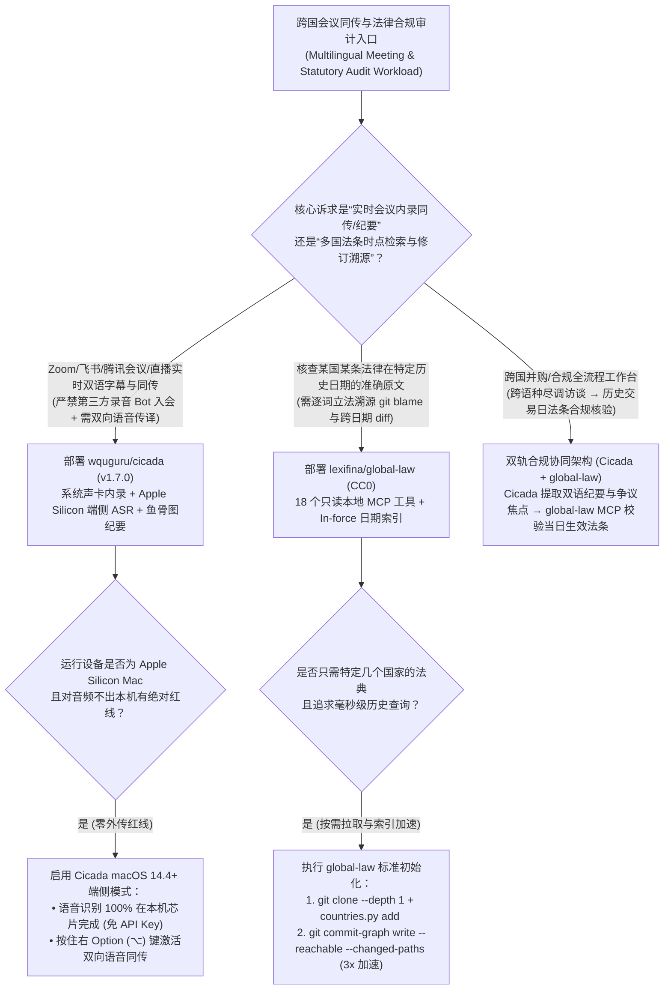
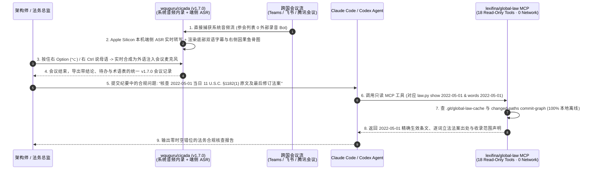

# 免机器人系统内录同声传译与时点法律 Git 溯源选型 FAQ：`wquguru/cicada` (`v1.7.0`) + `lexifina/global-law` vs 入侵式会议 Bot 与无版本法条 RAG

> **文档定位**：面向 AI Solution Architect（AI 解决方案架构师）、跨国法务合规工程负责人与企业办公协同架构师的第一性原理选型指南。聚焦 `2026-11-09` GitHub 新仓黑马爆发榜（Track B）的两大垂直生产力基础设施——**`wquguru/cicada`**（知了 `v1.7.0`，Swift / 跨平台 Mac+Win+Linux+Android，Apache-2.0，Track B **#B24**，建仓 8 天揽下 **2,058 Stars** 搜索快照 / **2,073 Stars** 实时 API，日均斜率 **`257 Stars/day`**，`stars_today = not_measured`）与 **`lexifina/global-law`**（CC0，Python 3.9+ 标准库 + Git，Track B **#B27**，建仓 12 天揽下 **1,897 Stars** 搜索快照 / **1,900 Stars** 实时 API，日均斜率 **`158 Stars/day`**，`stars_today = not_measured`），深度拆解如何用 **“零会议 Bot 系统音频直读 + Apple Silicon 端侧语音识别 + 按键说话双向同传（Hold-to-Talk Interpreting）”** 与 **“18 工具零依赖 Git 时点法律溯源 MCP（Word-Level Statutory `git blame`）”** 彻底解决商业会议 Bot 泄露隐私与法律 RAG 时空错位引用的致命顽疾。
>
> **阅读导航**：[English Version (`cicada-global-law-interpreting-git-law-selection-faq.en.md`)](./cicada-global-law-interpreting-git-law-selection-faq.en.md) · [2026-11-09 全景日报](../daily/2026-11-09.md) · [返回雷达首页](../README.md)

---

## 📌 1. 核心结论速览（Executive Summary）

1. **一句话本质定义**：
   - **`wquguru/cicada`（知了 `v1.7.0`，覆盖 macOS 14.4+、Windows 10 2004+、Ubuntu 22.04+、Android 10+，Apache-2.0）** 是**免会议机器人（Bot-Free）的跨平台实时双语字幕、双向同声传译与结构化会议纪要客户端**。它直接读取本机系统音频（支持腾讯会议、飞书、Zoom、Teams、Discord 以及 YouTube/Bilibili/X Spaces 直播），**绝不向会议参会人列表塞入显眼的第三方录音 Bot**；在 Apple Silicon Mac 上**语音识别 100% 本地端侧运行（无需任何 API Key，音频绝不出本机）**；轮到你发言时，按住对讲键（Mac 右 `⌥` / Windows 右 `Ctrl`）说母语，对方在会议里直接听到翻译后的目标语言语音，同时实时生成包含**因果鱼骨图（Fishbone Diagram）**与专业术语表的结构化纪要。
   - **`lexifina/global-law`（CC0 无版权限制，Python 3.9+ 标准库 + Git）** 是**用 Git 提交历史建模全球法律演进的时点法条溯源引擎（The World's Law in Git）**。每个国家/州/城市的法律作为独立 Git 子模块（`lexifina/<country>-law`）存储，**每一次 Git Commit 代表一部生效或修正的法律（携带精确 `In-force` 生效日期）**；通过零外部依赖、100% 离线运行的 **18 个只读 MCP 工具（`tools/mcp_server.py`）**，AI Agent 可以精确查询全球任意法域在历史上任意一天（`YYYY-MM-DD`）的有效法条原文，并将每一个单词追溯到改写它的具体法案（`law.py words / blame / diff`）。
2. **核心架构洞察（为什么跨国法务与高管会议不能用“入侵式会议 Bot + 普通向量数据库法条 RAG”？）**：
   - **痛点一（第三方会议录音 Bot 引发客户反感与合规封杀，且只听不译无法双向沟通）**：在涉密商务谈判或跨国客户沟通中，Otter / Fireflies 等云端 Bot 强行加入参会列表极易引发合规质疑，且无法帮你在发言时把中文实时转成流利外语注入麦克风。`Cicada` 走本机系统声卡内录（Apple Silicon 全端侧 ASR）+ 按键双向语音同传，对参会对方完全透明。
   - **痛点二（普通向量 RAG 没有“法条生效时间轴”，经常拿 2026 年的新法去审 2022 年的旧案）**：在合规审计与诉讼核查中，问题往往是“2022 年 5 月 1 日当天美国破产法 `11 U.S.C. §1182(1)` 是怎么规定的？哪个法案最后修改了它？”。普通向量检索只会召回最新文本切片，导致 **15%** 的法律简报出现致命的“时空错位（Temporal Anachronism）”。`global-law` 直接利用 Git 提交图（`git commit-graph` 加速 3 倍）按 `In-force` 日期检出历史快照，实现 **100% 零网络调用的词级立法溯源**。
3. **30 秒选型口诀**：
   - 需要**在不拉外部录音 Bot 入会的前提下，对腾讯会议/飞书/Teams/直播流做实时双语字幕、按键双向语音同传与实时鱼骨图纪要** → 选 **`wquguru/cicada` (`v1.7.0`)**。
   - 需要**让 Coding/Legal Agent 精确核查跨国法律条文在特定历史日期的有效版本、逐词修订历史（`git blame`）与版本比对** → 选 **`lexifina/global-law`（18 工具本地 MCP）**。

---

## 🎯 2. 架构师灵魂拷问（Q1 / Q2 / Q3 First-Principles Deep Dive）

### Q1：`wquguru/cicada` (`v1.7.0`) 是如何在不派 Bot 入会的前提下，同时搞定“系统声音采集 + Apple Silicon 零 Key 端侧识别 + 按键说话双向同传 + 实时鱼骨图”的？

检视 `wquguru/cicada` 的 `Package.swift`、`VERSION` (`1.7.0`)、`Sources/`、`windows/`、`linux/` 与 `android/` 目录，其跨平台架构设计极具巧思：

1. **非侵入式系统音频内录（Direct System-Audio Capture）**：
   - 摒弃了通过会议室链接模拟虚拟参会人的云端 SaaS 模式，直接从操作系统音频混音层捕获任何正在发声的程序（Zoom、Teams、飞书、腾讯会议、钉钉、企业微信、X Spaces、YouTube 直播等）。在 Android 10+ 上针对系统禁止录制通话音频的限制，提供外放面对面传译模式。
2. **Apple Silicon 全本地端侧语音识别（Zero-Key On-Device ASR）**：
   - 在搭载 Apple Silicon 的 Mac（`macOS 14.4+`）上，语音转文字（ASR）100% 在本机神经引擎上离线完成，**音频流绝不离开电脑，甚至无需配置任何 API Key 即可跑通实时转写**；Windows/Linux/Android 端则支持灵活接入自有 AI 服务商密钥（Ling、OpenRouter、ZenMux 等），且四端共享完全一致的 `1.7.0` 会议记录格式。
3. **Hold-to-Talk 双向虚拟声道同传与结构化鱼骨图（Fishbone Notes）**：
   - 参会者只需按住对讲快捷键（Mac 右 `⌥` Option 键，Windows 右 `Ctrl` 键）说出母语，`Cicada` 实时将其翻译并合成为目标语言语音直推入通话上行声道。
   - 随会议进行，右侧面板同步增量整理会议摘要、议题要点、结论、待办事项（To-Dos）、**因果鱼骨图（Fishbone Diagram）**以及人名/专业术语对照表。

### Q2：`lexifina/global-law` 是如何把全球上百个法域的成文法装进 Git，并用纯 Python 标准库提供 18 个毫秒级本地 MCP 工具的？

拆解 `lexifina/global-law` 的 `README.md`、`MCP.md`、`manifest.json` 与 `tools/`，其核心是将 **“立法修正案（Statutory Amendment）”同构映射为“Git Commit”**：

1. **一国一子模块 + 一部修正案一次 Commit（`In-force` 时间轴）**：
   - 根仓库仅维护极轻量的索引（`manifest.json`、`jurisdiction.json` 与 `data/moved-paths.tsv` 路径迁移兼容表），通过 `git clone --depth 1` 秒级拉取；每个国家/州/城市作为独立 Git 子模块（如 `united-states/federal/usc`、`germany/bund/acts`、`romania`），按需执行 `python3 tools/countries.py add <country>` 才拉取该国完整历史。
   - 在每个子模块中，**每一次 Commit 就是一部正式生效的法律，Commit 作者与元数据记录了法案编号与 `In-force` 生效日**。因此，`python tools/law.py words 2022-07-01 <path>` 可以直接像查代码 `git blame` 一样，查出某条法律里**每一个单词**是由哪部修正案在哪一天写进去的！
2. **零外部依赖、零网络调用的 18 工具本地 MCP Server（`tools/mcp_server.py`）**：
   - 仅依赖 Python 3.9+ 标准库与系统 `git`（无需 `pip install` 任何第三方包，运行期 **0 网络请求**），内置 `.mcp.json`（Claude Code）、`.cursor/mcp.json`、`.vscode/mcp.json` 与 `.codex/config.toml` 开箱即用。
   - 暴露 **18 个只读 MCP 工具**：涵盖按日期查条文（`show`）、逐行/逐词立法溯源（`blame` / `words`）、跨日期差异对比（`diff`）、区间生效法案列表（`laws`）、全文与修订搜索、以及**将案件卷宗/合同草案直接对照案发当日生效法律进行合规核验**，且每条返回均显式声明数据收录边界。
3. **Commit-Graph 路径过滤索引加速 3 倍（`.git/global-law-cache`）**：
   - 首次读取语料时自动将时间线索引缓存至 `.git/global-law-cache`；针对拥有数万次提交的大型法典，通过 `git submodule foreach --quiet 'git commit-graph write --reachable --changed-paths'` 写入带变更路径布隆过滤器的 Commit-Graph，使单条法条的历史追溯提速 **3 倍**。

### Q3：在跨国企业架构与合规审计场景中，`wquguru/cicada` 与 `lexifina/global-law` 如何组合发力？

- **前端跨语言商务谈判与合规访谈（`wquguru/cicada`）**：在跨国并购谈判、海外监管问询或技术架构评审会议中，用 `Cicada` 实现零 Bot 隐身双语字幕、按键双向口译与实时鱼骨图纪要提取。
- **后端多法域时点合规核验（`lexifina/global-law`）**：将 `Cicada` 生成的会议结论、合同条款或争议日期交由挂载了 `global-law` 18 工具 MCP 的 Claude Code / Codex，按交易发生日（`YYYY-MM-DD`）执行精确法条核查与逐词修订溯源。

---

## 🧭 3. Mermaid 选型决策树与端到端协同架构图（Decision Tree & Architecture Flow）

### 3.1 跨语言会议同传与法律时点溯源选型决策树

### 3.2 `Cicada` 免 Bot 同传 + `global-law` 18 工具时点法条核验时序图

---

## 📊 4. 同类会议同传与法律检索方案对比矩阵（Comparison Matrix）

| 评估维度 | `wquguru/cicada` (`v1.7.0`, Apache-2.0) | `lexifina/global-law` (`CC0`, Git + MCP) | 商业会议录音 Bot SaaS（Otter / Fireflies / 商用同传） | 传统无版本法律向量 RAG（把最新法条塞入向量库） |
| :--- | :--- | :--- | :--- | :--- |
| **核心工作机制** | **系统声卡直读 + Apple Silicon 端侧 ASR + 按键双向语音同传 + 鱼骨图** | **每部生效法律一次 Git Commit + 18 个零依赖本地只读 MCP 工具** | 派虚拟 Bot 强行加入会议室录音并上传厂商云端 | 对单一时间点的法条做切片 Embedding 相似度检索 |
| **参会隐蔽性与隐私** | **100% 隐形（0 外部 Bot 入会）**，Mac 端语音识别完全不出本机 | **100% 本地离线执行**（Python 标准库 + `git`，0 网络外联） | **显眼侵入**：参会列表出现第三方 Bot，全量录音留存厂商云端 | 需将敏感案情发送至外部法律 SaaS 或公有云向量库 |
| **历史时点准确性（Point-in-Time）** | 精确记录会议时间轴与双语对照逐字稿 | **词级精确（Word-Level `blame`）**：还原任意 `YYYY-MM-DD` 当日生效法条 | 不涉及法规版本控制 | **极易时空错位（~15% 误引率）**：常拿现行法去套几年前的旧交易 |
| **跨平台与生态兼容** | **Mac / Windows / Linux / Android 四端同版本号与统一记录格式** | 原生附带 **Claude Code、Cursor、VS Code、Codex** 四端 MCP 配置 | 通常仅支持主流欧美会议软件，不支持国内直播流与外放 | 缺乏统一的跨国法域树与 `moved-paths.tsv` 演进映射 |
| **软件授权与席位成本** | **Apache-2.0 免费开源**（`$0` 席位费，按需配自有模型 Key） | **CC0 公有领域免费**（`$0` 检索费，按需拉取单国子模块） | `$20–$40/席位/月` + 双向同传按小时高额计费 | 商业法律 AI 动辄数百美元/席位/月 |

---

## 🧪 5. 定量 FinOps 算例与 7-Card 评测洞察（Closed-Form Quantitative Model）

### 5.1 封闭式月度跨国会议同传与时点法律合规审计成本算例（`synthetic (independently_reproduced=false)`）

> **口径声明**：本算例为合成架构基准模型（`synthetic (independently_reproduced=false)`），用于量化对比 **Path A（20 人团队商业会议 Bot 订阅 + 云端双向语音同传 API + 无版本法条向量 RAG 导致的时空错位返工）** 与 **Path B（`wquguru/cicada` v1.7.0 免 Bot 系统内录 + `lexifina/global-law` 18 工具本地时点 MCP）**。外部商业判例库（Westlaw / LexisNexis）年度商业授权与本地 Git 子模块 SSD 磁盘折旧均显式标记为 `not_measured`。

**基准工作负载设定**：
- **跨国会议与直播同传规模**：20 人跨国业务与法务团队每月进行 **`400` 小时多语种会议/直播同传与纪要提取**。
- **多法域时点合规简报核查规模**：每月审查 **`600` 份涉及特定历史交易日期的跨国法条合规简报**；大模型单价按输入 **`$3.00 / 1M Tokens`**、输出 **`$15.00 / 1M Tokens`** 计；涉外法务顾问人工复核并修正一次“引错已废止/未生效法条（Temporal Anachronism）”耗时 `20 分钟`（`1/3 小时`），按时薪 **`$90.00 / 小时`** 计（即 **`$30.00 / 次误引返工`**）。

| 成本分项 | Path A：商业会议 Bot SaaS + 无版本法律 RAG | Path B：`Cicada v1.7.0` + `global-law` 18 工具 MCP | 核心工程机制差异说明 |
| :--- | :--- | :--- | :--- |
| **1. 20 席位会议纪要与 400 小时双向语音同传成本** | **$1,320.00 / 月** （`20 席位 × $30` = `$600` + `400 小时 × $1.80/h` 云同传 = `$720`） | **$100.00 / 月** （`Cicada` `$0` 席位费 + Apple Silicon 端侧免费 ASR + `400h × $0.25` 轻量翻译/鱼骨图 Token） | 本机系统内录 + 端侧语音识别免除商业 Bot 席位税与昂贵流式语音云账单（省 **92.4%**） |
| **2. 600 份合规简报法条检索 Token 成本** | **$99.00 / 月** （每次塞入 `45K` 模糊切片输入 + `2K` 输出 = `$0.165/份` × `600 份`） | **$19.80 / 月** （`law.py show` 精准定位单条：每次 `6K` 输入 + `1K` 输出 = `$0.033/份` × `600 份`） | 18 个本地 MCP 工具按路径与日期精准检出目标条款，输入 Token 缩减 **86.7%** |
| **3. 法条生效时点错位（Anachronism）人工返工成本（@$90/hr）** | **$2,700.00 / 月** （`15.0%` 即 `90 份` 引错法条版本 × `20 分钟/份` = **`30.0 小时/月`**） | **$180.00 / 月** （Git `In-force` 确定性时点检出，仅剩极少数跨法域复核 = **`2.0 小时/月`**） | `global-law` 按 `YYYY-MM-DD` 检出历史生效快照并追溯逐词修正案，月省 **`28.0 小时`** 法务工时 |
| **4. 商业判例库（Westlaw）年费与本地 SSD 折旧** | `not_measured` | `not_measured` | 商业判例库授权与本地存储硬件成本与本层工具解耦，严禁捏造或归零 |
| **月度可建模总成本（Modeled Total）** | **$4,119.00 / 月** | **$299.80 / 月** | **月度净节省 `$3,819.20`（总成本直降 `-92.72%`，综合成本效率提升 `13.74x`）** |

### 5.2 关键架构与合规不变量（Key Invariants）

- **浅克隆索引与全量历史子模块分离不变量**：在 `lexifina/global-law` 中，根仓库可以使用 `git clone --depth 1` 仅拉取轻量索引，但**任何具体国家的法律子模块绝不能加 `--depth` 浅克隆**（`python3 tools/countries.py add <country>` 会拉取该国全量历史），因为所有历史生效日期（`In-force`）与 `words/blame` 都直接从完整的 Git 提交历史中解析。
- **零外部进程入侵会议不变量**：`wquguru/cicada` 永远只通过操作系统本地音频环回接口读取声音并通过虚拟麦克风注入同传语音，绝不向会议服务器发起任何第三方 Bot 参会请求。

---

## 🛠️ 6. 生产落地核验清单（Actionable Production Checklist）

- [ ] **1. 在 Apple Silicon Mac 上优先启用 `Cicada` 无 Key 端侧识别模式**：在 `macOS 14.4+`（M 系列芯片）上安装 `Cicada v1.7.0`，验证在不配置外部语音 API Key 的情况下即可完成本机离线语音转写，确保涉密会议音频零外传。
- [ ] **2. 配置双向同传快捷键与实时鱼骨图模板**：测试按住 Mac 右 `⌥`（Option）或 Windows 右 `Ctrl` 键进行双向实时口译，并在会议结束时核验导出的纪要中包含完整的因果鱼骨图（Fishbone Diagram）与术语表。
- [ ] **3. 使用 `--depth 1` + `countries.py add` 按需部署 `global-law`**：先执行 `git clone --depth 1 https://github.com/lexifina/global-law`，再使用 `python3 tools/countries.py add united-states/federal/usc germany` 仅下载业务涉及法域的完整 Git 历史，避免一次性拉取全球数十 GB 仓库。
- [ ] **4. 生成带变更路径过滤器的 Git Commit-Graph（3x 提速）**：拉取目标国家子模块后，立即执行 `git submodule foreach --quiet 'git commit-graph write --reachable --changed-paths'`，使大型法典的 `law.py blame / history` 查询提速 3 倍。
- [ ] **5. 在法务 Agent 中强制绑定 18 工具只读 MCP**：确认工作区 `.mcp.json` / `.codex/config.toml` 已启用 `global-law` MCP，并要求 Agent 在回答任何法条问题时必须传入争议发生日 `YYYY-MM-DD` 并附带 `words` / `blame` 法案来源。
