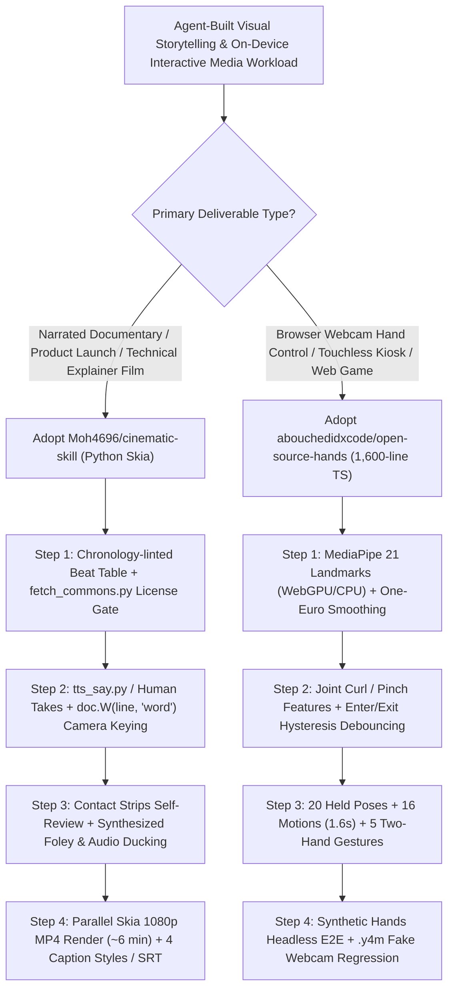

# Word-Exact Code-Built Documentary Rendering (Python Skia `cinematic-skill`) & Zero-Dependency Browser Hand Gesture Engine (`open-source-hands`) Selection FAQ

> **Positioning**: This standalone guide is **Round 17 of the 2026-11-11 Night Shift (Cumulative Guide #62)**, written in the plain-language, first-principles, closed-form FinOps style of `ib-vs-ethernet-roce-selection-faq.md` for AI Application and Interactive Media Solution Architects evaluating two breakout agent-ready repositories:
> 1. **`Moh4696/cinematic-skill` (`75★`, MIT)**: Narrated cinematic documentaries and explainers built 100% from deterministic Python `skia-python` code by coding agents (`Claude Code`, `Codex`, `Cursor`, `Gemini CLI`, `OpenCode`), featuring **word-exact audio keyframing (`doc.W(line, "word")`)**, license-gated Wikimedia Commons retrieval, synthesized zero-royalty sound effects, and three human approval gates;
> 2. **`abouchedidxcode/open-source-hands` (`188★`, MIT)**: A `1,600`-line zero-dependency TypeScript hand-gesture kit atop Google's `MediaPipe Hand Landmarker` (21 points/hand) delivering **One-Euro smoothing, enter/exit hysteresis debouncing, 41 poses/motions/two-hand gestures**, and **webcam-free headless Chromium E2E testing via synthetic hands and `.y4m` fake webcam streams**.
>
> **中文版 FAQ**: [cinematic-skill-open-source-hands-code-film-gesture-selection-faq.md](cinematic-skill-open-source-hands-code-film-gesture-selection-faq.md) · **Architecture Summary SVG**: [`assets/github-ai-radar-2026-11-11-r17-cinematic-hands.svg`](../../../assets/github-ai-radar-2026-11-11-r17-cinematic-hands.svg)

---

## 📌 1. Executive Summary

1. **In plain English, what problems do these two repositories actually solve?**
   - **Eliminating Diffusion Text Hallucinations & Manual Keyframe Re-Timing in Narrated Videos (`Moh4696/cinematic-skill`)**: When producing a 90-second "Vox-style" documentary or product launch video (corkboard evidence walls, map pins, newspaper clippings, highlighter swipes, rolling counters), generative video diffusion models garble text and numbers, while manual After Effects timelines break completely whenever a narrator changes a single sentence. `cinematic-skill` renders every frame deterministically in Python (`skia-python`) over a single continuous 2D/2.5D world (`Cork evidence wall`, `Studio`, `Blueprint`, `Night`). Every camera glide, stamp slam, and counter roll is keyed directly to the spoken word (`doc.W(line, "word")`)—so swapping scratch TTS (`say` / `espeak-ng`) for a human voice automatically re-times the entire film, rendering 92 seconds of 1080p video in **~6 minutes on a 16 GB laptop**.
   - **Eliminating Landmark Flicker & Headless CI Blindness in Browser Hand Tracking (`abouchedidxcode/open-source-hands`)**: Raw `MediaPipe Hand Landmarker` outputs 21 noisy 3D coordinates per hand that jitter and flicker across pose boundaries. Worse, AI coding agents cannot verify webcam apps in headless CI without a physical human waving at a camera. `open-source-hands` wraps MediaPipe in **1,600 lines of zero-dependency TypeScript** with **One-Euro adaptive smoothing** and **enter/exit hysteresis thresholds** across **20 held poses, 16 1.6s-window motions, and 5 two-hand gestures**, while shipping **synthetic hands** (`npm run e2e`) and **`.y4m` fake webcam injection** (`node scripts/camera-check.mjs clips/`) for 100% webcam-free automated testing.
2. **Closed-Form FinOps Verdict (`CLAIM-20261111-R17-CINEMATIC-HANDS`)**:
   - For a Digital Media & Interactive Experience Studio delivering **40 narrated 90-second documentaries/explainers** and **12 browser-based webcam gesture experiences per month** (cloud render/GPU instance `$2.50/hr`, motion designer / frontend engineer loaded rate `$80.00/hr`; human voice actor studio sessions and physical kiosk displays: `not_measured`):
   - Upgrading from **Path A (Manual After Effects keyframing / diffusion video re-rolls + raw MediaPipe landmark thresholding with manual webcam QA, `$5,760.00/mo`)** to **Path C (`Moh4696/cinematic-skill` Skia `doc.W(line, "word")` pipeline + `abouchedidxcode/open-source-hands` hysteresis kit & synthetic hands E2E, `$820.00/mo`)** saves **`$4,940.00/mo` (`-85.76%`, `$59,280.00/yr`)** and cuts engineering/design hours from `62.0 hrs/mo` to `9.5 hrs/mo` (**`-84.68%`**).

---

## 🎯 2. Three Core Architectural Questions (Q1 / Q2 / Q3 Deep-Dive)

### Q1: How does `Moh4696/cinematic-skill` automatically re-time an entire documentary when the voice track changes—and how does it prevent layout bugs and copyright violations?
- **First-Principles Breakdown**:
  1. **Word-Exact Audio Keyframing (`doc.W(line, "word")`)**:
     - Instead of hardcoding frame numbers (`frame = 420`) or timestamps (`t = 14.2s`), `tts_say.py`, `split_takes.py`, and `build_narration.py` segment either a scratch TTS voice (`macOS say` / `espeak-ng`) or recorded human takes into timed lines and word anchors. Scene scripts reference `doc.W(line, "word")` so camera moves, highlighter swipes, and rolling counters automatically shift whenever narration is re-recorded or translated.
  2. **Contact Strip Visual Self-Review & Three Human Approval Gates**:
     - Before showing a draft, the agent renders still frames and **contact strips** of every camera move over the single designed world to inspect for text overlap or framing errors. Execution pauses for human approval at three deterministic gates: **chronology-linted beat table**, **visual look**, and **30-second draft**.
  3. **License-Gated Wikimedia Retrieval & Procedural SFX (`fetch_commons.py`)**:
     - `fetch_commons.py` searches Wikimedia Commons, refuses non-free files, and writes `credits.md` automatically, while sound effects are synthesized procedurally in code (zero licensing friction) and mixed with ducked score and 4 burned-in caption styles / SRT.

### Q2: How does `abouchedidxcode/open-source-hands` eliminate gesture flicker in 1,600 lines of zero-dependency TypeScript and enable webcam-free CI for coding agents?
- **First-Principles Breakdown**:
  1. **One-Euro Adaptive Filtering + Enter/Exit Hysteresis State Machine**:
     - Applying a fixed low-pass filter to 21 MediaPipe hand landmarks introduces severe lag during fast swipes or throws. The **One-Euro filter** dynamically adapts its cutoff frequency based on velocity—smoothing jitter when the hand is still while tracking rapid motion with minimal latency.
     - From smoothed joint angles, finger curls, pinch gaps, palm facing, and roll are scored every frame across **20 held poses** using **hysteresis (separate enter and exit thresholds)** so poses never flicker at decision boundaries, alongside **16 one-hand motions** (over a `1.6 s` window) and **5 two-hand gestures** (`clap`, `zoom-in/out`, `steer-left/right`).
  2. **Three-Tier Webcam-Free Verification (`npm test` → Synthetic Hands E2E → `.y4m` Injection)**:
     - **Engine unit tests (`npm test`)**: Verifies pose/motion math in Node without a browser;
     - **Synthetic Hands + Bot Player (`npm run build && npm run e2e`)**: Drives the Three.js starter game (`templates/game/`) in headless Chromium using synthetic hands;
     - **Real MediaPipe `.y4m` Fake Webcam (`node scripts/camera-check.mjs clips/`)**: Feeds recorded `.y4m` clips as a virtual webcam into the real MediaPipe WebAssembly model to verify detection rate and reaction time.

### Q3: How should Solution Architects adopt and combine these two repositories in enterprise workflows?
- **Selection Rule**:
  - Use **`Moh4696/cinematic-skill`** for all data-heavy explainers, architecture walkthroughs, compliance training videos, and product launch films where exact typography, repeatable rendering, and rapid voice re-timing are mandatory.
  - Copy **`abouchedidxcode/open-source-hands/src/kit`** (`shadcn/ui` style) into any browser application, interactive kiosk, or educational game requiring **100% on-device webcam privacy (video never leaves the device)** and automated headless CI.

---

## 🧭 3. Mermaid Decision Tree & Dual Agent-Native Pipeline

---

## 📊 4. Architectural Comparison Matrix

| Evaluation Dimension | Path A: Manual AE / Diffusion Video + Raw MediaPipe | Path B: Hardcoded-Frame Code Video + Unsmoothed Landmarks | **Path C (Recommended): `cinematic-skill` + `open-source-hands`** |
| :--- | :--- | :--- | :--- |
| **Typography Accuracy & Determinism** | Diffusion garbles text/numbers; AE is manual-only | Accurate text, but lacks continuous camera world & spotlight | **100% deterministic Python Skia world; renders 92s 1080p in ~6 min** |
| **Voice Edit / Translation Re-Timing** | Editing one line requires shifting hundreds of AE keyframes | Frame-hardcoded (`frame=420`); breaks on voice duration change | **`doc.W(line, "word")` re-times the entire film automatically on voice swap** |
| **Asset Licensing & Sound Effects** | Manual license audits and commercial SFX subscriptions | No built-in license gate or audio ducking | **Wikimedia license gate (`credits.md`) + procedural zero-royalty SFX** |
| **Gesture Stability & Flicker Control** | Raw 21 landmarks jitter and flicker across pose boundaries | Simple moving average introduces lag on fast swipes | **One-Euro filter + enter/exit hysteresis across 20 poses / 16 motions / 5 2-hand** |
| **Webcam-Free Headless CI Testing** | Requires a physical human waving at a live webcam | Cannot run E2E gesture tests in headless CI | **Built-in Synthetic Hands + bot player + `.y4m` fake webcam CLI** |
| **Monthly TCO (40 Films + 12 Apps)** | **`$5,760.00 / mo`** (`$800` compute + `$4,960` labor) | **`$2,920.00 / mo`** (`$200` compute + `$2,720` labor) | **`$820.00 / mo` (Saves `$4,940.00/mo` · `-85.76%`)** |

---

## 🧪 5. Closed-Form FinOps Example & 7-Card Insights (`CLAIM-20261111-R17-CINEMATIC-HANDS`)

### 5.1 Workload & Scope Boundary
- **Workload**: A Digital Media & Interactive Experience team producing **40 narrated 90-second explainers/documentaries** and **12 browser-based webcam gesture apps per month**.
- **Rates**: Cloud render/GPU instance at **`$2.50 / hr`**; motion designer / frontend engineer loaded rate at **`$80.00 / hr`**.
- **Explicit Scope Boundary**: External commercial voice-over studio fees and physical exhibit kiosk hardware are marked **`not_measured`**.

### 5.2 Closed-Form Monthly Cost Breakdown

| Cost Component | Path A: Manual AE / Diffusion + Manual Webcam QA | Path B: Hardcoded Code Video + No Synthetic Hands CI | **Path C: `cinematic-skill` + `open-source-hands` (Recommended)** |
| :--- | :--- | :--- | :--- |
| **Render & Test Compute (`$2.50/hr`)** | `320 hrs × $2.50` = **`$800.00`** | `80 hrs × $2.50` = **`$200.00`** | `24 hrs × $2.50` = **`$60.00`** |
| **Engineering & Motion Design (`$80/hr`)** | `62.0 hrs × $80.00` = **`$4,960.00`** | `34.0 hrs × $80.00` = **`$2,720.00`** | `9.5 hrs × $80.00` = **`$760.00`** |
| **Total Monthly TCO** | **`$5,760.00 / mo`** | **`$2,920.00 / mo`** (`-49.31%`) | **`$820.00 / mo`** |
| **Net Savings vs. Path A** | Baseline | Saves `$2,840.00 / mo` | **Saves `$4,940.00 / mo` (`-85.76%` · `$59,280.00/yr`)** |
| **Voice Studio & Kiosk Hardware** | `not_measured` | `not_measured` | `not_measured` |

---

## 🛠️ 6. Production Verification Checklist

- [ ] **1. `cinematic-skill` Setup & Dependency Gate**: Run `npx skills add Moh4696/cinematic-skill`, install `skia-python`, `numpy`, and `pillow`, and execute `check_setup.py` to confirm `ffmpeg` and system TTS (`say` / `espeak-ng`) availability.
- [ ] **2. Contact Strip & License Audit Enforcement**: Verify the chronology-linted beat table, inspect contact strips of every camera move before rendering full 1080p video, and confirm `fetch_commons.py` generated a clean `credits.md`.
- [ ] **3. Self-Hosted MediaPipe Model & WASM Assets**: Copy `src/kit` into `src/hand-gesture-kit` and serve `public/models/hand_landmarker.task` (`float16`) and `public/wasm/*` locally (`@mediapipe/tasks-vision@1.1.0`) so no webcam or model request depends on external CDNs at runtime.
- [ ] **4. Hysteresis Tuning in Gesture Lab**: Disable experimental poses (`config: { pose: { experimental: false } }`) in production and export tuned enter/exit thresholds from `lab.html` after running reliability and confusion checks.
- [ ] **5. Webcam-Free Headless CI Pipeline**: Enforce `npm test`, `npm run build && npm run e2e` (Synthetic Hands in headless Chromium), and `node scripts/camera-check.mjs clips/` (`.y4m` virtual webcam injection) on every pull request.
