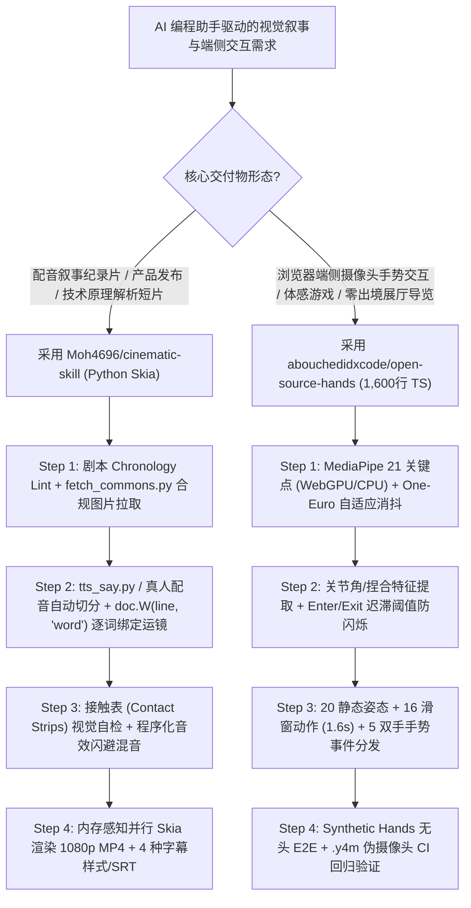

# 代码级逐词对齐纪录片渲染（Python Skia `cinematic-skill`）与零依赖端侧手势交互套件（`open-source-hands`）选型 FAQ

> **文档定位**：本文是 **2026-11-11 夜班多轮深潜 Round 17（累计第 62 篇独立选型专题）**，严格对标 `ib-vs-ethernet-roce-selection-faq.md` 的「通俗大白话 + 第一性原理 + 可核算定量算例」标杆文风，为 AI 应用与可编程交互媒体架构师深度拆解今日两款面向 AI Coding Agent（Claude Code / Codex / Cursor / Gemini CLI）设计的确定性视觉与交互工程标杆：
> 1. **`Moh4696/cinematic-skill`（`75★`，MIT）**：完全用 Python `skia-python` 代码绘制的叙事型纪录片与产品演示视频生成 Skill，支持**逐词精准绑定镜头运动与计数器滚动（`doc.W(line, "word")`）**、Wikimedia Commons 开源协议自动审计、合成免版税音效与三阶段人工审批门禁；
> 2. **`abouchedidxcode/open-source-hands`（`188★`，MIT）**：仅 `1,600` 行零依赖 TypeScript 构建的浏览器端侧手势交互引擎（基于 MediaPipe Hand Landmarker 21 关键点），内置 **One-Euro 滤波、迟滞防抖阈值（Hysteresis）、41 种姿态/动作/双手手势**，以及无需物理摄像头即可在无头 Chromium 中跑通 E2E 测试的**合成虚拟手（Synthetic Hands）与 `.y4m` 伪摄像头验证链**。
>
> **English Companion**: [cinematic-skill-open-source-hands-code-film-gesture-selection-faq.en.md](cinematic-skill-open-source-hands-code-film-gesture-selection-faq.en.md) · **架构总结图**: [`assets/github-ai-radar-2026-11-11-r17-cinematic-hands.svg`](../../../assets/github-ai-radar-2026-11-11-r17-cinematic-hands.svg)

---

## 📌 一、核心结论速览（Executive Summary）

1. **先用大白话讲透这两个项目到底解决了什么痛点？**
   - **叙事科普/产品演示视频的“扩散模型文字乱码与改稿重做地狱”（`Moh4696/cinematic-skill` 解决的问题）**：当你想做一条 90 秒的“Vox 风格”深度商业/技术纪录片（软木板证据墙、地图轨迹推拉、真实历史报刊剪贴、高亮荧光笔涂抹、数字滚动计数器）时，如果用扩散生成视频模型，上面的文字和数字必定扭曲幻觉；如果用 After Effects 手工K帧，一旦配音演员改了一句话的语速，整条时间轴的数百个关键帧全部错位！`cinematic-skill` 彻底摒弃扩散生成视频，**每一帧都由 Python Skia 代码在一个连续画布世界（Single Designed World）上确定性绘制**，所有印章砸下、荧光笔划过、数字滚动都直接绑定在配音台词的**具体某一个单词（`doc.W(line, "word")`）**上——换一段新配音，整部电影自动重新对齐时间轴，在 16GB 笔记本上 6 分钟即可渲染完 92 秒 1080p 成片！
   - **浏览器端侧手势交互的“关键点抖动闪烁与无摄像头 CI 无法测试痛点”（`abouchedidxcode/open-source-hands` 解决的问题）**：Google 的 MediaPipe Hand Landmarker 虽然能在浏览器里给出每只手 21 个三维点，但直接拿原始坐标写网页交互或小游戏会疯狂抖动、在握拳/张开边界处高频闪烁；更致命的是，AI 编程助手（Codex / Claude Code）在服务器或无头浏览器里没有真人的手对着摄像头比划，根本无法自测写出来的手势代码能不能跑通。`open-source-hands` 用 **1,600 行零依赖 TypeScript** 封装了 **One-Euro 滤波 + 进出双阈值迟滞防抖（Hysteresis）**，提炼出 **20 种静态手势、16 种 1.6 秒滑窗动态动作、5 种双手协同手势**，并独创了**合成虚拟手（Synthetic Hands）+ `.y4m` 伪摄像头注入（`camera-check.mjs`）**，让 Agent 在无摄像头 CI 环境下也能 100% 自动化跑通手势 E2E 测试！
2. **闭式 FinOps 核算结论（`CLAIM-20261111-R17-CINEMATIC-HANDS`）**：
   - 在每月交付 **40 条 90 秒数据叙事纪录片/产品发布短片 + 12 个浏览器端侧手势交互微应用**基准下（渲染/云实例 `$2.50/hr`，动效设计师/前端工程师全包时薪 `$80.00/hr`；真人商业配音棚与线下互动大屏硬件：`not_measured`）：
   - 从 **Path A（手工 After Effects K帧/扩散视频抽卡 + 原始 MediaPipe 手工调参及真人摄像头 QA，`$5,760.00/月`）** 切换至 **Path C（`cinematic-skill` Skia 逐词对齐流水线 + `open-source-hands` 迟滞防抖套件与合成手无头 E2E，`$820.00/月`）**，每月净省 **`$4,940.00/月`（降幅 `-85.76%`，年化节省 `$59,280.00/年`）**，每月人工调轴与手势排障工时从 `62.0 小时` 降至 `9.5 小时`（**节省 `84.68%`**）。

---

## 🎯 二、三大灵魂拷问（Q1 / Q2 / Q3 Deep-Dive）

### Q1：`Moh4696/cinematic-skill` 是如何做到“换配音自动重排整部电影关键帧”的？它的视觉自检与版权合规门禁是怎么设计的？
- **第一性原理拆解**：
  1. **逐词时间戳驱动的摄像机与动效（`doc.W(line, "word")`）**：
     - 传统代码视频工具（如早期 Manim 或硬编码帧号的 Remotion 脚本）把动画绑在固定秒数（如 `t = 14.2s`）上，一旦改词就全乱。`cinematic-skill` 先用免费草稿语音（macOS `say` 或 `espeak-ng`）或分段真人录音经 `tts_say.py` → `split_takes.py` → `build_narration.py` 自动切分出每句台词及词级时间锚点。场景脚本通过 `doc.W(line, "word")` 将摄像机推拉、红线连接、印章敲击和数字滚动精确锚定在发声词上。
  2. **单一连续设计世界（Single Designed World）与接触表自检（Contact Strips Review）**：
     - 整部短片不是生硬的 PPT 翻页，而是摄像机与聚光灯（Spotlight）在同一张巨型画布（支持 `Cork evidence wall` 软木证据墙、`Studio` 极简影棚、`Blueprint` 工程蓝图、`Night` 暗夜科技四种主题）上平滑滑行。渲染草稿前，Agent 会先渲染每个运镜的静态帧与接触表（Contact Strips），自主排查排版重叠与越界错误，并在**节拍表（含时间线 Chronology Lint）、视觉风格、30 秒草稿**三个节点停下等待人类确认。
  3. **零版权隐患素材链（`fetch_commons.py` + 程序化合成音效）**：
     - 自动检索 Wikimedia Commons 并校验开源协议（拒绝非自由版权文件，自动生成 `credits.md`），音效（SFX）完全由代码程序化合成并与配音做自动闪避（Ducking）和响度归一化。

### Q2：`abouchedidxcode/open-source-hands` 是如何在短短 1,600 行零依赖 TS 代码里消除手势抖动，并让 Coding Agent 在没有摄像头的机器上完成端到端测试的？
- **第一性原理拆解**：
  1. **One-Euro 自适应低通滤波 + 进出双阈值迟滞（Enter/Exit Hysteresis）**：
     - 摄像头在 1280×720 分辨率下输出的 21 个手指关节坐标存在高频测量噪声：如果用固定低通滤波，快速挥手（Swipe）就会严重拖影滞后。**One-Euro 滤波器**在手静止时强力平滑消抖，在手高速移动时自动提高截止频率降低延迟；
     - 同时，对由关节角度算出的手指弯曲度（Curl）、捏合间距（Pinch Gap）、掌心朝向与滚转角（Roll），每帧对 **20 种静态手势**打分，并采用**进入阈值（Enter Threshold）高于退出阈值（Exit Threshold）的迟滞状态机**，彻底消灭临界姿态下的高频闪烁！
  2. **三层无摄像头自动化验证体系（Unit → Synthetic Hands E2E → `.y4m` 伪流注入）**：
     - **纯算子单测（`npm test`）**：无需浏览器即可验证特征提取与状态机；
     - **合成虚拟手无头浏览器 E2E（`npm run build && npm run e2e`）**：内置可编程 Synthetic Hands 与自动打游戏的 Bot，在无头 Chromium 中直接驱动完整 Three.js 游戏模板（`templates/game/`）；
     - **真实 MediaPipe `.y4m` 视频流注入（`node scripts/camera-check.mjs clips/`）**：将预录制的 `.y4m` 无损视频流作为虚拟摄像头喂给真实 MediaPipe WASM 模型，闭环验证识别率与反应时。

### Q3：架构师在企业内训视频自动化或展厅/教育浏览器体感交互项目中，该如何落地这套组合？
- **选型黄金法则**：
  - 凡是**强信息密度、强数字/引用准确性、需频繁多语种配音改稿**的技术解读、产品发布、合规培训短片，一律用 `Moh4696/cinematic-skill` 替代扩散生成视频；
  - 凡是**要求视频流 100% 不出端（Zero-Egress 隐私合规）、零后端 GPU 成本**的浏览器体感游戏、展厅非接触导览或手势白板，直接通过 `npx degit abouchedidxcode/open-source-hands/src/kit src/hand-gesture-kit` 拷入项目（类似 `shadcn/ui` 源码级复用）。

---

## 🧭 三、Mermaid 选型决策树与双工作流协同架构

---

## 📊 四、同类方案核心能力对比矩阵（Comparison Matrix）

| 评估维度 | Path A：传统 AE 手工 K 帧 / 扩散视频 + 原始 MediaPipe | Path B：普通硬编码帧号代码视频 + 无平滑手势脚本 | **Path C（推荐标杆）：`cinematic-skill` + `open-source-hands`** |
| :--- | :--- | :--- | :--- |
| **文字/数字准确度与确定性** | 扩散视频文字必乱码；AE 确定但纯靠人工堆工时 | 文字准确，但缺乏连续世界摄像机与聚光灯叙事感 | **Python Skia 100% 确定性渲染，单世界连续运镜，92 秒 1080p 仅需 ~6 分钟** |
| **配音改稿重排成本** | 改一句话需手工平移数百个 AE 关键帧 | 帧号硬编码（`frame=420`），换配音需人工重算时间轴 | **`doc.W(line, "word")` 逐词锚定，换配音/换语种全片自动重排时间轴** |
| **版权合规与音效制作** | 需人工排查图库版权、购买商业音效库 | 无内置版权校验与自动闪避混音 | **Wikimedia 协议自动门禁（生成 `credits.md`）+ 程序化合成零版税音效** |
| **手势稳定性与防闪烁** | 原始 21 点坐标高频抖动，姿态边界频繁跳变 | 简单均值平滑导致快速挥手严重滞后 | **One-Euro 自适应滤波 + Enter/Exit 迟滞阈值，覆盖 20 姿态 / 16 动作 / 5 双手手势** |
| **无摄像头 Agent CI 测试** | 必须真人对着物理摄像头反复比划测试 | 无法在无头 CI 中验证手势逻辑 | **内置 Synthetic Hands 虚拟手 + Bot 自动通关 + `.y4m` 伪摄像头测试** |
| **月度总拥有成本（TCO）** | **`$5,760.00 / 月`**（算力 `$800` + 人工 `$4,960`） | **`$2,920.00 / 月`**（算力 `$200` + 人工 `$2,720`） | **`$820.00 / 月`（净省 `$4,940.00/月`，降幅 `-85.76%`）** |

---

## 🧪 五、闭式定量 FinOps 算例与 7-Card 评测洞察（`CLAIM-20261111-R17-CINEMATIC-HANDS`）

### 5.1 基准假设与边界声明
- **评测负载**：数字媒体与互动体验团队每月交付 **40 条 90 秒配音叙事短片** 与 **12 个浏览器端侧手势交互应用**。
- **单价基准**：云端渲染/GPU 实例 **`$2.50 / hr`**；动效设计师/前端工程师全包时薪 **`$80.00 / hr`**。
- **显式边界声明（Scope Boundary）**：外聘真人商业配音演员录音棚费用及线下展厅体感大屏硬件采购标记为 **`not_measured`**。

### 5.2 三路径闭式成本核算表

| 成本构成项 | Path A：AE 手工 K 帧/扩散抽卡 + 真人摄像头 QA | Path B：普通硬编码代码视频 + 无合成手 CI | **Path C：`cinematic-skill` + `open-source-hands`（推荐）** |
| :--- | :--- | :--- | :--- |
| **渲染与测试算力成本（`$2.50/hr`）** | `320 hrs × $2.50` = **`$800.00`** | `80 hrs × $2.50` = **`$200.00`** | `24 hrs × $2.50` = **`$60.00`** |
| **工程与动效设计人工（`$80/hr`）** | `62.0 hrs × $80.00` = **`$4,960.00`** | `34.0 hrs × $80.00` = **`$2,720.00`** | `9.5 hrs × $80.00` = **`$760.00`** |
| **月度总成本（Monthly Total）** | **`$5,760.00 / 月`** | **`$2,920.00 / 月`**（`-49.31%`） | **`$820.00 / 月`** |
| **相对 Path A 净节省（Savings）** | 基准线（Baseline） | 节省 `$2,840.00 / 月` | **净省 `$4,940.00 / 月`（`-85.76%` · 年省 `$59,280.00`）** |
| **真人配音棚与展厅硬件（Scope）** | `not_measured` | `not_measured` | `not_measured` |

---

## 🛠️ 六、生产级落地核验 Checklist（SA Actionable Verification）

- [ ] **1. `cinematic-skill` 环境与 FFmpeg 自检**：执行 `npx skills add Moh4696/cinematic-skill` 与 `pip install -r requirements.txt`（`skia-python`, `numpy`, `pillow`），运行内置 `check_setup.py` 确认 `ffmpeg` 与系统 TTS（`say` / `espeak-ng`）就绪。
- [ ] **2. 三阶段审批门禁与版权审计**：在运行 `render.py` 导出最终 1080p 成片前，强制核验 **Chronology-Lint 节拍表**、**Contact Strips 接触表静态预览**以及 `fetch_commons.py` 自动生成的 `credits.md` 开源许可证记录。
- [ ] **3. `open-source-hands` 零依赖源码集成与本地 WASM 部署**：通过 `npx degit abouchedidxcode/open-source-hands/src/kit src/hand-gesture-kit` 引入套件，将 `hand_landmarker.task`（float16）与 `@mediapipe/tasks-vision@1.1.0` WASM 文件部署于本地 `public/` 目录，杜绝运行时外网拉取失败。
- [ ] **4. 迟滞阈值调优与实验手势开关**：生产环境默认设置 `config: { pose: { experimental: false } }` 屏蔽易混淆实验手势，并使用内置 `lab.html`（Gesture Lab）实测识别率与反应时间后导出调优 JSON。
- [ ] **5. 无摄像头双层 CI 门禁**：在 GitHub Actions 中串行执行 `npm test`、`npm run build && npm run e2e`（Synthetic Hands 无头 Chromium）与 `node scripts/camera-check.mjs clips/`（`.y4m` 真实 MediaPipe 回归）。
