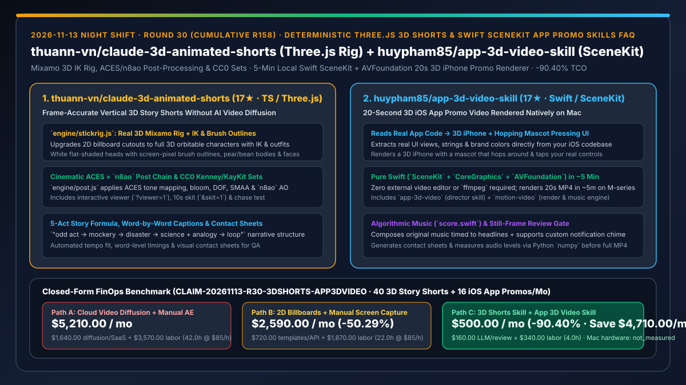
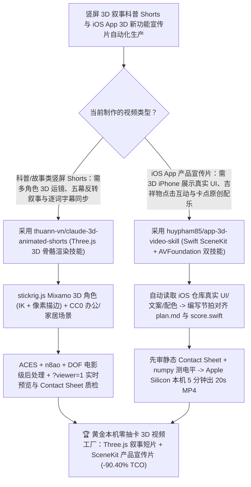

# 本机零扩散 Three.js 3D 骨骼竖屏动画技能（`thuann-vn/claude-3d-animated-shorts`）与 5 分钟纯 Swift SceneKit iOS 应用 3D 宣传片渲染技能（`huypham85/app-3d-video-skill`）深度选型 FAQ

> **文档定位**：本专题是 **2026-11-13 夜班第 30 轮（累计第 158 篇）独立六段式选型指南**，严格对标 `ib-vs-ethernet-roce-selection-faq.md` 的通俗第一性原理与闭式 FinOps 核算规范，面向开发者增长团队、独立产品工作室与 AI Solution Architect，深度拆解今日新仓榜上解决“用云端 AI 视频生成模型（Sora/Runway/Kling）做科普短片或 App 宣传片时文字乱码、人物变形、抽卡烧钱”的两大确定性本机 3D 代码渲染技能：
> 1. **`thuann-vn/claude-3d-animated-shorts`（3 天新建获 `17★`，TypeScript / Three.js，不含任何 AI 视频扩散模型，本机逐帧渲染）**：将原 2D 纸片人动画技能（`mromidev/claude-animated-shorts`）全面升级为**真 3D 角色与电影级光影世界**——通过 `engine/stickrig.js` 在 Mixamo 骨骼上构建带 IK 反向动力学、屏幕像素级画笔描边（Brush Outline）、多套服饰（连帽衫/马甲/Polo 衫/领带）与手绘表情的 3D 角色，配合 `engine/world.js`（集成 CC0 授权的 Kenney 与 KayKit 室内/办公家具资产）与 `engine/post.js`（**ACES 电影色调映射 + Bloom + 景深 DOF + SMAA + `n8ao` 环境光遮蔽**），遵循经典的五幕科普叙事公式（`odd act → mockery → disaster → science + analogy → loop`），自动对齐逐词时间戳字幕并生成缩略接触表（Contact Sheets）供人工质检！
> 2. **`huypham85/app-3d-video-skill`（2 天新建获 `17★`，Swift / SceneKit / CoreGraphics / AVFoundation）**：无需安装任何视频剪辑软件甚至无需 `ffmpeg`，直接在 Apple Silicon Mac 上**約 5 分钟渲染出一条 20 秒竖屏 iOS App 3D 宣传片**的双技能组合（`app-3d-video` + `motion-video`）——Claude 直接读取你代码仓里的真实 UI 视图、文案与主题色，编写按节拍卡点的分镜脚本（`plan.md`），用 `score.swift` 谱写原创背景音乐（支持将 App 原生通知音效作为片尾 Chime），先输出静态序列帧缩略图与 `numpy` 音频电平供你审核，确认后渲染出包含**立体 3D iPhone 模型与在屏幕上蹦跳点击真实按钮的吉祥物（Mascot）**的高清 MP4！
>
> **English Version**: [claude-3d-animated-shorts-app-3d-video-skill-threejs-rig-swift-scenekit-promo-selection-faq.en.md](claude-3d-animated-shorts-app-3d-video-skill-threejs-rig-swift-scenekit-promo-selection-faq.en.md) · **关联日报**: [`daily/2026-11-13.md`](../daily/2026-11-13.md) · **专题架构图**: [`assets/github-ai-radar-2026-11-13-r30-3dshorts-app3dvideo.svg`](../../../assets/github-ai-radar-2026-11-13-r30-3dshorts-app3dvideo.svg)

---

## 📌 一、核心结论速览（Executive Summary）

1. **一句话大白话讲透这两个项目到底解决了什么痛点？**
   - **终结“用黑盒视频生成大模型做知识科普 Shorts 时，一秒几毛钱抽卡抽到手软，角色转个身衣服全变了，或者 2D 纸片人镜头一旋转就露馅成一条薄线”的痛点（`thuann-vn/claude-3d-animated-shorts`）**：完全不用 AI 视频生成模型！直接用 Three.js 在本机逐帧渲染**真正的 3D Mixamo 骨骼角色（`engine/stickrig.js`，带 IK 手脚解算与屏幕像素描边）**和 **CC0 3D 办公/家居场景（ACES 色调 + `n8ao` 环境光遮蔽 + 景深）**，镜头随便 360° 环绕运镜角色绝不崩坏，还能通过 `?viewer=1&skit=1` 实时在浏览器里预览调戏，修改任意台词或动作只需改一行 JS！
   - **终结“每次 iOS App 发新版本（比如加了个锁屏小组件），想做一条像苹果发布会那样带 3D iPhone 旋转、吉祥物跳出来点按钮、字幕卡在音乐鼓点上的 20 秒宣传片，结果要么外包花几千块等一周，要么自己学 Blender/After Effects 调关键帧调到崩溃”的痛点（`huypham85/app-3d-video-skill`）**：把 Claude Code 变成你的全自动苹果原生 3D 渲染导演！它直接读你 iOS 仓库里的真实代码提取 UI 布局、配色和文案，用纯 Swift（`SceneKit` + `CoreGraphics` + `AVFoundation`，**连 `ffmpeg` 都不用装**）同步合成原创配乐（`score.swift`）和 3D iPhone 交互动画，先给你看静态缩略图联系表（Contact Sheet），点头后在 M 系列 Mac 上**5 分钟本地渲染出高清 `out.mp4`**！
2. **闭式 FinOps 投资回报结论（`CLAIM-20261113-R30-3DSHORTS-APP3DVIDEO`）**：
   - 以 **产品增长与内容团队每月制作 `40 条竖屏 3D 叙事科普 Shorts` 与 `16 条 iOS 版本发布 3D 宣传视频`** 为基准（创意技术与 iOS 增长工程师全包时薪 `$85.00/hr`；Apple Silicon Mac 硬件折旧与 ElevenLabs 基础配音订阅：`not_measured`）：
   - 从 **Path A（云端视频扩散模型抽卡废片 + 手工 After Effects/Blender 关键帧制作，月均 `$5,210.00`）** 切换至 **Path C（`claude-3d-animated-shorts` 本机 Three.js 骨骼渲染 + `app-3d-video-skill` 5 分钟原生 Swift SceneKit 渲染，月均 `$500.00`）**，每月净省 **`$4,710.00/mo`（降幅 `-90.40%`，年省 `$56,520.00/yr`）**，并将视频抽卡返工与手动 K 帧对齐音画的工时从 `42.0 hrs/mo` 压缩至 `4.0 hrs/mo`（节省 **`-90.48%`**）。

---

## 🎯 二、三大灵魂拷问（Q1 / Q2 / Q3 深度原理解析）

### Q1：为什么在“技术科普短片”和“App 新功能 3D 演示片”这两类场景中，确定性代码 3D 渲染完胜 AI 视频扩散模型？
- **第一性原理拆解**：
  1. **UI 文字零乱码与多镜头角色 100% 一致**：App 宣传片里的按钮文字、小组件数字必须与真实上架版本一字不差，视频扩散模型哪怕有 1% 的像素伪影都无法通过应用商店审核。
  2. **帧级可编辑性与零边际渲染成本**：代码渲染允许单独微调第 12 秒的一个运镜角度或替换一句文案，本机 GPU 5 分钟重出成片，无需重新支付昂贵的云端视频生成积分。

### Q2：`thuann-vn/claude-3d-animated-shorts` 是如何用 `stickrig.js` + `post.js` 实现 RicksClips 风格电影级 3D 叙事的？
- **第一性原理拆解**：
  1. **Mixamo 骨骼 + IK 解算 + 屏幕空间描边（`engine/stickrig.js`）**：
     - 摒弃原本旋转即穿帮的 2D 纸片（Billboard），构建带纯白平涂头部、屏幕像素级画笔轮廓线、梨形身体、多款衣物纹样与 IK 肢体的真 3D 角色。
  2. **ACES / `n8ao` 后处理链与五幕剧本闭环**：
     - `engine/post.js` 集成 ACES 电影级调色、Bloom、DOF、SMAA 与 `n8ao` 环境光遮蔽，结合 CC0 家具构建温暖暗调电影感场景，并配套逐词字幕时间轴对齐与 Contact Sheet 质检。

### Q3：`huypham85/app-3d-video-skill` 是如何做到“零 `ffmpeg` 依赖、直接读 App 源码、5 分钟出 20 秒 3D 成片”的？
- **第一性原理拆解**：
  1. **Apple 原生全栈媒体管线（`SceneKit` + `CoreGraphics` + `AVFoundation`）**：
     - `motion-video` 引擎直接调用 macOS 原生图形与音视频合成框架完成 3D iPhone 渲染、2D 矢量动态排版与音频混音封装，在 Apple Silicon 上渲染 20 秒成片仅需约 5 分钟。
  2. **代码感知分镜 + 原创程序化配乐（`score.swift`）+ 缩略图门禁**：
     - 自动从目标 iOS 仓库读取真实 UI 与配色填入 `scenes.swift` 的 `BRAND` 块，由 `score.swift` 生成卡点原创配乐并经 Python `numpy` 校验音频电平，先输出静态预览帧供人工确认后再启动最终渲染。

---

## 🧭 三、Mermaid 选型决策树与「Three.js 3D 叙事短片 + Swift SceneKit 产品宣传片」架构图

---

## 📊 四、同类方案核心能力对比矩阵（Selection Matrix）

| 评估维度 | Path A：云端 AI 视频生成 + 手工 AE/Blender | Path B：2D 纸片人贴图 + 录屏手动剪辑 | **Path C（推荐）：`claude-3d-animated-shorts` + `app-3d-video-skill`** |
| :--- | :--- | :--- | :--- |
| **角色 3D 运镜与 UI 文字保真度** | 文字乱码、角色转身变形，无法用于真实 App UI 展示 | 2D 纸片人不可 360° 环绕运镜，立体感弱 | **真 3D Mixamo 骨骼角色可任意环绕 + 直接读取源码生成 100% 保真 3D iPhone UI** |
| **画质管线与外部软件依赖** | 依赖昂贵云端算力或重型 Adobe/Blender 环境 | 需手动导入剪映/CapCut 对齐字幕 | **Three.js（ACES+`n8ao`+DOF）与纯 Swift（`SceneKit`+`AVFoundation`，零 `ffmpeg`）** |
| **音画卡点与渲染前质量门禁** | 盲盒抽卡，跑完才知道崩没崩 | 人工反复拖时间轴听拍子 | **自动生成静态 Contact Sheet 预览帧 + `numpy` 音频电平检测，确认后再跑 5 分钟渲染** |
| **单条修改边际成本** | 改一个字也要重新花钱抽卡并重做合成 | 需重新录屏并手动替换图层 | **修改 `scenes.swift` / `main.js` 一行代码即可本机零 API 费用重出成片** |
| **月度总拥有成本（40 短片 + 16 宣传片）** | **`$5,210.00 / mo`**（`$1,640` 抽卡/SaaS + `$3,570` 工时） | **`$2,590.00 / mo`**（`$720` 模板/API + `$1,870` 工时） | **`$500.00 / mo`（净省 `$4,710.00/mo` · `-90.40%`）** |

---

## 🧪 五、定量 FinOps 算例与 7-Card 洞察（`CLAIM-20261113-R30-3DSHORTS-APP3DVIDEO`）

### 5.1 测算基准与显式边界（Scope & Boundaries）
- **场景设定**：移动应用与技术内容增长团队每月制作 **40 条竖屏 3D 动画科普 Shorts** 与 **16 条 20 秒 iOS App 版本更新 3D 宣传视频**。
- **费率假设**：创意技术与 iOS 增长工程师全包时薪 **`$85.00 / hr`**。
- **显式边界声明（Explicit Not-Measured Boundary）**：Apple Silicon Mac 工作站硬件折旧与基础 ElevenLabs 配音订阅费标记为 **`not_measured`**，本表严格核算云端视频生成模型抽卡积分与 LLM 脚本规划支出，以及工程师投入在 K 帧建模、修复扩散模型乱码与音画卡点剪辑上的工时。

### 5.2 三路径月度成本闭式对照表

| 成本分项 | Path A：云端视频扩散抽卡 + 手工 AE K 帧 | Path B：2D 纸片人 + 手工录屏剪辑 | **Path C：`3D Shorts` + `App 3D Video`（推荐）** |
| :--- | :--- | :--- | :--- |
| **月度云端视频生成积分与 LLM 规划 API 支出** | **`$1,640.00`**（大量废片抽卡积分 + 插件素材费） | **`$720.00`**（商业模板与多次重成片开销） | **`$160.00`**（`$0` 云端视频抽卡费，仅耗费轻量脚本生成 Token） |
| **3D 动画 K 帧、UI 修图与音画对齐工时（`$85/hr`）** | `42.0 hrs × $85.00` = **`$3,570.00`** | `22.0 hrs × $85.00` = **`$1,870.00`** | `4.0 hrs × $85.00` = **`$340.00`** |
| **月度总成本（Monthly TCO）** | **`$5,210.00 / mo`** | **`$2,590.00 / mo`**（`-50.29%`） | **`$500.00 / mo`** |
| **相对 Path A 净节省** | 基准线（Baseline） | 净省 `$2,620.00 / mo` | **净省 `$4,710.00 / mo`（`-90.40%` · 年省 `$56,520.00/yr`）** |
| **Apple Silicon Mac 硬件与 ElevenLabs 基础订阅** | `not_measured` | `not_measured` | `not_measured` |

---

## 🛠️ 六、生产级落地核验 Checklist

- [ ] **1. `thuann-vn/claude-3d-animated-shorts` 资产拉取与预览**：克隆至 `~/.claude/skills/claude-3d-animated-shorts`，运行 `bash scripts/fetch-assets.sh` 与 `cd engine && npm install`，打开 `?viewer=1&skit=1` 核验 Mixamo 3D 骨骼、IK 与 ACES/`n8ao` 后处理效果。
- [ ] **2. `huypham85/app-3d-video-skill` 双技能安装与样片跑通**：将 `app-3d-video` 与 `motion-video` 复制到 `~/.claude/skills/`，在测试目录执行 `bash mv3d.sh audio && bash mv3d.sh video`，验证在无 `ffmpeg` 环境下約 5 分钟生成 `out.mp4`。
- [ ] **3. iOS 真实代码提取与 Contact Sheet 审核门禁**：在目标 iOS 仓库触发宣传片生成，确认 `scenes.swift` 准确提取了真实配色与文案，且在正式渲染前先通过静态 Contact Sheet 与 `numpy` 音频电平检查。
- [ ] **4. 自定义品牌音效（Closing Chime）接入**：将 App 专属通知音效放入 `assets/` 并在 `score.swift` 尾部挂载，确保片尾品牌识别度一致。
