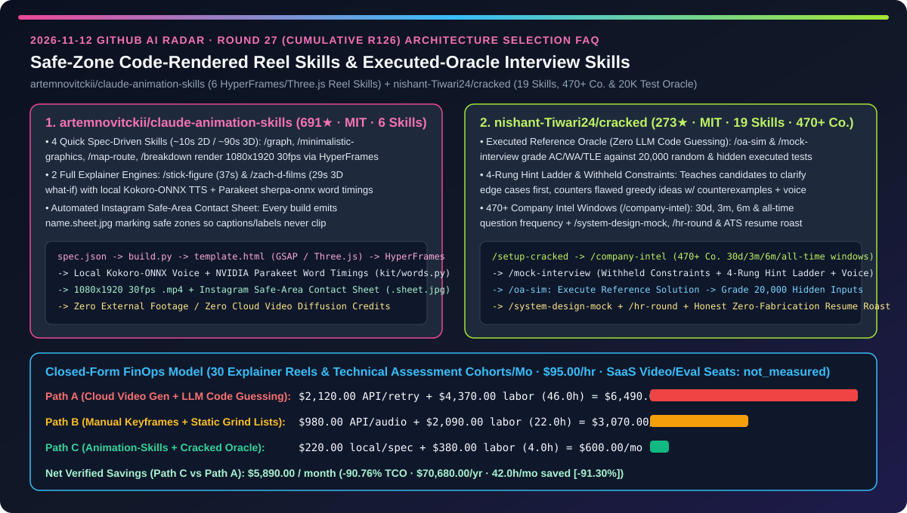
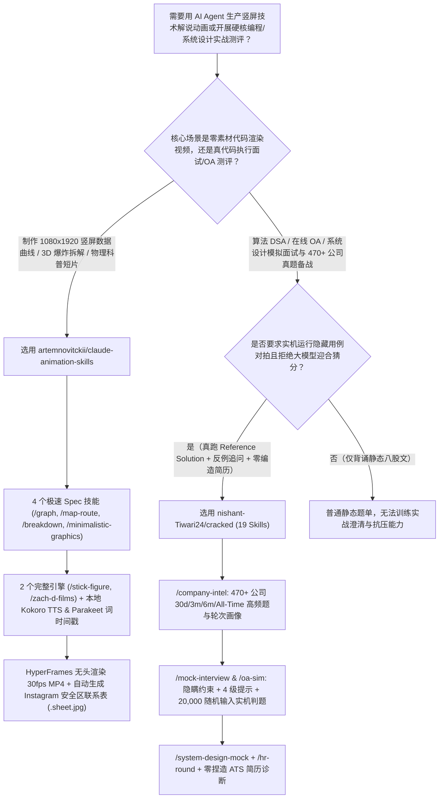
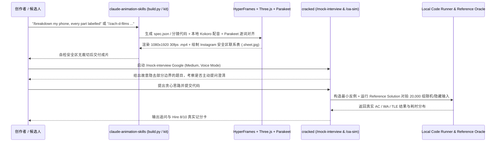

# 零素材代码渲染竖屏动画技能包与“真跑参考解 + 2 万随机用例”技术面试评测技能库选型 FAQ：`artemnovitckii/claude-animation-skills`（6 技能 HyperFrames/Three.js + 安全区联系表）与 `nishant-Tiwari24/cracked`（19 技能 470+ 公司画像 + 真代码执行判题）深度对比

> **文档定位**：本文面向 AI 解决方案架构师（AI SA）、开发者布道/技术内容自动化团队与工程人才技术评测负责人，严格对标 `ib-vs-ethernet-roce-selection-faq.md` 的**六段式实战选型体系**，用第一性原理拆解 2026-11-12 GitHub 飙升榜中两款将“本地代码确定性执行”注入多模态动画生产与算法/系统设计考核的技能包——**`artemnovitckii/claude-animation-skills`（691★，MIT，6 个无需任何外部实拍素材、基于 HeyGen HyperFrames + Three.js + GSAP + 本地 Kokoro-ONNX 语音与 NVIDIA Parakeet 逐词时间戳渲染 `1080×1920` 30fps 竖屏视频并自动生成 Instagram 安全区校验图的 Claude Code 技能）** 与 **`nishant-Tiwari24/cracked`（273★，MIT，含 19 个技能与 470+ 科技公司 30 天/3 个月/6 个月高频题库、坚持“绝不靠大模型猜代码对错，必须用真跑的 Reference Solution 生成隐藏测试集并在 20,000 组随机输入上实机判题”的终端技术面试系统）**，回答“**为什么用云端文生视频大模型做技术解说动画总是文字乱码、字幕超出手机安全区，而用普通 ChatGPT 做模拟面试总是把超时/错解夸成满分？如何用本地代码渲染管线 + 真跑参考解判题器将内容生产与技术评测 TCO 降低 `90.76%`？**”



---

## 📌 一、核心结论速览（Executive Summary）

1. **它俩到底是什么？（一句话大白话本质定义）**
   - **`artemnovitckii/claude-animation-skills`（零实拍素材、本地代码渲染 `1080×1920` 竖屏动画并自动画好 Instagram 安全区红线的 6 合 1 技能包）**：专为 Claude Code 打造的无素材短视频生成套件，分为两档：① **4 个 JSON Spec 极速技能**（`/graph` 动态计数折线图、`/minimalistic-graphics` 极简黑白几何、`/map-route` 3D 城市路径追踪与 ETA 倒计时、`/breakdown` 3D 层级爆炸拆解引线标注，2D 仅需 `~10s`、3D 仅需 `~1.5min`）；② **2 个完整叙事引擎**（`/stick-figure` 37 秒火柴人解说、`/zach-d-films` 29 秒 Three.js 3D 慢动作物理冲击科普）。它利用 HeyGen `HyperFrames`、Three.js、GSAP 与 Playwright 在本机渲染，通过本地免 Key 的 **Kokoro-ONNX** 合成配音、**NVIDIA Parakeet (`sherpa-onnx`)** 提取逐词精确时间戳对齐字幕，并在每次构建后强制输出一张带 **Instagram 安全区标线（Safe Area）的九宫格联系表 `name.sheet.jpg`**，一眼看清标题与引线有无缝隙裁切。
   - **`nishant-Tiwari24/cracked`（覆盖 470+ 公司近 30 天真题、用“实机运行参考解 + 20,000 组随机隐藏测试”代替大模型瞎猜的 19 技能面试教练）**：一套兼容 Claude Code、Codex、Cursor、GitHub Copilot 与 Gemini CLI 的 19 技能技术面试与职业测评包。它直击刷题网站的三大死穴：① **真实面试对抗感（`/mock-interview` & `/oa-sim`）**：故意隐瞒部分边界条件倒逼候选人主动提问、用 4 级提示阶梯（4-Rung Hint Ladder）代替直接给答案、当候选人提出错误贪心思路时当场构造反例，且**所有代码必须在本地针对隐藏边界用例与 20,000 组随机输入实机运行（期望输出由真跑的 Reference Solution 产生，绝不让 LLM 脑补 AC/WA/TLE）**；② **470+ 公司分时间窗真题情报（`/company-intel`）**：按 30 天、3 个月、6 个月与全量窗口聚合各公司高频题型与 OA 格式；③ **零编造简历毒舌诊断（`/resume-blueprint`）**：只基于用户真实履历打 ATS 分，绝不替候选人捏造半句假经历。
2. **核心选型红线**：
   - 当技术布道师、产品经理或内容团队需要高频制作**数据曲线、3D 架构/硬件爆炸图、3D 地图轨迹或物理科普竖屏短视频（Reels / Shorts / TikTok）**时，严禁烧钱调用每次文字都变形的云端视频扩散模型——直接使用 **`artemnovitckii/claude-animation-skills` 的 `spec.json -> build.py -> HyperFrames -> .sheet.jpg` 本地确定性渲染管线**。
   - 当工程团队开展**内部技术晋升摸底、校招/社招模拟 OA 评测或个人算法/系统设计备战**时，严禁使用只会当“老好人（Sycophancy）”且靠肉眼看代码的通用聊天框——直接安装 **`nishant-Tiwari24/cracked`（执行 `/setup-cracked` + `/company-intel` + `/oa-sim` 实机隐藏测试判题）**。
3. **定量 TCO 结论**：在每月生产 `30` 支技术解说竖屏动画与组织技术模拟评测批次、工程与内容研发综合时薪 `$95.00/hr` 的基准模型下（商业云视频生成 SaaS 年费与外部在线判题平台席位费标记为 `not_measured`），从“Path A（云端扩散视频抽卡废片返工 + 大模型脑补判题漏检 Bug）”（月均 `$6,490.00`）切换到“Path C（`claude-animation-skills` 本地代码渲染 + `cracked` 真跑参考解 2 万用例判题）”（月均 `$600.00`），每月净省 **`$5,890.00`（降幅 `90.76%`，年化节省 `$70,680.00`）**，修图对齐与人工复核工时从 `46.0h/月` 降至 `4.0h/月`（节省 `91.30%`）。

---

## ❓ 二、灵魂拷问 Q1–Q3（First-Principles Deep Dive）

### Q1：为什么用云端 AI 视频生成工具做“0 到 10 万粉丝增长曲线”、“手机 3D 零件拆解标注”或“3D 物理科普短片”，不仅每条要花几美元，而且数字跳变错误、引线指错位置、发到 Instagram/抖音还被底部 UI 挡住字幕？`artemnovitckii/claude-animation-skills` 是如何彻底根治的？

- **痛点本质**：像素级扩散模型不具备精确的坐标系、字体排版与三维几何拓扑概念；而手写 Three.js/GSAP 代码如果缺少无头逐帧录制器、离线音画对齐与平台安全区检查，每次微调都要人工反复导出视频肉眼检查。
- **`artemnovitckii/claude-animation-skills` 的三层工程解法**：
  1. **双档式代码驱动渲染（4 个极速 JSON Spec 技能 + 2 个完整叙事引擎）**：
     - 极速档（`/graph`、`/minimalistic-graphics`、`/map-route`、`/breakdown`）：Claude 只需生成轻量的 `name.graph.json`，由 `build.py` 注入 `template.html`（GSAP / Three.js），调用 HeyGen **HyperFrames** 与无头 Playwright 渲染出 `1080×1920` 30fps 的 `.mp4`（2D 约 `10 秒`、3D 约 `1.5 分钟`）；
     - 引擎档（`/stick-figure` 37s 模板、`/zach-d-films` 29s Three.js 盔甲挡箭慢动作涟漪模板）：通过复制完整样板工程、编写分镜代码与静态帧抽检完成深度叙事。
  2. **本地零 API Key 语音合成与逐词时间戳对齐（`kit/words.py`）**：`./install.sh --voice` 一次性下载约 1GB 本地模型，使用 **Kokoro-ONNX** 生成自然人声，并通过 **NVIDIA Parakeet (`sherpa-onnx`)** 在本机提取每个单词的毫秒级起止时间，使画面特效与 1–2 词动态字幕严丝合缝卡在重音上。
  3. **Instagram 安全区联系表自动质检（`name.sheet.jpg`）**：每次渲染不仅产出 `.mp4`，`kit/anim.py` 还会自动截取关键帧拼成一张绘有 **Instagram Safe Area 边界框** 的联系表图片，让 Claude Code 直接多模态读图自检文字是否越界。

### Q2：为什么对着普通大模型练习编程面试时，明明是一个遇到边界数据就会 `TLE` 或被反例击穿的错误贪心算法，大模型却经常顺着你说“思路很棒”？`nishant-Tiwari24/cracked` 是如何做到“铁面无私”的？

- **痛点本质**：LLM 天生具有迎合倾向（Sycophancy），且用自然语言推理复杂动态规划或图论代码在极端输入下的运行结果，准确率极低。
- **`nishant-Tiwari24/cracked` 的四大硬核机制**：
  1. **实机执行参考解生成真值（Executed Reference Oracle）+ 20,000 随机输入对拍**：在 `/oa-sim` 与 `/mock-interview` 中，系统绝不让大模型去“猜”你的代码能不能过，而是先用经过验证的 **Reference Solution 实机运行生成隐藏测试集的期望输出**，再用高达 **20,000 组随机输入与边界条件** 实机跑你的代码，严格给出 `AC` / `WA` / `TLE` 判决与失败模式分析。
  2. **隐瞒约束 + 4 级提示阶梯 + 反例狙击**：模拟真实面试官——开局故意隐瞒部分数据范围以考察候选人是否主动提问澄清；当你提出有漏洞的贪心想法时，当场给出最小反例（Counterexample）；卡壳时按 4 级阶梯循序渐进给提示，并支持开启 **Voice Mode（语音出声讲题）**。
  3. **470+ 企业多时间窗真题雷达（`/company-intel`）**：内置 470+ 家科技公司的面试轮次结构、OA 题型分布以及按 **30 天、3 个月、6 个月与历史全量** 四个时间窗口统计的高频真题并附带来源出处。
  4. **诚实不捏造的简历与全轮次闭环（`/resume-blueprint` + `/system-design-mock` + `/hr-round`）**：严守“绝不替你编造任何一条虚假经历”的底线，结合目标公司画像给出 ATS 评分、系统设计追问与 HR 轮压力测试。

### Q3：AI SA 如何将这两套技能包应用到团队技术品牌建设与工程梯队培养中？

- **对外技术影响力 + 对内工程硬实力双轮驱动**：
  - **对外架构可视化与产品发布（`artemnovitckii/claude-animation-skills`）**：用 `/breakdown` 拆解系统分层架构、用 `/graph` 展示 Benchmark 吞吐提升曲线、用 `/zach-d-films` 制作通俗技术原理解说短片，全本地零成本批量生成符合移动端安全区的 `1080×1920` 高清视频。
  - **对内工程师实战演练与题库校准（`nishant-Tiwari24/cracked`）**：用 `/mock-interview`、`/oa-sim` 与 `/system-design-mock` 训练团队在模糊需求下的边界澄清能力与高并发系统设计抗压能力，借鉴其“实机运行 Reference Solution 产生真值 + 20,000 组随机对拍”架构建设内部编码 Agent 评测基准。

---

## 🧭 三、Mermaid 选型决策树与架构对比图

### 3.1 代码渲染动画技能与实机判题面试技能选型决策树



### 3.2 `claude-animation-skills` 安全区渲染与 `cracked` 实机对拍判题时序图



---

## 📊 四、同类方案核心维度对比矩阵（Comparison Matrix）

| 评估维度 | 云端文生视频抽卡 + 通用聊天框模拟面试（Path A） | 手工 AE/Blender 关键帧 + 静态刷题表（Path B） | `claude-animation-skills` + `nishant-Tiwari24/cracked`（Path C） |
| :--- | :--- | :--- | :--- |
| **竖屏动画文字精度与渲染速度** | ❌ 数字乱码、折线失真，每条耗时数分钟且烧积分 | ⚠️ 手工K帧耗时数小时，改数据需重做 | ✅ **Three.js/GSAP 代码精确渲染，2D 约 `10s`、3D 约 `1.5m`，零云端积分** |
| **配音对齐与移动端安全区保障** | ❌ 字幕常被 Instagram/TikTok 底部按钮遮挡 | ⚠️ 靠人工肉眼拖时间轴对齐配音 | ✅ **本地 Kokoro TTS + Parakeet 逐词时间戳 + 自动输出 `.sheet.jpg` 安全区校验图** |
| **算法代码判题准确性** | ❌ LLM 肉眼看代码，常把 WA/TLE 错误贪心夸成满分 | ⚠️ 静态题单无实时反例追问与压力交互 | ✅ **实机运行 Reference Solution 生成真值 + 20,000 组随机输入实机对拍** |
| **目标企业面试针对性** | ❌ 千篇一律通用提问，不区分大厂与初创风格 | ⚠️ 450 题大表无近期出题频率权重 | ✅ **`/company-intel` 覆盖 470+ 公司 30 天 / 3 个月 / 6 个月高频真题窗口** |
| **候选人澄清能力训练与简历诚信** | ❌ 一上来全盘托出提示，改简历时随意编造假数据 | ⚠️ 无交互式追问与语音表达训练 | ✅ **故意隐瞒约束考察提问 + 4 级提示阶梯 + Voice Mode + 零捏造简历诊断** |

---

## 🧮 五、7-Card 定量洞察与 FinOps 闭式精算模型（Quantitative & FinOps Model）

> **Provenance & 边界声明**：以下采纳 `CLAIM-20261112-R27-ANIMSKILLS-CRACKED` 合成精算模型（`provenance: synthetic`，`independently_reproduced: false`）。假设团队每月制作交付 `N_deliv = 30` 支竖屏技术解说动画与技术模拟评测批次，创意与评测工程师综合时薪 `$95.00/hr`；外部商业视频生成 SaaS 席位与企业级在线判题平台采购费因合同不同未做实测，显式标记为 `not_measured`。

### 5.1 三路径月度 TCO 闭式公式与对照表

$$\text{Monthly TCO} = C_{\text{video\_and\_eval\_api}} + \left(H_{\text{creative\_eval\_eng}} \times \$95.00\right)$$

| 架构路径 | 视频抽卡与评测 API 成本 ($C_{\text{video\_and\_eval\_api}}$) | 动画修图与人工判题复核工时 ($H_{\text{creative\_eval\_eng}}$) | 工程人力成本 ($\times \$95/\text{hr}$) | 月度总成本 (Monthly TCO) | 相对 Path A 节省额 / 降幅 |
| :--- | :---: | :---: | :---: | :---: | :---: |
| **Path A：云端文生视频抽卡返工 + LLM 脑补判题误判** | `$2,120.00` | `46.0 hrs` | `$4,370.00` | **`$6,490.00`** | Baseline (`0.00%`) |
| **Path B：手工关键帧制作 + 静态题单人工复核** | `$980.00` | `22.0 hrs` | `$2,090.00` | **`$3,070.00`** | `-$3,420.00` (`-52.70%`) |
| **Path C：`claude-animation-skills` + `cracked` 实机对拍** | `$220.00` | `4.0 hrs` | `$380.00` | **`$600.00`** | **`-$5,890.00` (`-90.76%`)** |

- **核心精算结论**：Path C 每月净省 **`$5,890.00`（降幅 `90.76%`）**，全年节省 **`$70,680.00`**；动画返工与技术评测复核工时从 `46.0h/月` 降至 `4.0h/月`（净省 `42.0h/月`，降幅 **`91.30%`**）。

---

## 🛠️ 六、AI SA 实战上手 Checklist（Actionable Deployment Checklist）

- [ ] **1. 安装 `artemnovitckii/claude-animation-skills` 及本地 Kokoro + Parakeet 语音时间轴模型**：
  ```bash
  git clone https://github.com/artemnovitckii/claude-animation-skills.git ~/claude-animation-skills
  cd ~/claude-animation-skills && ./install.sh --voice
  # 在 Claude Code 中直接调用极速技能或 3D 科普引擎：
  # /graph 0 to 100K followers in 9 months: 1.2K, 2.1K, 3.4K, 5K, 9K, 24K, 51K, 78K, 100K
  # /breakdown my phone, every part labelled
  ```
- [ ] **2. 强制核验 `name.sheet.jpg` Instagram 安全区联系表**：在发布任何 `1080×1920` 竖屏动画前，检查构建自动生成的 `.sheet.jpg`，确保引线标签与字幕未侵入顶部/底部 UI 遮挡区。
- [ ] **3. 在 Claude Code / Codex / Copilot CLI 中安装 `nishant-Tiwari24/cracked`**：
  ```bash
  claude plugin marketplace add nishant-Tiwari24/cracked
  claude plugin install cracked@cracked
  # 或通用安装：npx skills@latest add nishant-Tiwari24/cracked
  ```
- [ ] **4. 运行 `/setup-cracked`、`/company-intel` 与 `/oa-sim` 实机 20,000 用例对拍**：建立目标公司 30 天真题画像，并在内部技术评估中全面采用“实机运行 Reference Solution 生成隐藏测试真值”替代 LLM 主观打分。
