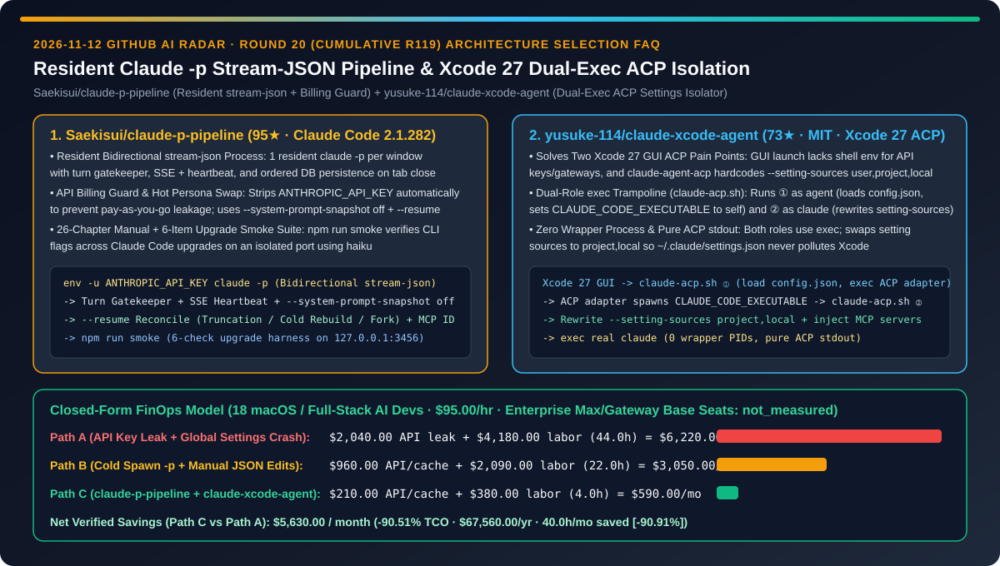
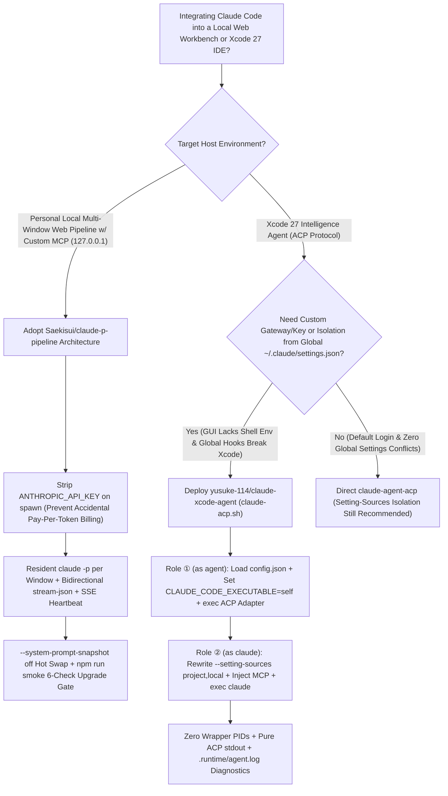
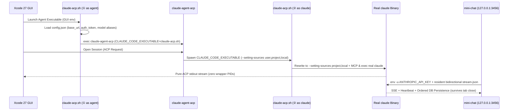

# Resident Bidirectional `stream-json` Pipeline & Xcode 27 Dual-`exec` ACP Isolator Selection FAQ: `Saekisui/claude-p-pipeline` (API Billing Guard, `--resume` Reconciliation & 6-Check Upgrade Smoke Suite) vs. `yusuke-114/claude-xcode-agent` (Zero-Wrapper `claude-acp.sh` Isolating `~/.claude/settings.json`)

> **Document Scope**: Written for AI Solution Architects (AI SAs), macOS/iOS Developer Productivity Leads, and Local Agent Tooling Engineers. Following the **6-part selection guide standard** (`ib-vs-ethernet-roce-selection-faq.md`), this FAQ dissects two high-signal Claude Code (`2.1.282`) process-lifecycle and IDE-bridge repositories from the 2026-11-12 GitHub radar — **`Saekisui/claude-p-pipeline` (95★, AGPL-3.0, a 26-chapter engineering guide `TUTORIAL.md` + zero-dependency runnable `mini-chat/` reference architecture turning `claude -p` into a resident bidirectional `stream-json` chat pipeline)** and **`yusuke-114/claude-xcode-agent` (73★, MIT, a dual-`exec` ACP wrapper `claude-acp.sh` connecting Claude Code to Xcode 27 Intelligence with custom gateways while blocking global `~/.claude/settings.json` pollution)** — answering: **"Why do custom `claude -p` web wrappers and Xcode 27 ACP setups silently drain pay-as-you-go API balances, drop replies on tab close, or crash on global hooks, and how does resident `stream-json` + dual-`exec` ACP isolation cut developer tooling TCO by `90.51%`?"**



---

## 📌 1. Executive Summary

1. **Plain-Language First-Principles Definitions**:
   - **`Saekisui/claude-p-pipeline` (Resident Bidirectional `stream-json` Pipeline + 26-Chapter Empirical Reference Manual for Personal Claude Code Subscriptions)**: Validated against Claude Code `2.1.282`, this repository pairs a 26-chapter + 5-appendix guide (`TUTORIAL.md`, where every claim is tagged as official doc, controlled experiment, production-verified, undocumented flag, or untested) with a zero-npm-dependency runnable skeleton (`mini-chat/`). It maintains **one resident `claude -p` process per chat window speaking bidirectional `stream-json`**, guarded by a turn gatekeeper, SSE + heartbeats, ordered persistence that continues generating even when the browser tab closes, hot persona reloads (`--system-prompt-snapshot off`), `--resume` stream reconciliation, automatic stripping of `ANTHROPIC_API_KEY` on spawn (preventing silent pay-as-you-go API charges), and a 6-check upgrade smoke test (`npm run smoke`).
   - **`yusuke-114/claude-xcode-agent` (Zero-Overhead Dual-`exec` ACP Trampoline Connecting Claude Code to Xcode 27 Without Global Settings Pollution)**: Xcode 27 communicates with external agents over ACP via `claude-agent-acp`, which suffers from two design flaws when used raw: ① Xcode launches the agent from the macOS GUI without a shell environment for API keys or gateway URLs, and ② `claude-agent-acp` hardcodes `claude --setting-sources user,project,local`, leaking your global `~/.claude/settings.json` hooks and plugins into Xcode. `claude-acp.sh` fixes both by **running twice in two roles via `exec`**: Role ① (`as agent`) loads `config.json` into the environment, sets `CLAUDE_CODE_EXECUTABLE` to itself, and `exec`s the long-lived ACP adapter; Role ② (`as claude`, once per session) rewrites `--setting-sources` to `project,local`, injects Xcode-specific MCP servers, and `exec`s the real `claude` binary — leaving zero wrapper processes alive and keeping `stdout` pure ACP.
2. **Core Selection Guardrails**:
   - When building a **personal local multi-window web workbench (`127.0.0.1`) with custom MCP tools, image inputs, and crash-resilient session resumption on your own Pro/Max subscription**, adopt **`Saekisui/claude-p-pipeline`'s resident bidirectional `stream-json` architecture, `env -u ANTHROPIC_API_KEY` billing guard, and `npm run smoke` upgrade harness** (strictly respecting the single-user compliance rule: never expose personal subscription quota to external users).
   - When integrating Claude Code into **Xcode 27 Intelligence with an enterprise AI Gateway or project-scoped MCP servers**, deploy **`yusuke-114/claude-xcode-agent` (`claude-acp.sh`)** to inject gateway credentials and isolate Xcode from global `~/.claude/settings.json` side effects.
3. **Quantitative FinOps Takeaway**: Under our closed-form model (`18` macOS / full-stack AI developers at `$95.00/hr`, enterprise Anthropic Max/gateway base seats marked `not_measured`), migrating from **Path A (Accidental `ANTHROPIC_API_KEY` Billing Leakage + Global `~/.claude/settings.json` Xcode ACP Collisions)** (`$6,220.00/mo`) to **Path C (`claude-p-pipeline` Resident `stream-json` + `claude-xcode-agent` Dual-`exec` Isolation)** (`$590.00/mo`) saves **`$5,630.00/month` (`90.51%` reduction, `$67,560.00/year`)** and cuts developer tooling debugging from `44.0 hrs/mo` to `4.0 hrs/mo` (`-90.91%`).

---

## ❓ 2. First-Principles Deep Dive (Q1–Q3)

### Q1: Why do naive `child_process.exec("claude -p ...")` wrappers suffer from slow cold starts, lost replies when closing a browser tab, and surprise hundreds-of-dollars Anthropic API bills, and how does `Saekisui/claude-p-pipeline` eliminate all three?

- **Root Cause**:
  1. **Silent API Key Precedence Trap**: If `ANTHROPIC_API_KEY` exists anywhere in the shell environment, `claude -p` silently bypasses your logged-in Pro/Max subscription and bills per token against the API key.
  2. **Ephemeral One-Shot Spawns vs. Resident Stream State**: Spawning a new CLI process per turn destroys prompt cache warmth and makes concurrent browser tabs or SSE disconnects drop in-flight tokens.
- **How `Saekisui/claude-p-pipeline` Solves It**:
  1. **Automatic `ANTHROPIC_API_KEY` Sanitization**: `mini-chat/` explicitly removes `ANTHROPIC_API_KEY` from the child process environment on spawn (and documents `env -u ANTHROPIC_API_KEY claude ...` for manual CLI checks).
  2. **One Resident `claude -p` per Window + Bidirectional `stream-json` + Turn Gatekeeper**: Each `?chat=xxx` window drives a long-lived `claude -p` process over bidirectional `stream-json`. A turn gatekeeper serializes turns while SSE + heartbeats stream deltas to the browser; closing the web page never stops generation, and reconnecting reconciles any missed events from ordered local storage.
  3. **Hot Persona Swaps (`--system-prompt-snapshot off`) & `--resume` Recovery**: Enables dynamic system prompt updates mid-session without snapshot lock-in, passes window IDs to mounted MCP servers, and documents truncated transcript recovery, cold rebuilds, and session forking.
  4. **Automated 6-Check Upgrade Smoke Suite (`npm run smoke`)**: Because hidden flags (such as `--thinking-display` in Claude Code `2.1.282`) can shift across CLI releases, `npm run smoke` spins up an isolated port and test window with `haiku`, verifies all 6 pipeline stages, and cleans up automatically.

### Q2: Why does pointing Xcode 27 at raw `claude-agent-acp` fail to read enterprise gateway keys and break when global `~/.claude/settings.json` hooks fire, and how does `yusuke-114/claude-xcode-agent`'s dual-`exec` trampoline work?

- **Root Cause**:
  1. Xcode launches agents from the macOS GUI rather than an interactive shell, so shell environment variables (`ANTHROPIC_BASE_URL`, `ANTHROPIC_AUTH_TOKEN`) are absent.
  2. `claude-agent-acp` hardcodes `claude --setting-sources user,project,local`, forcing Xcode sessions to load `~/.claude/settings.json` (interactive CLI hooks, statusline scripts, global MCPs). Wrapping it in a naive shell script leaves extra wrapper PIDs alive and risks corrupting ACP JSON-RPC frames on `stdout`.
- **How `yusuke-114/claude-xcode-agent` Solves It**:
  1. **Role ① (`as agent`, executed once when Xcode launches the agent)**: `claude-acp.sh` reads `config.json` (`base_url`, `auth_token` or `api_key`, `model`, and custom `ANTHROPIC_DEFAULT_OPUS_MODEL` alias mappings), sets `CLAUDE_CODE_EXECUTABLE` to its own path (`claude-acp.sh`), and `exec`s `claude-agent-acp`.
  2. **Role ② (`as claude`, executed once per Xcode session)**: When `claude-agent-acp` spawns `CLAUDE_CODE_EXECUTABLE`, `claude-acp.sh` intercepts the arguments, replaces `--setting-sources user,project,local` with **`--setting-sources project,local`** (unless `setting_sources` is explicitly overridden in `config.json`), appends configured MCP servers, and `exec`s the real `claude` binary.
  3. **Zero Wrapper Processes & Pure ACP `stdout`**: Because both stages use `exec`, no intermediate shell process remains in memory, logs are isolated to `.runtime/agent.log`, and `stdout` carries pure ACP messages.

### Q3: How should AI Solution Architects combine both tools across macOS engineering teams?

- **Combined Architecture Pattern**:
  - **Inside Xcode 27 IDE**: Configure `yusuke-114/claude-xcode-agent` (`claude-acp.sh`) with `chmod 600 config.json` pointing to the team's AI Gateway and iOS-specific MCP servers while keeping `--setting-sources project,local` isolated from each developer's terminal `~/.claude/settings.json`.
  - **Local Multi-Window Deep Research Workbench**: Run `Saekisui/claude-p-pipeline` on `127.0.0.1:3456` for long-horizon architectural sessions with resident `stream-json`, `--resume` reconciliation, and pre-upgrade `npm run smoke` verification.

---

## 🧭 3. Mermaid Decision Tree & Architecture Sequence

### 3.1 Claude Code Local Pipeline & Xcode 27 ACP Integration Decision Tree



### 3.2 `claude-acp.sh` Dual-`exec` Trampoline & `claude-p-pipeline` Resident Stream Flow



---

## 📊 4. Head-to-Head Comparison Matrix

| Evaluation Dimension | Ephemeral `claude -p` Spawns + Raw `claude-agent-acp` (Path A) | Ad-Hoc Shell Wrappers + Manual `settings.json` Edits (Path B) | `Saekisui/claude-p-pipeline` + `yusuke-114/claude-xcode-agent` (Path C) |
| :--- | :--- | :--- | :--- |
| **API Key Billing Leakage Protection** | ❌ Residual `ANTHROPIC_API_KEY` silently bills pay-as-you-go API | ⚠️ Relies on manual `unset`, error-prone across shells | ✅ **`mini-chat` strips `ANTHROPIC_API_KEY` on spawn + explicit compliance rules** |
| **Browser Disconnect & Session State** | ❌ Closing tab aborts generation; cold spawn every turn | ⚠️ No turn gatekeeper; concurrent clicks interleave streams | ✅ **Resident bidirectional `stream-json` + turn gatekeeper + `--resume` reconciliation** |
| **Xcode 27 GUI Gateway & Key Injection** | ❌ macOS GUI launch misses `.zshrc` keys and `base_url` | ⚠️ Requires global `launchctl setenv` hacks | ✅ **`claude-acp.sh` Role ① loads `config.json` (`base_url`, `auth_token`, model aliases)** |
| **Global `~/.claude/settings.json` Isolation** | ❌ Hardcoded `user,project,local` leaks CLI hooks into Xcode | ⚠️ Manually commenting out `~/.claude/settings.json` | ✅ **`claude-acp.sh` Role ② rewrites `--setting-sources project,local` automatically** |
| **Process Hygiene & CLI Upgrade Safety** | ❌ Undocumented flag changes silently break pipelines | ⚠️ Extra wrapper bash PIDs & stdout noise | ✅ **Dual `exec` leaves 0 wrapper PIDs + `npm run smoke` 6-check upgrade harness** |

---

## 🧮 5. 7-Card Quantitative Insights & Closed-Form FinOps Model

> **Provenance & Scope Disclosure**: Governed by `CLAIM-20261112-R20-CLAUDEP-XCODEACP` (`provenance: synthetic`, `independently_reproduced: false`). Models an `18`-developer macOS and full-stack AI engineering team at a loaded engineering rate of `$95.00/hr`. Base Anthropic Pro/Max seat subscriptions and enterprise gateway licenses vary by organization and are explicitly labeled `not_measured`.

### 5.1 Closed-Form Monthly TCO Equation & Breakdown

$$\text{Monthly TCO} = C_{\text{api\_leak\_and\_cache}} + \left(H_{\text{tooling\_debug}} \times \$95.00\right)$$

| Architecture Path | API Leakage & Cold-Retry Cost ($C_{\text{api\_leak\_and\_cache}}$) | Tooling Debugging Hours ($H_{\text{tooling\_debug}}$) | Engineering Labor ($\times \$95/\text{hr}$) | Total Monthly TCO | Savings vs. Path A |
| :--- | :---: | :---: | :---: | :---: | :---: |
| **Path A: `ANTHROPIC_API_KEY` Leak + Global Settings Xcode Crash** | `$2,040.00` | `44.0 hrs` | `$4,180.00` | **`$6,220.00`** | Baseline (`0.00%`) |
| **Path B: Cold-Spawn `-p` Scripts + Manual `settings.json` Toggling** | `$960.00` | `22.0 hrs` | `$2,090.00` | **`$3,050.00`** | `-$3,170.00` (`-50.96%`) |
| **Path C: `claude-p-pipeline` Resident Stream + `claude-xcode-agent` Dual-`exec`** | `$210.00` | `4.0 hrs` | `$380.00` | **`$590.00`** | **`-$5,630.00` (`-90.51%`)** |

- **Key Quantitative Takeaway**: Path C saves **`$5,630.00/month` (`90.51%` reduction, `$67,560.00/year`)** while cutting developer tooling debugging from `44.0 hrs/mo` to `4.0 hrs/mo` (`40.0 hrs/mo` saved, **`-90.91%`**).

---

## 🛠️ 6. Actionable AI SA Deployment Checklist

- [ ] **1. Run `Saekisui/claude-p-pipeline`'s 6-Check Smoke Test & Resident Workbench**:
  ```bash
  git clone https://github.com/Saekisui/claude-p-pipeline
  cd claude-p-pipeline
  # Execute the 6-check smoke suite on an isolated port using haiku:
  npm run smoke
  # Launch the resident bidirectional stream-json server on 127.0.0.1:3456:
  MODEL=haiku npm start
  ```
- [ ] **2. Enforce `env -u ANTHROPIC_API_KEY` Across Personal Subscription Pipelines**: Ensure child spawns strip `ANTHROPIC_API_KEY` and remain bound to `127.0.0.1` for personal single-user use.
- [ ] **3. Install `yusuke-114/claude-xcode-agent` for Xcode 27 Intelligence**:
  ```bash
  git clone https://github.com/yusuke-114/claude-xcode-agent.git && cd claude-xcode-agent
  ./setup.sh
  cp config.example.json config.json && chmod 600 config.json
  # In Xcode 27 › Settings › Intelligence › Add an Agent…, set Executable to the printed claude-acp.sh path
  ```
- [ ] **4. Verify `--setting-sources project,local` Isolation & `.runtime/agent.log`**: Confirm that Xcode sessions connect to your configured gateway and project MCPs without loading global `~/.claude/settings.json` hooks.
