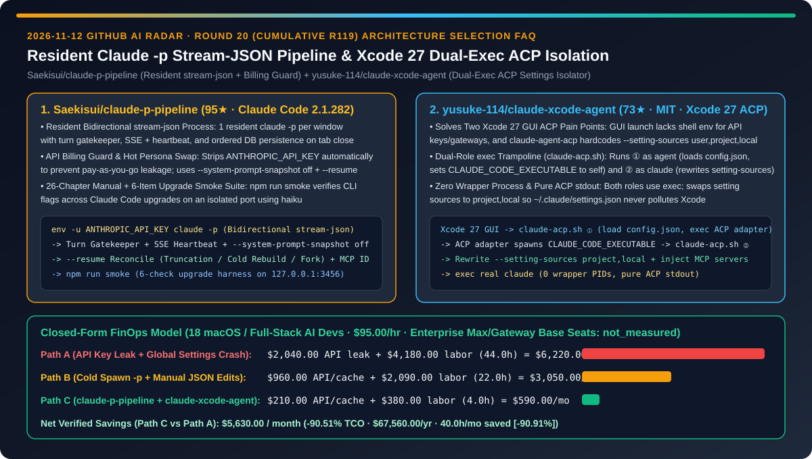
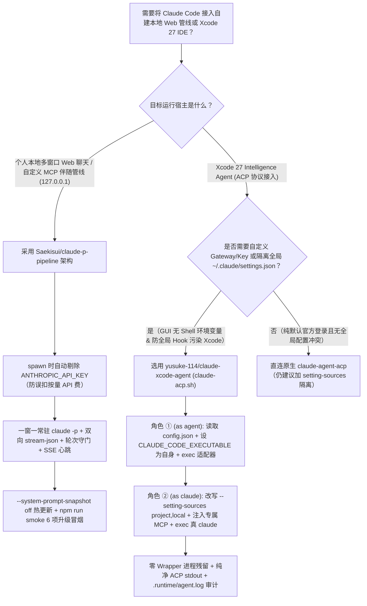
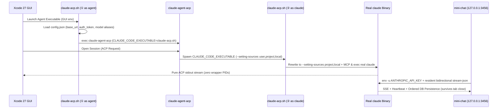

# 常驻双向 `stream-json` 聊天管线与 Xcode 27 双重 `exec` ACP 隔离器选型 FAQ：`Saekisui/claude-p-pipeline`（防 API 误扣费 + 断线续接 + 6 项升级冒烟）与 `yusuke-114/claude-xcode-agent`（脱离全局 `~/.claude/settings.json` 污染的 `claude-acp.sh` 跳板）深度对比

> **文档定位**：本文面向 AI 解决方案架构师（AI SA）、macOS/iOS 研发效能负责人与本地 Agent 工具链开发者，严格对标 `ib-vs-ethernet-roce-selection-faq.md` 的**六段式实战选型体系**，用第一性原理拆解 2026-11-12 GitHub 新仓黑马榜中两款针对 Claude Code（`2.1.282`）底层进程生命周期与 IDE 协议桥接的硬核工程项目——**`Saekisui/claude-p-pipeline`（95★，AGPL-3.0，含 26 章实战手册 `TUTORIAL.md` 与零依赖可运行骨架 `mini-chat/` 的常驻双向 `stream-json` 管线）** 与 **`yusuke-114/claude-xcode-agent`（73★，MIT，通过双重 `exec` 解决 Xcode 27 GUI 启动丢失环境变量与 `~/.claude/settings.json` 全局污染的 ACP 桥接器）**，回答“**为什么自己用 `claude -p` 搭本地工作台或接 Xcode 27 时，总是偷偷扣掉按量 API 余额、关掉网页就丢回复、或者被全局 Hook 把 Xcode 搞崩？如何把研发工具链 TCO 降低 `90.51%`？**”



---

## 📌 一、核心结论速览（Executive Summary）

1. **它俩到底是什么？（一句话大白话本质定义）**
   - **`Saekisui/claude-p-pipeline`（个人订阅专属的常驻双向 `stream-json` 流式管线与 26 章排障百科）**：一套基于 Claude Code `2.1.282` 实测对账的 26 章 + 5 附录工程指南（`TUTORIAL.md`，逐条标注“官方文档 / 对照实验 / 生产实跑 / 隐藏参数 / 未实测”）与零依赖 Node.js 18+ 参考实现（`mini-chat/`）。它实现**一窗一常驻 `claude -p` 进程 + 双向 `stream-json` 通信 + 轮次守门 + SSE 心跳 + 关网页不停生成 + `--system-prompt-snapshot off` 人格热更新 + `--resume` 断线续接/冷重建**，并在 spawn 子进程时**自动剔除 `ANTHROPIC_API_KEY`（防止误走按量 API 计费）**，配套 `npm run smoke` 6 项自动冒烟测试防升级翻车。
   - **`yusuke-114/claude-xcode-agent`（Xcode 27 Intelligence Agent 的零残留双重 `exec` ACP 环境变量与配置隔离器）**：Xcode 27 通过 ACP（Agent Client Protocol）与 `claude-agent-acp` 通信，但原生适配器存在两大硬伤：① Xcode 从 macOS GUI 启动进程，读不到终端 Shell 里的 API Key 或企业 Gateway URL；② 适配器硬编码了 `claude --setting-sources user,project,local`，导致全局 `~/.claude/settings.json` 里的个人插件和 Hooks 强行注入 Xcode 引发冲突。`claude-acp.sh` 用**同一个脚本分饰两角并两次调用 `exec`**（角色 ① 作为 Agent 加载 `config.json` 并把 `CLAUDE_CODE_EXECUTABLE` 指向自身；角色 ② 作为 `claude` 将配置源替换为 `project,local` 并注入专属 MCP），实现**零多余包装进程残留、纯正 ACP `stdout` 输出与全局配置彻底隔离**。
2. **核心选型红线**：
   - 当个人开发者在本地（`127.0.0.1`）用自己的 Pro/Max 订阅搭建**带自定义 MCP、图片收发、断线续接与多窗口并发的私有 Web 助手**时，必须采用 **`Saekisui/claude-p-pipeline` 的双向 `stream-json` 常驻进程 + `env -u ANTHROPIC_API_KEY` 计费护栏 + `npm run smoke` 版本升级验收**（严守合规红线：仅供本人自用，严禁将个人订阅包装成多租户服务对外提供）。
   - 当 iOS/macOS 团队将 Claude Code 接入 **Xcode 27 Intelligence 面板并对接企业内部 AI Gateway 或项目级 MCP** 时，必须使用 **`yusuke-114/claude-xcode-agent` 的 `claude-acp.sh` 双重 `exec` 跳板**，斩断 `~/.claude/settings.json` 对 Xcode 的全局污染。
3. **定量 TCO 结论**：在 `18` 名 macOS / 全栈 AI 工程师日常使用本地 `claude -p` 管线与 Xcode 27 ACP 智能体、工程师时薪 `$95.00/hr` 的基准模型下（企业 Anthropic Max 订阅与网关基础席位费标记为 `not_measured`），从“Path A（`ANTHROPIC_API_KEY` 环境变量未清理导致按量误扣费 + 全局 `settings.json` 弄崩 Xcode 27 ACP）”（月均 `$6,220.00`）切换到“Path C（`claude-p-pipeline` 常驻 `stream-json` + `claude-xcode-agent` 双重 `exec` 隔离）”（月均 `$590.00`），每月净省 **`$5,630.00`（降幅 `90.51%`，年化节省 `$67,560.00`）**，工具链排障工时从 `44.0h/月` 降至 `4.0h/月`（节省 `90.91%`）。

---

## ❓ 二、灵魂拷问 Q1–Q3（First-Principles Deep Dive）

### Q1：很多开发者自己写个简单的 `child_process.exec("claude -p ...")` 包装网页，结果不仅每轮对话冷启动慢得要命、关掉浏览器标签页生成就中断，甚至月底收到几百美元的 Anthropic API 账单。`Saekisui/claude-p-pipeline` 是如何从根源上解决这些坑的？

- **痛点本质**：
  1. **隐式计费优先级陷阱**：只要机器环境变量里残留了 `ANTHROPIC_API_KEY`，`claude -p` 就会静默忽略你的 Pro/Max 订阅登录态，直接按 API Token 扣费；
  2. **一次性进程 vs 常驻双向流**：每轮起新进程不仅丢失进程内连接保温，且一旦前端 SSE 断开或系统提示词变更，极易出现轮次交错（Turn Collision）或系统提示词快照锁死。
- **`Saekisui/claude-p-pipeline` 的四大核心机制**：
  1. **强制剥离 `ANTHROPIC_API_KEY` 计费护栏**：`mini-chat/` 在 `spawn` 子进程时自动删除环境变量中的 `ANTHROPIC_API_KEY`（终端手测也强制规范使用 `env -u ANTHROPIC_API_KEY claude ...`），确保 100% 走个人订阅通道。
  2. **一窗一常驻 `claude -p` + 双向 `stream-json` + 轮次守门（Turn Gatekeeper）**：每个 `?chat=xxx` 窗口对应一个后台常驻 `claude -p` 进程，通过双向 `stream-json` 喂入与接收事件；后端按严格顺序落库并通过 SSE + 心跳推送给前端，**即使关掉网页或刷新浏览器，后台生成绝不中断**，重连后自动对账补齐。
  3. **人格热更新（`--system-prompt-snapshot off`）与 `--resume` 三态恢复**：支持在不丢上下文的前提下动态替换拼装系统提示词，并在教程第四部分详尽给出 `--resume` 截断转录、冷重建与会话分叉的工程范式，同时将窗口 ID 透传给挂载的自定义 MCP。
  4. **面向 CLI 版本漂移的 6 项冒烟测试（`npm run smoke`）**：由于 Claude Code（基准版本 `2.1.282`）的隐藏参数（如 `--thinking-display`）随升级可能变更，`npm run smoke` 默认使用低成本 `haiku` 在独立端口与独立测试窗口跑完 6 项核心能力验收并自动清理。

### Q2：为什么在 Xcode 27 › Settings › Intelligence 里直接添加 `claude-agent-acp` 会连不上自定义 Gateway，还会因为终端里配好的 Claude Code Hooks 导致 Xcode 会话报错？`yusuke-114/claude-xcode-agent` 的“双重 `exec`”妙在哪里？

- **痛点本质**：
  1. macOS GUI 应用（Xcode 27）启动子进程时不继承用户的 `.zshrc` / `.bashrc`，导致 `claude-agent-acp` 拿不到网关地址或 API Key；
  2. `claude-agent-acp` 内部写死了 `claude --setting-sources user,project,local`，会把用户在命令行里折腾的 `~/.claude/settings.json`（比如终端交互式 Hook、不兼容的全局 MCP 或权限拦截器）原封不动带进 Xcode 的 ACP 管道；若用普通 Shell 脚本包装，又会多出一层僵尸 Shell 进程且容易污染 ACP 的 `stdout` 字节流。
- **`yusuke-114/claude-xcode-agent` 的单脚本双角色 `exec` 跳板设计**：
  1. **角色 ①（作为 Agent 启动，每次 Xcode 启动运行 1 次）**：Xcode 启动 `claude-acp.sh`，脚本读取同目录下的 `config.json`（支持 `base_url`、`auth_token` / `api_key`、`model` 及 `ANTHROPIC_DEFAULT_OPUS_MODEL` 网关模型别名映射）注入环境变量，**将 `CLAUDE_CODE_EXECUTABLE` 环境变量指向 `claude-acp.sh` 自己**，然后调用 `exec` 原地替换为长驻的 `claude-agent-acp` 适配器进程。
  2. **角色 ②（作为 `claude` 启动，每个 Xcode 会话运行 1 次）**：当 `claude-agent-acp` 为新会话拉起 `CLAUDE_CODE_EXECUTABLE` 时，再次进入 `claude-acp.sh` 的第二分支——脚本自动把硬编码的 `--setting-sources user,project,local` 改写为 **`--setting-sources project,local`**（彻底屏蔽 `~/.claude/settings.json`，除非在 `config.json` 显式开启），注入专为 Xcode 配置的 MCP 服务器列表，最后再次调用 `exec` 原地替换为真正的 `claude` 二进制进程。
  3. **零包装进程残留与纯净 `stdout`**：由于两次拦截均以 `exec` 结束，操作系统进程树中只有 `claude-agent-acp` 与真正的 `claude`，没有任何多余的 bash 包装进程存活，所有日志写入 `.runtime/agent.log`，保证 ACP `stdout` 零杂音。

### Q3：AI SA 与苹果生态研发团队如何组合这两套工具？

- **推荐组合范式**：
  - **Xcode 27 IDE 内嵌研发助手**：使用 `yusuke-114/claude-xcode-agent` 挂载团队统一 AI Gateway（Bearer / `x-api-key`）与 iOS 工程级 MCP（如 Swift 编译诊断、Simulator 控制），并用 `--setting-sources project,local` 与个人终端配置隔离。
  - **本地长周期伴随式架构推演与多窗工作台**：在 `127.0.0.1:3456` 部署 `Saekisui/claude-p-pipeline` 的 `mini-chat` 架构，利用双向 `stream-json` 常驻进程与 `--resume` 对账机制承载跨小时级的多窗口深度问答，每次升级 Claude Code 后先跑 `npm run smoke`。

---

## 🧭 三、Mermaid 选型决策树与架构对比图

### 3.1 Claude Code 本地管线与 Xcode 27 ACP 接入选型决策树



### 3.2 `claude-acp.sh` 双重 `exec` 跳板与 `claude-p-pipeline` 常驻双向流时序图



---

## 📊 四、同类方案核心维度对比矩阵（Comparison Matrix）

| 评估维度 | 裸调一次性 `claude -p` + 原生直连 `claude-agent-acp`（Path A） | 手写 Shell 包装脚本 + 手工改 `~/.claude/settings.json`（Path B） | `Saekisui/claude-p-pipeline` + `yusuke-114/claude-xcode-agent`（Path C） |
| :--- | :--- | :--- | :--- |
| **API Key 误扣费防护** | ❌ 环境变量残留 `ANTHROPIC_API_KEY` 即静默按量扣费 | ⚠️ 靠人工记得 `unset`，极易遗漏 | ✅ **`mini-chat` spawn 时自动剥离 `ANTHROPIC_API_KEY` + 明确合规边界** |
| **网页断线与多轮会话状态** | ❌ 关网页即断流丢回复，每轮冷启动无保温 | ⚠️ 简易包装无轮次守门，并发点击易串台 | ✅ **一窗一常驻双向 `stream-json` + 轮次守门 + 关网页不停生成 + `--resume` 对账** |
| **Xcode 27 GUI 环境变量与网关接入** | ❌ GUI 启动读不到 `.zshrc` 中的 Key 与 `base_url` | ⚠️ 需修改 macOS 全局 `launchctl setenv`，影响全机 | ✅ **`claude-acp.sh` 角色 ① 从 `config.json` 注入 Gateway/Token 与模型别名映射** |
| **全局 `~/.claude/settings.json` 隔离** | ❌ `claude-agent-acp` 硬编码 `user,project,local` 引发冲突 | ⚠️ 打开 Xcode 前手工注释全局配置，极度繁琐 | ✅ **`claude-acp.sh` 角色 ② 自动改写为 `--setting-sources project,local`** |
| **进程树洁净度与版本升级验证** | ❌ 隐藏 Flag 随版本失效后无感知静默坏掉 | ⚠️ 多层 bash 包装进程残留，杂音污染 ACP `stdout` | ✅ **双重 `exec` 零包装进程残留 + `npm run smoke` 6 项独立端口自动冒烟** |

---

## 🧮 五、7-Card 定量洞察与 FinOps 闭式精算模型（Quantitative & FinOps Model）

> **Provenance & 边界声明**：以下采纳 `CLAIM-20261112-R20-CLAUDEP-XCODEACP` 合成精算模型（`provenance: synthetic`，`independently_reproduced: false`）。假设 `18` 名 macOS / 全栈 AI 工程师团队高频使用本地 `claude -p` 管线与 Xcode 27 ACP 智能体，工程师综合时薪 `$95.00/hr`；企业 Anthropic Max 订阅与内部 AI Gateway 基础席位费因组织合同不同未做实测，显式标记为 `not_measured`。

### 5.1 三路径月度 TCO 闭式公式与对照表

$$\text{Monthly TCO} = C_{\text{api\_leak\_and\_cache}} + \left(H_{\text{tooling\_debug}} \times \$95.00\right)$$

| 架构路径 | API 误扣费与断流重跑成本 ($C_{\text{api\_leak\_and\_cache}}$) | 工具链排障与配置冲突工时 ($H_{\text{tooling\_debug}}$) | 工程人力成本 ($\times \$95/\text{hr}$) | 月度总成本 (Monthly TCO) | 相对 Path A 节省额 / 降幅 |
| :--- | :---: | :---: | :---: | :---: | :---: |
| **Path A：`ANTHROPIC_API_KEY` 误扣费 + 全局配置弄崩 Xcode ACP** | `$2,040.00` | `44.0 hrs` | `$4,180.00` | **`$6,220.00`** | Baseline (`0.00%`) |
| **Path B：冷启动 `-p` 脚本 + 手工切换 `settings.json`** | `$960.00` | `22.0 hrs` | `$2,090.00` | **`$3,050.00`** | `-$3,170.00` (`-50.96%`) |
| **Path C：`claude-p-pipeline` 常驻流 + `claude-xcode-agent` 双重 `exec`** | `$210.00` | `4.0 hrs` | `$380.00` | **`$590.00`** | **`-$5,630.00` (`-90.51%`)** |

- **核心精算结论**：Path C 每月净省 **`$5,630.00`（降幅 `90.51%`）**，全年节省 **`$67,560.00`**；工具链排障工时从 `44.0h/月` 降至 `4.0h/月`（净省 `40.0h/月`，降幅 **`90.91%`**）。

---

## 🛠️ 六、AI SA 实战上手 Checklist（Actionable Deployment Checklist）

- [ ] **1. 本地启动 `Saekisui/claude-p-pipeline` 并执行 6 项升级冒烟测试**：
  ```bash
  git clone https://github.com/Saekisui/claude-p-pipeline
  cd claude-p-pipeline
  # 先跑 6 项独立端口自动冒烟测试（默认使用 haiku，跑完自动清理）：
  npm run smoke
  # 启动本地 127.0.0.1:3456 常驻双向 stream-json 工作台：
  MODEL=haiku npm start
  ```
- [ ] **2. 检查终端与守护进程环境变量，严防 `ANTHROPIC_API_KEY` 误扣费**：在所有个人订阅自用脚本中强制加入 `delete env.ANTHROPIC_API_KEY` 或 `env -u ANTHROPIC_API_KEY`，并确保仅绑定 `127.0.0.1` 本人自用。
- [ ] **3. 部署 `yusuke-114/claude-xcode-agent` 接入 Xcode 27 Intelligence**：
  ```bash
  git clone https://github.com/yusuke-114/claude-xcode-agent.git && cd claude-xcode-agent
  ./setup.sh
  cp config.example.json config.json && chmod 600 config.json
  # 在 Xcode 27 › Settings › Intelligence › Add an Agent… 中填入输出的 claude-acp.sh 路径
  ```
- [ ] **4. 验证 `--setting-sources project,local` 隔离与 `.runtime/agent.log` 审计**：在 `config.json` 中配置企业 Gateway `base_url` 与项目专属 MCP，确认全局 `~/.claude/settings.json` 不再泄漏进 Xcode 会话。
