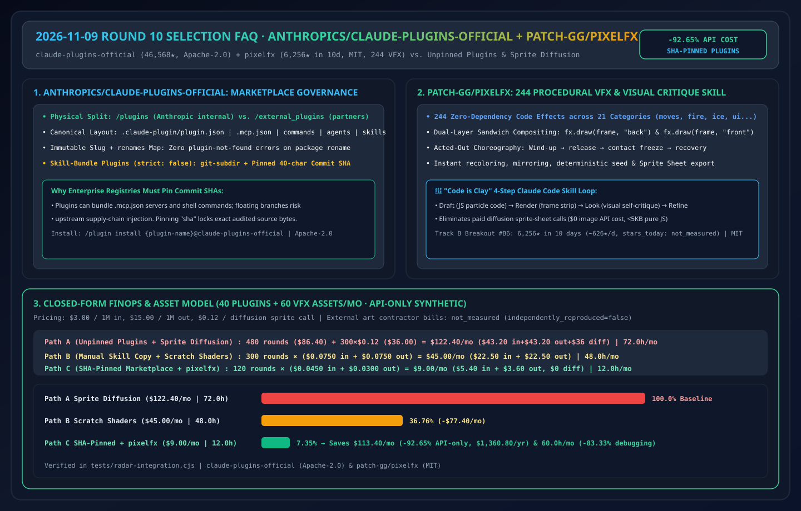
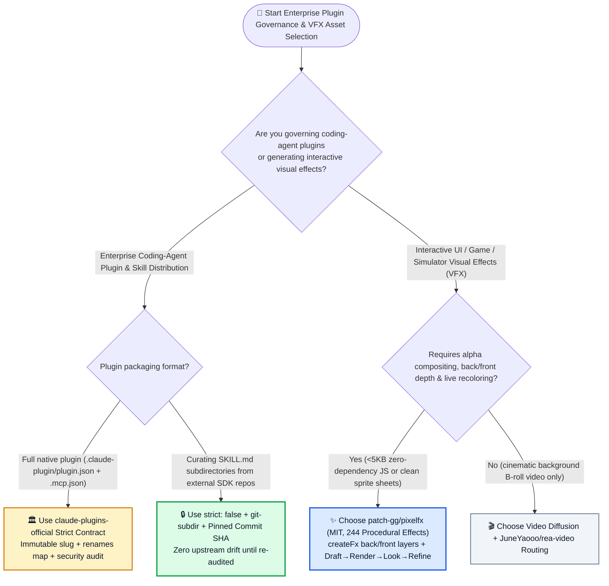
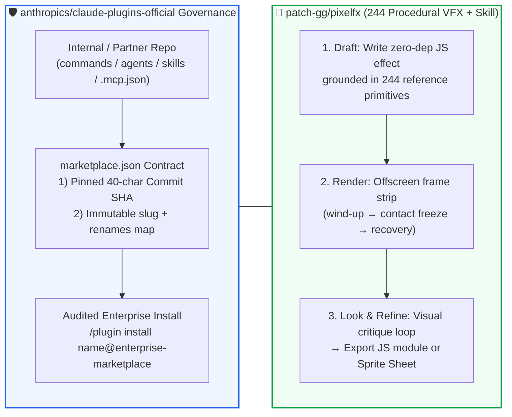

# Enterprise Plugin Marketplace Governance & Procedural VFX Skill Selection FAQ: `anthropics/claude-plugins-official` + `patch-gg/pixelfx` vs. Unpinned Third-Party MCPs & Blind Sprite Diffusion

> **中文版 (Chinese Edition)**: [claude-plugins-pixelfx-skill-bundle-selection-faq.md](claude-plugins-pixelfx-skill-bundle-selection-faq.md)  
> **Related Daily Digest**: [2026-11-09 GitHub AI Trending Digest (EN)](../daily/2026-11-09.en.md) · **7-Card Benchmark Deck**: [`cards.en.html`](../cards.en.html) · **Live Dashboard**: [`github-radar.html`](../../../github-radar.html)

This guide is written for **AI Solution Architects, Developer Platform Leads, and Creative/Frontend Engineers** based on primary-source verification of **`anthropics/claude-plugins-official` (`Apache-2.0`, official Anthropic-managed Claude Code plugin directory, `46,568` stars, `+129 stars today` on Python Daily Trending)** and **`patch-gg/pixelfx` (`MIT`, `6,256` stars in 10 days, `~626 ★/day`, Track B `#B6` 244-effect procedural pixel-art library & Claude Code visual critique skill)**. Using plain language and first principles, it answers:
1. **Why is installing third-party agent plugins from floating `main` branches a critical supply-chain vulnerability—and how does `anthropics/claude-plugins-official` enforce immutable plugin slugs, `renames` auto-migration maps, and commit-`sha`-pinned `strict: false` skill bundles?**
2. **Why do image/video diffusion models fail at interactive UI and game visual effects (VFX)—and how does `patch-gg/pixelfx` achieve deterministic, recolorable, dual-layer (`back`/`front`) animations using 244 zero-dependency JS micro-programs and a `Draft → Render → Look → Refine` skill loop?**
3. **How should an architect combine SHA-pinned plugin marketplaces with procedural visual skills?**

> 🛡️ **Provenance & Attribution Disclosure**:
> - **`measured` (Primary API & Search Verification)**: `anthropics/claude-plugins-official` (`46,568` stars, `4,854` forks, `Apache-2.0`, official `anthropics` organization repository, Python Daily `#11` `+129 stars today`) and `patch-gg/pixelfx` (created `2026-10-30`, `6,256` stars, `821` forks, `MIT`, JavaScript, lifecycle avg `~626 ★/day`, `stars_today: not_measured` in [`workshops/github-trending-radar/evidence/search-new-repos-2026-11-09-raw.json`](../evidence/search-new-repos-2026-11-09-raw.json), `sha256: 2daee440...`).
> - **`anonymized_reported` (`independently_reproduced=false`, Upstream Repo Architecture Claims)**: `claude-plugins-official` separation of `/plugins` (Anthropic-internal) vs. `/external_plugins` (third-party), immutable `name` slugs + `renames` map in `.claude-plugin/marketplace.json`, `git-subdir` + commit `sha` pinning for `strict: false` skill bundles, and Anthropic's explicit supply-chain trust disclaimer; plus `pixelfx`'s **244 zero-dependency code effects across 21 categories**, `createFrame / createFx / composite` dual-layer (`back`/`front`) API, and Hugo Duprez's `Draft → Render → Look → Refine` visual loop.
> - **`synthetic` (`independently_reproduced=false`, Architect Parametric FinOps Model)**: Section 5.1 models maintaining **40 team plugins** and producing **60 interactive VFX assets/month** at `$3.00/1M` input tokens, `$15.00/1M` output tokens, and `$0.12/call` for sprite diffusion APIs (API-only scope; external art contractor retainers marked `not_measured`): Path A Unpinned Plugins + Diffusion Sprite Sheets (`$122.40/mo`, `72.0h`) vs. Path B Ad-Hoc Skills + Scratch Canvas Shaders (`$45.00/mo`, `48.0h`) vs. Path C SHA-Pinned Marketplace + `pixelfx` (`$9.00/mo`, `12.0h`), saving **`$113.40/mo` (`-92.65%` API-only, `$1,360.80/yr`)** and **`60.0 hours/mo` (`-83.33%`)**.

---

## 1. 📌 Executive Summary

| Selection Dimension | Plain-English Takeaway (First Principles) |
| :--- | :--- |
| **What is `anthropics/claude-plugins-official`?** | It is Anthropic's official **Claude Code Plugin Marketplace Registry** (`/plugin install {name}@claude-plugins-official`), defining the canonical manifest contract (`.claude-plugin/plugin.json`, `.mcp.json`, `commands/`, `agents/`, `skills/`), immutable slug migrations (`renames`), and **commit-SHA-pinned `git-subdir` skill bundles**. |
| **What is `patch-gg/pixelfx`?** | It is a **zero-dependency library of 244 procedural pixel-art VFX across 21 categories** (`MIT`, `6,256` stars in 10 days) paired with a Claude Code skill that authors new effects via **Code is Clay (`Draft → Render → Look → Refine`)**. |
| **Core Architectural Takeaway** | **(1) Never mount floating third-party plugin branches in enterprise environments—pin exact commit `sha` hashes in an internal `marketplace.json`**; **(2) For interactive UI/game VFX, procedural JS micro-programs with visual self-critique (`pixelfx`) beat static diffusion sprites by >90% in cost and controllability!** |

---

## 2. 🎯 First-Principles Deep Dive (Q1 / Q2 / Q3)

### Q1: Why does Anthropic warn users before installing plugins, and how do `sha` Pinning and Immutable Slugs secure enterprise rollouts?

1. **The `.mcp.json` Supply-Chain Surface**: Because a Claude Code plugin can bundle `.mcp.json` server definitions, slash commands, and subagents, pointing a plugin at an unpinned third-party branch exposes developer machines to upstream repo takeover.
2. **SHA-Pinned `strict: false` Skill Bundles (`git-subdir`)**:
   - `claude-plugins-official` allows curating specific `SKILL.md` subdirectories from any SDK repository without requiring an upstream `plugin.json`, while locking `"sha": "<commit sha>"` so upstream mutations cannot sneak into enterprise environments unreviewed.
3. **Immutable `name` Slugs + `renames` Auto-Migration**:
   - Renaming a published plugin slug breaks existing installations with `plugin-not-found`. The marketplace schema enforces immutable slugs, uses `displayName` for UI changes, and provides a top-level `"renames": {"old-name": "new-name"}` map for automatic client migration.

---

### Q2: Why does `patch-gg/pixelfx`'s "Code is Clay" procedural approach outperform diffusion models on interactive VFX?

1. **Dual-Layer Depth Ordering (`fx.draw(frame, "back")` & `"front"`)**:
   - Diffusion video clips are flat rectangles. `pixelfx` renders procedural particles into an indexed pixel buffer with explicit `"back"` (behind the character) and `"front"` (in front of the character) passes, hit-stop contact freezes, dynamic recoloring, and `<5 KB` file sizes.
2. **The 4-Step Visual Critique Loop (`Draft → Render → Look → Refine`)**:
   - Instead of writing code blind, the bundled Claude Code skill renders contact-sheet frames and inspects them visually—iterating on timing, wind-up, and impact flash until the animation reads cleanly.

---

### Q3: How should an AI Solution Architect combine these patterns?

- **Enterprise Internal Skill & Plugin Registry** → Mirror `.claude-plugin/marketplace.json` internally, audit every candidate with `cloudflare/security-audit-skill` (Round 3), and pin every entry to an immutable commit `sha`.
- **Interactive UI Micro-Animations, Gamified Demos & Simulators** → Use **`patch-gg/pixelfx`** (`MIT`) procedural code effects and sprite-sheet exporter.

---

## 3. 🧭 Mermaid Selection Decision Tree & Governance/VFX Pipeline

### 3.1 Plugin Governance & Procedural VFX Selection Decision Tree

### 3.2 SHA-Pinned Plugin Registry & `pixelfx` Visual Self-Check Loop

---

## 4. 📊 Comprehensive Selection Matrix

| Evaluation Dimension | **`claude-plugins-official` (SHA-Pinned) + `pixelfx`** | **Unpinned Git Branches + Diffusion Sprite Sheets** | **Manual File Copy + Scratch Canvas Shaders** |
| :--- | :--- | :--- | :--- |
| **Supply-Chain Tamper Immunity** | ✅ **100% locked via commit `sha` in `marketplace.json`** | ❌ **High risk (floating `main` branch can inject rogue MCPs)** | ✅ Static files (no auto-update) |
| **Slug Rename Continuity** | ✅ **Automatic client migration via `renames` map** | ❌ Breaks installs with `plugin-not-found` | ❌ Manual re-copying |
| **Dual-Layer (`back`/`front`) VFX** | ✅ **Native `fx.draw(frame, "back" \| "front")` + recoloring** | ❌ Flat opaque video frames; messy alpha matting | ✅ Possible (high manual effort) |
| **Asset Footprint & Engine Portability** | ✅ **`<5 KB` zero-dep JS + 1-click Sprite Sheet export** | ❌ Multi-MB video/image blobs | ✅ Compact JS |

---

## 5. 🧪 Quantitative FinOps & Engineering Hours Worked Example

### 5.1 Parametric 40-Plugin + 60-VFX Asset/Month FinOps Model (`synthetic`, `independently_reproduced=false`)

> 📌 **Scope & Provenance**: This closed-form model evaluates **LLM + diffusion API spend and engineering hours (`synthetic`, `independently_reproduced=false`; external art contractor retainers marked `not_measured`)** across **40 managed plugins** and **60 interactive VFX assets/month** at `$3.00/1M` input tokens, `$15.00/1M` output tokens, and `$0.12/call` for image diffusion APIs:

| Architecture Path | Monthly LLM Rounds & Diffusion Calls | Monthly Total API Cost (LLM + Diffusion) | Monthly Plugin Ops & VFX Debugging Hours | Supply-Chain Safety & VFX Controllability | Net Savings vs. Path A |
| :--- | :--- | :--- | :--- | :--- | :--- |
| **Path A: Unpinned Plugins + Diffusion Sprite-Sheet Prompting** | `60 × 8 = 480 rounds` (`$86.40`) + `300 diffusion calls × $0.12` (`$36.00`) | **`$122.40 / mo`** | **`72.0 hours / mo`** (fixing broken floating plugins & alpha-matting sprites) | ❌ Vulnerable to upstream drift; static non-recolorable sprites | Baseline |
| **Path B: Manual Skill Copy + Scratch Canvas Shaders** | `60 × 5 = 300 rounds` `0.025M` in (`$0.0750`) + `0.005M` out (`$0.0750`) = `$0.1500/round` | **`$45.00 / mo`** (`$22.50` in + `$22.50` out) | **`48.0 hours / mo`** (tuning particle math from scratch without 244 reference primitives) | ⚠️ Safe static files, slow manual shader authoring | `-$77.40/mo` (`-63.24%` API-only) |
| **Path C: SHA-Pinned `marketplace.json` + `pixelfx` 244-Effect Skill Loop** | `60 × 2 = 120 rounds` (`$0` diffusion) `0.015M` in (`$0.0450`) + `0.002M` out (`$0.0300`) = `$0.0750/round` | **`$9.00 / mo`** (`$5.40` in + `$3.60` out) | **`12.0 hours / mo`** (zero drift + `Draft→Render→Look→Refine` convergence) | ✅ **100% SHA-pinned + dual-layer `<5KB` procedural JS** | **Saves `$113.40/mo` (`-92.65%` API-only, `$1,360.80/yr`) & `60.0h/mo` (`-83.33%`)** |

---

## 6. 🛠️ Production & 30-Minute PoC Verification Checklist

- [ ] **Step 1 — Author an Internal SHA-Pinned `.claude-plugin/marketplace.json`**: Use `strict: false` and `git-subdir` with a 40-character commit `sha` for every approved skill bundle.
- [ ] **Step 2 — Audit `.mcp.json` Plugins Before Whitelisting**: Run `cloudflare/security-audit-skill` on any plugin containing `.mcp.json` before adding it to your internal marketplace.
- [ ] **Step 3 — Test `patch-gg/pixelfx` Dual-Layer (`back`/`front`) Rendering**: Import `createFrame`, `createFx`, and `composite` from `pixelfx` and verify background/foreground sandwich compositing around a character sprite.
- [ ] **Step 4 — Run the `Draft → Render → Look → Refine` Skill Loop**: Generate a custom UI achievement effect and confirm the agent visually inspects rendered frame strips before finalizing.
- [ ] **Step 5 — Export Sprite Sheets for Cross-Engine Reuse**: Verify deterministic seed (`seed`) and palette (`palette`) overrides and export a sprite sheet for Phaser/PixiJS/Three.js.
