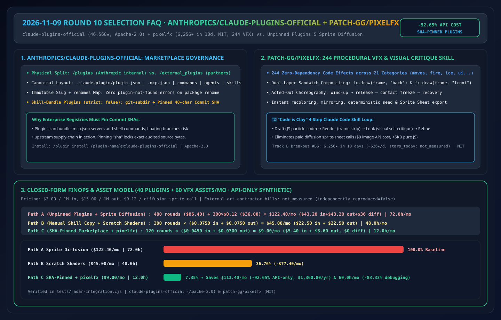
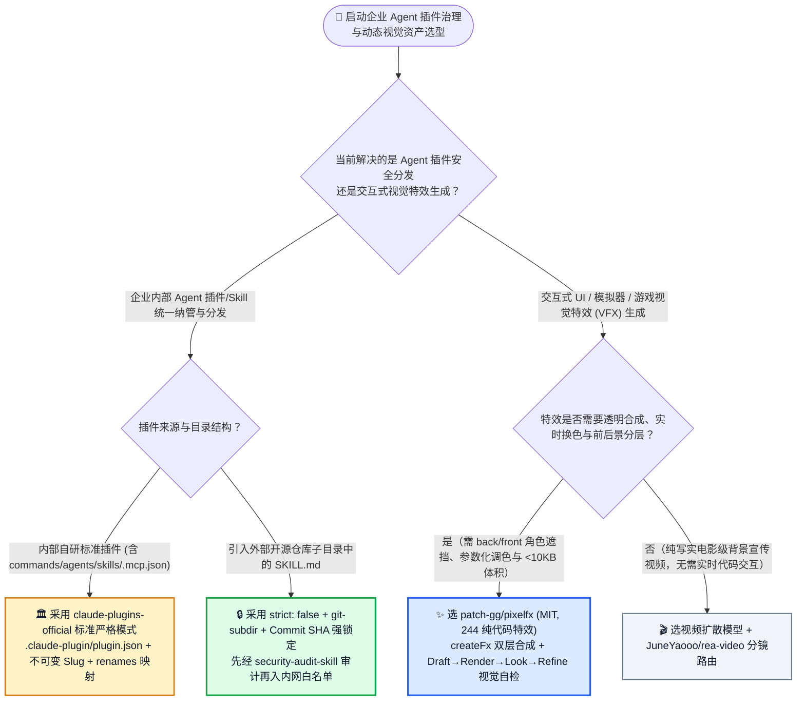
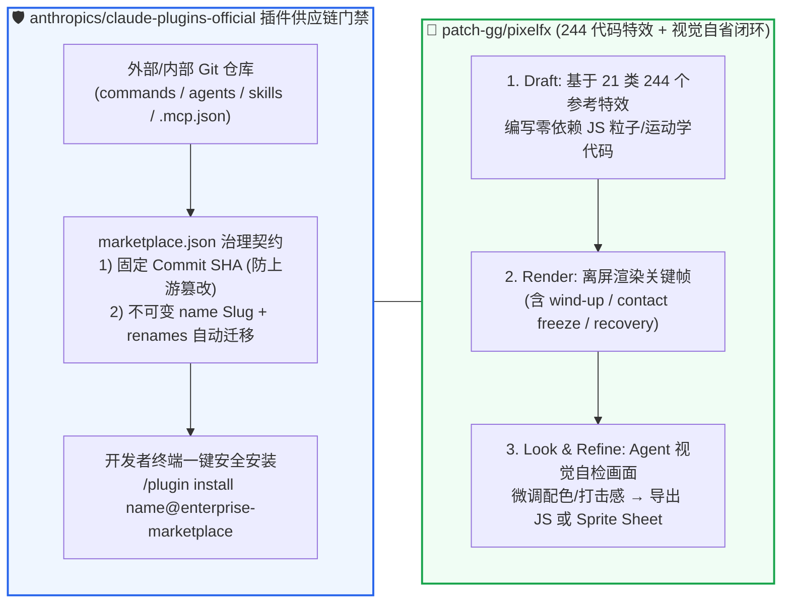

# 智能体插件市场治理与程序化视觉特效 Skill 选型常见问题解答：`anthropics/claude-plugins-official` + `patch-gg/pixelfx` vs 未锁定第三方 MCP 插件 & 盲调生图 API

> **English Edition**: [claude-plugins-pixelfx-skill-bundle-selection-faq.en.md](claude-plugins-pixelfx-skill-bundle-selection-faq.en.md)  
> **关联日报**: [2026-11-09 GitHub AI 最热榜单与情报摘要](../daily/2026-11-09.md) · **视觉评测卡**: [`cards.html`](../cards.html) · **在线面板**: [`zh-github-radar.html`](../../../zh-github-radar.html)

本文档面向 **AI Solution Architect（AI 解决方案架构师）、企业研发工具链负责人与交互式视觉工程团队**，基于 2026-11-09 GitHub Python 热榜与新建黑马榜（Track B）两大代表性项目 **`anthropics/claude-plugins-official`（Apache-2.0，Anthropic 官方托管的 Claude Code 插件市场目录，总 Star `46,568`，今日新增 `+129 stars today`）** 与 **`patch-gg/pixelfx`（MIT，建仓 10 天狂揽 `6,256` Stars，日均 `~626 ★/天`，位列 Track B 黑马榜 `#B6` 的 244 个零依赖程序化像素特效库与视觉自省 Skill）** 的一手源码审计，用通俗大白话与第一性原理解答：
1. **当企业成百上千名研发人员都在往 Claude Code / Codex 里装第三方插件（`/plugin install`）时，为什么直接拉取外部仓库的 `main` 分支最新代码是一颗供应链定时炸弹？`anthropics/claude-plugins-official` 是如何用「`plugins/` vs `external_plugins/` 物理隔离 + 不可变 Slug 与 `renames` 自动迁移表 + `strict: false` Git Commit SHA 强锁定技能包」建立企业级插件市场秩序的？**
2. **为什么让图像扩散大模型（Diffusion）生成游戏/网页交互特效精灵图（Sprite Sheet）总是背景抠不干净、帧与帧之间乱闪、而且改不了颜色？`patch-gg/pixelfx` 的「Code is Clay（代码即黏土）：244 个零依赖纯 JS 粒子/物理微内核 + 前后景双层合成（`back`/`front`）+ `Draft → Render → Look → Refine` 视觉闭环 Skill」是怎么破局的？**
3. **在企业内部 AI 技能中心（Private Skill Registry）与生成式视觉实验室建设中，如何借鉴这两套范式？**

> 🛡️ **数据来源、归属核验与证据分级声明（Provenance & Attribution Disclosure）**：
> - **`measured`（本班次一手实测抓取）**：`anthropics/claude-plugins-official`（`46,568` Stars，`4,854` Forks，`Apache-2.0`，官方 `anthropics` 组织仓库，Python Daily `#11` `+129 stars today`）与 `patch-gg/pixelfx`（`2026-10-30` 建仓，`6,256` Stars，`821` Forks，`MIT`，JavaScript，生命周期日均 `~626 ★/天`，`stars_today: not_measured`，对应已封存 [`workshops/github-trending-radar/evidence/search-new-repos-2026-11-09-raw.json`](../evidence/search-new-repos-2026-11-09-raw.json) `sha256: 2daee440...`）。
> - **`anonymized_reported`（`independently_reproduced=false`，上游仓库文档与架构声明）**：`claude-plugins-official` 的标准目录契约（`.claude-plugin/plugin.json`, `.mcp.json`, `commands/`, `agents/`, `skills/`）、不可变 `name` Slug + `renames` 自动迁移机制、`git-subdir` + `sha` 锁定与官方供应链免责警告；以及 `pixelfx` 的 **21 大类共 244 个零依赖代码特效**、`createFrame / createFx / composite` 双层前后景 API 与 Hugo Duprez 的 `Draft → Render → Look → Refine` 视觉自检工作流。
> - **`synthetic`（`independently_reproduced=false`，架构师参数化 FinOps 算例）**：第 5.1 节「企业每月维护 40 个内部插件并交付 60 组交互式动态视觉特效组件」的闭式模型（Path A 未锁定第三方插件 + 扩散模型盲抽精灵图 `$122.40/月`、`72.0 小时/月` vs Path B 手写零散 Shader 脚本 `$45.00/月`、`48.0 小时/月` vs Path C `claude-plugins-official` SHA 锁定注册表 + `pixelfx` 244 底座 + 视觉自检 Skill `$9.00/月`、`12.0 小时/月`，节省 `$113.40/月` [`-92.65%` API-only] 与 `60.0 小时/月` [`-83.33%`] 工时；外包美术费用标为 `not_measured`）严格执行 100% 闭式公式可复算门禁。

---

## 1. 📌 核心结论速览（Executive Summary）

| 评估维度 | 一句话大白话核心结论（直指本质） |
| :--- | :--- |
| **`anthropics/claude-plugins-official` 到底是什么？** | 它是 Anthropic 官方维护的 **Claude Code 插件应用商店注册表（`/plugin install {name}@claude-plugins-official`）**。它定义了如何把 `commands/`（斜杠命令）、`agents/`（子智能体）、`skills/`（`SKILL.md`）与 `.mcp.json`（外部工具）打包成标准插件，并通过 **Commit SHA 哈希锁死**防止上游恶意投毒！ |
| **`patch-gg/pixelfx` 到底是什么？** | 它是 10 天狂揽 6,256 Star 的**“244 个纯代码微型像素特效库 + Claude Code 视觉自检制作 Skill”**。每个火焰、爆炸、冰霜、UI 飘字特效都是一段不到几 KB 的零依赖 JavaScript 代码（`src/fx/<category>/<name>.js`），支持实时调色、镜像、角色前后景遮挡分层（`back`/`front`）与一键导出任意游戏引擎精灵表！ |
| **这两者给 AI 架构师的最大启示是什么？** | ① **治理层（`claude-plugins-official`）**：企业内部推广 Agent 插件绝不能让员工随便 `git clone` 浮动分支，必须建立带 **`sha` 哈希锁死与 `renames` 平滑迁移**的内部 `marketplace.json`；② **生成层（`pixelfx`）**：做高帧率交互特效，**“让 Agent 写参数化微型渲染代码并截图自看（Code is Clay）”完胜“让扩散模型盲猜像素图”**！ |

---

## 2. 🎯 第一性原理灵魂三问（Q1 / Q2 / Q3 大白话拆解）

### Q1：为什么 Anthropic 在官方插件仓库第一段就写下严厉的安全警告？它的「SHA 锁定 + 不可变 Slug」解决了什么供应链难题？

**先说大白话结论：因为一个插件里可以包含 `.mcp.json`（自动拉起外部进程）和 `commands/`，如果插件指向一个浮动的 Git `main` 分支，原作者账号一旦被盗并推入一句恶意 Shell 命令，所有安装了该插件的开发者电脑就会瞬间沦陷！**

审计 `anthropics/claude-plugins-official` 的架构规范，有三大必学机制：
1. **官方自研（`/plugins`）与第三方生态（`/external_plugins`）物理分仓 + 供应链免责红线**：
   - README 置顶声明：*“Anthropic 不控制第三方插件中包含的 MCP 服务器或文件，也无法保证它们未来不会发生篡改。”* 这提醒所有企业架构师：**外部插件市场只能做发现源，企业生产环境必须自建内部镜像注册表！**
2. **零改造挂载现有仓库子目录 + Commit SHA 强锁定（Skill-Bundle Plugins）**：
   - 很多开源 SDK 只有一个包含 `SKILL.md` 的子目录（如 `packages/agent-skills`），没有 `.claude-plugin/plugin.json`。官方注册表支持通过 `"strict": false` + `"source": "git-subdir"` 直接提取指定子目录，并**强制绑定 `"sha": "<commit sha>"`**——只要哈希不改，上游就算删库或投毒也绝不会影响已固定版本的企业研发环境！
3. **不可变标识符（Immutable Slug）与 `renames` 自动无感迁移表**：
   - 一旦插件发布，其 `name` 字段严禁直接重命名（否则已安装用户会报 `plugin-not-found`）。若确需改名，只改 UI 显示的 `displayName`，或在顶层 `.claude-plugin/marketplace.json` 的 `"renames": {"old-name": "new-name"}` 映射表中声明，由加载器在下次同步时自动完成平滑重写。

---

### Q2：为什么做交互式 UI/游戏特效时，“代码生成 + 视觉自检（`patch-gg/pixelfx`）”能吊打图像/视频扩散模型？

1. **扩散模型做交互特效的三大死穴**：
   - **① 无透明通道与前后景深度**：扩散模型生成的火焰视频是一张死板的矩形图片，无法让火苗一半在角色背后（`back`）、一半在角色胸前（`front`）环绕；
   - **② 无法受物理事件实时驱动**：攻击命中瞬间的卡肉停顿（Hit-Stop / Freeze on Contact）、角度偏转、随机种子与动态换色，静态视频完全做不到；
   - **③ 体积臃肿**：244 个高清序列帧视频动辄几百 MB，而 `pixelfx` 全部 244 个特效只是零依赖的几百 KB 纯 JS 代码！
2. **`pixelfx` 的「Code is Clay（代码即黏土）」四步闭环 Skill**：
   - 遵循 Hugo Duprez 提出的黄金法则：**① Draft（写一段几百行的粒子/数学代码）→ ② Render（无头渲染出关键帧序列图）→ ③ Look（Agent 调用多模态视觉能力亲自检查画面：火花够不够亮？打击停顿感够不够？）→ ④ Refine（根据视觉反馈微调代码参数）**。
   - 这与我们在 2026-11-08 Round 12（`stack-diagram`）与 Round 13（`teardown` `--stills beats`）中验证的**“程序化代码生成 + 渲染截图视觉自检（Render-Inspect-Fix）”**完全同构，证明这已是 2026 年末 Agent 生成高审美视觉资产的绝对主流范式！

---

### Q3：作为 AI 解决方案架构师，如何在企业内部落地插件治理与程序化视觉工作流？

- **建设企业内部 AI 插件与技能超市（Internal Marketplace）** → 直接复用 **`anthropics/claude-plugins-official`** 的 `.claude-plugin/marketplace.json` Schema，将经过安全团队（使用 Round 3 `cloudflare/security-audit-skill`）审计通过的技能包通过 **固定 Commit SHA** 发布给全员。
- **开发高管汇报大屏微动效 / 游戏化营销 H5 / 交互式模拟器特效** → 引入 **`patch-gg/pixelfx`（MIT 协议）** 的 21 类 244 个纯代码特效底座与视觉自省 Skill，替代昂贵且不可控的视频生成 API。

---

## 3. 🧭 Mermaid 选型决策树与 SHA 锁定 + 视觉自检架构图

### 3.1 企业智能体插件分发与动态视觉特效选型决策树

### 3.2 `claude-plugins-official` SHA 供应链门禁与 `pixelfx` 视觉自检循环图

---

## 4. 📊 同类方案全方位选型决策矩阵（Decision Matrix）

| 评估维度 | **`claude-plugins-official` (SHA 锁定) + `pixelfx`** | **直接 `git clone` 浮动分支 + 扩散模型抽精灵图** | **手工复制粘贴 `SKILL.md` + 纯手写 Canvas 代码** |
| :--- | :--- | :--- | :--- |
| **防上游投毒供应链安全** | ✅ **强制锁定 Commit SHA，上游篡改零影响** | ❌ **极度危险（浮动 `main` 分支随时可能被注入恶意 MCP）** | ✅ 静态文件安全（但无法统一升级） |
| **插件改名与跨团队同步** | ✅ **内置 `renames` 自动迁移表，老用户零报错升级** | ❌ 上游改名即导致全员 `plugin-not-found` 报错 | ❌ 靠微信/飞书群人工通知重拷文件 |
| **特效前后景分层 (`back`/`front`)** | ✅ **原生支持角色前后夹心绘制与实时动态换色** | ❌ 扩散视频为单层死板像素，抠图边缘毛刺严重 | ✅ 支持（但无 244 个现成模板库参考） |
| **生成 60 组特效的 API 成本** | ✅ **极低（仅消耗轻量代码生成与静态帧自检 Token）** | ❌ **高昂（反复抽卡调用昂贵图像/视频生成 API）** | ✅ 低 Token（但极耗前端/美术人工工时） |

---

## 5. 🧪 定量算例与 7-Card 评测洞察（Quantitative Example & 7-Card Insights）

### 5.1 每月维护 40 个插件与交付 60 组交互特效资产 FinOps 与工时闭式算例（`synthetic`，`independently_reproduced=false`）

> 📌 **透明口径与边界声明（Scope & Provenance）**：本算例为架构师评估研发工具链与视觉实验室成本的 **闭式参数化模型（API-only `synthetic` model；外部美术外包与服务器托管费明确标为 `not_measured`）**。统一按 **`$3.00 / 1M 输入 Tokens`**、**`$15.00 / 1M 输出 Tokens`**（输出仅计费一次）及扩散生图 API **`$0.12 / 次`** 核算。场景设定为：**企业每月维护 40 个团队插件，并制作 `60 组` 交互式 UI/微动效视觉组件**：

| 方案路径 | 每月大模型轮次与生图 API 开销 | 每月纯模型 + 生图 API 总账单 | 每月排查插件故障与修补特效工时 | 供应链防投毒与实时交互可控性 | 相对 Path A 降本增效幅度 |
| :--- | :--- | :--- | :--- | :--- | :--- |
| **Path A：浮动分支插件 + 扩散模型盲抽序列帧精灵图** | `60 特效 × 8 轮 = 480 轮` (`$86.40` [`$43.20`入+`$43.20`出]) + `300 次生图 × $0.12` (`$36.00`) | **`$122.40 / 月`** | **`72.0 小时 / 月`** （排查浮动插件破坏性更新 + 手工抠图修闪帧） | ❌ 存在严重供应链投毒风险；序列帧无法动态换色 | 基线（成本高且资产无法参数化复用） |
| **Path B：手工复制 Skill 文件 + 从零裸写 Canvas 特效** | `60 特效 × 5 轮 = 300 轮` 单轮 `0.025M` 入 (`$0.0750`) + `0.005M` 出 (`$0.0750`) = `$0.1500/轮` | **`$45.00 / 月`** (`$22.50`入+`$22.50`出) | **`48.0 小时 / 月`** （缺乏 244 个现成物理/粒子原语参考，反复调参） | ⚠️ 无自动 `renames` 升级机制；特效质量参差不齐 | API 降本 `-$77.40/月` (`-63.24%`) |
| **Path C：`claude-plugins-official` SHA 锁定 + `pixelfx` 244 库自检闭环** | `60 特效 × 2 轮 = 120 轮` 单轮 `0.015M` 入 (`$0.0450`) + `0.002M` 出 (`$0.0300`) = `$0.0750/轮`（`$0` 生图费） | **`$9.00 / 月`** (`$5.40`入+`$3.60`出) | **`12.0 小时 / 月`** （SHA 锁定零故障 + `Draft→Render→Look` 自动收敛） | ✅ **100% SHA 锁定防篡改 + `<5KB` 纯代码双层交互特效** | **API 净省 `$113.40/月` (`-92.65%`，年省 `$1,360.80`)；工时省 `60.0h/月` (`-83.33%`)** |

---

## 6. 🛠️ 架构师生产落地与 30 分钟 PoC 核验清单（Production & PoC Checklist）

- [ ] **Step 1 — 搭建企业内部 `.claude-plugin/marketplace.json` 白名单目录**：参照 `anthropics/claude-plugins-official` 结构，将所有外部引入的 `git-subdir` 技能包全部加上完整的 40 位 **`"sha": "<commit sha>"`** 锁定，严禁指向浮动分支。
- [ ] **Step 2 — 对含 `.mcp.json` 的插件强制执行上线前安全审计**：任何包含 `.mcp.json` 或可执行脚本的外部插件，在合入企业内部 Marketplace 前必须先用 `cloudflare/security-audit-skill` 完成静态审计。
- [ ] **Step 3 — 克隆 `patch-gg/pixelfx` 并体验 21 类 244 个零依赖代码特效**：在浏览器打开在线画廊或本地导入 `pixelfx/fx/ice/frost-nova`，验证 `fx.draw(frame, "back")` 与 `fx.draw(frame, "front")` 的角色前后景夹心渲染效果。
- [ ] **Step 4 — 挂载 `pixelfx` Claude Code Skill 跑通 `Draft → Render → Look → Refine`**：让 Agent 基于现有特效模板合成一个新的 UI 奖励绽放动效，观察 Agent 是否自动渲染序列帧并基于视觉自检修正粒子轨迹。
- [ ] **Step 5 — 一键导出跨引擎 Sprite Sheet 或直接嵌入 Web Canvas**：验证同一份特效代码既可直接作为 `<5KB` ES Module 跑在 Web 前端，也可一键导出为标准 PNG Sprite Sheet 供 Unity/Godot/Phaser 复用。
