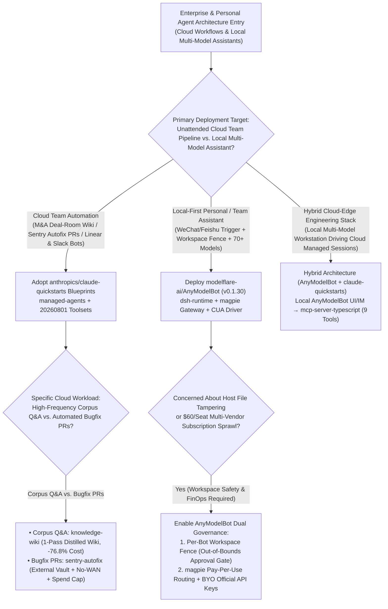
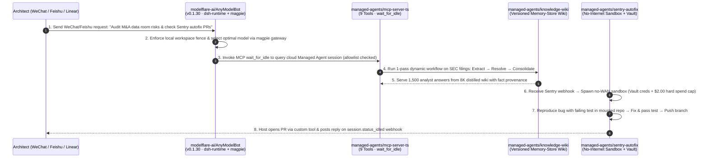

# Managed Agent Reference Blueprints & Local-First Multi-Model Bot Gateway Selection FAQ: `anthropics/claude-quickstarts` (`managed-agents`) + `modelflare-ai/AnyModelBot` (`v0.1.30`) vs. Repeated Raw-Corpus RAG & Multi-Vendor Seat Lock-In

> **Document Scope**: A first-principles architecture and FinOps selection guide for AI Solution Architects, Enterprise Agent Platform Leads, and Developer Productivity Directors. Focusing on two standout agent harness repositories from the `2026-11-09` GitHub AI Radar — **`anthropics/claude-quickstarts`** (MIT, Track A Velocity Leader **#V6**, measured **`+560 Stars today`**, **19,814 Stars** on trending snapshot / **19,895 Stars** live API, featuring 10 `managed-agents/` and `20260801` toolset blueprints) and **`modelflare-ai/AnyModelBot`** (`v0.1.30`, MIT, Track B Breakout New Repo **#B19**, **2,742 Stars** on search snapshot / **2,743 Stars** live API in 13 days, **`211 Stars/day`** lifecycle velocity, `stars_today = not_measured`) — this guide dissects how **One-Pass Distilled Knowledge Wikis + Air-Gapped Vault `sentry-autofix` Sandboxes with Hard Spend Caps + Local `dsh-runtime` / `magpie` 70+ Model Pay-Per-Use Gateways** eliminate repeated raw-document RAG bloat, runaway bugfix token loops, and redundant multi-vendor seat subscriptions.
>
> **Navigation**: [中文版 (`claude-quickstarts-anymodelbot-managed-harness-selection-faq.md`)](./claude-quickstarts-anymodelbot-managed-harness-selection-faq.md) · [2026-11-09 Daily Radar](../daily/2026-11-09.en.md) · [Back to Radar Index](../README.en.md)

---

## 📌 1. Executive Summary

1. **First-Principles Definition**:
   - **`anthropics/claude-quickstarts` (MIT, 15 Official Reference Architectures)** is Anthropic's canonical blueprint collection for production Claude deployments. Its `+560★` single-day surge is driven by **10 new `managed-agents/` reference implementations** and **`computer_toolset_20260801` / `browser_toolset_20260801` drivers** — including `knowledge-wiki` (one-pass corpus distillation into a versioned memory-store wiki), `sentry-autofix` (no-internet sandbox with external Vault credential injection, mandatory failing-test reproduction, and per-session hard spend caps), `daily-brief` (dual read-only preferences + read-write bookmark/ledger memory stores via `ant apply`), and `mcp-server-typescript` (9 MCP tools with `wait_for_idle` event-stream folding).
   - **`modelflare-ai/AnyModelBot` (`v0.1.30`, TypeScript/Electron + Python, MIT)** is an open-source, local-first alternative to Grok Bot, OpenAI dots, and Claude Duet. Built on **DeepSeek Harness (`dsh-runtime`)** with a built-in **`magpie` multi-model gateway (routing across 70+ models from 13 providers or BYO official API keys)** and a cross-platform **CUA computer-use driver**, it connects via WeChat (`weixin:login` iLink), Feishu, Telegram, Slack, and Discord while enforcing strict per-bot workspace directory fences (prompting user approval before touching files outside its workspace).
2. **Core Architectural Insight (Why Naive RAG, Unbounded Autofix Bots & Multi-Vendor Subscriptions Bleed Budget)**:
   - **Failure Mode #1 (Re-Searching Raw Document Chunks on Every Analyst Question)**: In an M&A deal room or architecture audit where analysts ask 1,500 questions against a 500K-token SEC EDGAR corpus, naive RAG stuffs `60K` raw tokens per query (`$303.75/mo`). `managed-agents/knowledge-wiki` runs one dynamic workflow (`extract → resolve → consolidate`) to distill the corpus into a versioned memory-store wiki with provenance, shrinking subsequent queries to `8K` tokens (**`-76.8%` Q&A cost**).
   - **Failure Mode #2 (Unbounded Bugfix Loops & $60/Seat Multi-Vendor Subscription Sprawl)**: Uncapped bugfix agents spin on un-reproducible stack traces and expose credentials inside sandboxes, while engineering teams pay 3× `$20/seat/mo` subscriptions so developers can use GPT, Claude, and Gemini. `sentry-autofix` enforces a `$2.00` hard spend cap inside a no-WAN sandbox with external Vault credentials, while `AnyModelBot` replaces fixed multi-vendor seats with a local pay-per-use `magpie` gateway.
3. **30-Second Selection Rule**:
   - Choose **`anthropics/claude-quickstarts` (`managed-agents`)** as your reference blueprint for **cloud-hosted team workflows (stateless Linear/Slack webhooks, air-gapped Sentry autofix PRs, distilled deal-room wikis, and `20260801` VNC/CDP computer-use toolsets)**.
   - Choose **`modelflare-ai/AnyModelBot` (`v0.1.30`)** when you want a **local-first, zero-subscription personal/team Super Agent reachable from WeChat/Feishu/Telegram that switches freely across 70+ models with local workspace sandboxing**.

---

## 🎯 2. Architect's First-Principles Deep Dive (Q1 / Q2 / Q3)

### Q1: What are the 4 production-ready architectural patterns inside `anthropics/claude-quickstarts`'s new `managed-agents/` and `20260801` toolset blueprints?

Inspecting `anthropics/claude-quickstarts` reveals four blueprints that solve recurring enterprise agent failure modes:

1. **Pattern #1: One-Pass Distilled Versioned Knowledge Wiki (`managed-agents/knowledge-wiki`)**:
   - Instead of running raw vector search on every analyst query over SEC EDGAR filings, a single dynamic workflow run executes **Extract → Resolve → Consolidate** into a versioned memory-store wiki with fact-level provenance. Subsequent analyst questions read the compact wiki (`~8K` tokens) rather than `60K` raw filing chunks.
2. **Pattern #2: No-Internet Sandbox + External Vault + Hard Spend Cap (`managed-agents/sentry-autofix`)**:
   - Triggered per Sentry issue via webhook: the agent reads the stack trace and Seer root-cause analysis, **must reproduce the bug with a failing test** in a mounted GitHub repo, pushes a fix branch, and invokes a host custom tool to open the PR for human review.
   - Enforces three hard security invariants: **(a)** credentials remain in an external Vault outside the sandbox (`injection_location`); **(b)** the sandbox has **no route to the open internet**; and **(c)** every session enforces a **hard spend cap**.
3. **Pattern #3: Dual Read-Only / Read-Write Memory Stores & Explicit Unreadable Reporting (`managed-agents/daily-brief`)**:
   - Defined declaratively via `ant apply`, separating a **read-only preferences store** from a **read-write state store** (tracking per-source bookmarks and an anti-repeat ledger). If a Slack or GitHub source fails to read, the step reports it explicitly as `unreadable` rather than silently fabricating a "quiet day."
4. **Pattern #4: Stateless `session.status_idled` Webhooks & `wait_for_idle` Stream Folding (`linear`, `slack`, `mcp-server-typescript`)**:
   - Eliminates external state databases for Slack and Linear bots by storing `channel/thread/org_id` in session `metadata` upon `@mention` and reading it back when the `session.status_idled` webhook fires. Meanwhile, `mcp-server-typescript` exposes 9 tools where `wait_for_idle` collapses an event stream into a single request/response call guarded by an agent allowlist.

### Q2: How does `modelflare-ai/AnyModelBot` (`v0.1.30`) combine `dsh-runtime`, the `magpie` gateway, and WeChat/Feishu channels into a local-first Super Agent?

Inspecting `package.json` (`v0.1.30`) and the repository structure of `modelflare-ai/AnyModelBot` reveals four tightly integrated layers:

1. **DeepSeek Harness (`dsh-runtime`) + Native CUA Driver**:
   - Cross-compiled via `prepare-dsh.mjs`, `bundle-dsh.mjs`, and `fetch-cua-driver.mjs` for Windows, macOS, and Linux (`x64` and `arm64`), providing out-of-the-box background task execution, cron rules, and desktop computer-use without manual daemon wiring.
2. **Built-In `magpie` Multi-Model Gateway (`build-magpie.mjs` + `build-catalog.ts`)**:
   - Connects either directly to official OpenAI/Anthropic/Google API keys or through a unified token-metered gateway covering **70+ text, image, and video models across 13 providers** (GPT, Claude, Gemini, Grok, DeepSeek, Kimi, GLM) with automatic provider fallback.
3. **Per-Bot Workspace Directory Fence**:
   - Every bot is an isolated persona with its own default model, memory, and workspace directory. **Any attempt to read, write, or move files outside the assigned workspace triggers an explicit user approval prompt**, while all chat logs, memories, and keys remain on local storage.
4. **Native WeChat iLink (`weixin:login`) & Feishu/Telegram/Slack/Discord Channels**:
   - Includes `src/cli/weixin-login.ts` and Feishu adapters so users can dispatch background tasks from their phone and only receive notifications when human decision cards require approval.

### Q3: How should an enterprise combine `anthropics/claude-quickstarts` and `modelflare-ai/AnyModelBot`?

- **Shared Cloud Engineering & Deal-Room Workflows** → Deploy the **`anthropics/claude-quickstarts` (`managed-agents`)** patterns (`knowledge-wiki`, `sentry-autofix`, `daily-brief`, `linear`/`slack` stateless webhooks).
- **Local Developer Workstations & Multi-Model Mobile Assistants** → Deploy **`modelflare-ai/AnyModelBot` (`v0.1.30`)**, connecting local workspaces and WeChat/Feishu channels to 70+ models on a pay-per-use basis, and bridging to cloud Managed Agents via `mcp-server-typescript` (9 tools).

---

## 🧭 3. Mermaid Decision Tree & Execution Sequence

### 3.1 Managed Agent Blueprint & Multi-Model Gateway Decision Tree

### 3.2 End-to-End Execution Sequence (`knowledge-wiki` + `sentry-autofix` + `AnyModelBot`)

---

## 📊 4. Comparison Matrix Across Agent Harnesses & Bot Gateways

| Dimension | `anthropics/claude-quickstarts` (`managed-agents`) | `modelflare-ai/AnyModelBot` (`v0.1.30`) | Ad-Hoc Raw-Corpus RAG + Unbounded Bugfix Scripts | Proprietary Single-Vendor Bots (Grok Bot / Claude Duet / OpenAI dots) |
| :--- | :--- | :--- | :--- | :--- |
| **Core Scope & License** | **15 Official Anthropic Reference Blueprints (MIT)** | **Local-First Multi-Model Personal/Team Super Agent (MIT)** | Fragile custom glue scripts lacking session & vault primitives | Closed commercial apps locked to a single model vendor |
| **Knowledge & Memory Architecture** | **`knowledge-wiki` 1-pass distilled wiki** + `daily-brief` dual RO/RW memory stores | Persistent local persona memory + workspace file context | Re-searches `60K` raw chunks per query; high cost & contradictions | Opaque vendor cloud memory; no versioned corpus distillation |
| **Sandbox Security & Cost Caps** | **External Vault credentials + No-WAN sandbox + Hard spend cap** | **Per-bot workspace directory fence (approval gate)** + live usage meter | Plaintext tokens inside sandbox; runaway loops burn unlimited budget | Vendor-controlled permissions; no self-hosted audit trail |
| **Model Coverage & Billing** | Optimized for Claude API (`agent_with_overrides` per-session model swap) | **Built-in `magpie` gateway (70+ models, 13 providers)** or BYO keys; **`$0` base subscription** | Requires maintaining separate SDK adapters per provider | **$20–$30/seat/mo fixed subscription** per vendor ($60/mo for 3) |
| **Messaging & IM Channels** | Stateless Slack & Linear webhooks (`session.status_idled`) + Vercel Chat SDK | **Native WeChat (`weixin:login` iLink), Feishu, Telegram, Slack, Discord** | Requires custom public webhook relays and state DBs | Restricted to vendor app/web; no native WeChat/Feishu bridge |

---

## 🧪 5. Closed-Form FinOps Worked Example & 7-Card Insights

### 5.1 Monthly Deal-Room Q&A, Automated Bugfix & Multi-Model Team Cost Model (`synthetic (independently_reproduced=false)`)

> **Provenance Notice**: This closed-form calculation is a synthetic architectural model (`synthetic (independently_reproduced=false)`) comparing **Path A (Repeated Raw-Corpus RAG + Uncapped Bugfix Agent + 3-Vendor Fixed Seat Subscriptions for 15 Engineers)** against **Path B (`claude-quickstarts` Distilled `knowledge-wiki` + Spend-Capped `sentry-autofix` + `AnyModelBot` v0.1.30 Pay-Per-Use Gateway)**. External Sentry/Linear SaaS licenses and host VM electricity/amortization are explicitly marked `not_measured`.

**Workload Parameters**:
- **M&A / Architecture Deal-Room Q&A**: **`1,500` analyst queries/month** over a 500K-token filing corpus; frontier model pricing at **`$3.00 / 1M` input tokens** and **`$15.00 / 1M` output tokens**.
- **Automated Production Bugfix Sessions**: **`200` Sentry issue autofix runs/month**.
- **Engineering Team Multi-Model Access**: **`15` engineers** using GPT, Claude, and Gemini/DeepSeek assistants across desktop and WeChat/Feishu.

| Cost Component | Path A: Raw-Corpus RAG + Uncapped Autofix + 3-Sub Seats | Path B: `knowledge-wiki` + Capped `autofix` + `AnyModelBot` | Governing Engineering Mechanism |
| :--- | :--- | :--- | :--- |
| **1. Deal-Room 1,500-Query Token Cost** | **$303.75 / mo** (`60K` in + `1.5K` out = `$0.2025/query` × `1,500`) | **$70.50 / mo** (1-pass distillation `$12.00` + `1,500` × `[8K in + 1K out = $0.039]` = `$58.50`) | `managed-agents/knowledge-wiki` distills the corpus once into a versioned wiki (**-76.8%** Q&A cost) |
| **2. 200 Sentry Issue Autofix Runs** | **$510.00 / mo** (`170` normal × `$1.50` + `15%` = `30` runaway loops × `$8.50`) | **$315.00 / mo** (`170` normal × `$1.50` + `30` capped at **`$2.00` hard spend cap** = `$60.00`) | `managed-agents/sentry-autofix` enforces per-session hard spend caps & failing-test reproduction |
| **3. 15-Engineer Multi-Model Bot Access** | **$900.00 / mo** (`15 seats` × 3 vendor subscriptions at `$20/mo` = `$60.00/seat`) | **$180.00 / mo** (`AnyModelBot` `$0` seat fee; pay-per-use averages `$12.00/seat/mo`) | `AnyModelBot` `magpie` gateway routes across 70+ models on pay-per-use tokens (**-80.0%** seat cost) |
| **4. External Sentry/Linear SaaS & Host VM Compute** | `not_measured` | `not_measured` | Third-party SaaS seat licenses and host VM amortization are decoupled and never fabricated |
| **Total Modeled Monthly Cost** | **$1,713.75 / mo** | **$565.50 / mo** | **Net Savings: `$1,148.25 / mo` (`-67.00%` cost reduction, `3.03x` cost efficiency)** |

### 5.2 Key Security & Reliability Invariants

- **External Vault & No-WAN Sandbox Invariant**: In `managed-agents/sentry-autofix`, credentials stay in an external Vault (`injection_location`) and the code execution sandbox has no route to the open internet, preventing exfiltration during untrusted test execution.
- **Explicit Unreadable-Source Reporting Invariant**: In `managed-agents/daily-brief`, failed source reads are reported explicitly as `unreadable` rather than silently omitted as a quiet day.

---

## 🛠️ 6. Actionable Production Checklist

- [ ] **1. Replace Repeated Raw-Document RAG with `knowledge-wiki` Distillation**: For static or semi-static data rooms queried >50 times, run the `extract → resolve → consolidate` workflow once into a versioned memory-store wiki with provenance.
- [ ] **2. Enforce the 3-Lock Sandbox Pattern on Automated Code Fixes**: Configure `sentry-autofix` style workflows with external Vault credential injection, zero open-internet sandbox routing, and a hard per-session spend cap.
- [ ] **3. Use Stateless `session.status_idled` Webhooks for Slack & Linear**: Store `channel/thread/issue_id` in session `metadata` and read it back on `session.status_idled` rather than provisioning a separate state database.
- [ ] **4. Verify `AnyModelBot` (`v0.1.30`) `SHA256SUMS` & Per-Bot Workspace Fences**: Validate release `SHA256SUMS`, assign each bot persona a dedicated workspace folder, and confirm out-of-workspace file operations trigger human approval prompts.
- [ ] **5. Connect WeChat (`weixin:login`) & Feishu with Exception-Only Alerts**: Bind WeChat iLink or Feishu channels so background cron tasks execute silently and only interrupt users when approval cards require human sign-off.
