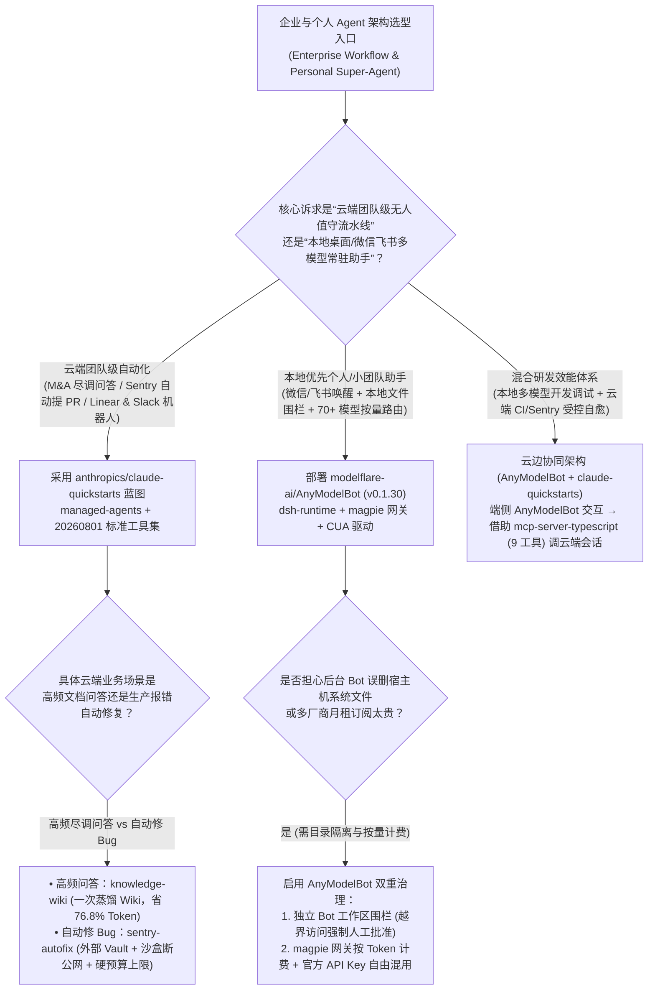
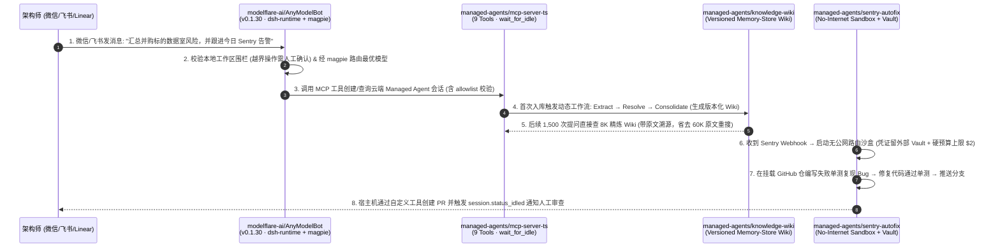

# 托管智能体参考蓝图与本地多模型网关选型 FAQ：`anthropics/claude-quickstarts` (`managed-agents`) + `modelflare-ai/AnyModelBot` vs 原始文档重复检索与多厂商席位锁死

> **文档定位**：面向 AI Solution Architect（AI 解决方案架构师）、企业 Agent 平台负责人与研发效能总监的第一性原理选型指南。聚焦 `2026-11-09` GitHub AI 全景热榜与新仓爆发榜同日登榜的两大生产级智能体底座——**`anthropics/claude-quickstarts`**（MIT，Track A 飙升榜 **#V6**，今日实测 **`+560 Stars today`**，榜单快照 **19,814 Stars** / 实时 API **19,895 Stars**，新增 10 套 `managed-agents/` 与 `20260801` 工具集参考实现）与 **`modelflare-ai/AnyModelBot`**（`v0.1.30`，MIT，Track B 新仓黑马榜 **#B19**，建仓 13 天揽下 **2,742 Stars** 搜索快照 / **2,743 Stars** 实时 API，日均斜率 **`211 Stars/day`**，`stars_today = not_measured`），深度拆解如何用 **“一次蒸馏知识 Wiki + 断网沙盒/硬预算上限的 Sentry 自动修 Bug 蓝图 + 本地 `dsh-runtime` / `magpie` 70+ 模型微信/飞书按量网关”** 终结原始文档重复 RAG、沙盒失控烧钱与多厂商固定席位费浪费。
>
> **阅读导航**：[English Version (`claude-quickstarts-anymodelbot-managed-harness-selection-faq.en.md`)](./claude-quickstarts-anymodelbot-managed-harness-selection-faq.en.md) · [2026-11-09 全景日报](../daily/2026-11-09.md) · [返回雷达首页](../README.md)

---

## 📌 1. 核心结论速览（Executive Summary）

1. **一句话本质定义**：
   - **`anthropics/claude-quickstarts`（MIT，15 套官方参考工程）** 是 Anthropic 官方维护的**生产级 Agent 架构样板间**。今日单日暴涨 `+560★` 的核心驱动力是其全新落地的 **10 套 `managed-agents/` 架构范式**与 **`computer_toolset_20260801` / `browser_toolset_20260801` 标准接口**——涵盖把 SEC EDGAR 并购尽调语料一次性提炼为版本化知识库的 `knowledge-wiki`、无公网路由且带单会话硬预算上限（Hard Spend Cap）的 `sentry-autofix`、读写双分离记忆库的 `daily-brief`、以及用 `wait_for_idle` 将异步事件流折叠为同步调用的 9 工具 `mcp-server-typescript`。
   - **`modelflare-ai/AnyModelBot`（`v0.1.30`，TypeScript/Electron + Python，MIT）** 是 Grok Bot、OpenAI dots 与 Claude Duet 的**本地优先、跨模型开源替代方案**。它底层运行在 **DeepSeek Harness（`dsh-runtime`）** 之上，内置 **`magpie` 模型路由网关（无缝接入 13 家供应商 70+ 款模型或直连官方 API Key）** 与 **CUA 桌面驱动**，支持通过微信（`weixin:login` iLink）、飞书、Telegram、Slack、Discord 随时唤醒，且每个 Bot 拥有严格受控的独立工作区目录（越界访问强制弹窗审批）。
2. **核心架构洞察（为什么企业自研 Agent 常常死于“每次重搜原文档、修 Bug 沙盒失控、多模型订阅破产”？）**：
   - **痛点一（高频尽调问答每次重搜原始大文档，Token 贵且跨文档事实冲突）**：在并购数据室（Deal Room）或大项目中，分析师围绕同一批 50 万 Token 的 SEC 财报提问 1,500 次。传统 RAG 每次检索拼入 `60K` 原始切片；而 `claude-quickstarts/managed-agents/knowledge-wiki` 先跑一次动态工作流（`extract → resolve → consolidate`）将语料蒸馏为带溯源的版本化 Memory-Store Wiki，后续每次提问仅需读取 `8K` 精炼 Wiki，**问答 Token 成本直降 76.8%**。
   - **痛点二（自动修 Bug Agent 暴露密钥、死循环烧钱，且团队为用多模型被迫重复买 3 家 `$20/月` 席位）**：`managed-agents/sentry-autofix` 展示了工业级安全边界——凭证留在沙盒外的外部 Vault（`injection_location`）、沙盒**完全切断公网路由**、强制先写失败单测复现 Bug、且每个会话设**硬性费用上限（Hard Spend Cap）**；而在个人与团队日常助手侧，`AnyModelBot` 用本地按量计费网关替代了每人每月 `$60` 的多家固定订阅。
3. **30 秒选型口诀**：
   - 需要**设计企业级云端托管 Agent（Webhook 无状态桥接 Linear/Slack、Sentry 自动提 PR、M&A 知识库蒸馏、Computer-Use VNC/CDP 标准工具集）** → 直接复用 **`anthropics/claude-quickstarts`** 的架构蓝图。
   - 需要**在自己电脑或内网服务器上常驻一个支持微信/飞书接入、任意切换 GPT/Claude/Gemini/DeepSeek 70+ 模型、带文件工作区围栏的个人/团队 Super Agent** → 选 **`modelflare-ai/AnyModelBot` (`v0.1.30`)**。

---

## 🎯 2. 架构师灵魂拷问（Q1 / Q2 / Q3 First-Principles Deep Dive）

### Q1：`anthropics/claude-quickstarts` 新增的 10 套 `managed-agents/` 与 `20260801` 工具集，到底沉淀了哪 4 个可以直接抄作业的黄金架构模式？

通读 `anthropics/claude-quickstarts` 的工程目录，最值得 AI SA 直接搬进生产方案的四大架构原语如下：

1. **模式一：语料一次性蒸馏 Wiki 模式（`managed-agents/knowledge-wiki`）**：
   - 针对高密度文档库（如 SEC EDGAR 并购数据室），不再用裸向量检索直接回答每个问题，而是先运行一次三阶段动态工作流：**提取（Extract）→ 消歧对齐（Resolve）→ 归并沉淀（Consolidate）**，生成写入版本化 Memory Store 的结构化 Knowledge Wiki（每条事实附带原文出处）。此后上千次分析师提问直接查询精炼 Wiki，彻底解决跨文档口径打架与高额重读账单。
2. **模式二：断网沙盒 + 外部 Vault + 硬预算上限的自动修 Bug 模式（`managed-agents/sentry-autofix`）**：
   - 每个 Sentry 报错通过 Webhook 触发一个独立会话：Agent 读取堆栈与 Seer 根因分析，在挂载的 GitHub 仓库中**必须先编写一个失败的单元测试复现该 Bug**，修复通过后推送分支，最后由宿主机（Host）通过自定义工具代为发起 PR 供人工 Code Review。
   - **三大安全铁律**：① 密钥永远保存在沙盒外的 Vault（按 `injection_location` 注入），沙盒内进程拿不到明文凭证；② 沙盒**无公网访问路由（No route to the open internet）**，彻底阻断依赖投毒外联；③ 每个会话配置**硬性金额上限（Hard Spend Cap）**，防止修不好 Bug 时无限死循环。
3. **模式三：读写分离双 Memory Store 与“不可读显式上报”模式（`managed-agents/daily-brief`）**：
   - 通过 `ant apply` 纯文件声明式部署，将记忆库一分为二：**只读偏好库（Read-Only Preferences Store）** + **读写状态库（Read-Write State Store，记录各数据源游标 Bookmark 与防重台账 Ledger）**。当某个数据源读取失败时，明确输出“数据源不可读（unreadable）”而非静默装作“今日无事发生（quiet day）”。
4. **模式四：无状态 Webhook 元数据回传与 `wait_for_idle` 流折叠（`linear` / `slack` / `mcp-server-typescript`）**：
   - Linear 与 Slack 机器人无需自建数据库或维护长连接：收到 `@mention` 时创建会话并将 `channel/thread/org_id` 存入会话 `metadata`；待会话完成后触发 `session.status_idled` Webhook，直接从 `metadata` 读回上下文把结果发回原帖。同时 `mcp-server-typescript` 通过 9 个工具（特别是 `wait_for_idle`）将异步事件流包装为单次同步 RPC，并通过 `agent allowlist` 限制 Bearer Token 权限范围。

### Q2：`modelflare-ai/AnyModelBot` (`v0.1.30`) 是如何把 DeepSeek Harness (`dsh-runtime`)、`magpie` 网关与微信/飞书通道组装成“零月租本地 Super Agent”的？

检视 `modelflare-ai/AnyModelBot` 的 `package.json`（`v0.1.30`）与源码树（`dsh-runtime/`、`electron/`、`bots/`、`src/`），其工程架构由四部分咬合而成：

1. **底层执行引擎：DeepSeek Harness (`dsh-runtime`) + CUA 桌面驱动**：
   - 构建脚本（`prepare-dsh.mjs`、`bundle-dsh.mjs`、`fetch-cua-driver.mjs`）针对 Windows、macOS、Linux 的 `x64` 与 `arm64` 双架构打包原生运行时，原生具备后台任务、定时规则与长程记忆能力。
2. **内置 `magpie` 多模型路由网关（13 家供应商、70+ 模型）**：
   - 通过 `build-magpie.mjs` 与 `build-catalog.ts` 编译本地模型目录，既支持填自己的 OpenAI / Anthropic / Google 官方 API Key 直连，也支持通过单密钥接入 GPT、Claude、Gemini、Grok、DeepSeek、Kimi、GLM 等 70+ 模型按量计费（自动故障回退并实时统计每笔 Token 费用）。
3. **工作区目录围栏（Workspace Fence）与全本地数据驻留**：
   - 每个机器人拥有独立的人设、默认模型、本地记忆与专属工作区文件夹；**一旦 Agent 试图读写工作区以外的宿主机文件，客户端立即拦截并弹窗请求用户批准**。所有聊天记录、记忆、文件与密钥 100% 存储在本地设备。
4. **全即时通讯通道桥接（`weixin:login` iLink + 飞书 + Telegram/Slack/Discord）**：
   - 内置 `src/cli/weixin-login.ts` 微信 iLink 登录与飞书机器人桥接，用户在手机微信或飞书里发一句话，家里的电脑/服务器就在后台执行任务，只有遇到“需要你拍板”的审批项时才主动打扰用户。

### Q3：企业架构师如何将 `anthropics/claude-quickstarts` 的云端托管模式与 `modelflare-ai/AnyModelBot` 的本地驻留模式结合落地？

- **企业级公共研发与知识工作流（Sentry 自动修复、Linear/Slack 团队协作、M&A 知识库）** → 采用 **`anthropics/claude-quickstarts`** 的云端无状态 Webhook + 断网沙盒 + 版本化 Wiki 架构。
- **工程师/架构师个人办公终端与跨模型实验工作台（本地文件整理、微信/飞书随身触发、70+ 模型性价比路由）** → 部署 **`modelflare-ai/AnyModelBot`**，免除多厂商重复订阅月租。

---

## 🧭 3. Mermaid 选型决策树与端到端架构时序图（Decision Tree & Architecture Flow）

### 3.1 托管 Agent 蓝图与本地多模型网关选型决策树

### 3.2 `knowledge-wiki` 蒸馏 + `sentry-autofix` 断网沙盒 + `AnyModelBot` 协同流时序图

---

## 📊 4. 同类 Agent 架构与助手方案对比矩阵（Comparison Matrix）

| 评估维度 | `anthropics/claude-quickstarts` (`managed-agents`) | `modelflare-ai/AnyModelBot` (`v0.1.30`) | 传统每次重搜原文 RAG + 无护栏修 Bug 脚本 | 闭源单厂商桌面助手（Grok Bot / Claude Duet / OpenAI dots） |
| :--- | :--- | :--- | :--- | :--- |
| **核心定位与开源协议** | **Anthropic 官方 15 套云端/端侧 Agent 参考架构（MIT）** | **本地优先跨模型常驻个人/团队 Super Agent（MIT）** | 零散手写胶水脚本，缺乏标准会话与安全边界 | 闭源商业软件，强绑定单一模型厂商生态 |
| **文档问答与记忆机制** | **`knowledge-wiki` 一次蒸馏版本化 Wiki** + `daily-brief` 读写双分离存储 | 本地持久化记忆 + 跨会话人设与工作区上下文保留 | 每次提问重搜 `60K` 原始文档切片，成本高且易前后矛盾 | 记忆黑盒存储在厂商云端，不支持自定义版本化 Wiki |
| **沙盒安全与成本熔断** | **外部 Vault 注入凭证 + 沙盒断公网 + 单会话硬预算上限** | **每 Bot 独立工作区围栏（越界必问）** + 实时余额/用量监控 | 沙盒内直接放明文 `GITHUB_TOKEN`，死循环可烧穿账单 | 权限粒度由厂商决定，不支持自托管私有化审计 |
| **模型覆盖与计费模式** | 原生针对 Claude API 优化（支持 `agent_with_overrides` 按会话换模型） | **内置 `magpie` 网关支持 13 家供应商 70+ 模型** 或自有 Key，**按量付费 `$0` 月租** | 需自行维护多套 SDK 适配代码 | **必须按月缴纳 `$20–$30/席位` 固定订阅费**，无法跨厂商混用 |
| **多通道与 IM 接入** | 提供 Slack、Linear（`session.status_idled` 无状态桥接）与 Vercel Chat SDK | **原生内置微信（`weixin:login` iLink）、飞书、Telegram、Slack、Discord** | 需自行搭建公网反向代理与消息队列 | 通常仅限官方专属 App，不支持国内微信/飞书直连 |

---

## 🧪 5. 定量 FinOps 算例与 7-Card 评测洞察（Closed-Form Quantitative Model）

### 5.1 封闭式月度尽调问答、自动修 Bug 与多模型助手成本算例（`synthetic (independently_reproduced=false)`）

> **口径声明**：本算例为合成架构基准模型（`synthetic (independently_reproduced=false)`），用于量化对比 **Path A（每次重搜原始语料的传统 RAG + 无预算上限的自动修 Bug 脚本 + 15 人团队订阅 3 家独立模型月租）** 与 **Path B（`claude-quickstarts` 蒸馏 `knowledge-wiki` + 硬预算上限 `sentry-autofix` + `AnyModelBot` v0.1.30 按量多模型网关）**。Sentry / Linear 商业 SaaS 席位费与宿主机基础云服务器电费均显式标记为 `not_measured`。

**基准工作负载设定**：
- **并购/项目数据室高频问答**：围绕 50 万 Token 的 SEC 财报/架构语料库，每月执行 **`1,500` 次分析师深度提问**；模型单价按输入 **`$3.00 / 1M Tokens`**、输出 **`$15.00 / 1M Tokens`** 计。
- **生产告警自动复现与修 Bug**：每月触发 **`200` 次 Sentry 生产告警自动修复会话**。
- **团队日常多模型助手覆盖**：**`15` 名研发/架构师**日常需要交替使用 GPT、Claude 与 Gemini/DeepSeek 模型处理桌面与微信/飞书任务。

| 成本分项 | Path A：重搜原文 RAG + 无上限修 Bug + 多家固定月租 | Path B：`knowledge-wiki` + 硬上限 `autofix` + `AnyModelBot` | 核心工程机制差异说明 |
| :--- | :--- | :--- | :--- |
| **1. 数据室 1,500 次问答 Token 成本** | **$303.75 / 月** （每次重搜 `60K` 输入 + `1.5K` 输出 = `$0.2025/次` × `1,500 次`） | **$70.50 / 月** （1 次语料蒸馏 `$12.00` + `1,500 次` × `[8K 输入 + 1K 输出 = $0.039]` = `$58.50`） | `managed-agents/knowledge-wiki` 一次提炼版本化 Wiki 供后续复查，问答成本直降 **76.8%** |
| **2. 200 次 Sentry 生产 Bug 自动修复成本** | **$510.00 / 月** （`170` 次常规 × `$1.50` + `15%` 即 `30` 次死循环失控 × `$8.50`） | **$315.00 / 月** （`170` 次常规 × `$1.50` + `30` 次受 **$2.00 硬预算上限**熔断 = `$60.00`） | `managed-agents/sentry-autofix` 强制单会话硬性消费上限与失败单测前置门禁 |
| **3. 15 人团队跨模型日常助手订阅/按量成本** | **$900.00 / 月** （`15 人` × 每人订阅 3 家厂商 `$20` 固定月租 = `$60.00/人/月`） | **$180.00 / 月** （`AnyModelBot` `$0` 固定月租，15 人实际按量消耗平均 `$12.00/人/月`） | `AnyModelBot` 内置 `magpie` 网关实现 70+ 模型按 Token 计费，消除多头闲置月租（省 **80.0%**） |
| **4. Sentry/Linear SaaS 席位与宿主机电费** | `not_measured` | `not_measured` | 第三方协作软件基础授权与物理机折旧与 Agent 架构解耦，严禁捏造或归零 |
| **月度可建模总成本（Modeled Total）** | **$1,713.75 / 月** | **$565.50 / 月** | **月度净节省 `$1,148.25`（总成本直降 `-67.00%`，综合成本效率提升 `3.03x`）** |

### 5.2 关键安全与可靠性不变量（Key Invariants）

- **沙盒凭证零落地与断网不变量（External Vault & No-WAN Sandbox Invariant）**：在 `managed-agents/sentry-autofix` 中，GitHub / Sentry 凭证始终驻留在沙盒外部的 Vault（通过 `injection_location` 在网关层代填），且代码执行沙盒无公网路由，从物理上杜绝恶意测试脚本窃取 Token。
- **不可读源显式告警不变量（Explicit Unreadable-Source Reporting）**：在 `managed-agents/daily-brief` 中，当某个 Slack 频道或 GitHub 仓库拉取失败时，严禁静默跳过伪造“今日无更新”，必须在简报中显式标记为 `unreadable` 并保留上次成功游标（Bookmark）。

---

## 🛠️ 6. 生产落地核验清单（Actionable Production Checklist）

- [ ] **1. 用 `knowledge-wiki` 替代高频重复文档库裸搜**：面对需要被团队反复提问 >50 次的静态/半静态资料库（并购数据室、架构 ADR 库），先运行一次 `extract → resolve → consolidate` 生成带溯源的版本化 Wiki。
- [ ] **2. 为所有无人值守修 Bug 会话加上“三道锁”**：参照 `managed-agents/sentry-autofix`，确保自动改代码沙盒具备：① 外部 Vault 注入凭证；② 禁用沙盒公网路由；③ 单会话硬性金额上限（Hard Spend Cap）与必写失败单测门禁。
- [ ] **3. 使用无状态 `session.status_idled` Webhook 桥接 IM/工单**：部署 Slack 或 Linear 机器人时，将 `channel/thread/issue_id` 写入会话 `metadata` 并在 `session.status_idled` 回调中读回，免去自建状态数据库。
- [ ] **4. 校验 `AnyModelBot` (`v0.1.30`) 安装包 `SHA256SUMS` 与工作区围栏**：部署 `AnyModelBot` 时核对 Release 页面的 `SHA256SUMS`，为每个不同职责的 Bot 划分独立本地工作区目录，并验证越界文件操作会触发人工审批弹窗。
- [ ] **5. 配置 `weixin:login` iLink 与飞书免打扰规则**：通过 `tsx src/cli/weixin-login.ts` 或客户端向导绑定微信/飞书后，将日常巡检设为后台静默执行，仅在命中“需要你拍板”条件时推送确认卡片。
