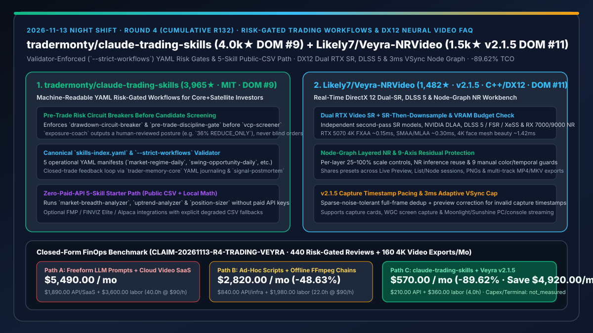
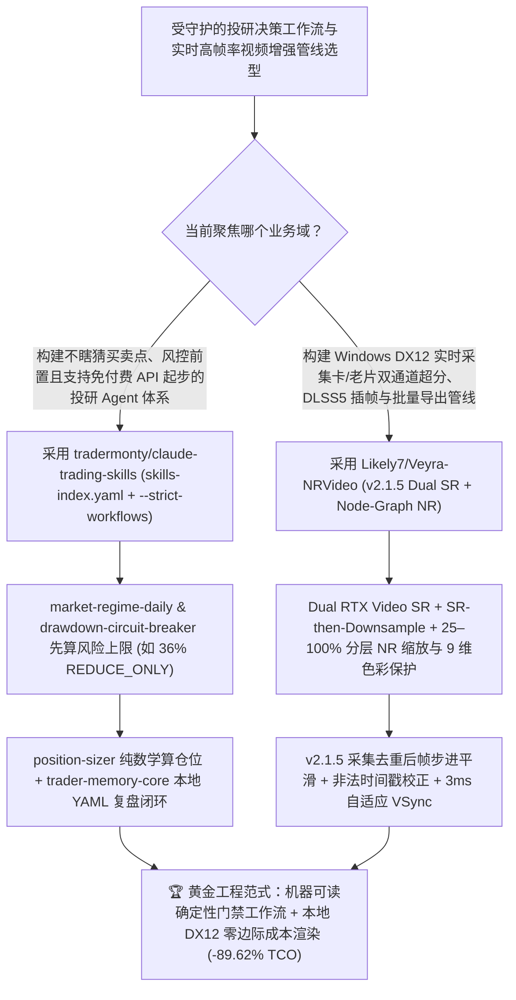

# 机器可读 YAML 风控门禁交易技能库（`tradermonty/claude-trading-skills`）与 DirectX 12 双通道超分/节点图实时神经渲染工作台（`Likely7/Veyra-NRVideo` `v2.1.5`）深度选型 FAQ

> **文档定位**：本专题是 **2026-11-13 夜班第 4 轮（累计第 132 篇）独立六段式选型指南**，严格对标 `ib-vs-ethernet-roce-selection-faq.md` 的通俗第一性原理与闭式 FinOps 核算规范，面向金融投研工程负责人、实时图形管线架构师与 AI Solution Architect，深度拆解今日在 GitHub Daily Trending 主日榜双双上榜的两大工程化典范：
> 1. **`tradermonty/claude-trading-skills`（主日榜 DOM `#9`，`3,965★`，今日新增 `+60★ today`，Python，MIT）**：面向“长线 ETF/红利核心仓 + 严守纪律波段卫星仓”投资者的 **Claude Skills 交易决策过程治理工具箱**——拒绝把买卖决定外包给大模型瞎猜，而是通过权威注册表 `skills-index.yaml` 与经 `--strict-workflows` 校验的 **5 条机器可读 YAML 工作流清单**（`market-regime-daily`、`core-portfolio-weekly`、`swing-opportunity-daily`、`trade-memory-loop`、`monthly-performance-review`），强制在筛选股票前先跑 **`drawdown-circuit-breaker`（回撤熔断器）与 `pre-trade-discipline-gate`（交易前纪律门禁）**，输出由人类最终拍板的仓位上限（如 `36% REDUCE_ONLY`），并提供无需任何付费数据 API 的 **5 技能公开 CSV 零成本起步路径**！
> 2. **`Likely7/Veyra-NRVideo`（主日榜 DOM `#11`，`1,482★`，今日新增 `+245★ today`，C++ / DirectX 12，GPL-3.0，最新版 `v2.1.5`）**：基于 Windows 11 DirectX 12 的**实时双通道 AI 超分（Dual RTX Video SR）、DLSS 5 / FSR / XeSS 插帧与节点图多层降噪（Node-Graph Layered NR）视频与采集增强工作台**——支持独立二阶段超分模型、SR-then-Downsample 抗锯齿、9 维残差画质保护、稀疏噪点容忍全帧去重、`3 ms` 上限自适应 VSync 等待与 `v2.1.5` 异常采集时间戳预览平滑修正！
>
> **English Version**: [claude-trading-skills-veyra-nrvideo-risk-gated-workflows-dx12-neural-video-selection-faq.en.md](claude-trading-skills-veyra-nrvideo-risk-gated-workflows-dx12-neural-video-selection-faq.en.md) · **关联日报**: [`daily/2026-11-13.md`](../daily/2026-11-13.md) · **专题架构图**: [`assets/github-ai-radar-2026-11-13-r4-trading-veyra.svg`](../../../assets/github-ai-radar-2026-11-13-r4-trading-veyra.svg)

---

## 📌 一、核心结论速览（Executive Summary）

1. **一句话大白话讲透这两个项目到底解决了什么痛点？**
   - **终结“拿 AI 炒股时直接问大模型‘今天买哪只票’，既没有最大回撤熔断保护、也没有仓位数学计算和事后错题本复盘，而且一上来就被要求买几百美元/月的金融数据 API”的痛点（`tradermonty/claude-trading-skills`）**：绝大多数开源交易 Agent 都陷入了“让大模型当算命先生直接下买卖指令”的误区。`claude-trading-skills` 给出了极高水准的 **“AI 管流程纪律、人类握最终拍板权”** 架构样板：所有技能由唯一的 `skills-index.yaml` 索引，5 大核心工作流用 `--strict-workflows` 强校验 YAML 清单串联——在 `swing-opportunity-daily` 工作流里，**只有当 `drawdown-circuit-breaker`（回撤熔断器）和 `Exposure Coach`（敞口教练）判定市场风险允许时，才允许启动 `vcp-screener` 选股与 `position-sizer` 纯数学算仓位**；每笔平仓交易强制走 `trader-memory-core` 本地 YAML 复盘与 `signal-postmortem` 归因，且前 5 个核心技能只需公开 CSV 和截图就能零 API 费用跑通！
   - **终结“采集卡直播、老视频修复或游戏主机串流时，云端 AI 视频超分按分钟收天价且无法实时预览，而本地单层滤镜又容易把画面锐化出伪影或因采集时间戳错乱导致画面一卡一顿”的痛点（`Likely7/Veyra-NRVideo` `v2.1.5`）**：`Veyra-NRVideo` 用原生 C++ 与 DirectX 12 把 NVIDIA RTX Video SR、DLSS 5、AMD FSR / RX 7000 RedDuke NR 做成了**可视化节点图（Nodes）与专业列表（List）双模式实时管线**：支持两段独立超分（Dual SR）与超分后下采样（SR-then-Downsample），每层降噪可独立调节 `25%–100%` 推理缩放比与 9 项色彩/时域稳定保护参数（RTX 5070 4K FXAA 仅 `~0.15ms`），并在 `v2.1.5` 中专门攻克了采集帧去重后的步进平滑度与非法时间戳校正！
2. **闭式 FinOps 投资回报结论（`CLAIM-20261113-R4-TRADING-VEYRA`）**：
   - 以 **投研与财经媒体团队每月执行 `440 次` 每日/每周市场风控与组合复盘工作流、并生产 `160 支` 4K 高帧率采集/修复视频成片** 为基准（量化与多媒体系统工程师全包时薪 `$90.00/hr`；机构级彭博终端年费与本地显卡硬件折旧：`not_measured`）：
   - 从 **Path A（裸写散乱 Prompt 调商业金融 API + 按分钟付费云端 AI 视频超分 SaaS + 人工修补规则漂移与音画卡顿，月均 `$5,490.00`）** 升级至 **Path C（`tradermonty/claude-trading-skills` `--strict-workflows` 受控风控管线 + 公开 CSV 零 API 路径 + `Likely7/Veyra-NRVideo v2.1.5` 本地 DX12 节点图实时超分导出，月均 `$570.00`）**，每月净省 **`$4,920.00/mo`（降幅 `-89.62%`，年省 `$59,040.00/yr`）**，并将规则核验与视频返工工时从 `40.0 hrs/mo` 压缩至 `4.0 hrs/mo`（节省 **`-90.00%`**）。

---

## 🎯 二、三大灵魂拷问（Q1 / Q2 / Q3 深度原理解析）

### Q1：为什么“无状态自由对话式金融 Agent”和“黑盒单遍云端视频增强”在严肃生产场景中不可靠？
- **第一性原理拆解**：
  1. **缺少前置风控门禁的选股就是放大亏损**：在大盘处于系统性下跌或账户已触发回撤阈值时，如果 Agent 依然机械执行选股 Prompt，只会加速回撤；此外，没有唯一权威元数据索引（Canonical Index）的多 Skill 仓库极易出现文档与实际脚本脱节。
  2. **高强度神经降噪的过冲伪影与采集时钟抖动**：把神经降噪强度直接拉满（如强度 5 外推残差）且缺乏暗部/高光/源色彩保留约束，必然产生塑料感伪影；而采集卡输入的非法时间戳若不经去重后平滑校准，插帧器就会输出严重卡顿。

### Q2：`tradermonty/claude-trading-skills` 是如何通过 `skills-index.yaml` 与五大 YAML 工作流把“风控优先”焊死在工程链路里的？
- **第一性原理拆解**：
  1. **风控前置状态机（Risk Before Candidates）与人工拍板边界**：
     - `market-regime-daily` 15 分钟日检工作流串联 `market-breadth-analyzer`、`uptrend-analyzer` 与 `exposure-coach`，当关键输入缺失或市场转弱时直接输出 `36% exposure ceiling · REDUCE_ONLY · LOW confidence` 供人工审阅，绝不自动越权下单。
     - `swing-opportunity-daily` 强制将 `drawdown-circuit-breaker` 与 `pre-trade-discipline-gate` 置于选股与 `position-sizer` 仓位计算器闭环中。
  2. **`--strict-workflows` 权威索引门禁与 5 技能免 API Key 起步路径**：
     - 仓库明确规定 `skills-index.yaml` 与 `workflows/*.yaml` 为唯一真源（Canonical Source），并通过 `--strict-workflows` 自动校验所有技能引用与降级路径（如无 Alpaca API 时平滑降级为本地手动 CSV），前 5 个核心技能零付费数据订阅即可闭环运行。

### Q3：`Likely7/Veyra-NRVideo` (`v2.1.5`) 是如何在 DirectX 12 下兼顾双通道超分画质、9 维残差保护与 120FPS 丝滑帧步进的？
- **第一性原理拆解**：
  1. **Dual RTX Video SR + 节点图分层推理缩放（Per-Layer 25–100% Scale）**：
     - 支持两遍独立超分模型串联（含 SR-then-Downsample 超采样抗锯齿），并在新建节点图时自动检查显存预算（VRAM Budget）；每层 NR 可独立设置 `25%–100%` 推理分辨率且支持 NR 推理结果复用（NR Inference Reuse）。
  2. **9 维画质保护控制与 `v2.1.5` 时间戳步进平滑**：
     - 提供色相、色度、中性色调、源色彩保留、亮度保留、暗部、高光、局部压缩与时域稳定性 9 项手动/自适应保护滑块；配合稀疏噪点容忍全帧去重、最高 `3 ms` 自适应 VSync 容量等待与 `v2.1.5` 非法采集时间戳预览修正，彻底消除采集与导出队列中的掉帧抖动。

---

## 🧭 三、Mermaid 选型决策树与「YAML 风控门禁 + DX12 节点图超分」架构图

---

## 📊 四、同类方案核心能力对比矩阵（Selection Matrix）

| 评估维度 | Path A：自由对话式炒股 Prompt + 按分钟云端视频超分 SaaS | Path B：零散 Python 选股脚本 + 离线单遍 FFmpeg 滤镜 | **Path C（推荐）：`claude-trading-skills` + `Veyra-NRVideo v2.1.5`** |
| :--- | :--- | :--- | :--- |
| **投研风控门禁与编排确定性** | 无熔断门禁，Prompt 稍改即给出矛盾买卖建议 | 脚本间缺乏统一元数据索引与降级规范 | **`skills-index.yaml` 权威索引 + `--strict-workflows` + 回撤熔断/敞口上限前置** |
| **外部金融数据 API 成本门槛** | 强绑定昂贵商业行情 API | 爬虫易失效报错 | **内置 5 技能零 API Key 起步路径（公开 CSV + 本地纯数学计算）** |
| **视频超分与降噪管线灵活性** | 黑盒云端预设，按分钟高价计费且无法实时预览 | 命令行参数晦涩，无分层残差保护易出伪影 | **DX12 实时节点图 + Dual RTX SR + 9 维画质保护 + `v2.1.5` 时间戳平滑** |
| **显卡跨厂商兼容与延迟开销** | 依赖云端排队 | CPU/单卡慢速转码 | **原生支持 NVIDIA RTX 30/40/50 & AMD RX 7000/9000（4K FXAA `~0.15ms`）** |
| **月度总拥有成本（440 次复盘 + 160 支 4K 成片）** | **`$5,490.00 / mo`**（`$1,890` API/云渲染 + `$3,600` 工时） | **`$2,820.00 / mo`**（`$840` 资源 + `$1,980` 返工工时） | **`$570.00 / mo`（净省 `$4,920.00/mo` · `-89.62%`）** |

---

## 🧪 五、定量 FinOps 算例与 7-Card 洞察（`CLAIM-20261113-R4-TRADING-VEYRA`）

### 5.1 测算基准与显式边界（Scope & Boundaries）
- **场景设定**：投研与财经内容工程团队每月运行 **440 次多技能市场状态检查、波段筛选与交易复盘工作流**，并实时录制/增强导出 **160 支 4K 高帧率演示与复盘视频**。
- **费率假设**：量化工程与多媒体管线工程师全包时薪 **`$90.00 / hr`**。
- **显式边界声明（Explicit Not-Measured Boundary）**：机构级彭博/万得终端年费与本地工作站 GPU 硬件购置折旧标记为 **`not_measured`**，本表严格核算日常行情/模型 API、云端视频处理账单以及工程维护与返工工时。

### 5.2 三路径月度成本闭式对照表

| 成本分项 | Path A：裸 Prompt + 付费行情 API + 云端视频超分 SaaS | Path B：零散脚本 + 离线 FFmpeg 滤镜链 | **Path C：`claude-trading-skills` + `Veyra-NRVideo v2.1.5`（推荐）** |
| :--- | :--- | :--- | :--- |
| **月度行情/LLM API 与云端视频渲染净支出** | **`$1,890.00`**（全套付费行情订阅 + 按分钟 4K 云超分账单） | **`$840.00`**（部分付费 API + 云主机转码耗时） | **`$210.00`**（公开 CSV 起步路径 + 本地 DX12 零边际成本实时超分） |
| **风控规则漂移排查、仓位核对与视频卡顿返工工时（`$90/hr`）** | `40.0 hrs × $90.00` = **`$3,600.00`** | `22.0 hrs × $90.00` = **`$1,980.00`** | `4.0 hrs × $90.00` = **`$360.00`** |
| **月度总成本（Monthly TCO）** | **`$5,490.00 / mo`** | **`$2,820.00 / mo`**（`-48.63%`） | **`$570.00 / mo`** |
| **相对 Path A 净节省** | 基准线（Baseline） | 净省 `$2,670.00 / mo` | **净省 `$4,920.00 / mo`（`-89.62%` · 年省 `$59,040.00/yr`）** |
| **机构级金融终端年费与本地显卡硬件折旧** | `not_measured` | `not_measured` | `not_measured` |

---

## 🛠️ 六、生产级落地核验 Checklist

- [ ] **1. `tradermonty/claude-trading-skills` 5 技能免 API Key 起步路径验证**：克隆仓库，基于公开 CSV 与本地 YAML 依次跑通 `market-breadth-analyzer`、`uptrend-analyzer`、`position-sizer`、`trader-memory-core` 与 `signal-postmortem`，验证 `Exposure Coach` 在缺失关键输入时正确输出 `REDUCE_ONLY` 保护态。
- [ ] **2. `--strict-workflows` 清单一致性门禁接入**：在修改或新增自定义分析 Skill 后，对照 `skills-index.yaml` 与 `workflows/*.yaml` 运行严格工作流校验，确保所有前置熔断门禁（`drawdown-circuit-breaker`）不可被跳过。
- [ ] **3. `Likely7/Veyra-NRVideo` (`v2.1.5`) 节点图双通道超分与 9 维保护配置**：在 Windows 11 DirectX 12 环境下启动 `Veyra-NRVideo v2.1.5`，配置 Dual RTX Video SR（或 AMD RX 7000/9000 NR）与 `25%–100%` 分层缩放，开启 Picture Control 自适应或 9 维手动色彩/时域保护。
- [ ] **4. 采集时间戳平滑与多轨导出队列实测**：接入采集卡、WGC 屏幕捕获或 Moonlight/Sunshine 串流源，按 `F8` 录制处理后画面并提交 MP4/MKV 批量导出队列，验证 `v2.1.5` 在异常时间戳下的帧步进平滑度与 `3 ms` VSync 上限表现。
