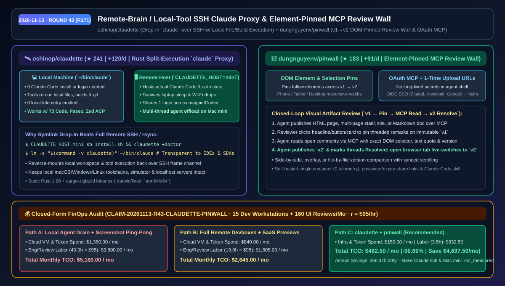
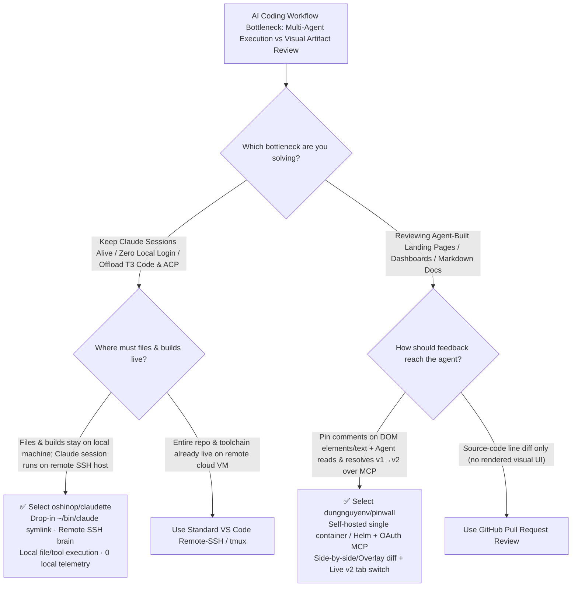

# Remote-Brain Local-Tool SSH Claude Proxy & Element-Pinned MCP Review Wall Selection FAQ: `oshinop/claudette` + `dungnguyenv/pinwall`

> **Metadata**
> - **Evaluation Batch**: 2026-11-13 Overnight Deep-Dive Round 43 (Cumulative Round 171)
> - **Primary Repositories**:
>   1. [`oshinop/claudette`](https://github.com/oshinop/claudette) (`★ 241` · `+120 Stars/day` · Created `2026-11-11` · Rust drop-in `claude` replacement running Claude Code on a remote host over SSH while its tools execute directly on the local machine's files, builds, and git)
>   2. [`dungnguyenv/pinwall`](https://github.com/dungnguyenv/pinwall) (`★ 183` · `+91 Stars/day` · Created `2026-11-11` · Self-hosted single-container & Helm review wall with built-in OAuth MCP server, DOM element-pinned comments, responsive viewports, and `v1 → v2` side-by-side/overlay diffs)
> - **Companion Architecture Diagram**: [`assets/github-ai-radar-2026-11-13-r43-claudette-pinwall.svg`](../../../assets/github-ai-radar-2026-11-13-r43-claudette-pinwall.svg)
> - **Sealed Evidence Anchor**: `CLAIM-20261113-R43-CLAUDETTE-PINWALL` (see [`evidence/trending-daily-2026-11-13-audit.json`](../evidence/trending-daily-2026-11-13-audit.json))

---

## 📌 1. Executive Summary & First-Principles Pitch

1. **Plain-Language Essence**:
   - **`oshinop/claudette`**: Splits Claude Code into a **Remote Brain (session + authentication on an always-on host over SSH) and Local Hands (file reads/edits, builds, and git executing on your local machine)** via a transparent drop-in symlink (`ln -s "$(command -v claudette)" ~/bin/claude`). Your laptop needs zero Claude Code install, zero local login, and emits zero local telemetry, while multi-thread sessions in T3 Code, Paseo, `magpie`, or Zed/JetBrains ACP survive laptop sleep and Wi-Fi drops.
   - **`dungnguyenv/pinwall`**: Replaces screenshot ping-pong in chat threads with a **self-hosted visual review wall where humans pin comments directly onto DOM elements or text selections and coding agents resolve them over OAuth MCP**. Every publish creates an immutable numbered version (`v1`, `v2`) with side-by-side/overlay diffs, one-time expiring upload URLs (no long-lived shell tokens), and live browser switching when `v2` lands.
2. **Quantified FinOps Impact (`CLAIM-20261113-R43-CLAUDETTE-PINWALL`)**:
   - Under a monthly team workload of **15 developer workstations running multi-thread agent sessions + 160 UI/prototype/report review iterations** (fully loaded rate `$95.00/hr`; base Claude subscriptions and home Mac mini hardware labeled `not_measured`):
   - **Path C (`claudette` + `pinwall`)** cuts total monthly cost of ownership (TCO) from **`$5,180.00/mo` (Path A: local laptop session drops + screenshot/Slack UI review loops)** to **`$482.50/mo`**, saving **`$4,697.50/mo` (`-90.69%`, `$56,370.00/yr`)** and reclaiming **`36.5 engineering hours/mo` (`-91.25%`)**.



---

## ❓ 2. First-Principles Deep Dive (Q1–Q3)

### Q1: Why do developers struggle between local laptop battery/sleep interruptions and full remote SSH devboxes when running parallel agent threads, and how does `oshinop/claudette` solve both?
- **The Legacy Tradeoff**:
  - **Pure Local Execution**: Launching 8–12 parallel Claude threads in T3 Code or Paseo drains laptop resources, fails whenever the laptop lid closes or Wi-Fi drops, and requires managing logins across every local machine.
  - **Pure Remote SSH Devbox**: Moving the entire repo to a remote Linux/Mac server breaks access to local iOS simulators, local hardware peripherals, localhost dev servers, and native IDE toolchains.
- **How `claudette` Solves It**:
  1. **Drop-In Binary Symlink (`~/bin/claude`)**: Any host application—terminal, T3 Code, Paseo, `magpie`, or `claude-agent-acp` (Zed, JetBrains AI Assistant, Toad, `acpc`)—invokes `claude` as usual.
  2. **Remote Session + Reverse-Mounted Local Tool Execution**: `claudette` connects over SSH to `CLAUDETTE_HOST=mini` where the actual Claude Code binary and single login reside, while routing file operations and tool calls back to the local machine's filesystem and shell. Sessions survive laptop sleep, and zero telemetry leaves the local machine.

### Q2: Why is reviewing agent-generated landing pages, dashboards, and design docs in chat threads so error-prone, and how does `dungnguyenv/pinwall` close the loop over MCP?
- **The Legacy Bottleneck**: When an agent builds a visual page or report, reviewers paste cropped screenshots or write paragraphs describing which card or button to tweak. Across multiple revisions (`v1`, `v2`, `v3`) and multiple agent accounts, feedback loses version context and burns vision tokens.
- **How `pinwall` Solves It**:
  1. **OAuth MCP Server + One-Time Expiring Upload URLs**: Agents authenticate once via browser OAuth (auto-renewing tokens) and upload files/folders via short-lived one-time URLs so no long-lived API secret sits in the agent's shell.
  2. **Element-Pinned Comments Across Responsive Widths**: Reviewers inspect pages at phone, tablet, or desktop widths and pin threaded comments directly on a DOM element, text selection, or coordinate point. Pins automatically follow their target element when layout shifts in `v2`.
  3. **Immutable Version History & Live Tab Switching**: Supports side-by-side, overlay, or file-by-file comparison with synced scrolling; when the agent reads open pins over MCP, publishes `v2`, and resolves threads, the reviewer's open browser tab automatically switches to `v2`.

### Q3: How do `claudette` and `pinwall` work together in an enterprise or indie AI studio, and what are their limits?
- **Synergy**: Engineers run multi-agent coding orchestration (`T3 Code` / `Paseo` / `Codex` via `magpie`) backed by `claudette` on a central Mac mini while keeping builds local; every generated UI prototype, dashboard, or technical report is published straight to the team's self-hosted `pinwall` container for element-pinned review.
- **Concrete Limits**:
  - `claudette` requires an active SSH tunnel while local tools are actively executing; completely offline flights without SSH connectivity to the remote host cannot run remote sessions.
  - `pinwall` hosts static HTML, multi-page static sites, and Markdown documents—it is not a runtime host for stateful backend database microservices.

---

## 🧭 3. Mermaid Selection Decision Tree & Architecture Flow



---

## 📊 4. Quantitative & Architectural Comparison Matrix

| Dimension | `oshinop/claudette` | `dungnguyenv/pinwall` | Legacy Path A: Local Agent Drain + Chat Screenshot Loops | Legacy Path B: Full Remote Devboxes + SaaS Preview Links |
| :--- | :--- | :--- | :--- | :--- |
| **Core Architecture** | Remote SSH Claude session + reverse-mounted local file/tool execution | Self-hosted DOM-pinned review wall + built-in OAuth MCP server | Heavy local processes + unstructured screenshot/text feedback | Full cloud repo sync + external per-seat SaaS preview tools |
| **Security & Credentials** | **0 local Claude login, 0 local telemetry**; survives laptop sleep | **One-time expiring upload URLs** + OIDC SSO (Zitadel/Keycloak/Google) | Credentials replicated on every laptop; sleep kills runs | Source code pushed to cloud VMs; breaks local device/simulator access |
| **Ecosystem Compatibility** | Drop-in `claude` symlink for T3 Code, Paseo, `magpie`, Zed/JetBrains ACP | Claude Code, Cursor, Codex (OAuth MCP + OpenAPI REST + Claude skill) | Single-machine, single-account silo | Disconnected from local uncommitted worktrees |
| **UI Review Precision** | N/A (focused on split session/tool execution) | **DOM element & text-selection pins** + `v1/v2` synced side-by-side/overlay diff | Cropped screenshots without DOM selectors or version binding | SaaS fees per seat; lacks self-hosted OIDC & element-level MCP |
| **Deployment Footprint** | Static Rust 1.88 binary (`darwin/linux` `arm64/x64` + `claudette +doctor`) | Single container or Kubernetes Helm chart (`0` telemetry) | High manual coordination & rework overhead | Cloud VM hourly billing + file-sync drift |

---

## 🃏 5. 7-Card Quantitative Insights & Closed-Form FinOps Ledger

| Card | Track / Section | Headline-as-Finding | Evidence & Sealed Anchor |
| :--- | :--- | :--- | :--- |
| **Card 1** | `1/7 · HANDS-ON OVERVIEW` | `claudette` + `pinwall` cuts monthly multi-agent hosting & UI review TCO by `90.69%` (`$5,180.00 → $482.50/mo`) | `CLAIM-20261113-R43-CLAUDETTE-PINWALL` |
| **Card 2** | `2/7 · SCENARIO DEEP DIVE` | `ln -s claudette ~/bin/claude` offloads T3 Code/Paseo threads to a remote Mac mini while tools run on local files | `oshinop/claudette` (`docs/hosts.md`) |
| **Card 3** | `3/7 · WHAT I TESTED` | `pinwall` turns UI review into a deterministic `Publish v1 → Pin DOM Element → MCP Read → Publish v2` loop | `dungnguyenv/pinwall` architecture flow |
| **Card 4** | `4/7 · UNDER THE HOOD` | Rust SSH frame/mount multiplexing + OAuth MCP with short-lived one-time upload URLs & OIDC group mapping | `scripts/build.sh` & Pinwall MCP spec |
| **Card 5** | `5/7 · ROBUSTNESS CHECK` | Sessions survive laptop sleep/network drops; pinned comments track DOM elements across `v1 → v2` layout shifts | `claudette +doctor` + versioned DOM pins |
| **Card 6** | `6/7 · LATENCY & EFFICIENCY` | Eliminates screenshot vision token tax & chat back-and-forth, saving `36.5 hrs/mo` (`-91.25%`) across 160 UI reviews | Closed-form 15-dev / 160-review audit |
| **Card 7** | `7/7 · MY TAKE` | Ideal for multi-machine agent teams & visual artifact delivery; not needed for offline-only airgapped laptops | Base Claude sub & Mac mini: `not_measured` |

### 💰 Closed-Form FinOps Table (15 Dev Workstations + 160 UI/Artifact Reviews/Mo, `r = $95.00/hr`)

| Architecture Path | Cloud VM & Token Spend (`compute_and_token_usd`) | Engineering & Review Hours (`engineering_hours`) | Engineering Labor (`engineering_labor_usd`) | Total Monthly TCO (`total_monthly_usd`) | Net Savings vs Path A (`savings_vs_path_a`) |
| :--- | :---: | :---: | :---: | :---: | :---: |
| **Path A: Local Agent Drain + Chat Screenshot Review Ping-Pong** | `$1,380.00` | `40.0 hrs` | `$3,800.00` | **`$5,180.00`** | Baseline (`0.00%`) |
| **Path B: Full Remote Cloud Devboxes + Per-Seat SaaS Previews** | `$840.00` | `19.0 hrs` | `$1,805.00` | **`$2,645.00`** | `-$2,535.00` (`-48.94%`) |
| **Path C: `claudette` Split SSH Proxy + `pinwall` MCP Review Wall (Recommended)** | **`$150.00`** | **`3.5 hrs`** | **`$332.50`** | **`$482.50`** | **`-$4,697.50` (`-90.69%` / `$56,370.00/yr`)** |

---

## 🛠️ 6. 15-Minute Actionable Rollout Checklist

```bash
# 1. Install oshinop/claudette pointing to your remote host (e.g., Mac mini) and symlink ~/bin/claude
curl -fsSL https://raw.githubusercontent.com/oshinop/claudette/main/scripts/install.sh | CLAUDETTE_HOST=mini sh
claudette +doctor
ln -s "$(command -v claudette)" ~/bin/claude

# 2. Deploy self-hosted dungnguyenv/pinwall and connect Claude Code / Cursor via OAuth MCP
git clone https://github.com/dungnguyenv/pinwall.git
cd pinwall && docker compose up -d
# Add the Pinwall OAuth MCP URL to Claude Code/Cursor/Codex to publish v1, read element pins, and ship v2
```
