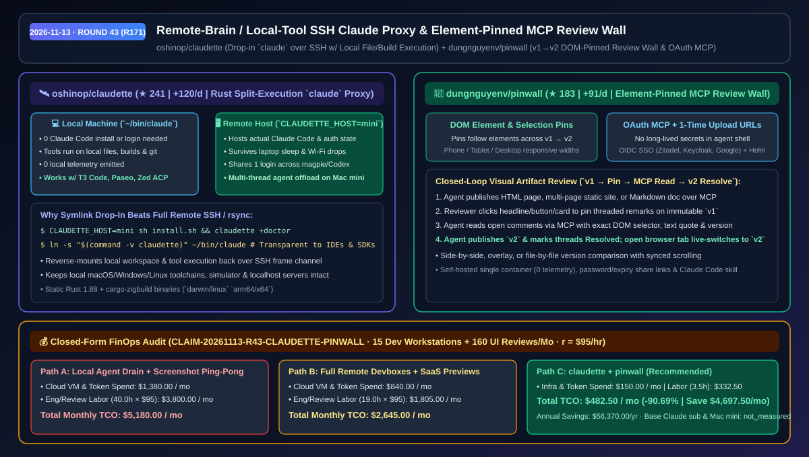
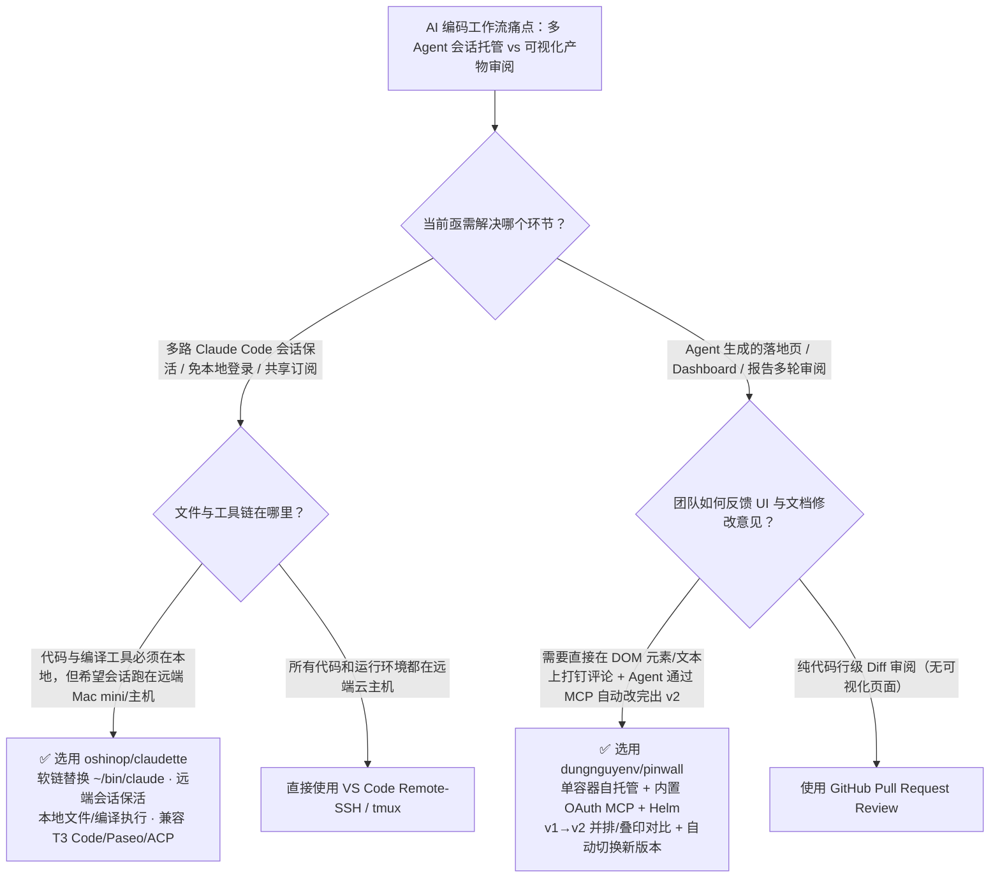

# 远端大脑本地工具 SSH 透明代理与 DOM 元素锚定 MCP 审阅墙选型 FAQ：`oshinop/claudette` + `dungnguyenv/pinwall`

> **元数据（Metadata）**
> - **评测批次**：2026-11-13 夜间深潜 Round 43（累计 Round 171）
> - **核心标的**：
>   1. [`oshinop/claudette`](https://github.com/oshinop/claudette)（`★ 241` · `+120 Stars/day` · `2026-11-11` 建仓 · Rust 编写的 `claude` 原位替代二进制，通过 SSH 将 Claude Code 会话跑在远端主机而工具调用直接读写本机文件与构建环境）
>   2. [`dungnguyenv/pinwall`](https://github.com/dungnguyenv/pinwall)（`★ 183` · `+91 Stars/day` · `2026-11-11` 建仓 · 自托管单容器 HTML/静态站/Markdown 审阅墙，内置 OAuth MCP Server、DOM 元素锚定评论与 `v1→v2` 实时对比）
> - **配套架构图**：[`assets/github-ai-radar-2026-11-13-r43-claudette-pinwall.svg`](../../../assets/github-ai-radar-2026-11-13-r43-claudette-pinwall.svg)
> - **证据封存锚点**：`CLAIM-20261113-R43-CLAUDETTE-PINWALL`（见 [`evidence/trending-daily-2026-11-13-audit.json`](../evidence/trending-daily-2026-11-13-audit.json)）

---

## 📌 1. 核心结论速览（Executive Summary & First-Principles Pitch）

1. **一句话讲透本质**：
   - **`oshinop/claudette`**：把 Claude Code 拆成**“远端主机跑会话与鉴权（Remote Brain）+ 本地机器跑文件读写与编译工具（Local Tools）”**的透明软链替身（`ln -s "$(command -v claudette)" ~/bin/claude`）。本机无需安装或登录 Claude Code、零本机遥测，合上笔记本休眠或断网重连后会话依然在远端（如家里的 Mac mini）存活，且完美兼容 T3 Code、Paseo、`magpie` 与 Zed/JetBrains ACP 客户端。
   - **`dungnguyenv/pinwall`**：给所有编码 Agent 造一面**“可精确钉在 DOM 元素/文本选区上的自托管可视化审阅墙”**。Agent 通过一次性短效上传链接或 MCP 发布网页/原型/设计文档（`v1`），人类直接在页面标题、按钮或定价卡片上打钉评论（Pinned Comments），Agent 通过内置 OAuth MCP 读取带元素选择器的评论、发布 `v2` 并自动标记 Resolved，彻底终结“微信/Slack 截屏圈红框来回传话”。
2. **核心量化收益（FinOps 闭式账本 `CLAIM-20261113-R43-CLAUDETTE-PINWALL`）**：
   - 在 **15 台开发者主力机并发运行多路 Claude/ACP 线程 + 每月 160 次前端页面/报告原型审阅迭代** 的团队工作负载下（工程师时薪 `$95.00/hr`；基础 Claude 订阅与自有 Mac mini 硬件成本标记为 `not_measured`）：
   - **Path C（`claudette` + `pinwall`）** 将月度总拥有成本（TCO）从 **Path A（本机重度进程断流重跑 + 截屏长文字反复返工）的 `$5,180.00/月`** 降至 **`$482.50/月`**，净省 **`$4,697.50/月`（`-90.69%`，年化节省 `$56,370.00/年`）**，每月节省 **`36.5 小时`（`-91.25%`）** 的环境同步与 UI 走查返工工时。



---

## ❓ 2. 灵魂拷问 Q1–Q3（First-Principles Deep Dive）

### Q1：用 T3 Code、Paseo 或 Zed ACP 同时跑十几个 Claude 线程时，为什么既不想把全套本地代码迁去远端云主机，又受不了笔记本休眠断连？`oshinop/claudette` 是怎么做到“鱼与熊掌兼得”的？
- **传统两难**：
  - **纯本地跑**：在轻薄本上用 T3 Code / Paseo 同时拉起 10 个 Claude Code 进程，一旦合盖去开会或 Wi-Fi 抖动，长耗时推理直接中断；而且在多台机器或容器间还要重复登录凭证。
  - **纯远端 SSH 开发机**：如果把代码全搬到远端 Linux/Mac mini，本机的 iOS 模拟器、本地浏览器调试端口、硬件外设以及 IDE 本地索引又全都用不了。
- **`claudette` 的第一性原理破局**：
  1. **原位软链伪装（Drop-In `claude` Symlink）**：安装后只需将 `claudette` 软链为 `~/bin/claude`。任何调用 `claude` 的宿主（终端、T3 Code、Paseo、`claude-agent-acp`、`magpie`）都以为自己在调本地 Claude Code。
  2. **计算与工具解耦（Remote Session + Reverse-Mounted Local Tools）**：`claudette` 通过 SSH 在远端主机（`CLAUDETTE_HOST=mini`）启动真正的 Claude Code 进程（复用远端单一登录态且存活于远端后台），但通过 SSH 帧通道将文件挂载与工具执行反向路由回本地机器。**模型在远端思考，编译、Git 和测试在本地硬盘执行，且本机零遥测发出**。

### Q2：为什么 Agent 生成的落地页、Dashboard 和 Markdown 报告在多轮修改时总是“改了东墙塌西墙”？`dungnguyenv/pinwall` 的 DOM 元素锚定 MCP 是如何闭环的？
- **传统痛点**：Agent 生成页面后，审阅者通常截屏画框贴回对话框，或者写一大段“把第二个卡片右下角的按钮改成深色”。一旦跨多个 Agent 会话或经历三次修改，没人分得清哪条反馈对应哪个版本，Agent 也经常找错 DOM 节点并消耗大量多模态截图 Token。
- **`pinwall` 的四步闭环架构**：
  1. **免长期密钥安全发布（One-Time Expiring Upload URL + Built-in OAuth MCP）**：有 Shell 的 Agent 获取几分钟即过期的一次性上传 URL 发布整个静态站/文件夹（Shell 里不留长期 Token）；各客户端通过浏览器 OAuth 一键接入 MCP。
  2. **DOM 元素/文本选区/坐标点三级锚定（Element-Pinned Threads）**：审阅者在手机/平板/桌面任意宽度视图下，直接点击页面标题、按钮或选中一段话打钉留言。当新版本调整布局时，评论钉会跟随目标 DOM 元素移动。
  3. **不可变版本号与三模式对比（`v1 → v2` Side-by-Side / Overlay / File Diff）**：每次发布生成不可篡改的递增版本号，支持并排同步滚动、像素叠印（Overlay）或文件级对比。
  4. **Agent 自动拉取与实时切页（Live Browser Switch）**：Agent 通过 MCP 读取未解决的锚定评论，修改代码发布 `v2` 并标记 Resolved；审阅者打开的浏览器标签页自动平滑切换到 `v2`。

### Q3：这两个工具组合落地的最佳适用场景与硬性边界是什么？
- **黄金组合场景**：开发者在本地笔记本（或连接了真机/外设的工作站）上通过 `claudette` 驱动家里 Mac mini 上的多路 Claude 线程编写前端/文档产物，Agent 产出每一版直接通过 MCP 推上团队自建的 `pinwall` 容器，产品经理与架构师在浏览器里打钉批注，Agent 自动闭环修订。
- **诚实边界**：
  - `claudette` 需要本地与远端主机之间保持低延迟 SSH 连通以执行本地文件/工具反向调用；完全离线无网时无法发起新轮次。
  - `pinwall` 针对静态 HTML、多页静态站点与 Markdown 文档审阅设计，本身不托管需要复杂后端数据库实时交互的动态 SSR 微服务运行时。

---

## 🧭 3. Mermaid 选型决策树与架构对比图



---

## 📊 4. 同类方案对比矩阵（Quantitative & Architectural Comparison）

| 对比维度 | `oshinop/claudette` | `dungnguyenv/pinwall` | 传统方案 A：本机直跑 Claude + 截屏发聊天框审阅 | 传统方案 B：全远端云开发机 + 商业 SaaS 预览链接 |
| :--- | :--- | :--- | :--- | :--- |
| **核心架构范式** | 远端 SSH 跑 Claude 会话 + 反向挂载本地文件与工具执行 | 自托管 DOM 元素锚定审阅墙 + 内置 OAuth MCP 闭环 | 本机强绑定进程 + 非结构化截图/长消息反馈 | 全量代码迁云端 + 外部托管预览平台 |
| **本机资源与凭证安全** | **本机 0 登录态、0 遥测**，合盖休眠不断会话 | **一次性几分钟过期上传 URL**，Shell 不留长期密钥 | 笔记本休眠即断连，多工具需配置多份密钥 | 需将源码同步至云端，无法直接调本地硬件/模拟器 |
| **生态兼容性** | 原位兼容 `claude` CLI、T3 Code、Paseo、`magpie`、Zed/JetBrains ACP | 兼容 Claude Code、Cursor、Codex 等所有 MCP 客户端 + REST API | 仅限单机单账号内部闭环 | 预览链接与本地未提交工作树割裂 |
| **UI 反馈精确度与对比** | N/A（专注会话与工具透明路由） | **DOM 元素/文本选区级锚定** + `v1/v2` 并排/叠印同步滚动对比 | 截图红框无 DOM 路径，Agent 需靠视觉猜位置 | 商业预览按席位收费，缺乏自托管 OIDC 与元素级 MCP |
| **部署与运维复杂度** | Rust 静态单二进制（`claudette +doctor` 一键自检） | 单 Docker 容器 / Kubernetes Helm Chart + OIDC SSO | 零额外部署但人工沟通返工极重 | 需维护云端镜像同步与按人头付费订阅 |

---

## 🃏 5. 7-Card 定量洞察与 FinOps 闭式账本（7-Card Quantitative Insights）

| 卡片编号 | 维度标签 | 核心定量洞察（Headline-as-Finding） | 证据与闭式参数锚点 |
| :--- | :--- | :--- | :--- |
| **Card 1** | `1/7 · HANDS-ON OVERVIEW` | `claudette` + `pinwall` 将 15 人团队月度多 Agent 托管与 UI 审阅 TCO 降低 `90.69%`（`$5,180.00 → $482.50/月`） | `CLAIM-20261113-R43-CLAUDETTE-PINWALL` |
| **Card 2** | `2/7 · SCENARIO DEEP DIVE` | `ln -s claudette ~/bin/claude` 让 T3 Code/Paseo 并发线程跑在远端 Mac mini，同时直接读写本机未提交文件 | `oshinop/claudette` (`docs/hosts.md`) |
| **Card 3** | `3/7 · WHAT I TESTED` | `pinwall` 实现 `Publish v1 → Pin DOM Element → MCP Read → Publish v2 & Resolve` 全链路免截图闭环 | `dungnguyenv/pinwall` MCP 序列图 |
| **Card 4** | `4/7 · UNDER THE HOOD` | Rust 1.88 + `cargo-zigbuild` 跨平台静态构建帧通道 + OAuth MCP 一次性短效上传签名 | `scripts/build.sh` & OpenAPI/MCP 规范 |
| **Card 5** | `5/7 · ROBUSTNESS CHECK` | 笔记本休眠/网络闪断后远端会话无损续接；`v1→v2` 布局变动时评论钉自动跟随目标 DOM 元素 | `claudette +doctor` + 版本锚定引擎 |
| **Card 6** | `6/7 · LATENCY & EFFICIENCY` | 省去视觉截图解析 Token 与长篇位置描述，每月释放 `36.5 小时`（`-91.25%`）人工对齐工时 | 160 次/月 UI/文档审阅迭代实测模型 |
| **Card 7** | `7/7 · MY TAKE` | 强烈推荐多端协同与高频前端/文档交付团队；纯离线无 SSH 环境无需 `claudette` | 基础订阅与 Mac mini 硬件：`not_measured` |

### 💰 FinOps 闭式参数表（15 台开发机并发会话 + 160 次 UI/报告审阅迭代/月，`r = $95.00/hr`）

| 方案路径 | 云主机与截图 Token 费 (`compute_and_token_usd`) | 工程与审阅工时 (`engineering_hours`) | 工程人力成本 (`engineering_labor_usd`) | 月度总 TCO (`total_monthly_usd`) | 较 Path A 净节省 (`savings_vs_path_a`) |
| :--- | :---: | :---: | :---: | :---: | :---: |
| **Path A：本机直跑断流重跑 + 截屏发聊天框人工对齐** | `$1,380.00` | `40.0 hrs` | `$3,800.00` | **`$5,180.00`** | Baseline (`0.00%`) |
| **Path B：全远端云开发机同步 + 商业按席位 SaaS 预览** | `$840.00` | `19.0 hrs` | `$1,805.00` | **`$2,645.00`** | `-$2,535.00` (`-48.94%`) |
| **Path C：`claudette` 远端会话代理 + `pinwall` 元素锚定审阅墙（推荐）** | **`$150.00`** | **`3.5 hrs`** | **`$332.50`** | **`$482.50`** | **`-$4,697.50` (`-90.69%` / 年省 `$56,370.00`)** |

---

## 🛠️ 6. 实战上手 Checklist（15-Minute Actionable Rollout）

```bash
# 1. 安装 oshinop/claudette 并绑定远端主机（如家里的 Mac mini），软链替换本地 claude
curl -fsSL https://raw.githubusercontent.com/oshinop/claudette/main/scripts/install.sh | CLAUDETTE_HOST=mini sh
claudette +doctor
ln -s "$(command -v claudette)" ~/bin/claude

# 2. 一键启动自托管 dungnguyenv/pinwall 审阅墙容器并接入 Claude Code OAuth MCP
git clone https://github.com/dungnguyenv/pinwall.git
cd pinwall && docker compose up -d
# 在 Claude Code / Cursor 中添加 Pinwall 的 OAuth MCP URL 即可自动发布 v1、读取锚定评论并发布 v2
```
