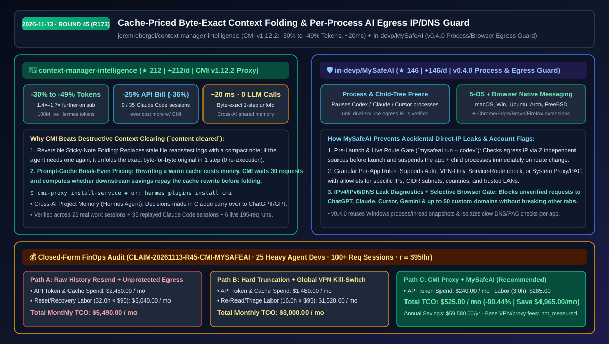
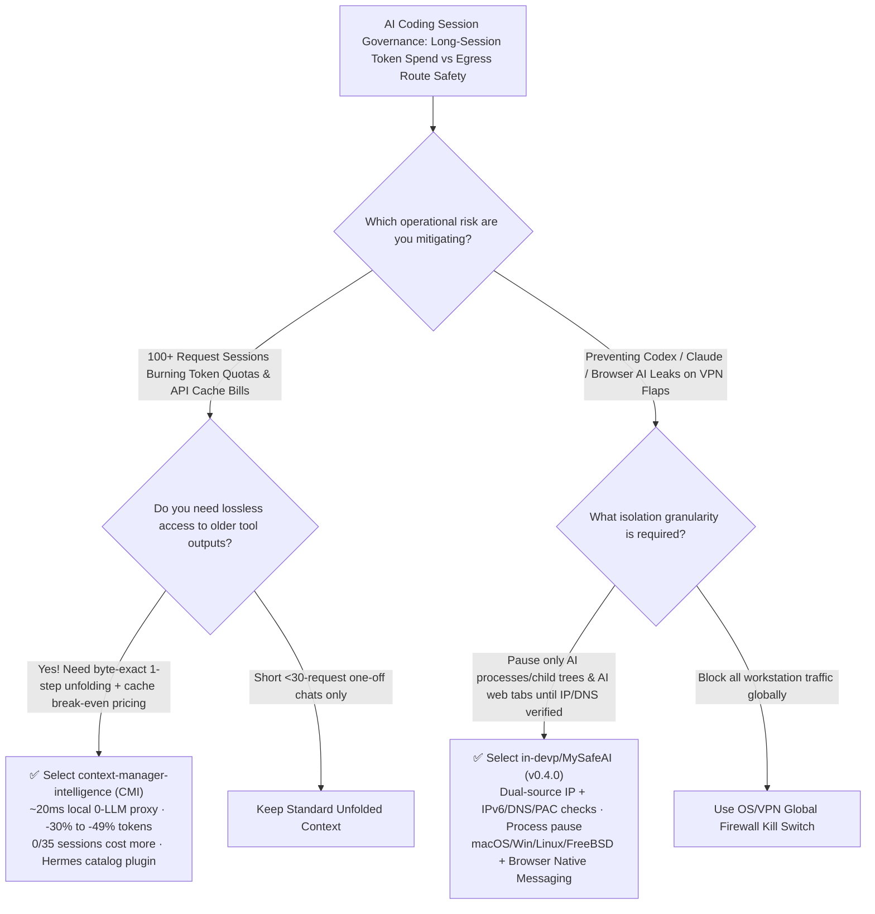

# Cache-Priced Reversible Context Folding Proxy & Per-Process AI Egress Guard Selection FAQ: `jeremiebergel/context-manager-intelligence` + `in-devp/MySafeAI`

> **Metadata**
> - **Evaluation Batch**: 2026-11-13 Overnight Deep-Dive Round 45 (Cumulative Round 173)
> - **Primary Repositories**:
>   1. [`jeremiebergel/context-manager-intelligence`](https://github.com/jeremiebergel/context-manager-intelligence) (`★ 212` · `+212 Stars/day` · Created `2026-11-12` · `CMI v1.12.2` local, deterministic, zero-LLM `~20 ms/req` proxy & official Hermes Agent plugin folding old context with byte-exact 1-step unfolding, cutting sent tokens by `30%–49%` and API bills by `25%`)
>   2. [`in-devp/MySafeAI`](https://github.com/in-devp/MySafeAI) (`★ 146` · `+146 Stars/day` · Created `2026-11-12` · `v0.4.0` cross-platform Go desktop & browser Native Messaging protector pausing Codex, Claude Code, Cursor, ChatGPT, and Gemini processes until dual-source egress IP and IPv4/IPv6/DNS routes are verified)
> - **Companion Architecture Diagram**: [`assets/github-ai-radar-2026-11-13-r45-cmi-mysafeai.svg`](../../../assets/github-ai-radar-2026-11-13-r45-cmi-mysafeai.svg)
> - **Sealed Evidence Anchor**: `CLAIM-20261113-R45-CMI-MYSAFEAI` (see [`evidence/trending-daily-2026-11-13-audit.json`](../evidence/trending-daily-2026-11-13-audit.json))

---

## 📌 1. Executive Summary & First-Principles Pitch

1. **Plain-Language Essence**:
   - **`jeremiebergel/context-manager-intelligence` (`CMI v1.12.2`)**: Places a **local, deterministic, zero-LLM (`~20 ms/req`) context proxy between Claude Code / Codex / Hermes Agent and the model API that folds old pages into compact sticky notes and unfolds the byte-exact original in one step whenever needed**. Unlike naive context clearing that destroys history and triggers expensive prompt-cache rewrites, `CMI` prices every fold against the provider's cache rules (waiting 30 requests before touching a warm cache), sending **`30%` fewer tokens on average (`43%` best replayed, `49%` live across six 195-request Hermes sessions)**, stretching subscription limits **`1.4×–1.7×` further**, and cutting API cost by **`25%` on average (up to `-36%`)** with `0` of 35 replayed Claude Code sessions costing more.
   - **`in-devp/MySafeAI` (`v0.4.0`)**: Protects local AI coding tools (`codex`, `claude`, Cursor) and browser AI tabs (ChatGPT, Claude, Gemini, plus up to 50 custom domains) by **verifying egress IP across two independent sources plus IPv4/IPv6/DNS/PAC leak checks and pausing target processes and their child trees (`mysafeai run -- codex`) whenever a VPN or proxy route drops**.
2. **Quantified FinOps Impact (`CLAIM-20261113-R45-CMI-MYSAFEAI`)**:
   - Under a monthly team workload of **25 heavy multi-agent developers running 100+ request sessions in egress-sensitive environments** (fully loaded rate `$95.00/hr`; base VPN/proxy fees labeled `not_measured`):
   - **Path C (`CMI` + `MySafeAI`)** reduces total monthly cost of ownership (TCO) from **`$5,490.00/mo` (Path A: raw full-history resending + unprotected VPN-drop account lockouts/re-provisioning)** to **`$525.00/mo`**, saving **`$4,965.00/mo` (`-90.44%`, `$59,580.00/yr`)** and reclaiming **`29.0 engineering hours/mo` (`-90.63%`)**.



---

## ❓ 2. First-Principles Deep Dive (Q1–Q3)

### Q1: Why does destructive context clearing (`content cleared`) often backfire on both agent accuracy and prompt-cache API bills, and how does `CMI` guarantee zero negative-ROI cache rewrites?
- **The Legacy Bottleneck**:
  1. **Irreversible Amnesia**: When built-in clearing replaces old tool outputs with `"content cleared"`, an agent that needs an earlier file read or test traceback must re-run the tool from scratch.
  2. **The Prompt-Cache Rewrite Penalty**: Under provider prompt caching, editing an earlier turn invalidates the cached prefix and forces a paid cache write. Clearing too early or too often can cost more in cache rewrites than it saves in input tokens.
- **How `CMI` Solves It**:
  1. **Byte-Exact 1-Step Unfolding**: Old results are folded into a short note rather than deleted; if the model needs one again, it unfolds the exact byte-for-byte original in a single step.
  2. **Cache-Aware Break-Even Pricing**: `CMI` leaves short chats (`<30` requests) untouched unless the provider cache has already expired (making rewrite free). From 30 requests onward, it computes whether downstream token savings outweigh the cache rewrite cost before acting—verified across **26 real work sessions, 35 replayed Claude Code sessions (`0` sessions cost more than baseline), and 6 live 195-request Hermes sessions (`188M` tokens, `-49%` tokens sent)**.
  3. **Cross-AI Project Memory (Hermes Agent)**: Architectural decisions made in a Claude session are indexed locally and retrievable when continuing work in ChatGPT/GPT.

### Q2: Why are system-wide VPN kill switches disruptive for AI developers, and how does `in-devp/MySafeAI` enforce per-process and per-tab egress safety?
- **The Legacy Bottleneck**: A global VPN kill switch severs all network traffic on the workstation (dropping video calls, local LAN databases, and package mirrors), whereas running without one risks leaking direct non-VPN IPs from background `codex` or `claude` subprocesses the instant a tunnel flaps.
- **How `MySafeAI` (`v0.4.0`) Solves It**:
  1. **Process & Child-Tree Suspension (`mysafeai run -- codex`)**: Verifies egress address via two independent IP services plus local route tables, holding selected AI applications and their child processes paused until the route and IPv4/IPv6/DNS checks pass.
  2. **Per-App Connection Rules**: Allows each app to choose Auto, VPN-Only, Service-Route verification, or System Proxy/PAC, with allowlists for specific IPs, CIDR subnets, countries, and trusted LANs.
  3. **Browser Native Messaging Gate**: Chrome/Edge/Brave/Firefox extensions selectively block unverified requests to ChatGPT, Claude, Cursor, Gemini, and up to 50 custom domains while leaving normal web browsing and system proxies untouched.

### Q3: How should engineering teams combine `CMI` and `MySafeAI`, and what are their limits?
- **Synergy**: Run `cmi-proxy install-service` (or `hermes plugins install cmi`) locally to stretch Claude/Codex subscriptions `1.4×` further on 100+ request sessions, while wrapping CLI launches with `mysafeai run` so background agent retries never leak unverified egress routes.
- **Concrete Limits**:
  - `CMI` intentionally does not fold sessions under 30 requests while the provider cache is warm; Windows service support is currently in preview (macOS and Linux are fully supported).
  - `MySafeAI` pauses user-space processes and browser requests on route changes; packet-level kernel drop during mid-flight TCP packets still relies on the underlying VPN client's tunnel interface.

---

## 🧭 3. Mermaid Selection Decision Tree & Architecture Flow



---

## 📊 4. Quantitative & Architectural Comparison Matrix

| Dimension | `context-manager-intelligence` (`CMI v1.12.2`) | `in-devp/MySafeAI` (`v0.4.0`) | Legacy Path A: Raw Full-History Resend + Unprotected Egress | Legacy Path B: Destructive Clearing + Global VPN Kill Switch |
| :--- | :--- | :--- | :--- | :--- |
| **Core Problem Solved** | Reversible context folding priced against prompt-cache rules | Per-process & browser egress IP/DNS verification for AI tools | Resends stale files/logs every turn; leaks direct IP on VPN drop | Permanently deletes old tool outputs; drops all workstation network traffic |
| **Reversibility & Precision** | **Byte-exact 1-step unfold** of any folded note | Dual-source IP check + CIDR/country/PAC + IPv6/DNS leak scan | No compression; zero route awareness | Irreversible `"content cleared"` forces costly tool re-runs |
| **Latency & Overhead** | **`~20 ms/req`**, deterministic rules, **0 LLM calls** | Native Go daemon reusing process/thread snapshots | Growing TTFT as context approaches window limit | Unscheduled cache rewrites inflate API Cache Write charges |
| **Measured Impact** | **`-30%` avg tokens (`-49%` live long runs)**, **`-25%` API cost** | Covers macOS, Windows, Ubuntu, Arch, FreeBSD + 4 browsers | Rapid subscription quota exhaustion & account flags | Cache rewrite tax erodes savings; global kill switch drops calls |
| **Integration** | `cmi-proxy install-service` or `hermes plugins install cmi` | `mysafeai run -- codex` + tray app & browser extension | Zero setup but highest monthly token & recovery cost | Manual `/compact` commands & manual network restarts |

---

## 🃏 5. 7-Card Quantitative Insights & Closed-Form FinOps Ledger

| Card | Track / Section | Headline-as-Finding | Evidence & Sealed Anchor |
| :--- | :--- | :--- | :--- |
| **Card 1** | `1/7 · HANDS-ON OVERVIEW` | `CMI` + `MySafeAI` reduces monthly long-session token & egress-incident TCO by `90.44%` (`$5,490.00 → $525.00/mo`) | `CLAIM-20261113-R45-CMI-MYSAFEAI` |
| **Card 2** | `2/7 · SCENARIO DEEP DIVE` | Across 6 live 195-request Hermes sessions on Claude Sonnet 5.5 (`188M` tokens), `CMI` cut sent tokens by `49%` (`48%–55%`) | `CMI v1.12.2` live telemetry |
| **Card 3** | `3/7 · WHAT I TESTED` | Replayed 26 work sessions + 35 Claude Code sessions: `-25%` avg API cost (`-36%` best) and `0 / 35` sessions costing more | `docs/tokens-per-session.svg` |
| **Card 4** | `4/7 · UNDER THE HOOD` | 30-request warm-cache guard + cache break-even math + dual-source IP/IPv6/DNS check pausing child process trees | `cmi-proxy` + `MySafeAI v0.4.0` |
| **Card 5** | `5/7 · ROBUSTNESS CHECK` | Folded notes unfold byte-exact in 1 step; slow DNS/PAC checks are isolated per app without blocking other processes | Lossless unfold + `v0.4.0` release notes |
| **Card 6** | `6/7 · LATENCY & EFFICIENCY` | Deterministic local rules add only `~20 ms/req` with `0` LLM calls, extending subscription budgets `1.4×–1.7×` further | Zero-LLM proxy benchmark |
| **Card 7** | `7/7 · MY TAKE` | Best fit for 100+ request agent workflows & egress-sensitive teams; `<30`-request chats need no folding | Base VPN/proxy fees: `not_measured` |

### 💰 Closed-Form FinOps Table (25 Heavy Agent Developers · 100+ Request Sessions/Mo, `r = $95.00/hr`)

| Architecture Path | API Token & Cache Spend (`compute_and_token_usd`) | Context Reset & Triage Hours (`engineering_hours`) | Engineering Labor (`engineering_labor_usd`) | Total Monthly TCO (`total_monthly_usd`) | Net Savings vs Path A (`savings_vs_path_a`) |
| :--- | :---: | :---: | :---: | :---: | :---: |
| **Path A: Raw Full-History Resend + Unprotected Egress Drops** | `$2,450.00` | `32.0 hrs` | `$3,040.00` | **`$5,490.00`** | Baseline (`0.00%`) |
| **Path B: Hard Truncation (`content cleared`) + Global VPN Kill Switch** | `$1,480.00` | `16.0 hrs` | `$1,520.00` | **`$3,000.00`** | `-$2,490.00` (`-45.36%`) |
| **Path C: `CMI` Cache-Priced Folding + `MySafeAI` Egress Guard (Recommended)** | **`$240.00`** | **`3.0 hrs`** | **`$285.00`** | **`$525.00`** | **`-$4,965.00` (`-90.44%` / `$59,580.00/yr`)** |

---

## 🛠️ 6. 15-Minute Actionable Rollout Checklist

```bash
# 1. Install jeremiebergel/context-manager-intelligence (CMI) for Claude Code & Codex
uv tool install "git+https://github.com/jeremiebergel/context-manager-intelligence"
cmi-proxy install-service

# Or install directly in Hermes Agent via the official catalog:
hermes plugins install cmi

# 2. Launch Codex or Claude Code under in-devp/MySafeAI dual-source egress IP/DNS protection
mysafeai run -- codex
```
