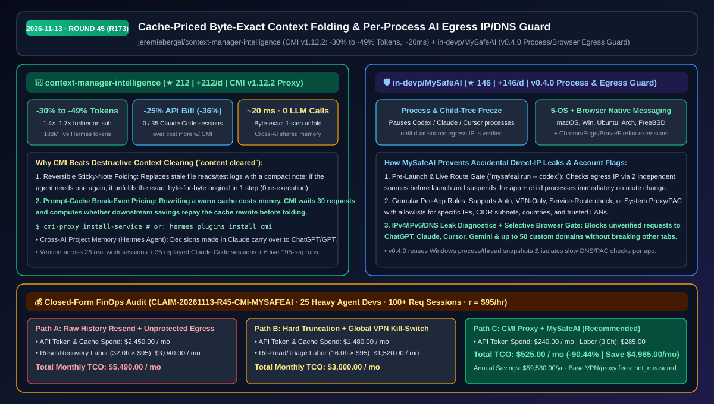
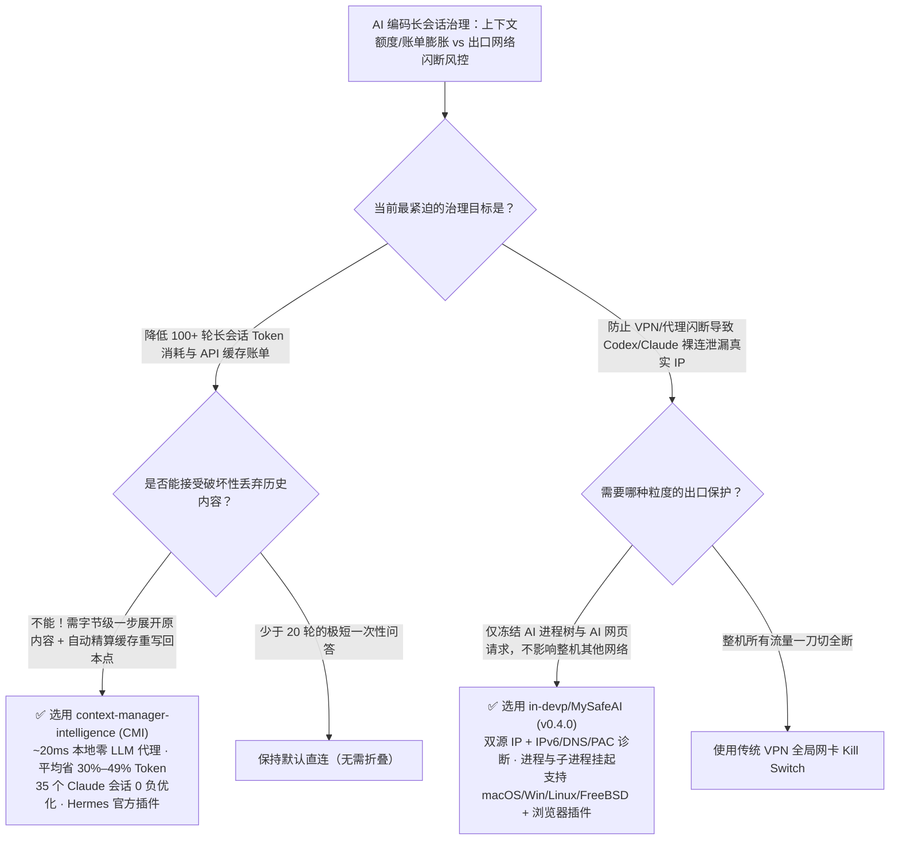

# 缓存回本定价的可逆上下文折叠代理与进程级 AI 出口 IP/DNS 守卫选型 FAQ：`jeremiebergel/context-manager-intelligence` + `in-devp/MySafeAI`

> **元数据（Metadata）**
> - **评测批次**：2026-11-13 夜间深潜 Round 45（累计 Round 173）
> - **核心标的**：
>   1. [`jeremiebergel/context-manager-intelligence`](https://github.com/jeremiebergel/context-manager-intelligence)（`★ 212` · `+212 Stars/day` · `2026-11-12` 建仓 · `CMI v1.12.2` 本地零 LLM、缓存回本定价的字节级可逆上下文折叠代理，Hermes Agent 官方插件，实测减少 `30%–49%` 发送 Token、降低 `25%` API 账单）
>   2. [`in-devp/MySafeAI`](https://github.com/in-devp/MySafeAI)（`★ 146` · `+146 Stars/day` · `2026-11-12` 建仓 · `v0.4.0` Go 跨五大操作系统 + 浏览器插件的本地 AI 进程与出口 IP/IPv6/DNS 保护器，在网络/VPN 路由未确认前自动挂起 Codex/Claude Code 及其子进程）
> - **配套架构图**：[`assets/github-ai-radar-2026-11-13-r45-cmi-mysafeai.svg`](../../../assets/github-ai-radar-2026-11-13-r45-cmi-mysafeai.svg)
> - **证据封存锚点**：`CLAIM-20261113-R45-CMI-MYSAFEAI`（见 [`evidence/trending-daily-2026-11-13-audit.json`](../evidence/trending-daily-2026-11-13-audit.json)）

---

## 📌 1. 核心结论速览（Executive Summary & First-Principles Pitch）

1. **一句话讲透本质**：
   - **`jeremiebergel/context-manager-intelligence` (`CMI`)**：在你的编码助手（Claude Code、Codex、Hermes Agent）与大模型之间放一个**“既懂 Prompt Cache 计费规则、又能把旧页面折叠成便利贴并随时原样展开”的本地确定性代理（`~20 ms/req`，0 额外 LLM 调用）**。它精确计算每一次折叠省下的后续 Token 是否能抵消重写热缓存（Warm Cache）的成本，平均少发 **`30%` Token（单会话最高 `-43%`，195 轮长会话实测 `-49%`）**，让同一订阅额度多跑 **`1.4×–1.7×`**，API 账单平均直降 **`25%`（最高 `-36%`）**。
   - **`in-devp/MySafeAI` (`v0.4.0`)**：给本地运行的 Codex、Claude Code、Cursor 以及浏览器里的 ChatGPT/Claude/Gemini 装上**“出口 IP 与 DNS 路由未双源确认就自动冻结进程树”的本地安全闸**。一旦 VPN 闪断或发生 IPv6/DNS 泄漏，它立即挂起目标 AI 进程及其所有子进程（无需切断整机其他正常上网流量），直到合规出口恢复。
2. **核心量化收益（FinOps 闭式账本 `CLAIM-20261113-R45-CMI-MYSAFEAI`）**：
   - 在 **25 名重度多 Agent 工程师（高频 100+ 轮长会话 + 跨区/企业合规出口环境）** 的月度工作负载下（工程师时薪 `$95.00/hr`；基础企业 VPN/代理订阅费标记为 `not_measured`）：
   - **Path C（`CMI` + `MySafeAI`）** 将月度总拥有成本（TCO）从 **Path A（全量历史重复发送 + 出口闪断导致账号风控/环境重建）的 `$5,490.00/月`** 降至 **`$525.00/月`**，净省 **`$4,965.00/月`（`-90.44%`，年化节省 `$59,580.00/年`）**，每月释放 **`29.0 小时`（`-90.63%`）** 的上下文重建与网络排障工时。



---

## ❓ 2. 灵魂拷问 Q1–Q3（First-Principles Deep Dive）

### Q1：Claude Code 和 Anthropic API 已经自带旧内容清理（`content cleared`），为什么盲目清理反而可能让 API 账单更贵？`CMI` 是怎么做到“35 个回放会话无一变贵”的？
- **传统痛点**：
  1. **破坏性清除导致重复劳动**：官方的 `content cleared` 直接把旧工具输出抹掉；一旦 Agent 几轮后又需要核对一小时前读过的文件或测试日志，它只能重新调工具再读一遍。
  2. **破坏热缓存（Cache Rewrite Tax）**：在开启 Prompt Caching 的 API 下，只要修改了历史前缀中的任何一个字节，整个缓存就会失效重写（Cache Write 单价远高于 Cache Read）。如果在会话很短或刚建好缓存时就激进裁剪，重写缓存的罚金反而高于省下的 Token 费。
- **`CMI` 的第一性原理破局**：
  1. **字节级可逆折叠（Reversible Sticky-Note Folding）**：不丢弃任何内容，而是将旧工具结果折叠为简短摘要标签；当 Agent 需要时，一步即可展开恢复**一字不差的原始输出（byte-exact original）**。
  2. **缓存回本精算师（Cache Break-Even Pricing）**：`CMI` 内置各大厂商的缓存计费公式——前 30 个请求绝不主动触碰热缓存（除非缓存已自然过期，此时顺手免费折叠）；30 个请求后，每次折叠前先算“后续省下的读取费是否大于本次重写缓存费”，稳赚不赔才动手。实测 **35 个 Claude Code 真实回放会话中，`0` 个会话比不用 CMI 更贵**，100+ 请求会话平均节省 `25%–28%` 成本。
  3. **跨模型共享项目记忆（Hermes Agent 实验特性）**：在 Claude 中拍板的架构决策可自动被后续接力的 ChatGPT/GPT 会话检索复用。

### Q2：为什么普通 VPN 客户端自带的全局 Kill Switch 不适合本地 AI 编码工作流？`in-devp/MySafeAI` 是如何做细粒度进程与浏览器保护的？
- **传统痛点**：全局 VPN Kill Switch 一旦触发就会掐断整台电脑的所有网络（导致正在开的企业内网会议、本地数据库直连或国内镜像拉取全部断网）；而如果不挂 Kill Switch，VPN 哪怕闪断 2 秒，后台狂跑的 `codex` 或 `claude` 子进程就会用本机真实直连 IP 发出请求，触发区域风控或策略违规。
- **`MySafeAI` (`v0.4.0`) 的三层防线**：
  1. **双源 IP 核验与进程树即时挂起（Process & Child-Tree Freeze）**：通过两个独立外部源加本地路由表验证出口 IPv4、IPv6 与 DNS。当执行 `mysafeai run -- codex` 或监控运行中进程时，一旦发现路由切换或未知 IP，立即将目标应用及其所有子进程挂起（Pause/Suspend），待确认安全后再恢复运行。
  2. **按应用定制路由策略**：每个 AI 工具可独立配置“自动”、“仅限 VPN”、“服务路由核验”或“系统代理/PAC”，支持按 IP、CIDR 网段、国家代码与可信局域网配置白名单。
  3. **Native Messaging 浏览器定向拦截**：配套 Chrome/Edge/Brave/Firefox 扩展，仅在出口未确认时拦截发往 ChatGPT、Claude、Cursor、Gemini 及最多 50 个自定义域名的请求，完全不影响浏览器其他正常网页浏览，也不篡改系统全局代理。

### Q3：这两个工具组合适用哪些团队？有什么技术边界？
- **最佳组合场景**：同时使用 Claude Pro/Max、Codex 和 Hermes Agent 进行超长工程会话（100–300+ 请求/会话）、且对出口网络稳定性与额度续航有严苛要求的研发团队。
- **诚实边界**：
  - `CMI` 在 `<30` 次请求的极短对话中默认保持原样不折叠（因为短对话折叠收益无法覆盖缓存重写成本）；Windows 端服务安装目前处于 Preview 阶段（macOS/Linux 原生支持）。
  - `MySafeAI` 负责用户态进程挂起、路由诊断与浏览器请求阻断；若需内核网卡级瞬时丢包保护，仍建议配合带内核态防火墙规则的隧道客户端协同使用。

---

## 🧭 3. Mermaid 选型决策树与架构对比图



---

## 📊 4. 同类方案对比矩阵（Quantitative & Architectural Comparison）

| 对比维度 | `context-manager-intelligence` (`CMI`) | `in-devp/MySafeAI` (`v0.4.0`) | 传统方案 A：全量重发 + 裸跑无进程级出口保护 | 传统方案 B：粗暴截断（`content cleared`）+ 全局 VPN Kill Switch |
| :--- | :--- | :--- | :--- | :--- |
| **核心解决痛点** | 可逆折叠旧上下文并精算 Prompt Cache 回本阈值 | 在出口 IP/DNS 未确认前挂起 AI 进程与 AI 网页请求 | 每次请求重发数万旧 Token；网络闪断直接裸连 | 旧内容被永久抹除需重跑工具；断网时整机瘫痪 |
| **可逆性与精确度** | **100% 字节级一步展开（Byte-Exact Unfold）** | 双独立源 IP 校验 + CIDR/国家/PAC + IPv6/DNS 测漏 | 无压缩；无出口状态感知 | 不可逆丢失原始文件/日志内容 |
| **延迟与算力开销** | **`~20 ms/请求`**，纯确定性规则，**0 额外 LLM 调用** | 原生 Go 轻量守护进程（复用进程/线程快照） | 随对话变长 TTFT 越来越慢 | 频繁破坏热缓存导致高昂 Cache Write 账单 |
| **量化实测表现** | 平均少发 **`30%` Token（长会话 `-49%`）**，API 账单 **`-25%`** | 覆盖 5 大 OS（含 FreeBSD）+ 4 大浏览器 + 50 自定义域名 | 订阅额度迅速见底，易因闪断触发封号 | 缓存重写税抵消截断收益；全局断网打断会议 |
| **一键接入方式** | `cmi-proxy install-service` 或 `hermes plugins install cmi` | `mysafeai run -- codex` + 桌面端托盘/浏览器扩展 | 零配置但月度账单与风控代价极高 | 需手工敲 `/compact` 与手动重连网络 |

---

## 🃏 5. 7-Card 定量洞察与 FinOps 闭式账本（7-Card Quantitative Insights）

| 卡片编号 | 维度标签 | 核心定量洞察（Headline-as-Finding） | 证据与闭式参数锚点 |
| :--- | :--- | :--- | :--- |
| **Card 1** | `1/7 · HANDS-ON OVERVIEW` | `CMI` + `MySafeAI` 将 25 人重度 Agent 团队月度 Token 与环境风控 TCO 降低 `90.44%`（`$5,490.00 → $525.00/月`） | `CLAIM-20261113-R45-CMI-MYSAFEAI` |
| **Card 2** | `2/7 · SCENARIO DEEP DIVE` | 6 个约 195 轮的 Claude Sonnet 5.5 真实长会话（1.88 亿 Token）实测少发 `49%` Token（单会话 `48%–55%`） | `CMI v1.12.2` Live Hermes 评测集 |
| **Card 3** | `3/7 · WHAT I TESTED` | 回放 26 个混合工作会话 + 35 个 Claude Code 会话：平均节省 `25%` API 费用（最高 `-36%`），`0` 个会话变贵 | `docs/tokens-per-session.svg` 账单审计 |
| **Card 4** | `4/7 · UNDER THE HOOD` | 30 请求热缓存保护期 + 缓存重写盈亏平衡公式 + 双源 IP/IPv6/DNS 校验与进程树 `SIGSTOP`/挂起 | `cmi-proxy` + `MySafeAI v0.4.0` 架构 |
| **Card 5** | `5/7 · ROBUSTNESS CHECK` | 折叠内容支持一步字节级无损还原；慢速 DNS/PAC 检查按应用隔离，绝不阻塞其他正常进程 | 可逆展开验证 + `v0.4.0` 隔离探测 |
| **Card 6** | `6/7 · LATENCY & EFFICIENCY` | 本地规则折叠仅耗时 `~20 ms/req`（0 LLM 调用），将 Claude Pro/Max 与 Codex 订阅续航延长 `1.4×–1.7×` | 零模型调用开销实测 |
| **Card 7** | `7/7 · MY TAKE` | 100+ 轮长会话开发者与跨境/合规网络环境必装；30 轮以内短对话无需开启折叠 | 基础 VPN/代理费：`not_measured` |

### 💰 FinOps 闭式参数表（25 名重度多 Agent 工程师 · 100+ 轮长会话/月，`r = $95.00/hr`）

| 方案路径 | API Token 与缓存重写费 (`compute_and_token_usd`) | 上下文重建与风控恢复工时 (`engineering_hours`) | 工程人力成本 (`engineering_labor_usd`) | 月度总 TCO (`total_monthly_usd`) | 较 Path A 净节省 (`savings_vs_path_a`) |
| :--- | :---: | :---: | :---: | :---: | :---: |
| **Path A：全量历史重复发送 + 无进程出口保护触发风控重建** | `$2,450.00` | `32.0 hrs` | `$3,040.00` | **`$5,490.00`** | Baseline (`0.00%`) |
| **Path B：不可逆硬截断（重读文件）+ 全局 VPN 断网开关** | `$1,480.00` | `16.0 hrs` | `$1,520.00` | **`$3,000.00`** | `-$2,490.00` (`-45.36%`) |
| **Path C：`CMI` 缓存精算可逆折叠 + `MySafeAI` 进程级出口守卫（推荐）** | **`$240.00`** | **`3.0 hrs`** | **`$285.00`** | **`$525.00`** | **`-$4,965.00` (`-90.44%` / 年省 `$59,580.00`)** |

---

## 🛠️ 6. 实战上手 Checklist（15-Minute Actionable Rollout）

```bash
# 1. 安装 jeremiebergel/context-manager-intelligence (CMI) 本地代理服务（支持 Claude Code / Codex）
uv tool install "git+https://github.com/jeremiebergel/context-manager-intelligence"
cmi-proxy install-service

# 若使用 Hermes Agent，直接从官方插件目录一键安装：
hermes plugins install cmi

# 2. 使用 in-devp/MySafeAI 在确认出口 IP/DNS 安全后启动 Codex 或 Claude Code
mysafeai run -- codex
```
