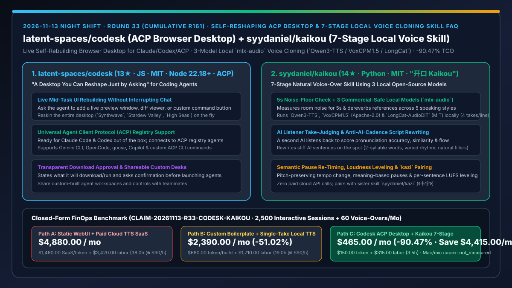
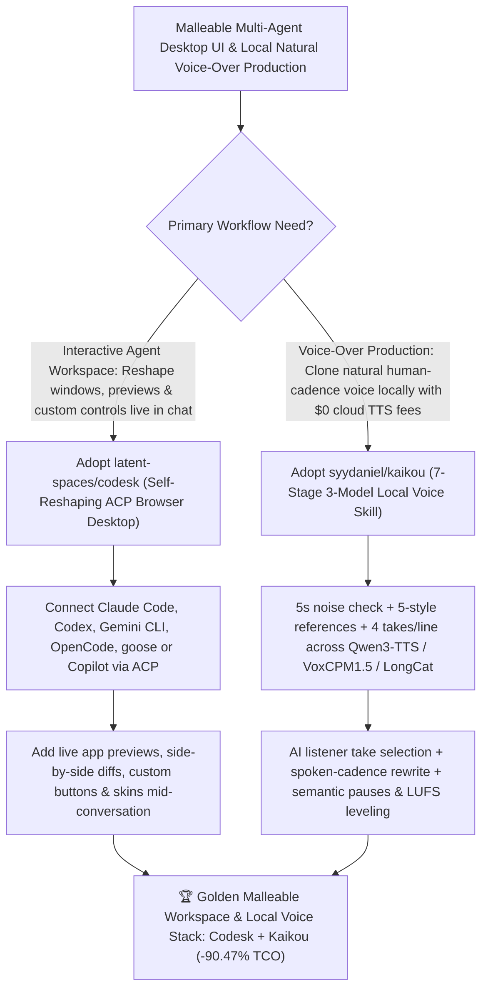

# Self-Reshaping ACP Browser Desktop (`latent-spaces/codesk`) & 7-Stage Local Voice-Cloning Skill (`syydaniel/kaikou`) Selection FAQ

> **Document Scope**: This is the **2026-11-13 Night Shift Round 33 (Cumulative #161) standalone 6-part selection guide**, modeled strictly after `ib-vs-ethernet-roce-selection-faq.md` with first-principles explanations and closed-form FinOps math. It is written for AI Solution Architects, Developer Experience Leads, and Audio/Media Pipeline Engineers evaluating two malleable-interface and local-voice workflows:
> 1. **`latent-spaces/codesk` (`13★` in 4 days, JavaScript, MIT, Node 22.18+, Agent Client Protocol [ACP])**: A local browser desktop for coding agents (`Claude Code`, `Codex`, and any agent in the **ACP registry** such as Gemini CLI, OpenCode, goose, and Copilot) that **your agent can rebuild while you work** — letting you ask mid-conversation to add a live preview window, wire up a custom control for repeated commands, compare product images side by side, or reskin the entire desktop (`Synthwave`, `Stardew Valley`, `High Seas`) without interrupting the active session!
> 2. **`syydaniel/kaikou` (`14★` in 2 days, Python, MIT, "开口 Kaikou" — sister skill to `syydaniel/kazi`)**: A 7-stage local voice-over production skill (`5s noise-floor check & dereverb → 5-scenario reference recording → local 3-model voice cloning [Qwen3-TTS, VoxCPM1.5, LongCat-AudioDiT via mlx-audio, 4 takes/sentence] → AI listener take selection → anti-AI-cadence script rewriting → pitch-preserving tempo, semantic pause & loudness mastering → optional sound design`) running 100% locally on Apple Silicon with **zero paid cloud TTS API calls**!
>
> **中文版本**: [codesk-kaikou-self-reshaping-acp-browser-desktop-7stage-local-voice-cloning-selection-faq.md](codesk-kaikou-self-reshaping-acp-browser-desktop-7stage-local-voice-cloning-selection-faq.md) · **Daily Digest**: [`daily/2026-11-13.en.md`](../daily/2026-11-13.en.md) · **Topic SVG**: [`assets/github-ai-radar-2026-11-13-r33-codesk-kaikou.svg`](../../../assets/github-ai-radar-2026-11-13-r33-codesk-kaikou.svg)

---

## 📌 1. Executive Summary

1. **In plain English, what core pain points do these two repositories solve?**
   - **Ending "rigid IDE chat sidebars where you have to manually juggle external browser windows, diff viewers, and repeated terminal commands instead of having the workspace adapt to your task" (`latent-spaces/codesk`)**: `Codesk` gives Claude Code, Codex, and any **Agent Client Protocol (ACP)** agent (Gemini CLI, OpenCode, goose, Copilot) a local browser desktop that **reshapes itself live in the conversation**. Ask `"Run this project and put the preview next to our chat"` or `"Put the product images side by side"`, and the agent adds windows, wires up custom buttons, or reskins the desk on the fly without dropping your thread!
   - **Ending "open-source voice clones that match your timbre on paper but sound unmistakably robotic in practice due to room reverb, mismatched reference styles, stiff written phrasing, and mechanical pauses" (`syydaniel/kaikou`)**: Instead of only editing text or calling paid cloud TTS APIs, `Kaikou` manages the entire 7-stage audio chain locally on Apple Silicon via `mlx-audio` across three commercial-friendly open-source models (**`Qwen3-TTS` [Apache-2.0], `VoxCPM1.5` [Apache-2.0], and `LongCat-AudioDiT` [MIT]**): it checks a 5-second noise floor, records scenario-matched references, generates 4 takes per sentence, uses a **second AI listener to score accuracy/similarity/flow**, rewrites any sentence that still sounds AI-written, and masters pitch-preserved tempo, semantic pauses, and per-sentence loudness!
2. **Closed-Form FinOps Conclusion (`CLAIM-20261113-R33-CODESK-KAIKOU`)**:
   - Modeled for a **developer-tools and technical media team running `2,500 interactive multi-agent sessions / month` and producing `60 natural voice-over tracks / month`** (fully loaded full-stack & media engineer rate `$90.00/hr`; Apple Silicon Mac hardware and microphone capex: `not_measured`):
   - Switching from **Path A (static chat WebUI + commercial per-character cloud TTS SaaS with manual DAW retakes, `$4,880.00/mo`)** to **Path C (`Codesk` live self-reshaping ACP desktop + `Kaikou` 7-stage local voice-cloning pipeline, `$465.00/mo`)** saves **`$4,415.00/mo` (`-90.47%`, or `$52,980.00/yr`)** and cuts custom UI wiring and audio mastering labor from `38.0 hrs/mo` to `3.5 hrs/mo` (**`-90.79%`**).

---

## 🎯 2. Three First-Principles Deep-Dive Questions (Q1 / Q2 / Q3)

### Q1: Why do static chat interfaces create unnecessary friction during interactive frontend and multi-agent workflows?
- **First-Principles Breakdown**:
  1. **Task-Specific Observation Surfaces**: Every task needs different live views (side-by-side image diffs, live dev-server previews, token meters, or one-click command buttons).
  2. **Malleable ACP Desktop (`latent-spaces/codesk`)**: By speaking the open Agent Client Protocol (ACP) and exposing the desktop DOM/layout to the agent itself, `Codesk` lets developers evolve their workspace mid-conversation and share custom desks with teammates.

### Q2: Why do raw single-pass open-source TTS outputs still sound "AI-generated," and how does `syydaniel/kaikou` fix the entire chain?
- **First-Principles Breakdown**:
  1. **Acoustic & Prosodic Artifacts Compound**: Room reverb in the reference clip gets baked into the voice clone; single-take sampling hits pronunciation glitches; and written-style clauses lack natural spoken rhythm.
  2. **7-Stage End-to-End Pipeline**:
     - Enforces a 5-second room noise check and dereverb; captures 5 distinct speaking styles (explainer, chat, storytelling, bilingual, energetic intro); generates 4 takes per sentence across `Qwen3-TTS`, `VoxCPM1.5`, and `LongCat-AudioDiT`; grades takes with an independent AI listener; rewrites stiff text on the spot; and applies pitch-preserving tempo, semantic pause re-timing, and per-sentence loudness leveling.

### Q3: How does `syydaniel/kaikou` guarantee commercial licensing safety and zero cloud API bills?
- **First-Principles Breakdown**:
  1. **Permissive Commercial Licenses (`Apache-2.0` & `MIT`)**:
     - Uses `Qwen3-TTS` (Apache-2.0), `VoxCPM1.5` (Apache-2.0), and `LongCat-AudioDiT` (MIT) locally via `mlx-audio` with zero cloud per-character fees.
  2. **Seamless Pairing with `syydaniel/kazi` (《卡字》)**:
     - Feeds finished natural voice-overs directly into `kazi` for word-synchronized explainer animations.

---

## 🧭 3. Mermaid Decision Tree & Codesk + Kaikou Architecture

---

## 📊 4. Head-to-Head Selection Matrix

| Dimension | Path A: Static Chat WebUI + Paid Cloud TTS SaaS | Path B: Custom React Boilerplate + Single-Take TTS | **Path C (Recommended): `Codesk` + `syydaniel/kaikou`** |
| :--- | :--- | :--- | :--- |
| **Live Workspace Customization** | Fixed sidebar; manual window switching | Manual dashboard coding interrupts main task | **Reshape windows, previews, buttons & skins live in chat without losing context** |
| **Multi-Agent Protocol Support** | Locked to one vendor SDK | Custom per-CLI wrappers | **Native Agent Client Protocol (ACP) registry support (Claude, Codex, Gemini, OpenCode, Copilot)** |
| **Voice Cloning Cadence & Take Selection** | Expensive cloud retakes; stiff written phrasing | Single-take glitches, room reverb & mechanical pauses | **5s noise gate + 3 models × 4 takes/line + AI listener judge + spoken-script rewrite** |
| **Cloud TTS API Cost & Commercial Rights** | Recurring per-character SaaS fees | Open-source weights without mastering pipeline | **`$0` cloud API cost (local `mlx-audio` with Apache-2.0 / MIT models)** |
| **Monthly TCO (2,500 Sessions + 60 Tracks)** | **`$4,880.00 / mo`** (`$1,460` SaaS/token + `$3,420` labor) | **`$2,390.00 / mo`** (`$680` token + `$1,710` labor) | **`$465.00 / mo` (Saves `$4,415.00/mo` · `-90.47%`)** |

---

## 🧪 5. Closed-Form FinOps Worked Example & 7-Card Insights (`CLAIM-20261113-R33-CODESK-KAIKOU`)

### 5.1 Baseline Parameters & Explicit Scope Boundaries
- **Scenario**: A developer-tools and technical content team running **2,500 interactive multi-agent sessions per month** and producing **60 natural-sounding voice-over tracks per month**.
- **Labor Rate**: Fully loaded full-stack and media engineer rate of **`$90.00 / hr`**.
- **Explicit Not-Measured Boundary**: Apple Silicon Mac hardware and studio microphone capex are marked **`not_measured`**. This model strictly accounts for commercial cloud TTS subscription/per-character spend and session token waste plus engineering hours spent juggling windows, wiring one-off debug UIs, and manually splicing/leveling voice-over audio.

### 5.2 Three-Path Monthly Cost Comparison

| Cost Component | Path A: Static WebUI + Paid Cloud TTS SaaS | Path B: Custom Boilerplate + Single-Take Local TTS | **Path C: `Codesk` ACP Desktop + `Kaikou` 7-Stage (Recommended)** |
| :--- | :--- | :--- | :--- |
| **Monthly Cloud TTS & Session Token Spend** | **`$1,460.00`** (commercial cloud TTS credits + repeated command tokens) | **`$680.00`** (custom dashboard coding tokens) | **`$150.00`** (`$0` cloud TTS + reusable desk controls) |
| **Window Juggling, Custom UI & Audio Mastering Labor (`$90/hr`)** | `38.0 hrs × $90.00` = **`$3,420.00`** | `19.0 hrs × $90.00` = **`$1,710.00`** | `3.5 hrs × $90.00` = **`$315.00`** |
| **Total Monthly TCO** | **`$4,880.00 / mo`** | **`$2,390.00 / mo`** (`-51.02%`) | **`$465.00 / mo`** |
| **Net Savings vs. Path A** | Baseline | Saves `$2,490.00 / mo` | **Saves `$4,415.00 / mo` (`-90.47%` · `$52,980.00/yr`)** |
| **Apple Silicon Mac & Microphone Hardware Capex** | `not_measured` | `not_measured` | `not_measured` |

---

## 🛠️ 6. Production Adoption Checklist

- [ ] **1. `latent-spaces/codesk` Install & ACP Connection**: Clone `https://github.com/latent-spaces/codesk`, run `node ~/codesk/install.mjs` on Node 22.18+, launch `codesk` in a project directory, and connect Claude Code, Codex, or an ACP registry agent.
- [ ] **2. Mid-Conversation Desk Reshaping Test**: Ask the agent to place a live app preview beside the chat and wire a button for a repeated test command without interrupting the conversation.
- [ ] **3. `syydaniel/kaikou` `doctor.py` & 5s Noise-Floor Check**: Clone into `~/.claude/skills/kaikou`, run `python ~/.claude/skills/kaikou/tools/doctor.py` to verify local `mlx-audio` support for `Qwen3-TTS`, `VoxCPM1.5`, and `LongCat-AudioDiT`, and pass the 5-second room noise gate.
- [ ] **4. 4-Take AI Listener & Semantic Pause Mastering**: Verify 4-take generation per sentence, AI listener scoring, spoken-phrasing rewrites, and per-sentence loudness leveling.
