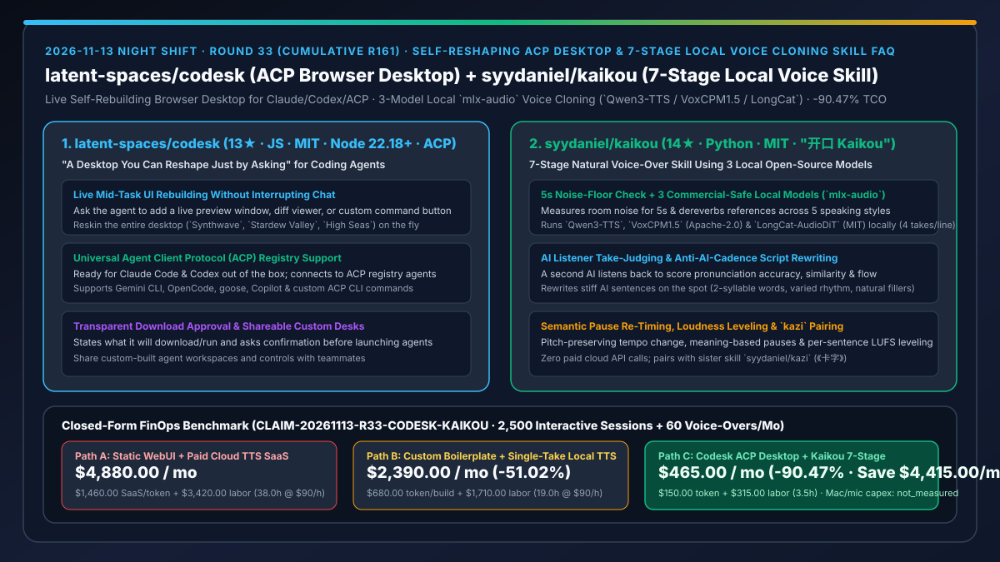
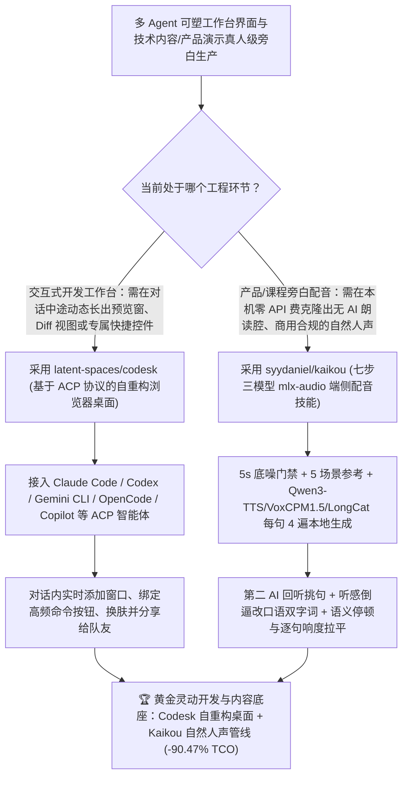

# 对话内实时自重构 ACP 浏览器桌面（`latent-spaces/codesk`）与七步三模型端侧去 AI 味旁白克隆技能（`syydaniel/kaikou`《开口》）深度选型 FAQ

> **文档定位**：本专题是 **2026-11-13 夜班第 33 轮（累计第 161 篇）独立六段式选型指南**，严格对标 `ib-vs-ethernet-roce-selection-faq.md` 的通俗第一性原理与闭式 FinOps 核算规范，面向开发者工具体验架构师、AIGC 音视频管线负责人与 AI Solution Architect，深度拆解今日新仓榜上将“工作台界面自身交给 Agent 在对话中动态热重构”与“用端侧三模型 4 遍抽样 + 第二 AI 回听改稿彻底消除克隆语音 AI 腔”的两大创新项目：
> 1. **`latent-spaces/codesk`（4 天新建获 `13★`，JavaScript，MIT，Node 22.18+，原生支持 Agent Client Protocol [ACP]）**：“一句话就能让 Agent 边干活边改造自己所在工作台界面”的本地浏览器桌面——开箱即连 Claude Code 与 Codex，并可从 **ACP 注册表**一键添加 Gemini CLI、OpenCode、goose、Copilot 等任意支持 ACP 的智能体；在任务进行途中，你可以随时要求 Agent **在聊天框旁新建实时预览窗口、把常用重复命令绑定成一个专属按钮、并排打开产品图对比，甚至当场把整个桌面换肤成 `Synthwave`、`Stardew Valley` 或 `High Seas` 而不中断当前对话**！
> 2. **`syydaniel/kaikou`（2 天新建获 `14★`，Python，MIT，《开口 Kaikou》，系《卡字》`syydaniel/kazi` 姊妹技能）**：“让克隆的声音，一开口就说人话”的端侧零付费 API 七步旁白制作技能——针对开源声音克隆“字里行间和停顿里全是 AI 朗读腔”的痛点，通过 `mlx-audio` 在 Apple Silicon 本机运行**三款允许商用的开源模型（`Qwen3-TTS` Apache-2.0、`VoxCPM1.5` Apache-2.0、`LongCat-AudioDiT` MIT）**，严格执行**七步闭环**：① 先空录 5 秒量底噪并去混响；② 分 5 类场景（讲解/聊天/讲故事/中英夹杂/有劲开场）录参考；③ 逐句生成、每句 4 遍；④ **独立 AI 回听挑句（核对读音、相似度与上下文衔接）**；⑤ **听感倒逼改文案（哪句一听像 AI 就改哪句，多用双字词、长短穿插）**；⑥ 变速不变调、按语义重排停顿、逐句响度拉平；⑦ 可选空间音效！
>
> **English Version**: [codesk-kaikou-self-reshaping-acp-browser-desktop-7stage-local-voice-cloning-selection-faq.en.md](codesk-kaikou-self-reshaping-acp-browser-desktop-7stage-local-voice-cloning-selection-faq.en.md) · **关联日报**: [`daily/2026-11-13.md`](../daily/2026-11-13.md) · **专题架构图**: [`assets/github-ai-radar-2026-11-13-r33-codesk-kaikou.svg`](../../../assets/github-ai-radar-2026-11-13-r33-codesk-kaikou.svg)

---

## 📌 一、核心结论速览（Executive Summary）

1. **一句话大白话讲透这两个项目到底解决了什么痛点？**
   - **终结“传统的 AI 编程界面全是死板的固定布局——你想一边聊一边看网页预览、或者把频繁敲的一条测试命令变成个顺手的开关按钮，还得切出去自己写前端或者来回切窗口”的痛点（`latent-spaces/codesk`）**：在 `Codesk` 里，工作台本身就是可被 Agent 实时改写的活代码！你直接对聊着天的 Claude Code、Codex 或任何支持 **ACP（Agent Client Protocol）** 的智能体说一句：“把这个项目跑起来，把预览窗口放在咱们聊天框右边”或者“把这两张商品图并排摆出来”，桌面当场无感长出新窗口和新控件，对话丝毫不断！
   - **终结“用开源 TTS 克隆自己的声音录课程或产品旁白时，虽然音色像你，但念出来的腔调像机器人在背书（底噪浑浊、书面长句一口气喘不上来、句间停顿全是一刀切的死板间隔）”的痛点（`syydaniel/kaikou`）**：《开口》指出“AI 味不光藏在字里，还藏在录音环境、参考讲法、挑句、文案和停顿里”！它不调任何付费云接口，直接在本机跑 **`Qwen3-TTS` + `VoxCPM1.5` + `LongCat-AudioDiT`** 三大商用合规模型，每句话生成 4 遍，**让另一个 AI 充当严苛听众回听挑句**；哪句话念出来哪怕有一丝 AI 腔，当场把书面语改成口语双字词重配，最后按语义重排停顿并逐句拉平响度，还能直接无缝交给姊妹技能《卡字》（`syydaniel/kazi`）生成字卡同步动画！
2. **闭式 FinOps 投资回报结论（`CLAIM-20261113-R33-CODESK-KAIKOU`）**：
   - 以 **开发者工具与技术内容团队每月执行 `2,500 次交互式多 Agent 开发会话` 并制作 `60 条真人口感技术讲解/产品旁白音轨`** 为基准（全栈与音视频工程师全包时薪 `$90.00/hr`；Apple Silicon Mac 硬件与麦克风外设折旧：`not_measured`）：
   - 从 **Path A（死板聊天 WebUI 频繁切窗敲重复命令 + 商业按字计费云端声音克隆 SaaS 反复抽卡修音，月均 `$4,880.00`）** 升级至 **Path C（`Codesk` 对话内自重构 ACP 桌面 + `Kaikou` 七步端侧三模型旁白克隆管线，月均 `$465.00`）**，每月净省 **`$4,415.00/mo`（降幅 `-90.47%`，年省 `$52,980.00/yr`）**，并将手工定制内部小工具界面与逐句修剪机械旁白的工时从 `38.0 hrs/mo` 压缩至 `3.5 hrs/mo`（节省 **`-90.79%`**）。

---

## 🎯 二、三大灵魂拷问（Q1 / Q2 / Q3 深度原理解析）

### Q1：为什么“固定布局的 IDE 侧边栏聊天框”无法释放多模态与前端开发任务的最大效率？
- **第一性原理拆解**：
  1. **每个任务的理想观察表面（Observation Surface）各不相同**：调前端样式时需要实时并排看 DOM 预览与设计原图；修数据管线时需要盯住特定端口状态与一条高频触发按钮。固定 UI 强迫人类用肉眼在终端、浏览器和文件夹之间充当搬运工。
  2. **`Codesk` 的对话内热塑机制（In-Conversation Desk Reshaping）**：基于标准 ACP 协议连接 Claude Code、Codex、Gemini CLI、OpenCode、goose 与 Copilot，让界面本身成为 Agent 的可写画布，且在下载运行新 Agent 前强制明示并征求用户确认。

### Q2：为什么直接跑单次开源 TTS 推理生成的克隆语音“一听就是 AI”，而 `syydaniel/kaikou` 能做出真人自然感？
- **第一性原理拆解**：
  1. **声学输入端与文本端的双重污染**：
     - 如果参考音频底噪超标或带着卧室混响，克隆模型会把混响当成你嗓音的一部分；如果拿“用讲解腔录的参考音频”去配“讲故事”，或者文稿全是 40 字不换气的书面翻译腔，神仙模型也救不回来。
  2. **七步全链路治理（从 5 秒底噪门禁到 AI 回听改稿）**：
     - 第 1–2 步：先空录 5 秒测底噪、去混响，并按 5 种场景分别录制参考库；
     - 第 3–5 步：用 `Qwen3-TTS`、`VoxCPM1.5`、`LongCat-AudioDiT` 逐句生成 4 遍，由独立 AI 回听打分（先看没念错字，再看像不像，最后看前后句气口连贯度），**一旦听出 AI 味直接反推修改文稿（拆短句、换双字词、点缀自然语气词）**；
     - 第 6–7 步：变速不变调、按语义逻辑重排句间停顿（而非固定毫秒）、逐句响度拉平。

### Q3：`syydaniel/kaikou` 在开源商用合规性与上下游工具链协同上做了哪些设计？
- **第一性原理拆解**：
  1. **100% 商用友好模型选型与本机零 API 账单**：
     - 严选无情绪黑盒开关、许可清晰的三大模型（`Qwen3-TTS` 与 `VoxCPM1.5` 为 Apache-2.0，`LongCat-AudioDiT` 为 MIT），通过 `mlx-audio` 在 Apple Silicon 本地推理（附 `tools/doctor.py` 环境自检）。
  2. **与《卡字》（`syydaniel/kazi`）形成音画双璧**：
     - 先用《开口》产出自然人声旁白与精确字词时间轴，再交由《卡字》生成严丝合缝卡在字上的讲解动画。

---

## 🧭 三、Mermaid 选型决策树与「Codesk 自重构桌面 + Kaikou 七步端侧配音」架构图

---

## 📊 四、同类方案核心能力对比矩阵（Selection Matrix）

| 评估维度 | Path A：固定聊天 WebUI + 商业云端按字计费 TTS | Path B：手写项目专属看板 + 单次裸跑开源 TTS | **Path C（推荐）：`Codesk` + `syydaniel/kaikou`《开口》** |
| :--- | :--- | :--- | :--- |
| **工作台界面随任务动态调整能力** | 固定死板，需在多个浏览器窗口和终端间来回切 | 每次手写 React 小工具，打断主任务思路 | **对话内直接要求 Agent 添加预览窗、对比视图或快捷控件，零中断热生效** |
| **多编码智能体接入标准** | 绑定单一模型 SDK | 需各自编写适配层 | **原生支持 Agent Client Protocol (ACP) 注册表（Claude/Codex/Gemini/OpenCode/Copilot）** |
| **克隆语音去 AI 朗读腔与挑句机制** | 云端抽卡按字烧钱，书面腔浓重且无法自动改稿 | 单模型单遍生成，常出现吞字、机械停顿与底噪 | **5s 底噪检测 + 三模型每句 4 遍 + 第二 AI 回听打分 + 听感倒逼改口语文案 + 语义停顿** |
| **云端 API 费用与商用许可证** | 高昂月费/字符费，商业条款受平台限制 | 开源但缺乏全流程后处理 | **`$0` 云端 API 费（Apple Silicon `mlx-audio` 本机跑 Apache-2.0 / MIT 三模型）** |
| **月度总拥有成本（2,500 会话 + 60 音轨）** | **`$4,880.00 / mo`**（`$1,460` SaaS/Token + `$3,420` 工时） | **`$2,390.00 / mo`**（`$680` Token + `$1,710` 工时） | **`$465.00 / mo`（净省 `$4,415.00/mo` · `-90.47%`）** |

---

## 🧪 五、定量 FinOps 算例与 7-Card 洞察（`CLAIM-20261113-R33-CODESK-KAIKOU`）

### 5.1 测算基准与显式边界（Scope & Boundaries）
- **场景设定**：开发者工具与技术内容团队每月运行 **2,500 次交互式多 Agent 编程会话**，并录制合成 **60 条高质量产品演示与技术课程旁白音轨**。
- **费率假设**：全栈与音视频工程人員全包时薪 **`$90.00 / hr`**。
- **显式边界声明（Explicit Not-Measured Boundary）**：Apple Silicon Mac 主机硬件与麦克风外设折旧标记为 **`not_measured`**，本表严格核算商业云端语音克隆按字订阅费与开发会话 Token 支出，以及工程师投入在切窗手敲重复命令、手写临时调试面板与在音频软件中逐句修剪机械停顿上的工时。

### 5.2 三路径月度成本闭式对照表

| 成本分项 | Path A：固定 WebUI + 商业云端克隆 SaaS | Path B：手写调试面板 + 裸跑单遍本地 TTS | **Path C：`Codesk` + `Kaikou`《开口》（推荐）** |
| :--- | :--- | :--- | :--- |
| **月度云端 TTS 订阅与开发会话 Token 支出** | **`$1,460.00`**（按字符计费云端克隆 + 重复命令 Token） | **`$680.00`**（手写调试面板消耗 Token） | **`$150.00`**（`$0` 云端 TTS 费用 + 快捷控件省去重复指令） |
| **切窗操作、手写面板与音频后期精修工时（`$90/hr`）** | `38.0 hrs × $90.00` = **`$3,420.00`** | `19.0 hrs × $90.00` = **`$1,710.00`** | `3.5 hrs × $90.00` = **`$315.00`** |
| **月度总成本（Monthly TCO）** | **`$4,880.00 / mo`** | **`$2,390.00 / mo`**（`-51.02%`） | **`$465.00 / mo`** |
| **相对 Path A 净节省** | 基准线（Baseline） | 净省 `$2,490.00 / mo` | **净省 `$4,415.00 / mo`（`-90.47%` · 年省 `$52,980.00/yr`）** |
| **Apple Silicon Mac 硬件与麦克风外设折旧** | `not_measured` | `not_measured` | `not_measured` |

---

## 🛠️ 六、生产级落地核验 Checklist

- [ ] **1. `latent-spaces/codesk` 安装与 ACP 智能体接入**：在 Node 22.18+ 环境执行 `git clone https://github.com/latent-spaces/codesk ~/codesk && node ~/codesk/install.mjs`，在项目目录运行 `codesk`，测试连接 Claude Code、Codex 及 ACP 注册表中的其他智能体。
- [ ] **2. 对话内动态添加窗口与控件验证**：在聊天中要求 Agent “启动本项目并把预览窗口放在聊天旁”以及“为常用测试命令添加一个按钮”，验证界面零中断实时更新。
- [ ] **3. `syydaniel/kaikou` 环境自检与 5 秒底噪门禁**：克隆至 `~/.claude/skills/kaikou`，运行 `python ~/.claude/skills/kaikou/tools/doctor.py` 核验 `mlx-audio` 与三款开源模型（`Qwen3-TTS`、`VoxCPM1.5`、`LongCat-AudioDiT`）就绪，并先通过 5 秒底噪检测。
- [ ] **4. 4 遍生成挑句、改稿与后期响度拉平验证**：验证每句生成 4 遍后由 AI 回听挑句、自动改写生硬书面句，并检查最终输出音频的语义停顿与响度一致性。
