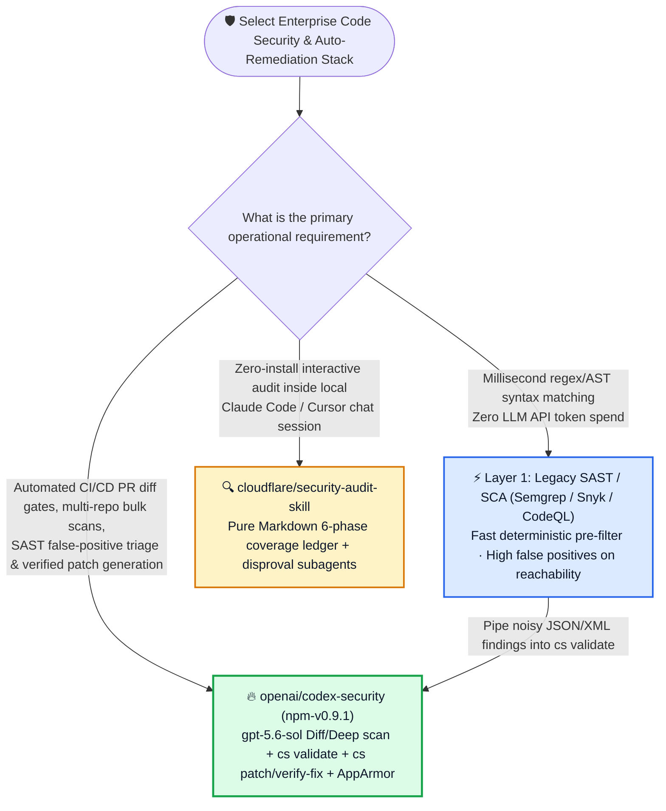

# AI Code Security Scanning, Third-Party Alert Triage & Automated Patching Selection FAQ: `openai/codex-security` (`npm-v0.9.1`, `gpt-5.6-sol` Standard/Deep Scan + `cs validate` + `cs patch`) vs. `cloudflare/security-audit-skill` vs. Legacy SAST/SCA

> **中文版**: [codex-security-vs-audit-skill-sast-selection-faq.md](codex-security-vs-audit-skill-sast-selection-faq.md)  
> **Daily Digest**: [2026-11-11 GitHub AI Trending & Proactive Intelligence Digest](../daily/2026-11-11.en.md) · **Visual Deck**: [`cards.en.html`](../cards.en.html) · **Live Radar**: [`github-radar.html`](../../../github-radar.html)


Written for **AI Solution Architects and Application Security (AppSec) Architects**, this selection guide is grounded in primary-source audits of **`openai/codex-security` (OpenAI's official `@openai/codex-security` vulnerability scanning, validation, and automated patching CLI, TypeScript SDK, and GitHub Action, `npm-v0.9.1`, Apache-2.0, Daily Trending DOM `#9`, `11,486` DOM / `11,489` API stars, `+20★ today` and actively pushed on 2026-11-11)** across [`action.yml`](https://github.com/openai/codex-security/blob/main/action.yml), [`docs/agent-workflows.md`](https://github.com/openai/codex-security/blob/main/docs/agent-workflows.md), and [`docs/scanner-imports/README.md`](https://github.com/openai/codex-security/blob/main/docs/scanner-imports/README.md), answering three core architectural questions:
1. **Why do engineering teams routinely mute expensive traditional SAST/SCA scanners (Semgrep, Snyk, Checkmarx, SonarQube) due to >80% unreachable false positives while still suffering from cross-file business-logic authorization bypasses?**
2. **How does `openai/codex-security` (`npm-v0.9.1`) unify PR diff scanning (`--diff`), multi-pass deduplicated deep audits (`--mode deep`), external scanner report validation (`cs validate`), automated patch generation (`cs patch`), and independent fix verification (`cs verify-fix`) inside an AppArmor-confined runtime?**
3. **When designing an enterprise DevSecOps pipeline, how should architects combine lightweight interactive skills (`cloudflare/security-audit-skill`), deterministic SAST pre-filters, and `@openai/codex-security`?**

> 🛡️ **Provenance & Attribution Disclosure**:
> - **`measured` (Primary-Source Verified in This Shift)**: Trending telemetry (`+20 stars today`, DOM Article `#9`, `11,486` DOM stars) is verified from the sealed 2026-11-11 GitHub Daily Trending HTML snapshot ([`workshops/github-trending-radar/evidence/trending-daily-2026-11-11-raw.html`](../evidence/trending-daily-2026-11-11-raw.html), `sha256: bacf15c20a7aca6007beeb3a6f284b0549a441a05dafa25b17a097dc8f4f1d8f`), and repository metadata (`npm-v0.9.1`, `Apache-2.0`, `11,489` API stars, `917` forks, `action.yml` default model `gpt-5.6-sol` with `effort: xhigh`, `compose.apparmor.yaml`) is verified via GitHub REST API.
> - **`anonymized_reported` (`independently_reproduced=false`, Upstream Documentation & Feature Specs)**: The 8 built-in Codex Security skills (`$security-scan`, `$security-diff-scan`, `$deep-security-scan`, `$triage-finding`, `$resolve-dependency-alert`, `$fix-finding`, `$verify-fix`, `$track-findings`), up to `96-hour` Deep Scan discovery windows, 4 supported inference providers (`openai`, `openrouter`, `fireworks`, `amazon-bedrock`), and third-party scanner importers (Semgrep, Snyk, Sonar, Checkmarx, Black Duck, Amazon Inspector, AWS Continuum, Endor Labs) are documented in upstream repository guides.
> - **`synthetic` (`independently_reproduced=false`, Architect Parametric FinOps & AppSec Labor Model)**: Section 5.1 models a **20-microservice engineering org (`400 PRs/mo` + `20` monthly deep scans + `300` SAST/SCA alerts/mo, with AppSec engineering time valued at `$75.00/hr`; commercial SAST license fees and CI runner compute bills are explicitly labeled `not_measured`)**, comparing Path A Legacy SAST + Manual Triage (`$6,750.00/mo`, `90.0h`) vs. Path B Interactive Chat Skill Only (`$3,480.00/mo`, `44.0h`) vs. Path C `openai/codex-security` Hybrid Closed-Loop Pipeline (`$948.00/mo` = `$198.00` API + `$750.00` final human review, saving `$5,802.00/mo` [`-85.96%`] and `80.0 hours/mo` [`-88.89%`]).

---

## 1. 📌 Executive Summary

| Dimension | Plain-Language Core Takeaway (First Principles) |
| :--- | :--- |
| **What is `openai/codex-security` (`npm-v0.9.1`)?** | It is OpenAI's official **end-to-end AI application security platform (`@openai/codex-security` CLI `cs`, TypeScript SDK, GitHub Action, and 8 built-in Codex skills)** that scans full repos or PR diffs, **ingests and validates third-party scanner reports (Semgrep/Snyk/Checkmarx/Sonar) against real source code (`cs validate`), generates patches (`cs patch`), verifies fixes (`cs verify-fix`), drafts `SECURITY.md` policies (`cs policy`), and exports SARIF or syncs to Linear/Jira/GitHub**. |
| **What AppSec pain point does it solve?** | Traditional SAST/SCA tools flood developers with unreachable CVE/regex alerts while missing cross-file auth bypasses; conversely, raw chat-based security prompts cannot enforce `--max-cost` CI budgets, emit GitHub SARIF annotations, or automatically triage 300 legacy Snyk/Checkmarx findings in batch. |
| **How does it compare to `cloudflare/security-audit-skill` and legacy SAST?** | **It acts as the intelligent verification and remediation brain on top of deterministic SAST**: keep fast SAST for `$0` syntax pre-screening, pipe its noisy outputs into `codex-security` (`cs validate` + `$resolve-dependency-alert`) to eliminate 80%+ false positives, run `cs scan --diff` on every PR, and auto-generate verified patches (`cs patch` → `cs verify-fix`) before a human ever looks at the alert. |

---

## 2. 🎯 First-Principles Q&A (Q1 / Q2 / Q3)

### Q1: Why do both "Legacy SAST/SCA Alone" and "Chat-Only Security Prompts" fail at enterprise scale?

**Plain-language answer: Legacy SAST is a context-blind regex/AST matcher that drowns teams in false positives without writing fixes, whereas chat-only security skills lack CI cost caps, SARIF gates, and third-party scanner ingestion.**

1. **The Two Fatal Flaws of Legacy SAST/SCA (Semgrep / Snyk / Checkmarx)**:
   - **Unreachable Alert Fatigue**: When a transitive dependency has a CVE in a helper function your service never imports, or a test fixture contains a dummy token, static rules fire high-severity alerts anyway—forcing AppSec engineers to spend 60+ hours/month reading call graphs manually.
   - **Cross-File Business-Logic Blindness**: Multi-hop authorization bugs (e.g., an endpoint checking authentication middleware in `router.ts` but failing to verify tenant ownership in `order-service.ts`) look syntactically clean to AST matchers.
2. **Where Interactive-Only Skills (`cloudflare/security-audit-skill`) Stop**:
   - `cloudflare/security-audit-skill` is great for zero-install interactive audits inside a local Claude Code / Cursor session (6-phase coverage ledger + adversarial disproval subagents), but it has no standalone CLI (`cs`), no TypeScript SDK, no GitHub Action with `--max-cost` USD circuit breakers, no AppArmor container profile (`compose.apparmor.yaml`), and no native readers for Checkmarx XML, Black Duck BOM-6, or Snyk JSON reports.

---

### Q2: How does `openai/codex-security` (`npm-v0.9.1`) orchestrate its 5-stage "Policy → Scan → Validate → Patch → Verify" closed loop?

**Plain-language analogy: It is an automated AppSec squad that first writes your repo's security constitution (`cs policy`), checks every PR diff at the door (`--diff`), runs multi-pass deep sweeps on weekends (`--mode deep`), cross-examines noisy Snyk/Semgrep alerts against real code (`cs validate`), and writes + tests the fix (`cs patch` & `cs verify-fix`) before paging an engineer.**

1. **Stage 1 — Threat Modeling & Out-of-Tree Policy Generation (`cs policy`)**:
   - `cs policy . --path services/api --knowledge-base architecture.md` drafts or updates `SECURITY.md` outside the repository working tree so existing files remain untouched until reviewed. Subsequent scans automatically honor component-level `SECURITY.md` rules.
2. **Stage 2 — Three Scan Scopes & Modes (`--diff`, `standard`, `deep`)**:
   - **PR Diff Scan (`$security-diff-scan` / `cs scan . --diff origin/main`)**: Audits only committed branch changes or local `--working-tree` edits.
   - **Standard Scan (`$security-scan` / `cs scan . --max-time 15`)**: Bounded single-pass repository or `--path` audit.
   - **Deep Scan (`$deep-security-scan` / `cs scan . --mode deep`)**: Repeats Standard scans across multiple passes (up to `max-time-hours: 96` in CI), feeding earlier findings into later passes and returning deduplicated, high-confidence vulnerabilities.
3. **Stage 3 — External Scanner Ingestion & Source-Grounded Validation (`publish findings` & `cs validate`)**:
   - Natively imports reports from **GitHub, Semgrep, Snyk, Sonar, Amazon Inspector, AWS Continuum, Black Duck SCA, Checkmarx SAST, and Endor Labs**.
   - Running `cs validate findings.json` (`$triage-finding` / `$resolve-dependency-alert`) traces each external alert against the actual repository source tree and container image, returning a concrete verdict, missing-evidence notes, and Git-history owner suggestions.
4. **Stage 4 — Automated Patching & Fix Verification (`cs patch` & `cs verify-fix`)**:
   - `cs patch --scan SCAN_ID` (`$fix-finding`) generates a targeted code fix, and `cs verify-fix --scan SCAN_ID` (`$verify-fix`) independently verifies that the patch resolves the vulnerability without regressions.
5. **Stage 5 — Multi-Provider Routing, Cost Caps & AppArmor Isolation**:
   - Supports `openai` (defaulting to `gpt-5.6-sol` with `effort: xhigh`), `openrouter`, `fireworks`, and `amazon-bedrock`, enforces `max-cost` USD limits and `fail-on-severity` gates, exports SARIF/JSON/CSV, syncs with Linear/Jira/GitHub (`$track-findings`), and runs inside `apparmor=codex-security-container` (`compose.apparmor.yaml`).

---

### Q3: How should an AI Solution Architect combine Legacy SAST, `cloudflare/security-audit-skill`, and `openai/codex-security`?

- **Layer 1 (Millisecond Syntax Pre-Filter)**: Keep **Semgrep / CodeQL / Snyk** in pre-commit and fast CI to catch leaked secrets and obvious syntax anti-patterns at `$0` LLM token cost.
- **Layer 2 (CI PR Gate, Alert Triage & Auto-Remediation)**: Deploy **`@openai/codex-security` (`npm-v0.9.1`)** in GitHub Actions—run `scope: diff` on every PR, pipe Layer-1 SAST/SCA JSON outputs into `cs validate` to strip unreachable false positives, and run `cs patch` + `cs verify-fix` on confirmed bugs.
- **Layer 3 (Interactive Architect Deep-Dive)**: Use **`cloudflare/security-audit-skill`** during interactive local architecture reviews when you want a zero-CLI Markdown skill inside Claude Code or Cursor.

---

## 3. 🧭 Mermaid Selection Decision Tree & Closed-Loop Sequence Diagram

### 3.1 Enterprise AppSec & AI Security Audit Selection Decision Tree



### 3.2 `@openai/codex-security` (`npm-v0.9.1`) End-to-End Closed-Loop Sequence

```mermaid
sequenceDiagram
    autonumber
    participant Dev as 👩‍💻 Developer / PR Workflow
    participant SAST as 📡 External Scanners (Semgrep/Snyk/Checkmarx)
    participant CS as 🛡️ @openai/codex-security (gpt-5.6-sol · AppArmor)
    participant Repo as 📂 Source Checkout & SECURITY.md
    participant Tracker as 📋 GitHub SARIF / Linear / Jira

    Note over CS,Repo: Phase 0: cs policy . --knowledge-base architecture.md drafts SECURITY.md baseline
    Dev->>CS: 1. Open PR triggering GitHub Action (scope: diff, max-cost circuit breaker)
    SAST->>CS: 2. Import 3rd-party scanner report (publish findings / cs validate)
    CS->>Repo: 3. Trace cross-file call graphs & reachability against SECURITY.md
    CS->>CS: 4. Filter 80%+ unreachable false positives; run cs patch on confirmed bugs
    CS->>Repo: 5. Run cs verify-fix to prove exploit path is closed without regressions
    CS-->>Tracker: 6. Emit validated SARIF/JSON, suggest Git-history owners & sync Linear/Jira
```

---

## 4. 📊 Architecture Selection Decision Matrix

| Evaluation Dimension | **`openai/codex-security` (`npm-v0.9.1`)** | **`cloudflare/security-audit-skill`** | **Legacy SAST / SCA (Semgrep / Snyk / Checkmarx)** | **Single-Prompt Raw LLM Code Review** |
| :--- | :--- | :--- | :--- | :--- |
| **Form Factor & Automation Surfaces** | ✅ **CLI (`cs`) + TypeScript SDK + GitHub Action + 8 Codex Skills** | ⚠️ Markdown `SKILL.md` only (no standalone CLI/SDK) | ✅ CLI + CI plugins + SaaS dashboard | ❌ Manual copy-paste or custom script |
| **Scan Scopes & Multi-Pass Depth** | ✅ **`--path`, `--diff` PR increments, `standard`, and `--mode deep` (up to 96h deduplicated)** | ⚠️ Interactive repo/directory sessions | ✅ Full-repo or diff rule matching | ❌ Truncated by single context window |
| **External Scanner Triage (`cs validate`)** | ✅ **Native importers for Semgrep, Snyk, Sonar, Checkmarx, Black Duck, Inspector** | ❌ No external scanner parsers | ❌ Siloed vendor formats | ❌ No structured ingestion pipeline |
| **Automated Patching & Verification** | ✅ **Built-in `cs patch` (`$fix-finding`) + `cs verify-fix` (`$verify-fix`)** | ❌ Audit report only (no automated patch verifier) | ⚠️ Simple syntax autofixes only | ⚠️ Untested edits often break builds |
| **Multi-Provider & Cost Circuit Breakers** | ✅ **OpenAI (`gpt-5.6-sol`) / OpenRouter / Fireworks / Bedrock + `--max-cost` USD cap** | ✅ Uses host CLI model | ✅ Fixed license (`$0` LLM tokens) | ❌ Unbounded token spend |
| **Container Isolation & Compliance Export** | ✅ **`compose.apparmor.yaml` (`codex-security-container`) + SARIF/JSON/CSV + Linear/Jira** | ❌ No container profile or SARIF exporter | ✅ SARIF & ticket sync | ❌ Freeform prose output |

---

## 5. 🧪 Quantitative FinOps & AppSec Labor Model (`synthetic`, `independently_reproduced=false`)

### 5.1 20-Microservice Organization (`400 PRs/mo` + `300 SAST Alerts/mo`) Closed-Form TCO Model (`synthetic`, `independently_reproduced=false`)

> 📌 **Scope & Provenance Disclosure**: This worked example is a **parametric API + AppSec engineering labor model (`synthetic`, `independently_reproduced=false`; commercial SAST/SCA annual license fees and CI runner VM compute bills are explicitly labeled `not_measured`)**. Scenario: **An engineering organization with `20` microservices processing `400 PRs/mo`, `20` monthly deep repository audits, and `300` raw SAST/SCA alerts/mo, with AppSec engineer labor valued at `$75.00/hr`**:

| Architecture Path | Monthly LLM Scanning & Validation API Bill | Monthly False-Positive Triage Labor (`@ $75/hr`) | Monthly Manual Patching & Verification Labor (`@ $75/hr`) | Total Monthly Cost (API + AppSec Labor) | Savings vs. Path A |
| :--- | :--- | :--- | :--- | :--- | :--- |
| **Path A: Legacy SAST/SCA Only + Manual AppSec Triage & Patching** | **`$0.00 / mo`** | `60.0 hours / mo` × `$75.00`<br/>= **`$4,500.00 / mo`** (manual reachability triage of 300 alerts) | `30.0 hours / mo` × `$75.00`<br/>= **`$2,250.00 / mo`** (manual fix authoring & testing) | **`$6,750.00 / mo`**<br/>(**`90.0 hours / mo`** AppSec toil) | Baseline (alert fatigue + missed business-logic flaws) |
| **Path B: Interactive Chat Security Skill Only (No CI `--diff` or `cs validate`)** | `20 interactive repo audits` = **`$180.00 / mo`** | `26.0 hours / mo` × `$75.00`<br/>= **`$1,950.00 / mo`** | `18.0 hours / mo` × `$75.00`<br/>= **`$1,350.00 / mo`** | **`$3,480.00 / mo`**<br/>(**`44.0 hours / mo`** AppSec toil) | Net savings `-$3,270.00/mo` (`-48.44%`) |
| **Path C: `openai/codex-security` (`npm-v0.9.1`) Hybrid Closed-Loop Pipeline** | • `400 PR --diff` × `$0.18` = **`$72.00`**<br/>• `20 repo --mode deep` × `$4.50` = **`$90.00`**<br/>• `300 cs validate + patch` × `$0.12` = **`$36.00`**<br/>→ Total API: **`$198.00 / mo`** | `cs validate` filters unreachable alerts; humans review confirmed findings only: **`5.0 hours / mo`** (`$375.00`) | `cs patch` + `cs verify-fix` generate verified fixes; humans approve PRs: **`5.0 hours / mo`** (`$375.00`) | API `$198.00` + Labor `$750.00` (`10.0h`)<br/>= **`$948.00 / mo`** | **Net savings `$5,802.00/mo` (`-85.96%`, `$69,624.00/yr`); AppSec toil `-80.0h/mo` (`-88.89%`)** |

---

## 6. 🛠️ Production Adoption & 30-Minute PoC Checklist

- [ ] **Step 1 — Install CLI & Generate Out-of-Tree `SECURITY.md` Baseline**: On Node.js `22.13.0+` / `24.x` / `26.x` and Python `3.10+`, run `npm install --global @openai/codex-security`, sign in via `cs login` (or set `OPENAI_API_KEY`), and run `cs policy . --knowledge-base architecture.md` to draft your repository `SECURITY.md`.
- [ ] **Step 2 — Enable Bounded PR Diff Scans in GitHub Actions**: Configure the `openai/codex-security` GitHub Action on pull requests with `scope: diff`, `model: gpt-5.6-sol`, `effort: xhigh`, and an explicit `max-cost` USD threshold, uploading `sarif-path` to GitHub Code Scanning.
- [ ] **Step 3 — Pipe Existing Semgrep / Snyk / Checkmarx Reports into `cs validate`**: Preview external scanner findings with `codex-security publish findings FILE --provider semgrep --repository . --to local --dry-run` and run `cs validate findings.json` to measure unreachable false-positive elimination.
- [ ] **Step 4 — Close the Loop with `cs patch` and `cs verify-fix`**: On a confirmed finding, run `cs patch --scan SCAN_ID` followed by `cs verify-fix --scan SCAN_ID` to confirm the exploit path is closed before requesting human merge approval.
- [ ] **Step 5 — Enforce AppArmor Container Isolation & Shared Worktree State**: Run containerized scans with `compose.apparmor.yaml` (`apparmor=codex-security-container`) and persist `CODEX_SECURITY_STATE_DIR` across linked Git worktrees so scan history and validated verdicts remain unified.
