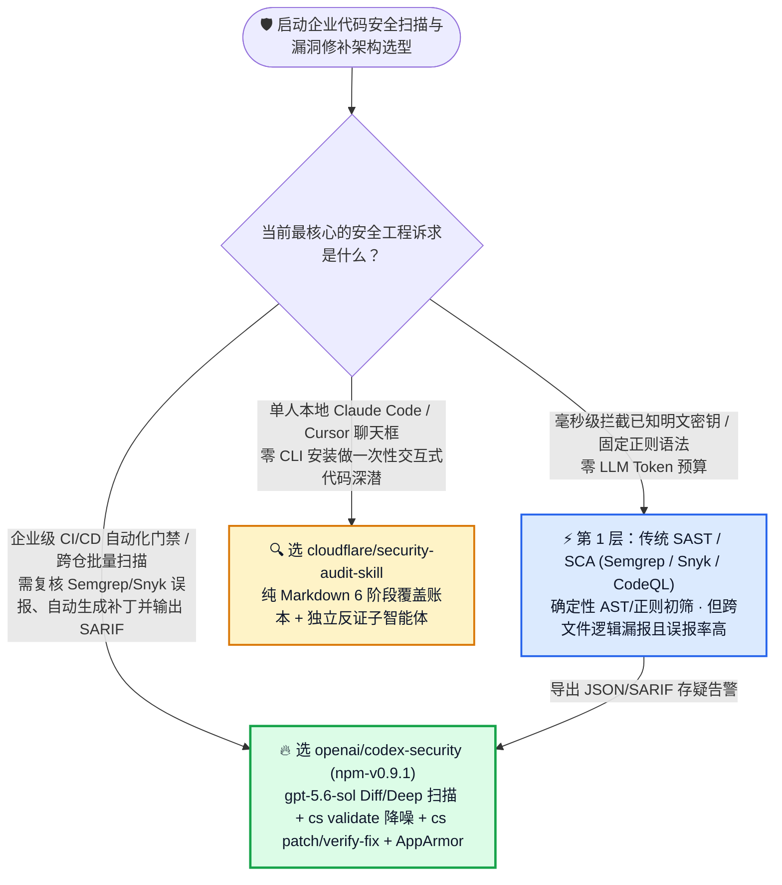
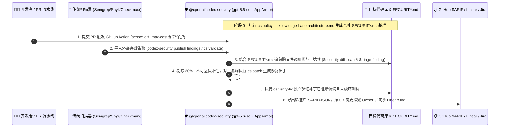

# AI 代码安全扫描、第三方告警降噪与自动修补闭环选型常见问题解答：`openai/codex-security` (`npm-v0.9.1`, `gpt-5.6-sol` Standard/Deep 扫描 + `cs validate` + `cs patch`) vs `cloudflare/security-audit-skill` vs 传统 SAST/SCA

> **English Edition**: [codex-security-vs-audit-skill-sast-selection-faq.en.md](codex-security-vs-audit-skill-sast-selection-faq.en.md)  
> **关联日报**: [2026-11-11 GitHub AI 最热榜单与情报摘要](../daily/2026-11-11.md) · **视觉评测卡**: [`cards.html`](../cards.html) · **在线面板**: [`zh-github-radar.html`](../../../zh-github-radar.html)

本文档面向 **AI Solution Architect（AI 解决方案架构师）与企业安全架构师（AppSec Architect）**，基于 2026-11-11 GitHub Daily Trending 主日榜新晋焦点项目 **`openai/codex-security`（OpenAI 官方开源的 `@openai/codex-security` 安全扫描、验证与补丁闭环 CLI / TypeScript SDK / GitHub Action，`npm-v0.9.1`，Apache-2.0，主日榜 DOM `#9`，总 Star `11,486` / API `11,489`，今日新增 `+20★ today` 且今日持续推送更新）** 的一手源码、[`action.yml`](https://github.com/openai/codex-security/blob/main/action.yml)、[`docs/agent-workflows.md`](https://github.com/openai/codex-security/blob/main/docs/agent-workflows.md) 与 [`docs/scanner-imports/README.md`](https://github.com/openai/codex-security/blob/main/docs/scanner-imports/README.md) 深度核验，用通俗大白话与第一性原理解答：
1. **为什么企业买了昂贵的传统静态扫描器（Semgrep / Snyk / Checkmarx / SonarQube），研发团队却因为“80% 以上全是误报、且看不懂跨文件越权漏洞”而把告警全部静音？**
2. **OpenAI 官方开源的 `openai/codex-security` (`npm-v0.9.1`) 到底是个什么东西？它如何通过「PR 增量 `--diff` + 多轮去重 `--mode deep` + 外部扫描报告真伪复核 `cs validate` + 自动打补丁 `cs patch` 与验证 `cs verify-fix`」把安全从事后报警变成自动闭环？**
3. **在企业落地选型时，什么时候用轻量级 `cloudflare/security-audit-skill`，什么时候用传统 SAST 初筛，什么时候必须上 `@openai/codex-security` CLI / GitHub Action？**

> 🛡️ **数据来源、归属核验与证据分级声明（Provenance & Attribution Disclosure）**：
> - **`measured`（本班次一手实测抓取）**：`openai/codex-security` 在 `https://github.com/trending?since=daily` 页面 DOM Article `#9` 的单日增量 `+20 stars today` 与 DOM 总 Star `11,486`（原始 HTML 证据已封存至 [`workshops/github-trending-radar/evidence/trending-daily-2026-11-11-raw.html`](../evidence/trending-daily-2026-11-11-raw.html)，`sha256: bacf15c20a7aca6007beeb3a6f284b0549a441a05dafa25b17a097dc8f4f1d8f`），以及 GitHub REST API 元数据（`npm-v0.9.1`，`Apache-2.0`，TypeScript，API Stars `11,489`，Forks `917`，`action.yml` 默认模型 `gpt-5.6-sol` 与推理强度 `xhigh`，`compose.apparmor.yaml` 容器隔离配置）。
> - **`anonymized_reported`（`independently_reproduced=false`，上游仓库文档与功能规格）**：`openai/codex-security` 官方文档披露的 8 大内置技能（`$security-scan`、`$security-diff-scan`、`$deep-security-scan`、`$triage-finding`、`$resolve-dependency-alert`、`$fix-finding`、`$verify-fix`、`$track-findings`）、Deep Scan 最高 `96 小时` 多轮去重上限、4 大推理提供商支持（`openai`、`openrouter`、`fireworks`、`amazon-bedrock`）及外部扫描器导入适配（Semgrep、Snyk、Sonar、Checkmarx、Black Duck、Amazon Inspector、AWS Continuum、Endor Labs）。
> - **`synthetic`（`independently_reproduced=false`，架构师参数化 FinOps 与工时算例）**：第 5.1 节「20 个微服务仓库（每月 `400 个 PR` + 每月 `300 条` 传统 SAST/SCA 告警甄别修补）」的闭式成本对比（Path A 纯传统 SAST+人工甄别修补 `$6,750.00/月` vs Path B 纯交互式聊天安全 Skill `$3,480.00/月` vs Path C `openai/codex-security` 混合闭环流水线 `$948.00/月` [`$198.00` API + `$750.00` 人工终审]，净省 `$5,802.00/月` [`-85.96%`] 与 `80.0 小时/月` [`-88.89%`] 安全工程师工时；商业 SAST 许可证费与 CI Runner 机器费明确标注为 `not_measured`）。

---

## 1. 📌 核心结论速览（Executive Summary）

| 评估维度 | 一句话大白话核心结论（直指本质） |
| :--- | :--- |
| **`openai/codex-security` 到底是个什么东西？** | 它是 OpenAI 官方开源的**全栈 AI 代码安全工程套件（`@openai/codex-security` CLI + TypeScript SDK + GitHub Action + Codex 桌面/CLI 8 大内置插件技能）**，不仅能自己扫代码（支持 PR 增量 `--diff` 与多轮去重 `--mode deep`），还能**直接吃进 Semgrep/Snyk/Checkmarx 的扫描报告去核查真假（`cs validate`）、自动写修复补丁（`cs patch`）、验证补丁是否生效（`cs verify-fix`），并导出标准 SARIF 或同步到 Jira/Linear/GitHub Issues**。 |
| **它解决了以前企业代码安全的什么痛点？** | 以前企业的安全扫描处于**“两头脱节”**：1）传统 SAST/SCA 只看死板的语法规则，报出几百条“测试文件里的硬编码”或“根本调用不到的死代码 CVE”，把研发烦到直接关掉门禁；2）纯聊天式安全 Prompt 虽然能看懂逻辑，但没法嵌进 CI 流水线设预算上限（`--max-cost`）、没法输出标准 SARIF 阻断合并、也没法一条命令批量复核已有扫描器的历史告警。 |
| **它和 `cloudflare/security-audit-skill` 及传统 SAST 的核心差别在哪？** | **它不是要替代传统 SAST，而是做传统 SAST 之上、具备源码实证与自动打补丁能力的“AI 安全总控与闭环验证层”**：① 拿 `cs scan --diff` 守住日常 PR；② 拿 `cs validate` 和 `$resolve-dependency-alert` 把传统 SAST/SCA 80%+ 的不可达假告警自动筛掉；③ 拿 `cs patch` + `cs verify-fix` 直接把真漏洞修好并跑验证，最后只把带完整源码证据链与现成补丁的真问题交给人审批！ |

---

## 2. 🎯 第一性原理灵魂三问（Q1 / Q2 / Q3 大白话拆解）

### Q1：为什么“只靠传统 SAST/SCA”和“只靠单次聊天安全 Skill”都撑不起企业级 DevSecOps？

**先说大白话结论：因为传统 SAST 是“没有上下文阅读能力的正则放大器”（误报太高、漏掉业务逻辑漏洞），而单次聊天 Skill 是“没有 CI 护栏、预算熔断和外部生态接口的手工作坊”！**

1. **传统 SAST/SCA（Semgrep / Checkmarx / Snyk）的两大盲区**：
   - **不可达误报海啸（Unreachable False Positives）**：依赖库报了一个高危 CVE，但你的业务代码根本没调用那个受影响的函数，或者前面已经有严格的网鉴中间件拦截；传统扫描器不管三七二十一全标红，安全工程师不得不花 60+ 小时/月逐条翻代码确认。
   - **业务逻辑与权限边界失明（Business-Logic Blindness）**：像“A 租户带着自己的合法 Token 却能通过修改订单号读取 B 租户账单（IDOR）”或“跨微服务的鉴权头透传丢失”，语法树完全合法，传统 SAST 检出率接近 0%。
2. **纯交互式审计 Skill（如单跑 `cloudflare/security-audit-skill`）的工程化短板**：
   - `cloudflare/security-audit-skill` 在单人交互式终端里非常优秀（6 阶段覆盖账本 + 独立反证子智能体），但它本质是一套 Markdown 指令：没有独立的 TypeScript SDK 供平台编程调用、没有带 `--max-cost` 美元熔断阈值的官方 GitHub Action（`action.yml`）、没有针对 Semgrep/Snyk/Checkmarx/Sonar/Inspector 报告的原生解析器，也没有 `compose.apparmor.yaml` 容器安全隔离配置。

---

### Q2：`openai/codex-security` (`npm-v0.9.1`) 的「8 大技能 + Standard/Deep 双模扫描 + 第三方报告复核闭环」底层是怎么工作的？

**大白话比喻：它就像给团队配了一个既懂编写《安全宪法》（`cs policy`）、又能在每次提交时查增量（`--diff`）、月底做全仓多轮交叉复查（`--mode deep`）、还能帮老扫描器“甄别假警报并顺手把漏洞补丁写好”（`cs validate` → `cs patch` → `cs verify-fix`）的自动化安全战队！**

根据官方 [`action.yml`](https://github.com/openai/codex-security/blob/main/action.yml) 与 [`docs/agent-workflows.md`](https://github.com/openai/codex-security/blob/main/docs/agent-workflows.md) 一手源码核验，其核心机制分为五层：
1. **第一层：基于架构知识的威胁建模与 `SECURITY.md` 生成（`cs policy`）**：
   - 运行 `cs policy . --path services/api --knowledge-base architecture.md`，它会在仓库外部安全目录生成 `SECURITY.md` 策略草稿与威胁模型（绝不擅自污染工作区源码），明确哪些是刻意设计的公开行为、哪些是核心鉴权边界，后续每次扫描都会自动读取该 `SECURITY.md` 避免误报。
2. **第二层：三档作用域与扫描深度（Diff / Standard / Deep）**：
   - **PR 增量扫描（`$security-diff-scan` / `cs scan . --diff origin/main`）**：只扫描当前分支或工作区（`--working-tree`）改动的代码及其关联调用链，极速低成本守住每次 PR。
   - **标准扫描（`$security-scan` / `cs scan . --max-time 15`）**：按指定目录或全仓执行单轮深度排查。
   - **多轮深度去重扫描（`$deep-security-scan` / `cs scan . --mode deep`）**：针对核心仓库重复执行多轮独立 Standard 扫描，后续轮次自动参考前序发现并执行跨轮去重（GitHub Action 支持最高 `max-time-hours: 96` 与 `max-cost` 美元预算硬顶）。
3. **第三层：外部扫描器接入与真伪复核（`publish findings` + `cs validate` + `$resolve-dependency-alert`）**：
   - 原生内置 **GitHub、Semgrep、Snyk、Sonar、Amazon Inspector、AWS Continuum、Black Duck SCA、Checkmarx SAST、Endor Labs** 导入器！
   - 把传统扫描器导出的 JSON/XML 喂给 `cs validate findings.json`（或 `$triage-finding` / `$resolve-dependency-alert`），模型会顺着真实源码调用栈验证漏洞是否真正可达，输出确凿裁决、缺失证据说明，并根据 Git 提交历史自动推荐代码责任人（Suggested Owners）。
4. **第四层：自动生成补丁与修复二次验证（`cs patch` & `cs verify-fix`）**：
   - 对确认的真漏洞执行 `cs patch --scan SCAN_ID`（`$fix-finding`）生成修复代码，再由 `cs verify-fix --scan SCAN_ID`（`$verify-fix`）独立核验补丁是否真正闭合了攻击路径且未破坏原有逻辑。
5. **第五层：多模型路由与 AppArmor 强隔离运行**：
   - `action.yml` 原生支持 `openai`（默认搭载 `gpt-5.6-sol` + `effort: xhigh`）、`openrouter`、`fireworks` 与 `amazon-bedrock` 四大提供商，并配套 `compose.apparmor.yaml`（强制挂载 `apparmor=codex-security-container`）在受限容器中安全运行扫描。

---

### Q3：作为 AI 解决方案架构师，面对传统 SAST、`cloudflare/security-audit-skill` 和 `openai/codex-security`，该如何组合选型？

**一句话黄金组合法则（Defense-in-Depth Triage Funnel）**：
- **第 1 道防线（毫秒级语法初筛）**：继续保留免费/已购的 **Semgrep / Snyk / GitHub CodeQL** 跑在本地 pre-commit 和基础 CI，抓取明显的硬编码密钥与已知高危语法模式。
- **第 2 道防线（PR 增量与外部告警 AI 复核修补）**：在 GitHub Actions 部署 **`@openai/codex-security` (`npm-v0.9.1`)**——对每个 PR 跑 `scope: diff`，对第 1 道防线报出的存疑 SAST/SCA 告警跑 `cs validate` 自动剔除不可达误报，并对真漏洞自动运行 `cs patch` + `cs verify-fix` 生成带验证报告的修复 PR。
- **第 3 道防线（交互式红蓝对抗深潜）**：当架构师在本地 Claude Code / Cursor 中人工精审某个全新高敏认证模块、且不希望配置外部 npm CLI 时，挂载轻量级 **`cloudflare/security-audit-skill`** 跑 6 阶段覆盖账本与反证子智能体。

---

## 3. 🧭 Mermaid 选型决策树与端到端闭环架构图

### 3.1 企业代码安全审计与自动修补架构选型决策树（Decision Tree）

### 3.2 `openai/codex-security` (`npm-v0.9.1`) 五步安全闭环时序与数据流图

---

## 4. 📊 同类方案全方位选型决策矩阵（Decision Matrix）

| 评估维度 | **`openai/codex-security` (`npm-v0.9.1`)** | **`cloudflare/security-audit-skill`** | **传统静态 SAST / SCA (Semgrep / Snyk / Checkmarx)** | **裸调大模型单次 Prompt 审代码** |
| :--- | :--- | :--- | :--- | :--- |
| **交付形态与自动化接口** | ✅ **CLI (`cs`) + TypeScript SDK + GitHub Action + 8 大内置 Skill** | ⚠️ 仅 `SKILL.md` 与参考文档（无独立 CLI/SDK） | ✅ CLI + CI 插件 + SaaS 控制台 | ❌ 手工复制粘贴或自写简易脚本 |
| **扫描范围与多轮深度模式** | ✅ **支持指定路径、`--diff` PR 增量、Standard 与 `--mode deep`（最高 96h 多轮去重）** | ⚠️ 面向全仓或目录交互式审计 | ✅ 全仓或增量规则匹配 | ❌ 受限于单次上下文窗口，大仓必漏检 |
| **外部扫描器报告导入复核** | ✅ **原生支持 Semgrep/Snyk/Sonar/Checkmarx/BlackDuck/Inspector 导入与 `cs validate` 真伪复核** | ❌ 无外部扫描报告解析器 | ❌ 各厂商格式孤立，无法用语义推理互审 | ❌ 无结构化导入管线 |
| **自动生成补丁与修复验证** | ✅ **原生内置 `cs patch` (`$fix-finding`) + `cs verify-fix` (`$verify-fix`) 闭环** | ❌ 仅输出审计报告，不负责自动打补丁闭环 | ⚠️ 仅提供简单语法替换建议，无跨文件修复验证 | ⚠️ 直接改代码易破坏业务且无独立复验 |
| **多模型路由与预算硬顶** | ✅ **支持 OpenAI (`gpt-5.6-sol`) / OpenRouter / Fireworks / Bedrock + `--max-cost` 美元熔断** | ✅ 跟随宿主 CLI 模型 | ✅ 固定年费许可（`$0` LLM Token） | ❌ 无成本熔断保护 |
| **容器安全隔离与合规导出** | ✅ **提供 `compose.apparmor.yaml` 强隔离 + 标准 SARIF/JSON/CSV 导出 + Linear/Jira 同步** | ❌ 无容器编排与 SARIF 导出器 | ✅ 支持 SARIF 与工单同步 | ❌ 纯自由文本输出 |

---

## 5. 🧪 定量算例与 7-Card 评测洞察（Quantitative Example & 7-Card Insights）

### 5.1 20 微服务团队（400 PR/月 + 300 条 SAST 告警/月）AppSec 闭式成本算例（`synthetic`，`independently_reproduced=false`）

> 📌 **透明口径与边界声明（Scope & Provenance）**：本算例为架构师评估企业研发安全流水线的 **API + 安全工程师甄别修补工时参数化算例（`synthetic` model；传统商业 SAST/SCA 年度软件许可费与自建 CI Runner 主机硬件费明确标注为 `not_measured`）**。场景设定为：**拥有 20 个核心微服务仓库的中型工程团队，每月产生 `400 个 PR`、每月执行 `20 次` 仓库级深度复查，并从存量 Semgrep/Snyk/Checkmarx 收到 `300 条` 原始漏洞告警；安全工程师综合工时成本按 `$75.00 / 小时` 计算**：

| 方案路径 | 每月 LLM 扫描与验证 API 账单 | 每月安全工程师人工甄别误报工时与成本 | 每月人工编写/回归补丁工时与成本 | 每月总综合成本（API + 人工工时） | 相对 Path A 降本增效幅度 |
| :--- | :--- | :--- | :--- | :--- | :--- |
| **Path A：纯传统 SAST/SCA + 全人工甄别与手工打补丁** | **`$0.00 / 月`** | `60.0 小时 / 月` × `$75.00` = **`$4,500.00 / 月`**（人工排查 300 条告警中的 80% 假阳性） | `30.0 小时 / 月` × `$75.00` = **`$2,250.00 / 月`**（手工写补丁与回归验证） | **`$6,750.00 / 月`** （耗费 **`90.0 小时 / 月`** 高工工时） | 基线（工程师被假阳性淹没，跨文件越权仍漏检） |
| **Path B：纯交互式单次安全 Skill 审仓（无 CI `--diff` 与外部报告自动复核）** | `20 仓交互审仓` = **`$180.00 / 月`** | `26.0 小时 / 月` × `$75.00` = **`$1,950.00 / 月`** | `18.0 小时 / 月` × `$75.00` = **`$1,350.00 / 月`** | **`$3,480.00 / 月`** （耗费 **`44.0 小时 / 月`** 工时） | 综合降本 `-$3,270.00/月` (`-48.44%`) |
| **Path C：`openai/codex-security` (`npm-v0.9.1`) 混合 CI 闭环流水线** | • `400 PR --diff` × `$0.18` = **`$72.00`** • `20 仓 --mode deep` × `$4.50` = **`$90.00`** • `300 条 cs validate + patch` × `$0.12` = **`$36.00`** → API 合计：**`$198.00 / 月`** | `cs validate` 自动剔除不可达误报，人工仅复核真问题：**`5.0 小时 / 月`** (`$375.00`) | `cs patch` + `cs verify-fix` 自动出补丁，人工仅终审合并：**`5.0 小时 / 月`** (`$375.00`) | API `$198.00` + 人工 `$750.00` (`10.0h`) = **`$948.00 / 月`** | **月度净省 `$5,802.00/月` (`-85.96%`，年省 `$69,624.00`)；安全工时省 `80.0h/月` (`-88.89%`)** |

---

## 6. 🛠️ 架构师生产落地与 30 分钟 PoC 核验清单（Production & PoC Checklist）

- [ ] **Step 1 — 安装 CLI 并用 `cs policy` 建立仓库安全边界基准**：在 Node.js `22.13.0+` / `24.x` / `26.x` 与 Python `3.10+` 环境下安装 `npm install --global @openai/codex-security`，先运行 `cs policy . --knowledge-base architecture.md` 生成仓外 `SECURITY.md` 草稿，经架构师审阅后合入仓库。
- [ ] **Step 2 — 在 PR 流水线启用低成本增量扫描（`scope: diff` + `max-cost`）**：在 GitHub Actions 中配置 `openai/codex-security` Action，针对 Pull Request 设置 `scope: diff`、`model: gpt-5.6-sol`、`effort: xhigh` 与明确的 `max-cost` 美元止损上限，并将生成的 SARIF 上传至 GitHub Code Scanning。
- [ ] **Step 3 — 接入存量 Semgrep / Snyk / Checkmarx 报告跑通 `cs validate` 降噪**：导出一份历史 SAST/SCA 扫描报告，运行 `codex-security publish findings FILE --provider semgrep --repository . --to local --dry-run` 与 `cs validate findings.json`，实测对比有多少不可达误报被源码调用链分析自动剔除。
- [ ] **Step 4 — 验证 `cs patch` 与 `cs verify-fix` 自动修补闭环**：针对扫描确认的 1 个真实漏洞运行 `cs patch --scan SCAN_ID`，随后立即执行 `cs verify-fix --scan SCAN_ID`，确认补丁通过独立修复核验后再提交人工 Code Review。
- [ ] **Step 5 — 生产容器开启 AppArmor 强隔离并固定状态目录**：在自建 Runner 或容器化批量扫描（Bulk Scans）中叠加 `compose.apparmor.yaml`（`apparmor=codex-security-container`），并保持 `CODEX_SECURITY_STATE_DIR` 环境变量稳定，使多个关联 Git Worktree 共享扫描历史与已验证结论。
