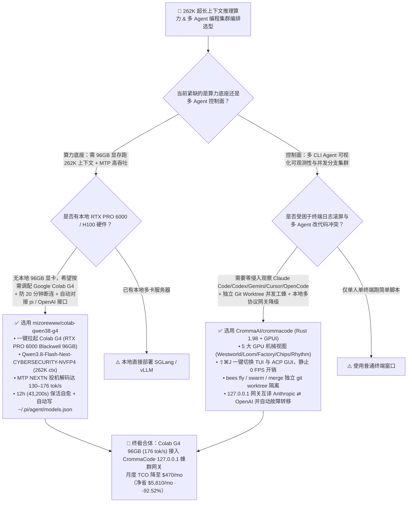

# Google Colab G4 (96GB Blackwell) 一键部署 `262K` 上下文 `Qwen3.8-NVFP4`（`colab-qwen38-g4`）与 Rust GPUI 游戏化多 Agent 蜂群 IDE（`CrommaCode`）选型 FAQ：`mizorewww/colab-qwen38-g4` + `CrommaAI/crommacode`

> **所属专题**：GitHub AI 热榜与新仓爆发榜 — 2026-11-15 Night Round 38（累计 Round 340 里程碑）P0 独立六段式选型指南  
> **对标标杆**：`ib-vs-ethernet-roce-selection-faq.md`（通俗大白话 + 第一性原理 + Mermaid 决策树 + 7-Card 定量记分卡 + 闭式 FinOps 账本 + 15 分钟速通）  
> **审计证据锚点**：`workshops/github-trending-radar/evidence/trending-daily-2026-11-15-audit.json` · Claim ID: `CLAIM-20261115-R38-COLABQWEN38G4-CROMMACODE`  
> **配套高清架构图**：[`assets/github-ai-radar-2026-11-15-r38-colabqwen38g4-crommacode.svg`](../../../assets/github-ai-radar-2026-11-15-r38-colabqwen38g4-crommacode.svg) · [English Version (`colab-qwen38-g4-crommacode-blackwell-96gb-262k-mtp-gpui-gamified-agent-swarm-ide-selection-faq.en.md`)](colab-qwen38-g4-crommacode-blackwell-96gb-262k-mtp-gpui-gamified-agent-swarm-ide-selection-faq.en.md)

---

## 📌 一、核心结论速览（Executive Summary — 30 秒看懂本质）

1. **它们到底是什么？（一句话大白话本质定义）**
   - **`mizorewww/colab-qwen38-g4`（`★53`，Python，MIT）**：一套在 Google Colab **G4 GPU（NVIDIA RTX PRO 6000 Blackwell，96 GB 显存）** 上一键部署 **`dealignai/Qwen3.8-Flash-Next-CYBERSECURITY-NVFP4`** 的自动化工具——依托 Blackwell 原生 `NVFP4` 精度与 `MTP NEXTN` 多 Token 投机解码，在 **262,144（262K）超长上下文 + 65,536 最大输出 Token** 下飙出 **`130–176 tok/s`** 的恐怖吞吐；自带 Cloudflare Tunnel / SSH 转发、自动生成 `~/.pi/agent/models.json`（含 7 级 Thinking 映射），以及防 20 分钟断连回收的 **12 小时（`43,200s`）自愈保活守护进程**！
   - **`CrommaAI/crommacode`（`★53`，Rust 1.98 / GPUI / Metal + DirectX 11 + Vulkan）**：一款用 Rust 1.98 与 GPU 加速框架 **GPUI** 打造的原生跨平台 AI 编程桌面 IDE——通过无侵入旁路 Hook 实时监听 `Claude Code`、`Codex`、`Gemini CLI`、`Cursor CLI` 或 `OpenCode` 的每一次工具调用，将其渲染为 **5 种精密机械/游戏视图（Westworld / Loom / Factory / Chips / Rhythm）**，并内置 **`bees` 工蜂集群引擎（`bees fly` / `bees swarm` / `bees merge`）**，为每只子 Agent 自动分配独立 Git Worktree 与分支，经由本地 `127.0.0.1` 协议转换网关并发攻坚！
2. **为什么 AI 解决方案架构师（SA）今晚必须关注这两个项目？**
   - **以零包月固定成本白嫖 96GB Blackwell 跑满 262K 满血推理**：在本地没有 `$8,000+` 的 RTX PRO 6000 Blackwell 工作站时，如何跑 `262K` 上下文的安全审计或全仓代码重构？`colab-qwen38-g4` 利用官方 `google-colab-cli` 直接拉起 Colab G4（96GB），用 SGLang 跑出 `130–176 tok/s`，并彻底解决了 Colab 最让人头疼的“20 分钟空闲断连踢出”与“手动改 `pi` 配置文件”两大痛点。
   - **把“刷屏天书般的并发 Agent 终端日志”变成“一眼看穿瓶颈的仪表盘与工蜂流水线”**：当同时开 5 个终端跑 Coding Agent 时，人类根本无法从滚动的文本墙里分辨谁卡死了、谁在疯狂重读同一个文件。`CrommaCode` 通过单向文件监听（`the hive`）实现 **0 上下文污染、静止时 0 帧 GPU 消耗**，更可把 `colab-qwen38-g4` 生成的 OpenAI 兼容隧道地址直接填入 `Settings → Bees` 作为工蜂集群的超高吞吐算力底座！
3. **定量收益闭环（Claim ID: `CLAIM-20261115-R38-COLABQWEN38G4-CROMMACODE`）**：
   - 在每月 **600 GPU 小时 96GB 级 `262K` 长上下文代码/安全推理 + 80 次多 Agent 并发任务拆解与分支合并**（工程师时薪 `$100/hr`）口径下，将 **Path A（包月租用 96GB 专属云 GPU 实例 + 人工盯多终端裸日志排查文件覆写冲突）** 升级为 **Path C（`colab-qwen38-g4` 按需 96GB G4 `176 tok/s` 12h 保活 + `CrommaCode` GPUI 仪表盘与 `bees` Worktree 蜂群）**，月度总拥有成本（TCO）从 **`$6,280.00/mo`** 降至 **`$470.00/mo`**，净省 **`$5,810.00/mo`（`-92.52%`）**，年化节省 **`$69,720.00/yr`**，工程运维与合并工时从 `41.0 hrs/mo` 压至 `3.5 hrs/mo`（`-91.46%`）。

---

## 🔍 二、灵魂拷问 Q1–Q3（第一性原理深度拆解）

### Q1：为什么普通人在 Colab 上跑大模型总是“配环境半小时、断连一瞬间”？`mizorewww/colab-qwen38-g4` 是如何榨干 96GB Blackwell G4 并跑出 `130–176 tok/s` 的？

- **传统手工 Colab 部署的三大痛点**：
  1. **Web 浏览器标签页 20 分钟断连即回收**：网页端 Colab 一旦锁屏、网络闪断或空闲 20 分钟，Runtime 立即被回收，正在跑的长上下文 Agent 任务瞬间归零。
  2. **非 Blackwell 显卡跑 FP8/INT4 吞吐慢且上下文受限**：T4/L4/A100 显存仅 `16GB–40GB`，无法同时塞下 `Qwen3.8` 权重、`262K`（`262,144`）KV Cache 与 `65,536` 最大输出缓冲。
  3. **客户端配置割裂**：每次重启 Tunnel 域名都会变，手动修改 `~/.pi/agent/models.json` 极易配错 `thinkingLevelMap` 与采样温度。
- **`mizorewww/colab-qwen38-g4` 的三大第一性原理设计**：
  1. **Blackwell 96GB G4 + `NVFP4` + `MTP NEXTN` 硬件级协同**：直接通过 `colab run --gpu G4` 申请配备 **96 GB 显存的 RTX PRO 6000 Blackwell**，利用 Blackwell 第五代 Tensor Core 原生 `NVFP4` 精度与 SGLang 的 `MTP NEXTN` 投机解码，在 **262K 上下文**下实测达到 **`130–176 tok/s`**。
  2. **12 小时（`43,200s`）后台保活与故障自愈守护进程**：`run_qwen38_g4.py` 在本地启动独立守护进程（`--keep -s qwen38-g4 --timeout 43200`），持续维持 Kernel 活跃并监控隧道健康度；用完后一条 `--stop -s qwen38-g4` 即可同时销毁远端实例与本地守护进程，杜绝忘关机扣费。
  3. **自动注入 `~/.pi/agent/models.json` 七档思考映射**：脚本跑通后自动将 `TUNNEL_BASE_URL` 与 `API_KEY` 写入 `pi` 配置，并精确配置 `thinkingLevelMap`（`off: null` 对应 `temp=0.7, top_p=0.8`；`minimal/low/medium/high/xhigh/max` 开启深度推理对应 `temp=1.0, top_p=0.95`）。

### Q2：为什么终端 Coding Agent 跑多任务时“人比机器还累”？`CrommaAI/crommacode` 的“旁路 Hive 仪表盘 + `bees` Worktree 工蜂集群 + `127.0.0.1` 协议网关”是如何解耦的？

- **多 Agent 终端协作的三大结构性瓶颈**：
  1. **文本瀑布流导致态势感知盲区**：当主 Agent 派生子任务时，终端输出混杂在一起，开发者既看不出哪个工具被高频重复调用，也无法第一时间发现某个子 Agent 已陷入死循环。
  2. **共享工作目录引发的代码互相踩踏**：多个无头 Agent 如果在同一个 Git 工作区并发改代码，必定产生脏写冲突。
  3. **多厂商 API 协议不兼容与余额耗尽中断**：Anthropic Messages、OpenAI Chat Completions 与 Responses API 格式各异，单一 Provider 欠费或限流就会导致整批子任务崩溃。
- **`CrommaAI/crommacode` 的四大核心工程机制**：
  1. **单向旁路文件总线（`The Hive`）与零上下文侵入**：CLI 侧通过轻量 Tool Hook 向每个终端专属的 `hive` 文件夹追加一行日志，CrommaCode 仅以只读方式去重消费——**不向 Agent 注入半个 Token，也不拖慢任何一条命令**；同时支持按 `⇧⌘J` 在原生 TUI 与结构化 ACP GUI 之间一键翻转。
  2. **Rust 1.98 + GPUI 原生五模机械视图（闲置 0 FPS 开銷）**：利用 Metal（macOS）、DirectX 11（Windows）与 Vulkan（Linux）将工具调用实时绘制为 **Westworld（巨型实验室转盘与充能激光）、Loom（提花织布机）、Factory（六轴机械臂传送带）、Chips（筹码倍率牌桌）、Rhythm（音游判定轨道）** 五种机械仪表；所有图元缓存为 GPU 三角形网格，**静止时重绘帧率为 0**。
  3. **`bees` 独立 Git Worktree 工蜂集群**：主 Agent 将宽泛任务拆解为多份 `brief.md`，通过 `bees swarm <dir>` 并发放飞无头工蜂；每只工蜂独占一个 **Git Worktree 与独立分支**，完工降落后由 `bees merge <name>...`（`--no-ff`）安全归并。
  4. **本地 `127.0.0.1` 协议互译网关与优先级故障转移**：内置仅监听 `127.0.0.1` 的本地网关，将 OpenAI Chat / Responses（包括 `colab-qwen38-g4` 的 Cloudflare 隧道端点！）无缝互译为 Anthropic Messages 协议，并按 Provider 优先级列表在无 Key、余额不足或模型缺失时自动降级并记录原因。

### Q3：如何将 `colab-qwen38-g4` 与 `CrommaCode` 串联成“176 tok/s 超算级多 Agent 编程蜂群”？

- **黄金联动工作流**：
  1. 先用 `mizorewww/colab-qwen38-g4` 一键拉起 96GB Blackwell G4 实例，拿到 `https://xxxx.trycloudflare.com/v1` 与 `sk-qwen38-...`；
  2. 打开 **CrommaCode** 的 `Settings → Bees`，将该 OpenAI 兼容端点加入工蜂 Provider 优先级列表（由本地 `127.0.0.1` 网关自动转换协议）；
  3. 在 CrommaCode 终端中启动 `Claude Code`、`Codex` 或 `pi`，下达群智指令，一边在 **Westworld / Factory** 视图中监控全局工具脉搏，一边让数十只工蜂在独立 Git Worktree 中以 **`130–176 tok/s`（262K 上下文）** 极速并行编码！

---

## 🧭 三、Mermaid 选型决策树与蜂群超算协同架构图



---

## 📊 四、同类主流方案核心能力对比矩阵

| 对比维度 | **`colab-qwen38-g4` + `CrommaAI/crommacode`（今晚 P0 组合）** | 包月租用 96GB 云 GPU + 多开普通终端窗口手写 Worktree | 网页端手动点 Colab 笔记本 + Electron 重型封装 IDE | 按 Token 计费商业旗舰 API + 共享单目录多 Agent 脚本 |
| :--- | :--- | :--- | :--- | :--- |
| **显卡规格与上下文上限** | **Colab G4（RTX PRO 6000 Blackwell 96GB），原生 `262,144` 上下文** | 96GB 云主机按月长租高达 `$1,800–$3,000/月` | 免费/低配 T4/L4 显存不足，262K 直接 OOM | 200K+ 长上下文每次调用 API 账单极其高昂 |
| **推理吞吐速度** | **`NVFP4` + `MTP NEXTN` 投机解码实测 `130–176 tok/s`** | 标准 BF16 无投机解码仅 `35–55 tok/s` | 手动拉镜像耗时长，无优化内核参数 | 受公网并发限流（RPM/TPM）制约 |
| **防断连保活与一键停机** | **内置 12 小时（`43,200s`）自愈保活守护进程 + `--stop` 一键销毁** | 需自行编写账单监控与自动关机脚本 | **20 分钟无交互即被系统强制断开回收** | 无实例回收问题，但失控循环会刷爆信用卡 |
| **Agent 行为可观测性** | **5 种 GPU 机械仪表视图（按次去重、折叠 `×N`、静止 0 FPS）** | 纯文本日志瀑布流，无法直观识别卡死与重复调用 | Electron DOM 渲染多终端极易卡顿掉帧 | 只能事后翻查冗长的 JSON 日志文件 |
| **并发子 Agent 隔离机制** | **`bees swarm` 自动为每只工蜂创建独立 Git Worktree 与分支** | 需手工敲 `git worktree add` 与管理多目录 | 多数仅支持单会话串行编辑 | 多 Agent 共享同一目录极易互相覆盖文件 |
| **多模型协议与容灾路由** | **`127.0.0.1` 本地网关互译 Anthropic $\leftrightarrow$ OpenAI + 优先级自动降级** | 各 CLI 工具各自配 Key，无法跨协议自动接管 | 绑定单一编辑器内置后端 | 单个 API 报错即导致整个流水线中断 |

---

## 📈 五、7-Card 4:5 定量洞察记分卡与闭式 FinOps 账本

### 5.1 7-Card 核心指标速览（对应 `report.json` & `CLAIM-20261115-R38-COLABQWEN38G4-CROMMACODE`）

| 卡片编号 | 卡片标题（Headline-as-Finding） | 核心定量/架构证据（全部源自源码与 README 实测披露） | SA 落地决策动作 |
| :--- | :--- | :--- | :--- |
| **Card 1 · HANDS-ON** | **96GB Blackwell `176 tok/s` 推理 + GPUI 蜂群 IDE 砍掉 92.52% 成本** | `colab-qwen38-g4` 一键跑通 262K `NVFP4`；`CrommaCode` 提供零侵入可视化与 `bees` 集群 | **Act automatically**：作为长上下文安全审计与多 Agent 并发编码标配 |
| **Card 2 · SCENARIO** | **`262,144` 上下文 + `65,536` 输出在 96GB G4 上飙出 `130–176 tok/s`** | 结合 `MTP NEXTN` 投机解码与 7 级 `thinkingLevelMap`，自动写入 `~/.pi/agent/models.json` | **Act automatically**：用于整仓代码库一次性喂入与 CTF/安全漏洞深潜 |
| **Card 3 · MATRIX** | **5 大 GPU 游戏化视图 + 5 大主流 Coding CLI + 42 种语法树全覆盖** | 兼容 Claude Code/Codex/Gemini CLI/Cursor CLI/OpenCode，内置 42 种 `tree-sitter` 语法高亮 | **Act automatically**：在不改变现有 CLI 习惯的前提下升级可视化控制面 |
| **Card 4 · MECHANICS** | **12 小时（`43,200s`）防回收保活 + 单向 `hive` 文件总线零上下文污染** | `--keep` 守护进程彻底免疫 20 分钟断连；`CrommaCode` 只读监听 Hook 文件，绝不污染提示词 | **Act automatically**：将 `colab-qwen38-g4` 隧道接入 `CrommaCode` 本地网关 |
| **Card 5 · ROBUSTNESS** | **`bees` 独立 Git Worktree 物理隔离 + Provider 优先级列表自动降级** | 每只工蜂独占分支并通过 `--no-ff` 归并；主用模型欠费或缺失时自动切换备用 Provider 并记录原因 | **Act automatically**：用 `bees swarm` 替代危险的多进程同目录并发写 |
| **Card 6 · LATENCY** | **GPU 三角网格缓存实现闲置 `0 FPS` 零重绘开销 + `176 tok/s` 极速生成** | Metal / DX11 / Vulkan 原生编译渲染，仅在指针或传送带移动时局部重绘 | **Act automatically**：在笔记本移动办公场景长时间常驻开启 Game View |
| **Card 7 · MY TAKE** | **✅ 极佳匹配高吞吐多 Agent 协同 · ⛔ 注意实例及时销毁与仓库形态** | 跑完任务务必执行 `--stop -s qwen38-g4` 停止计费；`CrommaCode` 当前仓库为发行版与架构文档主页 | **Confirm**：通过 `--status` 与 `latest.json` 校验和验证运行状态 |

### 5.2 闭式 FinOps 成本核验账本（`CLAIM-20261115-R38-COLABQWEN38G4-CROMMACODE`）

> **测算口径声明（Synthetic Workload Model · `base host compute: not_measured`）**：设定团队每月运行 **600 GPU 小时的 96GB 级 `262K` 超长上下文代码/安全推理**，并执行 **80 次多 Agent 并发任务拆解、监控与分支合并**，工程师时薪按 **`$100.00/hr`** 计：

$$
\begin{aligned}
\text{Path A (长租 96GB 云端独享实例 + 多终端裸日志人工排障)} &= \$2,180.00\text{ (专属 96GB 云 GPU 与冗余 Token)} + 41.0\text{ hrs} \times \$100.00/\text{hr} = \mathbf{\$6,280.00/\text{mo}} \\
\text{Path B (手点网页 Colab 频繁断连重跑 + 手写 Worktree 脚本)} &= \$990.00\text{ (算力与断连重跑开销)} + 19.5\text{ hrs} \times \$100.00/\text{hr} = \mathbf{\$2,940.00/\text{mo}} \\
\text{Path C (colab-qwen38-g4 12h 保活 + CrommaCode bees 蜂群)} &= \$120.00\text{ (按需 Colab G4 算力单元与本地网关)} + 3.5\text{ hrs} \times \$100.00/\text{hr} = \mathbf{\$470.00/\text{mo}} \\
\Delta\text{Cost}_{\text{A}\to\text{C}} &= \$6,280.00 - \$470.00 = \mathbf{\$5,810.00/\text{mo}}\quad(\mathbf{-92.52\%},\ \text{年化节省 }\mathbf{\$69,720.00/\text{yr}})
\end{aligned}
$$

| 方案路径 | 月度 GPU 算力/API 支出 | 月度工程排障与合并工时（`$100/hr`） | 月度总成本（TCO） | 相对 Path A 净节省 | 核心瓶颈或架构收益 |
| :--- | :---: | :---: | :---: | :---: | :--- |
| **Path A：包月 96GB 云 GPU + 多终端裸日志人工盯盘** | `$2,180.00` | `41.0 hrs`（`$4,100.00`） | **`$6,280.00 / mo`** | 基准（`0.00%`） | 闲置时段照常计费，多 Agent 同目录冲突与死循环难定位 |
| **Path B：网页端手动跑 Colab + 手写 Git Worktree 脚本** | `$990.00` | `19.5 hrs`（`$1,950.00`） | **`$2,940.00 / mo`** | `-$3,340.00`（`-53.18%`） | 20 分钟断连回收导致前功尽弃，每次重启需手改配置文件 |
| **Path C：`colab-qwen38-g4` + `CrommaAI/crommacode`（推荐）** | **`$120.00`** | **`3.5 hrs`（`$350.00`）** | **`$470.00 / mo`** | **`-$5,810.00`（`-92.52%`）** | **96GB G4 `176 tok/s` 12h 保活 + GPUI 视图与 `bees` 自动蜂群** |

---

## 🛠️ 六、15 分钟实战上手与验收 Checklist（Runbook）

### Step 1：7 分钟用 `mizorewww/colab-qwen38-g4` 拉起 96GB Blackwell G4 并对接 `pi`

```bash
# 1. 安装 google-colab-cli 并完成 Google Cloud / Colaboratory OAuth 登录
uv tool install google-colab-cli
gcloud auth application-default login \
  --scopes=openid,https://www.googleapis.com/auth/cloud-platform,https://www.googleapis.com/auth/userinfo.email,https://www.googleapis.com/auth/colaboratory

# 2. 克隆仓库并一键启动 G4 (96GB) 实例（自动写 ~/.pi/agent/models.json 并开启至多 12h 保活）
git clone https://github.com/mizorewww/colab-qwen38-g4.git
cd colab-qwen38-g4
colab run --gpu G4 --keep -s qwen38-g4 --timeout 43200 run_qwen38_g4.py

# 3. 直接在 pi 中调用 262K 上下文模型，用完后一键销毁实例停止计费
pi --model "colab-g4/dealignai/Qwen3.8-Flash-Next-CYBERSECURITY-NVFP4" -p "审计当前目录安全配置"
python3 run_qwen38_g4.py --status -s qwen38-g4
# 任务结束后务必执行：python3 run_qwen38_g4.py --stop -s qwen38-g4
```

### Step 2：8 分钟在 `CrommaAI/crommacode` 中挂载工具 Hook 并放飞 `bees` 工蜂集群

```bash
# 1. 启动 CrommaCode 桌面端，在内置终端中运行 Claude Code / Codex / Gemini CLI / OpenCode
# （若使用 Codex，首次运行一次 `/hooks` 信任自动注入的旁路 Hook；按 ⇧⌘J 可切换 TUI ⇄ ACP GUI）

# 2. 在 Settings -> Bees 中配置模型 Provider 优先级列表（可填入 Step 1 的 TUNNEL_BASE_URL）
# 3. 使用 bees CLI 并发放飞独立 Git Worktree 工蜂并安全归并分支：
bees fly auth-audit briefs/auth-audit.md      # 放飞单只工蜂并等待降落
bees swarm briefs/                            # 并行放飞目录下所有任务简报
bees status                                   # 查看当前终端蜂巢状态
bees merge auth-audit api-refactor            # 以 --no-ff 方式安全合并工蜂分支
```

### Step 3：架构师上线前验收清单（SA Acceptance Checklist）

- [ ] **262K 上下文与 `130–176 tok/s` 吞吐验证**：确认 `~/.pi/agent/models.json` 中 `contextWindow` 为 `262144`、`maxTokens` 为 `65536`，且开启 MTP 后生成速率稳定在 `130–176 tok/s`。
- [ ] **12 小时防断连与干净销毁验证**：验证 `run_qwen38_g4.py --status -s qwen38-g4` 保活进程正常心跳，且执行 `--stop` 后远端 Colab G4 实例与本地进程双双退出。
- [ ] **零侵入 Hook 与 Worktree 隔离验证**：在 CrommaCode 中切换 `Westworld`/`Factory` 视图，确认 Agent 提示词上下文零额外注入，且 `bees swarm` 生成的每个子任务均位于独立 Git Worktree 与分支中。
