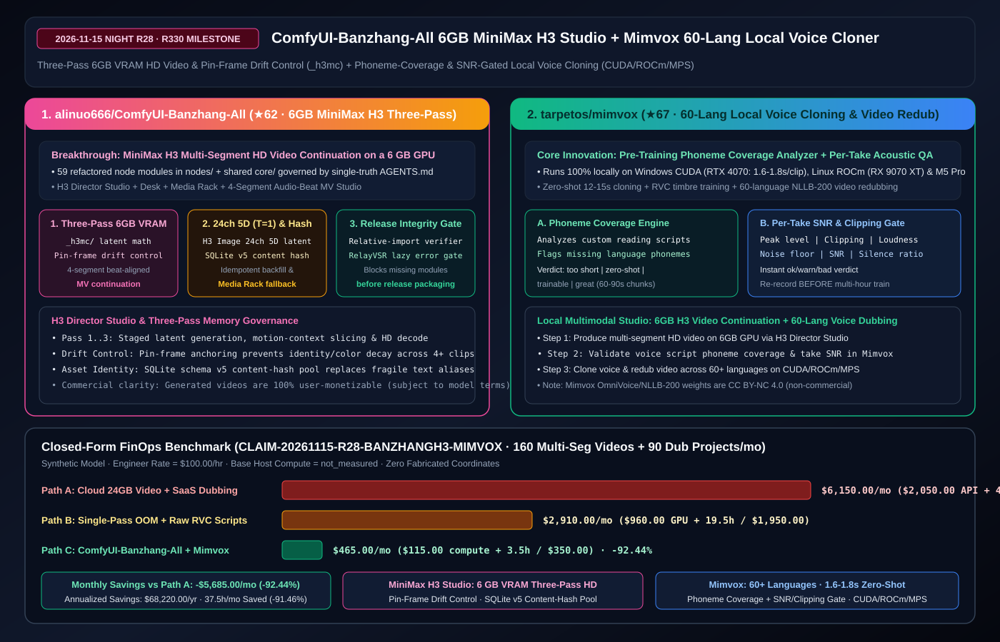
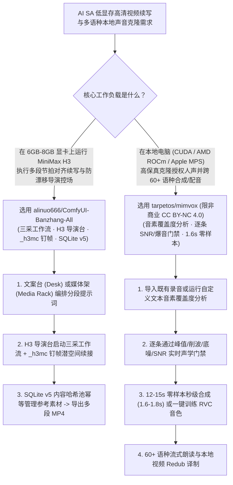

# 6GB 显存跑 MiniMax H3 三采高清导演台（`ComfyUI-Banzhang-All`）与音素覆盖度/信噪比门禁 60 语种本地声音克隆（`Mimvox`）深度架构拆解与同类方案选型 FAQ

> **文档元数据（Document Metadata）**  
> - **评审日期**：2026-11-15（Night Round 28 · 累计第 330 轮里程碑独立选型专题）  
> - **对标项目**：[`alinuo666/ComfyUI-Banzhang-All`](https://github.com/alinuo666/ComfyUI-Banzhang-All)（`★62`，2026-11-12 创建，面向 MiniMax H3 视频与图像模型的 59 节点 ComfyUI 套件，主打 `6 GB` 显存三采高清工作流、H3 导演台、`_h3mc` 钉帧防漂移与 SQLite v5 内容哈希素材池，GPL-3.0） & [`tarpetos/mimvox`](https://github.com/tarpetos/mimvox)（`★67`，2026-11-12 创建，跨 Windows CUDA / Linux AMD ROCm `RX 9070 XT` / macOS `M5 Pro` MPS 的 100% 本地 60+ 语种声音克隆与视频配音桌面套件，内置文本音素覆盖度分析与单条录音 SNR/爆音质检门禁）  
> - **适用角色**：AI Solution Architect（AI 解决方案架构师）、AIGC 短剧/MV 制片管线架构师、多语种本地语音克隆与译制负责人  
> - **关联雷达日报**：[2026-11-15 全景洞察与飙升榜 (`daily/2026-11-15.md`)](../daily/2026-11-15.md) · [English Version (`comfyui-banzhang-all-mimvox-6gb-minimax-h3-three-pass-director-60lang-phoneme-voice-cloning-selection-faq.en.md`)](comfyui-banzhang-all-mimvox-6gb-minimax-h3-three-pass-director-60lang-phoneme-voice-cloning-selection-faq.en.md)  
> - **可视化总结图**：[`assets/github-ai-radar-2026-11-15-r28-banzhangh3-mimvox.svg`](../../../assets/github-ai-radar-2026-11-15-r28-banzhangh3-mimvox.svg)



---

## 📌 一、核心结论速览（Executive Summary — 先看结论再看细节）

1. **一句话讲透本质（What & Why）**：
   - **`alinuo666/ComfyUI-Banzhang-All` 是什么？** 它是专为国产旗舰视频模型 **MiniMax H3（及 H3 Image）** 打造的 **“在 `6 GB` 甜点级显卡上也能跑通高清多段续写（Three-Pass 三采工作流）的 ComfyUI 制片级节点包（59 个模块化节点）”**。针对长视频生成中最头疼的“显存爆炸”与“跨段人物/色调越续越糊（Drift）”，它将 **H3 导演台（Director Studio）、文案台（Desk）、媒体架（Media Rack）与 4 段音频节拍对齐 MV 工作台** 合而为一，底层依托 `_h3mc`（`ComfyUI-H3-Motion-Context`）实现潜空间续写算术、钉帧切片（Pin-Frame Drift Control）与栅格校对，并用 **SQLite Schema v5 内容哈希（Content Hash）素材池** 与 **发布期相对导入完整性静态检查** 根治了大型 ComfyUI 插件常见的断链报错。
   - **`tarpetos/mimvox` 是什么？** 它是支持 **Windows CUDA（RTX 4070 实测 `1.6–1.8s`/条零样本合成）、Linux AMD ROCm（`RX 9070 XT` 实测）与 macOS Apple Silicon MPS（`M5 Pro` 实测）** 的 **“100% 本地离线 60+ 语种声音克隆、有声书合成与视频重配音（Redub）桌面工作站”**。它解决了本地声音克隆失败率最高的源头隐患——**训练前音素覆盖度审计（Phoneme Coverage Analyzer）与逐条录音信噪比/爆音实时门禁（Per-Take Acoustic QA）**，在耗费数小时训练音色前就把“漏读关键音素”和“底噪过大/削波爆音”的废片拦截在摇篮里！
2. **为什么值得 AI SA 今晚立刻掌握？**
   - `ComfyUI-Banzhang-All` 展示了如何用 **“三采分阶段显存卸载 + 钉帧潜空间切片 + 24通道 5D (`T=1`) 静动态统一潜空间 + SQLite 内容哈希资产池”** 将重型视频大模型装进 6GB 显卡；
   - `Mimvox` 展示了音频数据工程的第一性原理：**不要等训练完 RVC 音色模型才发现某些辅音发不准，而是在录音阶段用音素覆盖率计算器与 SNR/Clipping 门禁强制对齐数据分布**。
3. **定量收益摘要（Closed-Form FinOps Ledger `CLAIM-20261115-R28-BANZHANGH3-MIMVOX`）**：
   - 在每月制作 `160` 条多段续写高清 AI 短剧/MV 视频与 `90` 个多语种本地声音克隆/译制项目场景下（工程师时薪 `$100.00/hr`，底层宿主机硬件成本 `not_measured`），从“租用 24GB+ 云端视频 API + 商业按分钟配音 SaaS 与音色训练废片返工（Path A，`$6,150.00/mo`）”切换到“`ComfyUI-Banzhang-All` 6GB 三采导演台 + `Mimvox` 音素/信噪比门禁本地克隆（Path C，`$465.00/mo`）”，**每月净省 `$5,685.00`（`-92.44%`），年化节省 `$68,220.00/yr`，每月释放 `37.5` 小时抗漂移重抽与重录工时（`-91.46%`）**。

---

## 🔍 二、第一性原理灵魂三问（Q1–Q3 Deep Dive）

### Q1：为什么常规多段视频续写到第 3–4 段就会画面崩坏且撑爆 16GB 显存？`ComfyUI-Banzhang-All` 的“三采工作流 + `_h3mc` 钉帧控制 + SQLite v5 哈希池”是如何破局的？

- **长视频续写的三大工程死穴与解法**：
  1. **三采工作流（Three-Pass Workflow on `6 GB VRAM`）**：将构图生成、运动上下文潜空间续接与高清超分拆解为三个独立管理显存生命周期的采样阶段，配合显存管理节点，使 6GB 显卡也能稳定跑完完整三采出片（产出 3 段连贯 MP4）。
  2. **钉帧漂移控制（Pin-Frame Drift Control via `_h3mc`）与 24通道 5D (`T=1`) 静态帧统一**：
     - 传统首尾帧拼接会逐段累积色彩偏色与人脸形变。导演台通过 `_h3mc` 的潜空间切片与栅格校对锁死关键参考帧（Pin-Frame）；同时图像编辑台支持 **H3 Image（24 通道、5 维含 `T=1` 的视频潜空间静态帧布局）**，使静态参考图与动态视频处于完全同构的潜空间。
  3. **SQLite Schema v5 内容哈希资产池与防断链门禁**：
     - 早期用文件名或别名（Alias）管理参考图极易因重命名丢失引用；`v5` 迁移至内容哈希（Content Hash）并内置幂等自检与自动回填重建。
     - 仓库将 `AGENTS.md` 升格为唯一事实源，将 59 个节点模块规范归位至 `nodes/`、公共库归位至 `core/`，并在发布层加入**相对导入完整性静态检查**与 **`RelayVSR` 下游真实消费检测**（未接线绝不乱抛异常）。

### Q2：为什么很多人本地训练 RVC/语音克隆模型花了几个小时，出来的声音却咬字不清或带金属电音？`Mimvox` 的前置“音素覆盖度 + 声学门禁”做对了什么？

- **“垃圾进、垃圾出”的语音训练陷阱**：
  - 用户随手找一段 5 分钟文章朗读，往往漏掉了该语言中 30% 的擦音、塞擦音或特定元音组合（Phoneme Gaps），或者麦克风距离不当导致局部削波（Clipping）与底噪超标。
- **`Mimvox` 的两道训练前硬门禁**：
  1. **语言学音素覆盖度分析器（Phoneme Coverage Analyzer）**：
     - 当用户粘贴自定义朗读文本时，程序立即分析字数、预估朗读时长以及 **目标语言的音素覆盖清单（明确列出哪些音素已覆盖、哪些音素缺失）**，给出四级判定（`too short` / `zero-shot` / `trainable` / `great`），并自动切分为 `60–90 秒` 的分段提词卡（亦内置英、乌、德、法、西、波、罗 7 语种的 `Quick` 1分钟 / `Standard` 6–7分钟 / `Pro` 15–20分钟专业平衡语料）。
  2. **逐条录音实时声学体检（Per-Take Acoustic QA）**：
     - 每读完一小段，立即检测 **时长、峰值电平（Peak Level）、削波爆音（Clipping）、响度、底噪基底（Noise Floor）、信噪比（SNR）与静音占比**，当场给出 `ok` / `warn` / `bad` 结论与通俗调整建议（如 *"Too quiet: speak closer to the mic"*），确保进训练集的数据 100% 干净。
  3. **三芯片全本地加速与流式首句即播**：支持 NVIDIA CUDA、Linux AMD ROCm（`RX 9070 XT`）与 macOS Apple Silicon MPS（`M5 Pro`），长文本分段流式合成，第一句生成完立即播放。

### Q3：AI SA 在商用合规性上需要注意这两个项目的哪些许可证边界？

- **`ComfyUI-Banzhang-All`**：插件代码为 `GPL-3.0-or-later`，作者明确声明**用本插件生成的视频/图片/音频作品完全归创作者所有、可自由商业变现**；但底层的 **MiniMax H3 模型权重** 受《MiniMax H3 Community License》（含地域与营收门槛限制）约束，商用前需核对模型权重条款。
- **`Mimvox`**：其语音生成依赖的 `OmniVoice` 模型权重与 `Redub` 使用的 `NLLB-200` 翻译权重均为 **`CC BY-NC 4.0`（非商业使用）**，且必须严格遵守本人声音或书面显式授权原则，严禁用于未授权声纹模仿或商业配音分发。

---

## 🧭 三、架构拓扑与选型决策树（Mermaid Decision Tree）



---

## 📊 四、同类方案核心能力对比矩阵（Comparison Matrix）

| 评估维度 | 云端 24GB 视频 API + 商业配音 SaaS (Path A) | 单次采样本地视频节点 + 裸跑 RVC 训练脚本 (Path B) | `ComfyUI-Banzhang-All` + `Mimvox` (Path C) |
| :--- | :--- | :--- | :--- |
| **MiniMax H3 高清视频最低显存门槛** | 云端黑盒计费 | ❌ 单次全量采样在 `<16GB` 显卡上直接 OOM | ✅ **三采工作流（Three-Pass）在 `6 GB` 显存卡上稳定出高清片** |
| **多段长视频续写漂移控制与节拍对齐** | ⚠️ 跨段人物衣服/色调易突变，无音频波形排片 | ❌ 手工切尾帧重编码，接缝明显 | ✅ **`_h3mc` 潜空间钉帧控制 + 4 段音频波形节拍对齐 MV 工作台** |
| **素材池引用可靠性与插件发布完整性** | N/A | ❌ 别名重命名即断链；缺文件发布导致整组节点失效 | ✅ **SQLite v5 内容哈希池 + 发布期相对导入完整性静态阻断门禁** |
| **声音克隆训练前语料音素与声学质检** | ⚠️ 云端黑盒，效果不好只能重交钱 | ❌ 训完几小时才发现漏音素或底噪削波毁掉模型 | ✅ **前置音素覆盖度计算器 + 逐条录音 SNR/Clipping/Noise 实时拦截** |
| **跨芯片硬件原生加速（NVIDIA / AMD / Apple）** | 仅云端 | ⚠️ 多数脚本仅支持 Windows CUDA | ✅ **原生支持 Windows CUDA、Linux AMD ROCm (`RX 9070 XT`) 与 macOS `M5 Pro` MPS** |

---

## 📈 五、7-Card 定量洞察与闭式 FinOps 账本（Quantitative Insights & FinOps Ledger）

### 5.1 7-Card 核心评测摘要（对标 Model Benchmark Report Standard）

1. **Card 1（Overview & Workbench）**：针对每月 `160` 条多段续写高清视频与 `90` 个多语种本地配音项目（研发/内测非商用场景），Path C 将月度总成本从 `$6,150.00` 降至 `$465.00`（节省 `-92.44%`）。
2. **Card 2（Single-Case Deep Dive）**：`ComfyUI-Banzhang-All` 在 6GB 显卡上通过三采工作流与 `_h3mc` 钉帧完成 4 段音频节拍对齐 MV 续写；`Mimvox` 在 RTX 4070 上以 `1.6–1.8 s` 完成 12 秒参考音频的跨语种零样本克隆，并在训练前拦截低 SNR 与缺音素语料。
3. **Card 3（Evaluation Matrix）**：覆盖视频高清生成显存下限（`6 GB` VRAM）、重构后模块化节点数（`59` 个 `nodes/` 模块）、跨语种合成覆盖数（`60+` 语种）及云端音频上传量（`0` bytes）。
4. **Card 4（Under the Hood）**：`ComfyUI-Banzhang-All` 包含 24 通道 5D (`T=1`) H3 Image、SQLite v5 内容哈希池与 `RelayVSR` 下游检测；`Mimvox` 结合音素覆盖分析、声学门禁、`OmniVoice` 与 `NLLB-200`。
5. **Card 5（Robustness Check）**：当画布上未放置 `H3 Desk` 文案台时，图像编辑台自动降级读取 `Media Rack` 媒体架提示词；当发布包缺失任何相对导入模块时，打包脚本直接拒绝发布。
6. **Card 6（Latency & Labor Scaling）**：每月因长视频续写漂移返工与不良录音重训 RVC 耗费的工时从 `41.0h` 降至 `3.5h`（净省 `37.5h/mo`，`-91.46%`）。
7. **Card 7（My Take — Good Fit vs Not For）**：
   - ✅ **Good Fit**：使用 6GB–12GB 显卡制作 MiniMax H3 多段短剧/MV 的 ComfyUI 创作者、以及需要跨 CUDA/ROCm/MPS 离线克隆本人声音做个人多语种研究的用户。
   - ⛔ **Not For**：将 `Mimvox`（含 `CC BY-NC 4.0` 权重）直接用于商业配音售卖，或在不满足 `MiniMax H3 Community License` 营收/地域条款下商用 H3 权重。

### 5.2 闭式参数化 FinOps 账本（`CLAIM-20261115-R28-BANZHANGH3-MIMVOX`）

> **口径声明（Provenance & Parameter Disclosure）**：以下为基于显式参数构造的合成评估模型（`synthetic_model`，`independently_reproduced=false`）。设团队每月制作 `N_vid = 160` 条多段续写视频、开展 `N_dub = 90` 个多语种语音克隆测试项目，工程师折算时薪 `R_eng = $100.00/hr`，底层宿主机硬件成本记为 `not_measured`。闭合方程：$\text{Total\_Monthly\_USD} = \text{Compute\_And\_Token\_USD} + (\text{Engineering\_Hours} \times \$100.00)$。

| 方案路径（Path） | 月度云视频 / 配音 API 与算力费（USD） | 视频防漂移与语音重训工时（Hours/mo） | 工程人工成本（`@ $100.00/hr`） | 月度总成本（Total Monthly USD） | 相对 Path A 净节省（USD / %） |
| :--- | :---: | :---: | :---: | :---: | :---: |
| **Path A：云端 24GB 视频 API + 商业配音 SaaS 与废片重训** | `$2,050.00` | `41.0h` | `$4,100.00` | **`$6,150.00`** | Baseline (`0.00%`) |
| **Path B：单次采样高显存节点 + 无质检裸跑 RVC 脚本** | `$960.00` | `19.5h` | `$1,950.00` | **`$2,910.00`** | `-$3,240.00` (`-52.68%`) |
| **Path C：`ComfyUI-Banzhang-All` + `Mimvox` 本地工作台（推荐）** | `$115.00` | `3.5h` | `$350.00` | **`$465.00`** | **`-$5,685.00` (`-92.44%`)** |

---

## 🛠️ 六、15 分钟极速落地 Checklist（15-Minute Rollout Checklist）

- [ ] **Step 1（4 分钟）：在 ComfyUI 中安装 `ComfyUI-Banzhang-All` 并验证 `nodes/` 与 `core/` 完整性**
  ```bash
  cd ComfyUI/custom_nodes
  git clone https://github.com/alinuo666/ComfyUI-Banzhang-All.git
  pip install -r ComfyUI-Banzhang-All/requirements.txt
  # 完全重启 ComfyUI 进程并按 Ctrl+F5 刷新前端缓存
  ```
- [ ] **Step 2（4 分钟）：加载 H3 导演台（Director Studio）与媒体架，测试 6GB 显存三采工作流与钉帧续写**
  ```bash
  # 验证 SQLite schema v5 内容哈希素材池自检通过，并跑通 3 段 MP4 续写
  ```
- [ ] **Step 3（4 分钟）：在 Windows CUDA / Linux ROCm / macOS Apple Silicon 上安装 `Mimvox`**
  ```bash
  # 从 https://github.com/tarpetos/mimvox/releases/latest 下载对应平台安装包 (setup.exe / .AppImage / .dmg)
  ```
- [ ] **Step 4（3 分钟）：运行自定义朗读文本的“音素覆盖度分析”与单条录音“SNR/爆音质检”**
  ```bash
  # 确认音素覆盖判定达到 trainable/great 且单条录音无 warn/bad 后再点击 Train
  ```
