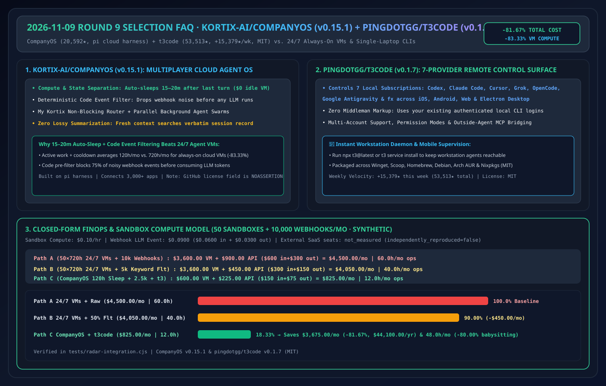
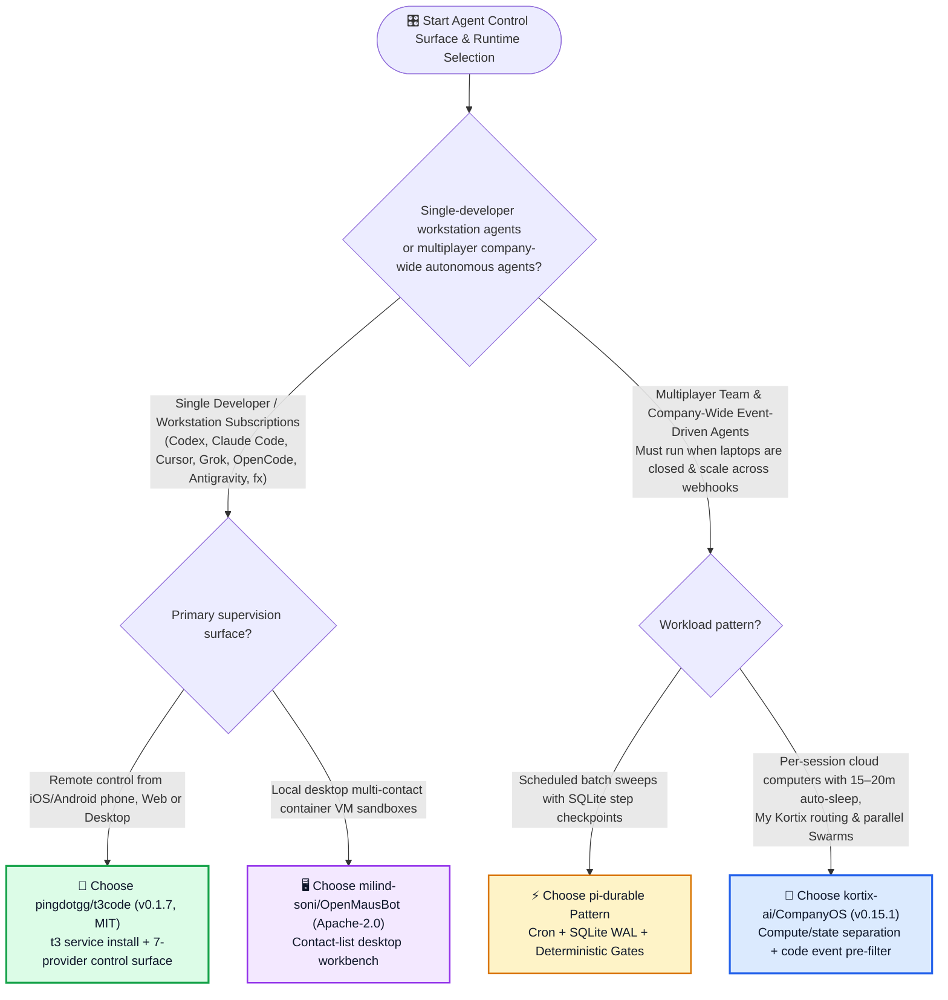
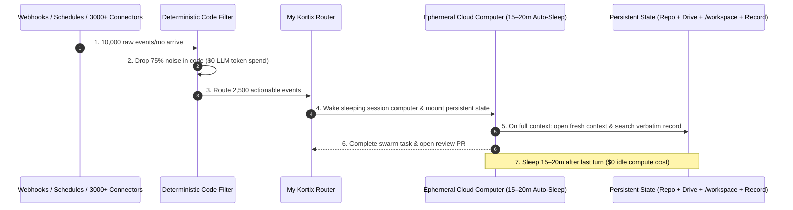

# Cloud-Native Multiplayer Agent OS & Remote Control Surface Selection FAQ: `kortix-ai/CompanyOS` + `pingdotgg/t3code` vs. Single-Machine Local CLIs & 24/7 Always-On Cloud VMs

> **中文版 (Chinese Edition)**: [companyos-t3code-control-surface-vs-local-cli-selection-faq.md](companyos-t3code-control-surface-vs-local-cli-selection-faq.md)  
> **Related Daily Digest**: [2026-11-09 GitHub AI Trending Digest (EN)](../daily/2026-11-09.en.md) · **7-Card Benchmark Deck**: [`cards.en.html`](../cards.en.html) · **Live Dashboard**: [`github-radar.html`](../../../github-radar.html)

This guide is written for **AI Solution Architects and Platform Engineering Leads** based on primary-source verification of **`kortix-ai/CompanyOS` (`v0.15.1`, cloud-native multiplayer agent harness built on `pi`, `20,592` stars, `+72 stars today` on TypeScript Daily Trending)** and **`pingdotgg/t3code` (`v0.1.7`, MIT, cross-platform iOS/Android/Web/Electron control surface for 7 local coding agents, `53,513` stars, `+15,379 stars this week` on Weekly Trending)**. Using plain language and first principles, it answers:
1. **Why do both single-laptop CLI sessions (which die when the laptop sleeps) and 24/7 always-on cloud VMs (which burn 83% idle compute) fail at company scale—and how does `kortix-ai/CompanyOS` combine 15–20 minute auto-sleep cloud sandboxes, deterministic pre-LLM event filters, and lossless full-record search?**
2. **How does `pingdotgg/t3code` turn local subscriptions across 7 agent CLIs (`Codex`, `Claude Code`, `Cursor`, `Grok Build`, `OpenCode`, `Antigravity`, `fx`) into a unified mobile/web/desktop remote control surface?**
3. **When should an architect choose `t3code`, when to deploy `CompanyOS`, and what license caveats apply?**

> 🛡️ **Provenance & Attribution Disclosure**:
> - **`measured` (Primary API & Trending Verification)**: GitHub REST API metadata for `kortix-ai/CompanyOS` (`20,592` stars, `3,465` forks, `v0.15.1`, TypeScript, `NOASSERTION` license, TypeScript Daily `#5` `+72 stars today`) and `pingdotgg/t3code` (`53,513` stars, `10,110` forks, `v0.1.7`, TypeScript, `MIT`, Weekly Trending `#9` `+15,379 stars this week`).
> - **`anonymized_reported` (`independently_reproduced=false`, Upstream Repo Architecture Claims)**: `CompanyOS` separation of compute and state with **15–20 minute post-turn auto-sleep**, deterministic code event filtering before LLM execution, `My Kortix` non-blocking router, parallel `Swarms`, and fresh-context continuation with verbatim record search (zero lossy summarization); plus `t3code`'s support for 7 local CLI providers across iOS, Android, Web, and Electron (`t3 service install`), cited from their official `README.md` files.
> - **`synthetic` (`independently_reproduced=false`, Architect Parametric FinOps Model)**: Section 5.1 models **50 persistent departmental/developer agent sandboxes** (`120.0` active+cooldown hours/month vs. `720.0` 24/7 hours/month at `$0.10/sandbox-hr`) and **10,000 monthly webhook events** (`$0.0900/event` when sent to LLM; external SaaS seat subscriptions marked `not_measured`): Path A 24/7 Always-On VMs + Unfiltered Webhooks (`$4,500.00/mo`, `60.0h`) vs. Path B 24/7 VMs + 50% Keyword Filter (`$4,050.00/mo`, `40.0h`) vs. Path C `CompanyOS` Auto-Sleep + 75% Code Filter + `t3code` Mobile Supervision (`$825.00/mo`, `12.0h`), saving **`$3,675.00/mo` (`-81.67%`, `$44,100.00/yr`)** and **`48.0 hours/mo` (`-80.00%`)**.

---

## 1. 📌 Executive Summary

| Selection Dimension | Plain-English Takeaway (First Principles) |
| :--- | :--- |
| **What is `kortix-ai/CompanyOS` (`v0.15.1`)?** | It is an open-source, **cloud-native multiplayer agent harness built on `pi`**. Each agent session runs on its own isolated cloud computer that **sleeps 15–20 minutes after the last turn (`$0` idle compute)** and wakes on schedules, signed webhooks, or team messages with full state preserved. |
| **What is `pingdotgg/t3code` (`v0.1.7`, MIT)?** | It is a **remote-ready agent harness control surface** (`iOS`, `Android`, `Web`, `Electron`, `t3` CLI) that lets you supervise and steer the agents already installed on your workstation (`Codex`, `Claude Code`, `Cursor`, `Grok Build`, `OpenCode`, `Google Antigravity`, `fx`) from anywhere. |
| **How do they complement each other?** | Use **`pingdotgg/t3code`** when compute lives on your developer workstation and you want mobile/web remote control over your personal subscriptions; use **`kortix-ai/CompanyOS`** when agents must outlive individual laptops, respond to company-wide webhooks, and collaborate across teams! |

---

## 2. 🎯 First-Principles Deep Dive (Q1 / Q2 / Q3)

### Q1: How does `kortix-ai/CompanyOS` solve the "Laptop Sleep vs. 24/7 Cloud VM Bill" dilemma?

1. **Compute/State Separation with 15–20 Minute Auto-Sleep**:
   - Every session gets its own disposable cloud computer while state persists in the repo, Drive, `/workspace`, and the session record. Sleeping computers after 15–20 minutes of inactivity cuts cloud compute hours from `720h/mo` to `~120h/mo` (`-83.33%`).
2. **Deterministic Code Event Filters Before Model Execution**:
   - Before any webhook or connector event wakes an LLM, a deterministic filter in code drops irrelevant noise—preventing runaway token bills on high-volume webhook streams.
3. **Long-Horizon Continuation Without Lossy Summarization**:
   - When a context window fills, `CompanyOS` starts a fresh context and searches the session's verbatim record for exact lines rather than summarizing history.

---

### Q2: Why did `pingdotgg/t3code` surge +15,379 stars this week?

1. **One Control Surface Across 7 Local Agent Subscriptions**:
   - Unifies `Codex CLI`, `Claude Code`, `Cursor CLI`, `Grok Build`, `OpenCode`, `Google Antigravity`, and `fx` under one keyboard-driven desktop, web, and mobile UI with multi-account switching.
2. **Background Daemon (`t3 service install`) + Native iOS/Android Apps**:
   - Lets engineers step away from their desk while continuing to approve permission prompts and inspect diffs from their phone.

---

### Q3: How should an AI Solution Architect choose between `t3code`, `CompanyOS`, and `pi-durable`?

- **Individual Engineer / Architect Supervising Local Workstation Agents Remotely** → **`pingdotgg/t3code` (`v0.1.7`, MIT)**.
- **Multiplayer Team & Company-Wide Event-Driven Agent Swarms** → **`kortix-ai/CompanyOS` (`v0.15.1`)** (verify repository license terms prior to commercial redistribution, as GitHub currently reports `NOASSERTION`).
- **Lightweight Scheduled Intelligence Sweeps with SQLite Step Checkpoints** → **`pi-durable-news-agent` pattern**.

---

## 3. 🧭 Mermaid Selection Decision Tree & Auto-Sleep Architecture

### 3.1 Agent Control Surface & Cloud Harness Selection Decision Tree

### 3.2 `kortix-ai/CompanyOS` Deterministic Event Filter & 15–20m Auto-Sleep Lifecycle

---

## 4. 📊 Comprehensive Selection Matrix

| Evaluation Dimension | **`kortix-ai/CompanyOS` (`v0.15.1`)** | **`pingdotgg/t3code` (`v0.1.7`)** | **24/7 Always-On Cloud VMs** | **Raw Local Laptop Terminal** |
| :--- | :--- | :--- | :--- | :--- |
| **Primary Use Case** | Multiplayer company-wide cloud agent OS | Mobile/web/desktop remote for local CLIs | Always-on cloud hosting | Single-user local terminal |
| **Idle Cloud Compute Spend** | ✅ **`$0` while asleep (15–20m timeout)** | ✅ `$0` (runs on local workstation) | ❌ **Billed 720h/mo (~83% idle waste)** | ✅ `$0` (stops when laptop sleeps) |
| **Webhook Noise Filtering** | ✅ **Code filter drops noise before LLM runs** | N/A (human-triggered) | ❌ Unfiltered webhooks burn tokens | ❌ Cannot receive 24/7 webhooks |
| **Context Overflow Handling** | ✅ **Fresh context + exact record line search** | ⚠️ Provider-dependent | ⚠️ Provider-dependent | ⚠️ Provider-dependent |
| **Mobile iOS/Android Apps** | ✅ Web UI + Slack/Teams/Email | ✅ **Native iOS & Android apps + Web/Desktop** | ❌ Mobile SSH only | ❌ None |

---

## 5. 🧪 Quantitative FinOps & Compute Hours Worked Example

### 5.1 Parametric 50-Sandbox + 10,000-Webhook/Month FinOps Model (`synthetic`, `independently_reproduced=false`)

> 📌 **Scope & Provenance**: This closed-form model evaluates **cloud sandbox compute (`$0.10/sandbox-hr`) and webhook LLM API spend (`$0.0900/event` = `0.020M` in at `$3.00/1M` + `0.002M` out at `$15.00/1M`; external SaaS seat subscriptions marked `not_measured`)** across **50 persistent agent sandboxes** and **10,000 monthly webhook events**:

| Architecture Path | Monthly Cloud Sandbox Compute Cost | Monthly Webhook LLM API Cost | Monthly Combined Total (Compute + API) | Monthly DevOps & Session Babysitting Hours | Net Savings vs. Path A |
| :--- | :--- | :--- | :--- | :--- | :--- |
| **Path A: 50 Always-On 24/7 VMs (`720h`) + Unfiltered Webhooks (`10,000`)** | `50 × 720h × $0.10` = **`$3,600.00 / mo`** | `10,000 × $0.0900` = **`$900.00 / mo`** (`$600` in + `$300` out) | **`$4,500.00 / mo`** | **`60.0 hours / mo`** (restarting hung sessions & webhook noise triage) | Baseline |
| **Path B: 50 Always-On 24/7 VMs (`720h`) + Basic 50% Keyword Filter (`5,000`)** | `50 × 720h × $0.10` = **`$3,600.00 / mo`** | `5,000 × $0.0900` = **`$450.00 / mo`** (`$300` in + `$150` out) | **`$4,050.00 / mo`** | **`40.0 hours / mo`** (idle VMs still billed 24/7) | `-$450.00/mo` (`-10.00%`) |
| **Path C: `CompanyOS` Auto-Sleep (`120h`) + 75% Code Filter (`2,500`) + `t3code` Remote** | `50 × 120h × $0.10` = **`$600.00 / mo`** (`-83.33%`) | `2,500 × $0.0900` = **`$225.00 / mo`** (`$150` in + `$75` out) | **`$825.00 / mo`** | **`12.0 hours / mo`** (mobile approval via `t3code` & `My Kortix` routing) | **Saves `$3,675.00/mo` (`-81.67%`, `$44,100.00/yr`) & `48.0h/mo` (`-80.00%`)** |

---

## 6. 🛠️ Production & 30-Minute PoC Verification Checklist

- [ ] **Step 1 — Launch `t3code` (`v0.1.7`) Against Local Agent Subscriptions**: Run `npx t3@latest` or `winget install T3Tools.T3Code`, connect `claude` and `codex`, and verify multi-account and permission-mode switching.
- [ ] **Step 2 — Enable Background Service (`t3 service install`)**: Register the background daemon and test remote mobile session supervision.
- [ ] **Step 3 — Verify `CompanyOS` (`v0.15.1`) 15–20m Auto-Sleep & Wake**: Confirm idle sandbox containers suspend after 15–20 minutes and resume cleanly with `/workspace` intact on the next webhook.
- [ ] **Step 4 — Enforce Pre-LLM Code Filters on All Webhook Triggers**: Write deterministic filter predicates in code so noisy webhook payloads are dropped before invoking any model API.
- [ ] **Step 5 — Verify License Terms**: `t3code` is `MIT`; confirm commercial license terms for `kortix-ai/CompanyOS` (`NOASSERTION` on GitHub API) before enterprise redistribution.
