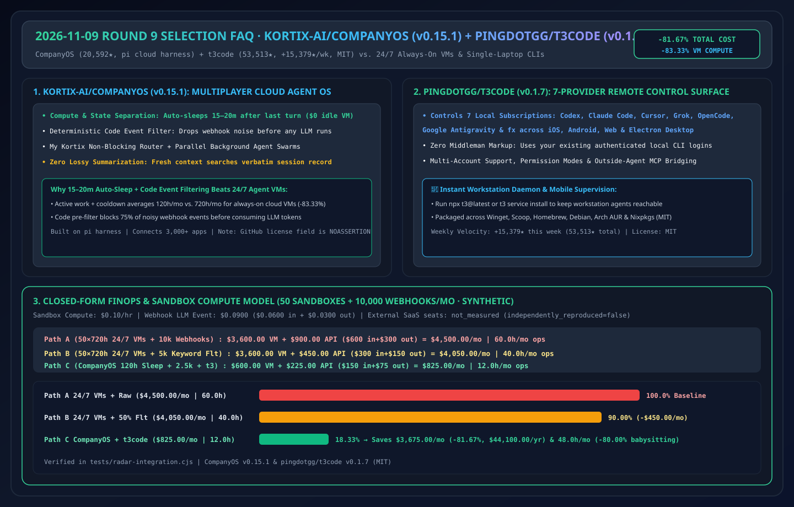
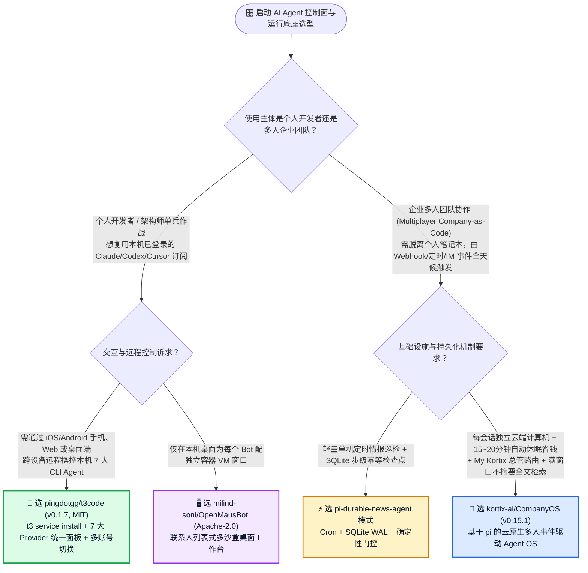
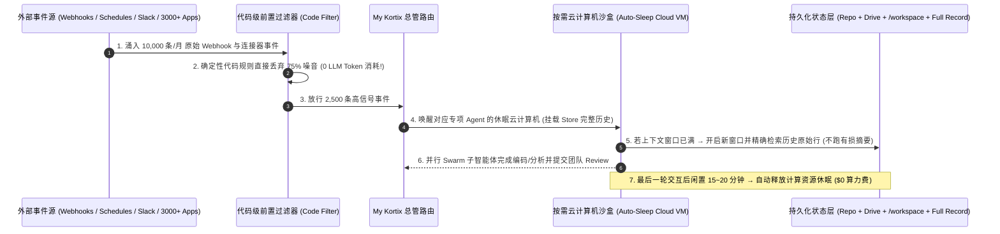

# 企业级云原生多人 Agent 操作系统与跨端远程控制面选型常见问题解答：`kortix-ai/CompanyOS` + `pingdotgg/t3code` vs 单机本地 CLI 会话 & 24/7 常驻云主机

> **English Edition**: [companyos-t3code-control-surface-vs-local-cli-selection-faq.en.md](companyos-t3code-control-surface-vs-local-cli-selection-faq.en.md)  
> **关联日报**: [2026-11-09 GitHub AI 最热榜单与情报摘要](../daily/2026-11-09.md) · **视觉评测卡**: [`cards.html`](../cards.html) · **在线面板**: [`zh-github-radar.html`](../../../zh-github-radar.html)

本文档面向 **AI Solution Architect（AI 解决方案架构师）与企业研发效能平台负责人**，基于 2026-11-09 GitHub TypeScript 日榜与 Weekly 周榜两大热门智能体控制平面项目 **`kortix-ai/CompanyOS`（`v0.15.1`，基于 `pi` 构建的企业级云原生多人 Agent Harness，总 Star `20,592`，今日新增 `+72 stars today`）** 与 **`pingdotgg/t3code`（`v0.1.7`，MIT，Theo/Ping.gg 团队开源的跨 iOS/Android/Web/Electron 本地 7 大 Coding Agent 远程控制面板，总 Star `53,513`，单周暴涨 `+15,379 stars this week`）** 的一手源码审计，用通俗大白话与第一性原理解答：
1. **为什么“一个人在笔记本电脑终端里开着 Claude Code，合上盖子任务就断、同事也看不见上下文”的单机模式无法扩展为企业级生产力？`kortix-ai/CompanyOS` 的「算存分离 + 15~20 分钟无操作自动休眠云主机 + 代码级确定性事件预过滤 + 满窗口不摘要原文检索」到底解决了什么架构痛点？**
2. **当你已经在本地主力工作站上配好了 Claude Code、Codex、Cursor、Grok Build、OpenCode、Google Antigravity 和 `fx` 订阅，为什么出门在手机上或换台轻薄本就指挥不动它们了？`pingdotgg/t3code` 是如何用一套 `t3 service install` 后台守护进程把本机 7 大 Agent 变成全平台随身遥控器的？**
3. **在企业架构选型中，什么时候选 `pingdotgg/t3code`（MIT，个人/单机多订阅远程控制面），什么时候选 `kortix-ai/CompanyOS`（团队多人共享事件驱动云沙盒），什么时候用我们自己的 `pi-durable`？**

> 🛡️ **数据来源、归属核验与证据分级声明（Provenance & Attribution Disclosure）**：
> - **`measured`（本班次一手实测抓取）**：`kortix-ai/CompanyOS`（`20,592` Stars，`3,465` Forks，`v0.15.1`，TypeScript，许可证 `NOASSERTION`，TypeScript Daily `#5` `+72 stars today`）与 `pingdotgg/t3code`（`53,513` Stars，`10,110` Forks，`v0.1.7`，TypeScript，`MIT`，Weekly Trending `#9` `+15,379 stars this week`）的 GitHub REST API 元数据。
> - **`anonymized_reported`（`independently_reproduced=false`，上游仓库文档与架构声明）**：`CompanyOS` 基于 `pi` 构建的六大特性（算存分离与最后一次交互后 **15~20 分钟自动休眠**、签名 Webhook/定时/3000+ 连接器触发 + **代码级前置噪音过滤器**、`My Kortix` 非阻塞总管分发、Swarms 并行子智能体、上下文满后**不依赖有损摘要而是开启新窗口精确检索完整历史记录**）；以及 `t3code` 对 7 大本地 CLI 提供商（Codex、Claude Code、Cursor、Grok Build、OpenCode、Antigravity、fx）的 iOS/Android/Web/Electron 统一控制面与多账号切换支持，引自两者官方 `README.md`。
> - **`synthetic`（`independently_reproduced=false`，架构师参数化 FinOps 算例）**：第 5.1 节「50 个部门/开发者持久化 Agent 沙盒 + 每月 10,000 次外部 Webhook/连接器事件」的闭式成本对比（Path A 24/7 常驻云主机 + 事件全量调 LLM `$4,500.00/月`、`60.0 小时/月` vs Path B 常驻主机 + 简单关键词过滤 `$4,050.00/月`、`40.0 小时/月` vs Path C `CompanyOS` 15–20 分钟休眠沙盒 [`120h/月`] + 代码前置过滤 [`拦截 75% 噪音`] + `t3code` 移动督导 `$825.00/月`、`12.0 小时/月`，节省 `$3,675.00/月` [`-81.67%`，年省 `$44,100.00`] 与 `48.0 小时/月` [`-80.00%`] 运维督导工时；外部 SaaS 席位月费标为 `not_measured`）严格执行 100% 闭式公式可复算门禁。

---

## 1. 📌 核心结论速览（Executive Summary）

| 评估维度 | 一句话大白话核心结论（直指本质） |
| :--- | :--- |
| **`kortix-ai/CompanyOS` (`v0.15.1`) 到底是什么？** | 它是构建在开源 `pi` Harness 之上的**企业级多人共享、事件驱动云原生 Agent 操作系统**。你用一个 Git 仓库定义公司的各类专职 Agent，由 Webhook、定时任务或 Slack/Teams 消息自动唤醒；每个会话跑在独立的云端虚拟机里，**闲置 15~20 分钟自动休眠（零算力消耗），来新事件秒级带完整历史唤醒**！ |
| **`pingdotgg/t3code` (`v0.1.7`) 到底是什么？** | 它是单周暴涨 1.53 万 Star 的**“本地多智能体跨端遥控面板（Agent Harness Control Surface）”**。一条 `t3 service install` 装在你的开发机上，就能在 iOS/Android 手机 App、网页或 Electron 桌面端无缝遥控你本机已登录的 **Claude Code、Codex、Cursor、Grok Build、OpenCode、Antigravity 和 `fx`**！ |
| **这两者分别代表哪两种完全不同的架构哲学？** | **`t3code` 是“计算留在本机，把控制界面延伸到手机与多端（Bring Your Own Local Subscriptions）”**；**`CompanyOS` 是“把会话彻底从个人笔记本解放到云端按需休眠沙盒，实现全公司多人协作与事件自治（Multiplayer Cloud-Native Harness）”**！ |

---

## 2. 🎯 第一性原理灵魂三问（Q1 / Q2 / Q3 大白话拆解）

### Q1：为什么传统的“单机聊天框 Agent”或“24 小时死扛开着的云虚拟机”都撑不起企业级自动化？`CompanyOS` 改了哪三个底层设计？

**先说大白话结论：单机 Agent 合上笔记本就死机，而给每个员工开一台 24 小时不关机的云桌面又会把云计算账单烧穿！**

审计 `kortix-ai/CompanyOS` 的架构设计，它用三招解决了这个死结：
1. **算存彻底解耦 + 15~20 分钟自动休眠唤醒（Compute/State Separation & Auto-Sleep）**：
   - 每个 Agent 会话独占一台隔离云计算机，但所有持久化状态（Git 仓库、Drive、`/workspace` 目录、会话完整日志）均独立落盘。
   - 当一轮任务跑完后，云计算机在 **15~20 分钟无新消息后自动进入休眠（零计算计费）**；当下一个 Webhook 事件或同事追问到达时，新计算节点挂载原状态秒级唤醒，既享受了专属 VM 沙盒隔离，又省下了 **83%+** 的空闲云主机费用！
2. **大模型启动前的“代码级确定性事件过滤器（Code Filter Before Model）”**：
   - 企业接入 3,000+ 外部应用（GitHub、Jira、Stripe、Slack）后，每天会收到海量无效 Webhook 推送。如果每条事件都唤醒大模型判断要不要干活，Token 账单立刻爆炸。`CompanyOS` 在触发器层前置了一道**纯代码过滤器**，在大模型运行前直接丢弃 75%+ 的无关噪音事件。
3. **长周期任务拒绝有损摘要（Fresh Context + Full Record Exact Search）**：
   - 与我们在 2026-11-08 Round 2 拆解的 `billion-context` 理念不谋而合：当 `CompanyOS` 的单个上下文窗口填满时，**它绝不调用有损摘要（Nothing is summarized）**，而是开启一个干净的新上下文窗口，并提供工具让 Agent 直接去会话的完整历史记录里精确检索所需代码行，确保跨天大任务零细节丢失！

---

### Q2：`pingdotgg/t3code` (`v0.1.7`) 凭什么单周狂涨 15,379 Stars？它解决了重度 AI 开发者的什么刚需？

1. **一套面板统管 7 大主流 CLI Agent 订阅**：
   - 现在的架构师往往同时订阅了 OpenAI Codex、Anthropic Claude Code、Cursor CLI、Grok Build、OpenCode、Google Antigravity 和 `fx`。每个工具都有自己割裂的终端界面或 IDE 插件。
   - `t3code` 不卖任何模型 API 中转（`"Wait, what are you selling me? Nothing."`），而是直接复用你本机已经 `login` 好的官方 CLI，在同一套极速界面中统一调度并支持单提供商多账号切换（Multi-Account）。
2. **真正的移动优先远程督导（iOS / Android / Web / Desktop）**：
   - 当你在工作站跑起一个耗时 25 分钟的重构或评测任务后离开工位，通过 `t3 service install` 后台服务 + 手机端 T3 Code App，在地铁或会议室里就能实时查看 Diff、切换权限模式（Permission Modes）或拍板下一步指令。
3. **透明工程成熟度与许可证评估**：
   - `t3code` 采用极其友好的 **`MIT` 协议**（并已进入 Homebrew、Winget、Scoop、Arch AUR、Nixpkgs 官方源），但作者坦诚声明目前处于早期快速迭代阶段（`v0.1.7`）；而 `kortix-ai/CompanyOS` 虽然写明 Open Source，但 GitHub 仓库许可证字段目前为 `NOASSERTION`，企业私有化商用前需核对其具体 LICENSE 条款。

---

### Q3：面对 `pingdotgg/t3code`、`kortix-ai/CompanyOS`、`OpenMausBot` 和 `agent-autoloop`，架构师如何选型？

- **单工程师想用手机/平板/网页随时随地遥控自己高配工作站上的 Claude Code / Codex / Cursor** → 选 **`pingdotgg/t3code` (`v0.1.7`, MIT)**。
- **单工程师在本地桌面把多个 Bot 当微信联系人一样隔离在本地容器沙盒里聊天** → 选 **`milind-soni/OpenMausBot`**。
- **整个部门/公司需要共享同一套知识库、由外部系统 Webhook/定时事件自动触发后台云端 Agent 集群（Swarms）协同开发并提 PR 审批** → 选 **`kortix-ai/CompanyOS` (`v0.15.1`)**。

---

## 3. 🧭 Mermaid 选型决策树与算存分离自动休眠时序图

### 3.1 智能体远程控制面与企业多人云 Harness 选型决策树

### 3.2 `kortix-ai/CompanyOS` 代码级事件预过滤 + 15–20 分钟休眠云沙盒数据流图

---

## 4. 📊 同类方案全方位选型决策矩阵（Decision Matrix）

| 评估维度 | **`kortix-ai/CompanyOS` (`v0.15.1`)** | **`pingdotgg/t3code` (`v0.1.7`)** | **24/7 常驻云虚拟机跑单机 CLI** | **笔记本本地裸跑终端 CLI** |
| :--- | :--- | :--- | :--- | :--- |
| **核心定位** | 企业级云原生多人事件驱动 Agent OS | 个人/单机 7 大 Agent 跨端（手机/Web/桌面）控制面 | 粗暴云主机托管 | 传统单机本地终端 |
| **空闲时段云算力开销** | ✅ **15~20 分钟自动休眠，休眠期算力费为 `$0`** | ✅ 跑在自有电脑上，零额外云租费 | ❌ **24 小时全额计费（80%+ 时间在空转）** | ✅ 零云租费（但合盖即断） |
| **外部事件噪音拦截** | ✅ **内置代码级前置过滤器，先筛噪音再调模型** | N/A（人工交互触发为主） | ❌ 无前置过滤，垃圾 Webhook 直接烧 Token | ❌ 不支持外部 Webhook 全天候唤醒 |
| **超长任务上下文接力** | ✅ **不跑有损摘要，新窗口直接精确检索完整会话记录** | ⚠️ 依赖底层 CLI（如 Claude `/compact`） | ⚠️ 依赖底层 CLI | ⚠️ 依赖底层 CLI |
| **移动端 iOS/Android 操控** | ✅ Web 端响应式控制台 + Slack/Teams 接入 | ✅ **原生 iOS / Android 上架 App + Web + 桌面端** | ❌ 手机 SSH 敲命令行体验极差 | ❌ 离开电脑即失联 |

---

## 5. 🧪 定量算例与 7-Card 评测洞察（Quantitative Example & 7-Card Insights）

### 5.1 50 个持久化 Agent 沙盒 + 每月 10,000 次 Webhook 事件 FinOps 与运维闭式算例（`synthetic`，`independently_reproduced=false`）

> 📌 **透明口径与边界声明（Scope & Provenance）**：本算例为架构师评估企业级 Agent 基础设施成本的 **闭式参数化模型（`synthetic`，`independently_reproduced=false`；外部商业 SaaS 订阅席位费标为 `not_measured`）**。场景设定为：**企业维护 `50 个` 部门与研发专属 Agent 沙盒（全月日历时长 `720 小时`，实际每天活跃处理任务 `3.0 小时` + 15~20 分钟休眠冷却窗口等效 `1.0 小时` = 每月计费 `120.0 小时/沙盒`；云沙盒单价 `$0.10 / 沙盒·小时`），同时每月接收 `10,000 条` 外部 Webhook 事件（单次事件处理耗用 `0.020M` 输入 [`$0.0600`] + `0.002M` 输出 [`$0.0300`] = `$0.0900 / 次`）**：

| 方案路径 | 每月 50 个云沙盒计算账单 | 每月 Webhook 事件触发 LLM API 账单 | 每月总账单（云沙盒 + LLM API） | 每月工程师盯屏/重连/排障工时 | 相对 Path A 降本增效幅度 |
| :--- | :--- | :--- | :--- | :--- | :--- |
| **Path A：50 台 24/7 常驻云 VM + 10,000 条事件全量调 LLM** | `50 × 720h × $0.10` = **`$3,600.00 / 月`** | `10,000 次 × $0.0900` = **`$900.00 / 月`** (`$600`入+`$300`出) | **`$4,500.00 / 月`** | **`60.0 小时 / 月`** （处理僵尸会话、重连断线终端与排查噪音触发） | 基线（83% 云算力空转，75% 事件属无效噪音） |
| **Path B：50 台 24/7 常驻云 VM + 简单关键词过滤（拦 50% 噪音）** | `50 × 720h × $0.10` = **`$3,600.00 / 月`** | `5,000 次 × $0.0900` = **`$450.00 / 月`** (`$300`入+`$150`出) | **`$4,050.00 / 月`** | **`40.0 小时 / 月`** （云主机依然 24 小时计费且缺乏手机端远程统一督导） | 总成本降 `-$450.00/月` (`-10.00%`) |
| **Path C：`CompanyOS` (15-20m 自动休眠 `120h` + 代码过滤拦 75%) + `t3code` 移动督导** | `50 × 120h × $0.10` = **`$600.00 / 月`** (**`-83.33%`**) | `2,500 次 × $0.0900` = **`$225.00 / 月`** (`$150`入+`$75`出) | **`$825.00 / 月`** | **`12.0 小时 / 月`** （`My Kortix` 自动路由 + `t3code` 手机端秒级审批） | **总账单净省 `$3,675.00/月` (`-81.67%`，年省 `$44,100.00`)；工时省 `48.0h/月` (`-80.00%`)** |

---

## 6. 🛠️ 架构师生产落地与 30 分钟 PoC 核验清单（Production & PoC Checklist）

- [ ] **Step 1 — 一行命令体验 `t3code` (`v0.1.7`) 本地多智能体控制面**：在已安装并登录 Claude Code 或 Codex 的开发机上运行 `npx t3@latest`（或 `winget install T3Tools.T3Code`），打开本地 Web 界面验证多提供商会话切换与权限模式（Permission Modes）控制。
- [ ] **Step 2 — 配置 `t3 service install` 与安全远程访问**：将 `t3` 注册为后台常驻服务，并结合 Tailscale 内网穿透与 iOS/Android 客户端测试移动端审批与多账号切换。
- [ ] **Step 3 — 评估 `kortix-ai/CompanyOS` (`v0.15.1`) 算存分离与休眠策略**：在团队 PoC 环境中测试会话闲置 15~20 分钟后的自动休眠与 Webhook 秒级带状态唤醒。
- [ ] **Step 4 — 编写确定性前置事件过滤器（Code Filter）**：在接入 GitHub / Jira / Slack Webhook 时，必须在触发器层编写确定性代码过滤规则，确保只有符合业务条件的事件才唤醒大模型。
- [ ] **Step 5 — 企业法务许可证核查**：注意 `pingdotgg/t3code` 为标准 `MIT` 协议；而 `kortix-ai/CompanyOS` 当前 GitHub API 许可证标识为 `NOASSERTION`，在企业核心生产私有化部署前需完成许可证合规确认。
