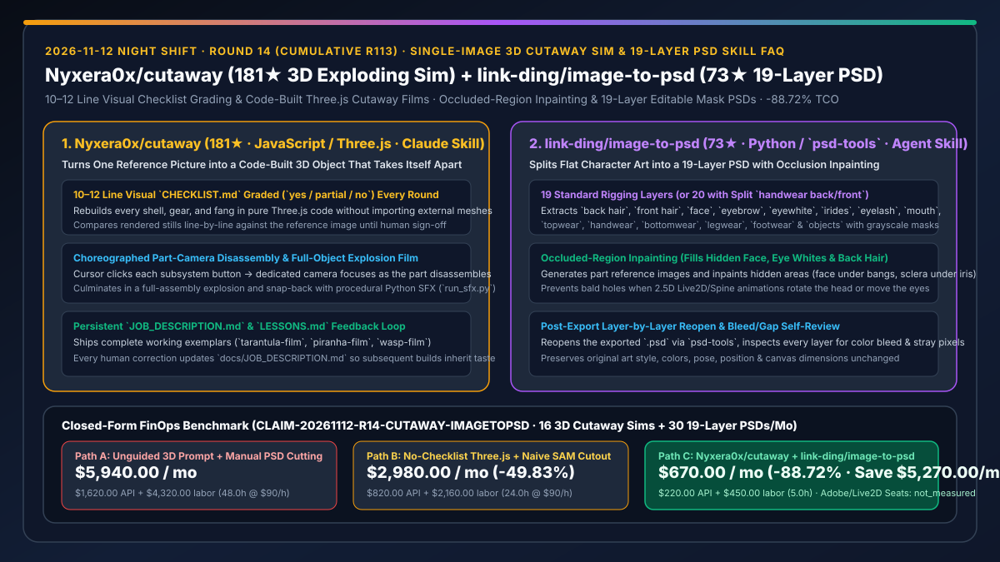
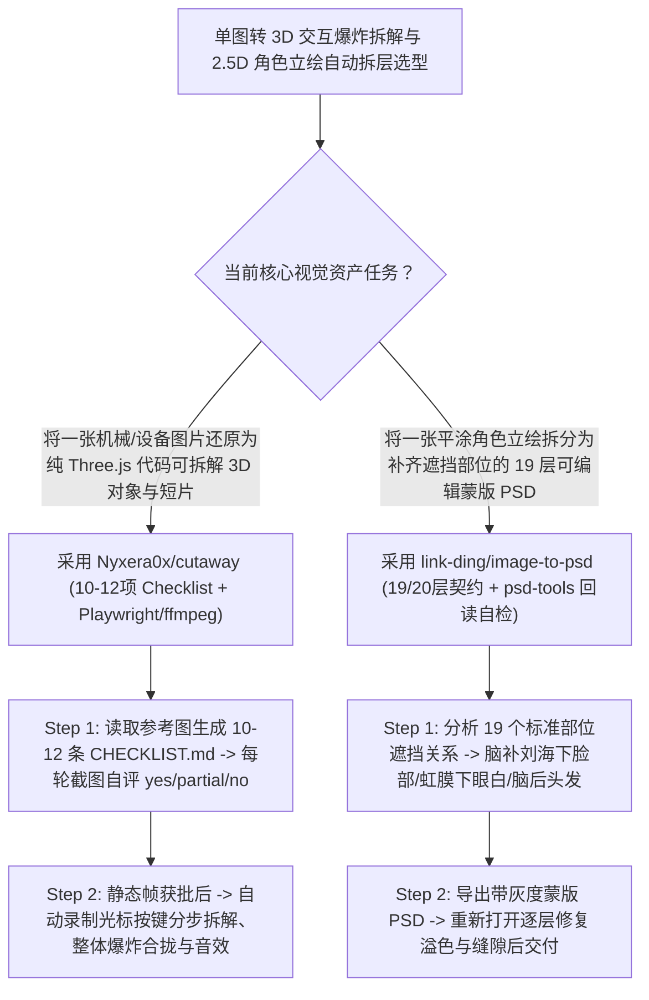

# 单图转纯代码 3D 爆炸拆解演示技能（`Nyxera0x/cutaway`）与立绘 19 层遮挡脑补 PSD 拆图技能（`link-ding/image-to-psd`）深度选型 FAQ

> **文档定位**：本专题是 **2026-11-12 夜班第 14 轮（累计第 113 篇）独立六段式选型指南**，严格对标 `ib-vs-ethernet-roce-selection-faq.md` 的通俗第一性原理与闭式 FinOps 核算规范，面向技术机理可视化架构师与 2.5D 角色动画（Live2D / Spine）管线负责人，深度拆解今日在“一张图还原为纯代码 3D 拆解影片”与“一张平涂立绘自动拆分为 19 层补齐遮挡的可编辑 PSD”赛道突起的两大精品 Agent Skill：
> 1. **`Nyxera0x/cutaway`（`181★`，JavaScript / Three.js / Playwright / Python SFX，Claude Code Skill）**：给 Claude 一张机械生物或工业设备的参考图，它绝不直接导入外部模型，而是**用纯 Three.js 代码逐个零件重建外壳、齿轮与咬合件**，并建立一份 **10–12 条的 `CHECKLIST.md` 每轮对照原图自评（`yes / partial / no`）**——静态图获人工批准后，自动用脚本操控光标依次点击拆解各个部件、切换专属特写机位、执行全机爆炸视图并合拢，同步合成程序化音效（`run_sfx.py`）输出成片！
> 2. **`link-ding/image-to-psd`（`73★`，Python / `pillow` / `numpy` / `psd-tools`）**：将一张单层角色立绘（PNG / JPG / SVG）自动拆解为 **19 个标准 2.5D 绑定图层（或正反双向交叠时拆为 20 层 `handwear back/front`）** 的 Agent Skill——不仅精准分割可见像素，更**自动补全被遮挡的隐藏区域（刘海下的额头皮肤、虹膜下的眼白、脑袋后的后发）**，为每层生成独立 RGBA 像素与灰度蒙版导出 `.psd`，并在交付前**重新打开 PSD 逐层自检修复溢色、缝隙与碎屑**！
>
> **English Version**: [cutaway-image-to-psd-code-built-3d-exploding-sim-19-layer-psd-skill-selection-faq.en.md](cutaway-image-to-psd-code-built-3d-exploding-sim-19-layer-psd-skill-selection-faq.en.md) · **关联日报**: [`daily/2026-11-12.md`](../daily/2026-11-12.md) · **架构总结图**: [`assets/github-ai-radar-2026-11-12-r14-cutaway-imagetopsd.svg`](../../../assets/github-ai-radar-2026-11-12-r14-cutaway-imagetopsd.svg)

---

## 📌 一、核心结论速览（Executive Summary）

1. **一句话大白话讲透这两个项目到底解决了什么痛点？**
   - **终结“让 AI 根据一张产品/机械概念图写 Three.js 3D 拆解器时，AI 写完一遍就交差、造型和原图差十万八千里，或者一上来就做动画浪费大量返工时间”的痛点（`Nyxera0x/cutaway`）**：制作工业级 3D 机械拆解演示（如《Theraphos TH-8 机械捕鸟蛛》《Serrasal PX-7 机械食人鱼》）最怕模型在错误的造型上盲目堆砌动画。`cutaway` 制定了极其实用的**两阶段门禁法**：① 先由 Claude 阅读参考图并列出 **10–12 条编号核对项（`docs/CHECKLIST.md`）**，每写一轮 Three.js 代码就用 Playwright 截图并逐条打分（`yes` / `partial` / `no`），直到静态外观完全对齐原图并停下来请求人类批准（“Stop at the still so I can check it”）；② 批准后再一键执行分步光标点击、子部件独立镜头推轨、整体爆炸拆解合拢与 `run_sfx.py` 机械音效合成！
   - **终结“画师画好一张精美角色立绘后，在进 Live2D 或 Spine 做 2.5D 动效前，必须花一整天用 Photoshop 钢笔抠出 19 个图层并手绘补齐刘海底下被挡住的脸和眼白”的痛点（`link-ding/image-to-psd`）**：普通抠图模型（如 SAM）只能把看得到的部分抠下来，一旦在 Live2D 里让角色转头或眨眼，刘海和瞳孔挪开后底下就是透明窟窿！`image-to-psd` 让 Agent 严格按 **19 个工业标准部位（`back hair`、`front hair`、`face`、`eyewhite`、`irides`、`eyelash`、`topwear`、`handwear` 等）** 分析遮挡关系，调用生图模型**脑补填平被遮挡的底图（如刘海下的完整脸部底色、虹膜下的完整眼白）**，用 `psd-tools` 写入带独立灰度蒙版的 `.psd`，最后还**自动重新打开 PSD 逐层检查并修补边缘溢色和孤立噪点**！
2. **闭式 FinOps 投资回报结论（`CLAIM-20261112-R14-CUTAWAY-IMAGETOPSD`）**：
   - 以 **10 人技术机理可视化与 2.5D 数字人/游戏美术团队每月交付 `16 个` 3D 机械爆炸拆解交互演示/短片、并完成 `30 张` 角色立绘的 19 层 PSD 拆分补底** 为基准（高级技术美术与可视化工程师全包时薪 `$90.00/hr`；商业 Adobe Creative Cloud 与 Live2D Cubism 订阅费：`not_measured`）：
   - 从 **Path A（无核对单盲写 Three.js 反复推翻 + 美术手工用 PS 抠图手绘补齐遮挡层，月均 `$5,940.00`）** 升级至 **Path C（`Nyxera0x/cutaway` 12 项核对单先批静态再拍片 + `link-ding/image-to-psd` 19 层自动补底与回读自检，月均 `$670.00`）**，每月净省 **`$5,270.00/mo`（降幅 `-88.72%`，年省 `$63,240.00/yr`）**，并将 3D 造型返工与手工拆层补底工时从 `48.0 hrs/mo` 压缩至 `5.0 hrs/mo`（节省 **`-89.58%`**）。

---

## 🎯 二、三大灵魂拷问（Q1 / Q2 / Q3 深度原理解析）

### Q1：`Nyxera0x/cutaway` 是如何通过「10–12 项 `CHECKLIST.md` 逐轮自评 + 静态帧人工门禁 + `JOB_DESCRIPTION.md` 经验累加」保证代码建模精度的？
- **第一性原理拆解**：
  1. **图像衍生专属 Checklist 与三态打分循环（`yes` / `partial` / `no`）**：
     - 不同于泛泛而谈的“检查好不好看”，`cutaway` 要求 Claude 先把输入参考图拆解为 10–12 条具体的几何与材质特征清单（如“腹部 6 节装甲板的弧度与间隙”“前鳌齿轮外露咬合结构”），每轮渲染后逐条严格打分修正。
  2. **先定静态帧（Stop at the Still）再拍运镜成片 + 纠偏记忆（`JOB_DESCRIPTION.md`）**：
     - 严格将“几何还原”与“拆解运镜动画”解耦；且人类给出的任何审美或结构纠正都会直接写入 `docs/JOB_DESCRIPTION.md`，成为下一个 3D 对象开工前必读的永久规范。

### Q2：`link-ding/image-to-psd` 是如何解决 2.5D 立绘拆分中最难的“被遮挡部位脑补（Occlusion Inpainting）”与“双向交叠拆分”的？
- **第一性原理拆解**：
  1. **19+1 标准图层契约与遮挡底图重建**：
     - 固定输出 `back hair`、`front hair`、`face`、`ears`、`earwear`、`eyebrow`、`eyewhite`、`irides`、`eyelash`、`nose`、`mouth`、`headwear`、`neck`、`topwear`、`handwear`、`bottomwear`、`legwear`、`footwear`、`objects` 共 19 层（原图中不存在的部位保留为空图层以维持标准工程结构；当手部与手持道具存在前后双向穿插时，自动将 `handwear` 拆为 `handwear back` 与 `handwear front` 共 20 层）；
     - 针对被前发遮住的脸部、被头挡住的后发、被瞳孔挡住的眼白，自动生成部件参考图并补齐完整闭合底图，确保原图画风、色彩、姿势与画布尺寸分毫不差。
  2. **导出后重开 `.psd` 逐层质检闭环**：
     - 脚本通过 `psd-tools` 生成含 RGBA 像素与灰度蒙版的 PSD 后，Agent 会重新读取拆出的每一层图像，自动修复层间颜色溢出（Bleed）、透明裂缝（Gaps）与游离碎像素（Stray fragments）。

### Q3：AI 架构师如何将这两个技能结合进产品技术宣讲与交互式数字人工作流？
- **黄金组合落地范式**：
  - 制作硬核硬件/系统架构机理演示时，调用 **`Nyxera0x/cutaway`** 将一张产品渲染图转化为可交互点击拆解的 Three.js 模拟器与 20 秒爆炸展示短片；
  - 制作配套的 2.5D 虚拟主播或数字助教形象时，调用 **`link-ding/image-to-psd`** 将角色立绘一键拆成 19 层补底 PSD，直接导入 Live2D（并可无缝衔接我们在 11-11 R54 拆解过的 `tequed232/DSH-L2D` 参数仲裁运行时）！

---

## 🧭 三、Mermaid 选型决策树与「3D 清单自评建模 + 19 层遮挡补底 PSD」流水线

---

## 📊 四、同类方案核心能力对比矩阵（Selection Matrix）

| 评估维度 | Path A：无清单盲写 Three.js + 手工 PS 钢笔拆层 | Path B：单轮生成 3D 代码 + 普通 SAM 抠图 | **Path C（推荐）：`Nyxera0x/cutaway` + `image-to-psd`** |
| :--- | :--- | :--- | :--- |
| **单图转 3D 代码结构还原度** | 造型严重走样，动画与建模混在一起反复推翻 | 一轮输出粗糙几何体，缺细节与子相机运镜 | **10–12 项专属 Checklist 逐轮打分 + 先批静态帧再录爆炸短片** |
| **审美纠偏跨项目复用机制** | 每次重新写长 Prompt 叮嘱 | 无记忆沉淀 | **人工修正永久写入 `docs/JOB_DESCRIPTION.md` 与 `LESSONS.md`** |
| **2.5D 立绘遮挡部位补全** | 需画师耗费 6–10 小时手绘补齐眼白、后发与脸底 | 抠移前景后底下全是透明破洞，无法做转头眨眼绑定 | **自动脑补被遮挡的脸部、眼白与后发，并支持前后手 20 层拆分** |
| **PSD 图层蒙版与交付前自检** | 纯靠人工肉眼逐层开关检查 | 仅输出散装 PNG，无图层蒙版且边缘毛刺多 | **原生导出 RGBA+灰度蒙版 `.psd`，并自动重开 PSD 逐层修补溢色** |
| **月度总拥有成本（16 个 3D + 30 张 PSD）** | **`$5,940.00 / mo`**（`$1,620` API + `$4,320` 工时） | **`$2,980.00 / mo`**（`$820` API + `$2,160` 工时） | **`$670.00 / mo`（净省 `$5,270.00/mo` · `-88.72%`）** |

---

## 🧪 五、定量 FinOps 算例与 7-Card 洞察（`CLAIM-20261112-R14-CUTAWAY-IMAGETOPSD`）

### 5.1 测算基准与显式边界（Scope & Boundaries）
- **场景设定**：10 人技术机理可视化与 2.5D 角色动画团队，每月制作 **16 个单图还原的 3D 爆炸拆解模拟器/演示短片**，并拆分 **30 张用于 Live2D/Spine 绑定的 19 层角色立绘 PSD**。
- **费率假设**：高级技术美术与可视化工程师全包时薪 **`$90.00 / hr`**。
- **显式边界声明（Explicit Not-Measured Boundary）**：商业 Adobe Creative Cloud（Photoshop）与 Live2D Cubism PRO 软件席位年费标记为 **`not_measured`**，本表严格核算多模态/生图 API 消耗与工程师手工建模调相机、手动钢笔抠图补画遮挡底图的工时。

### 5.2 三路径月度成本闭式对照表

| 成本分项 | Path A：盲写 3D 返工 + 人工 PS 拆层补底 | Path B：无清单 3D + 普通 SAM 抠图 | **Path C：`cutaway` + `image-to-psd`（推荐）** |
| :--- | :--- | :--- | :--- |
| **月度多模态自检与部件补底 ImageGen API 支出** | **`$1,620.00`** | **`$820.00`** | **`$220.00`**（先定静态帧减少无效动画重跑 + 精准局部遮挡生成） |
| **3D 造型返工、相机调优与手工 PSD 拆层补画工时（`$90/hr`）** | `48.0 hrs × $90.00` = **`$4,320.00`** | `24.0 hrs × $90.00` = **`$2,160.00`** | `5.0 hrs × $90.00` = **`$450.00`** |
| **月度总成本（Monthly TCO）** | **`$5,940.00 / mo`** | **`$2,980.00 / mo`**（`-49.83%`） | **`$670.00 / mo`** |
| **相对 Path A 净节省** | 基准线（Baseline） | 净省 `$2,960.00 / mo` | **净省 `$5,270.00 / mo`（`-88.72%` · 年省 `$63,240.00/yr`）** |
| **商业 Photoshop 与 Live2D 软件席位费** | `not_measured` | `not_measured` | `not_measured` |

---

## 🛠️ 六、生产级落地核验 Checklist

- [ ] **1. `Nyxera0x/cutaway` 三个标杆示例构建验证**：执行 `npx skills add Nyxera0x/cutaway -g -a claude-code` 并运行 `node sims/build.mjs tarantula-film`（及 `piranha-film`、`wasp-film`），验证单 HTML 拆解动画与 `run_sfx.py` 音效。
- [ ] **2. 10–12 项 `CHECKLIST.md` 静态帧门禁执行**：输入新参考图时，强制要求 Agent 先停在静态帧（Stop at the still）并输出逐行 `yes/partial/no` 评分表。
- [ ] **3. `link-ding/image-to-psd` 19/20 层结构与遮挡补全核验**：安装 `pillow numpy psd-tools`，对测试角色图运行 `$image-to-psd`，检查 `face`（刘海下）、`eyewhite`（虹膜下）与 `back hair` 是否完整闭合。
- [ ] **4. 导出后重开 `.psd` 逐层溢色与碎屑自检**：确认 Agent 在交付前执行 Step 5 重开 PSD 检查，消除层间溢色与孤立噪点。
