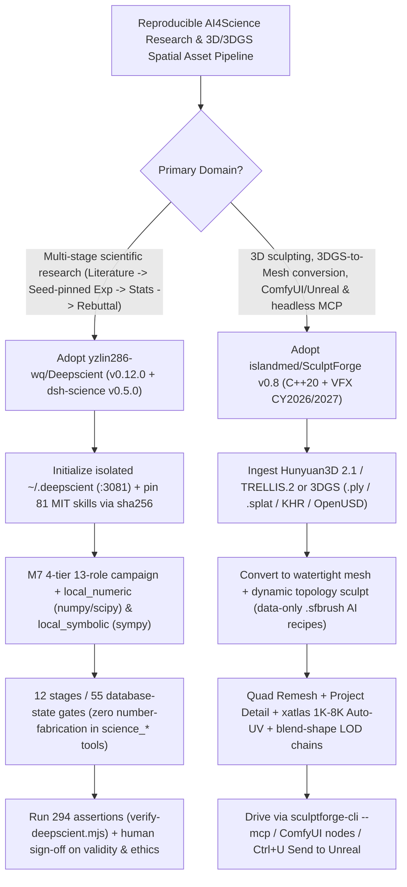

# 12-Stage 55-Gate Reproducible Scientific Workbench (`yzlin286-wq/Deepscient`) & Open-Source C++20 3D Sculpting/Gaussian-Splatting Engine (`islandmed/SculptForge` v0.8) Selection FAQ

> **Positioning**: This standalone guide is **Round 29 of the 2026-11-11 Night Shift (Cumulative Guide #74)**, written in the plain-language, first-principles, closed-form FinOps style of `ib-vs-ethernet-roce-selection-faq.md` for AI4Science and 3D Spatial Pipeline Solution Architects evaluating two high-velocity domain workbenches:
> 1. **`yzlin286-wq/Deepscient` (`973★`, JavaScript, `v0.12.0` + `dsh-science v0.5.0`, MIT)**: Structures `"Topic Selection → Literature Search → Experiment → Analysis → Plotting → Writing → Submission → Peer-Review Rebuttal"` into **12 stages, 55 database-state-verified gates, 36 scientific tools (`science_*` with zero number-fabrication outlets), and 98 commit/`sha256`-pinned skills**, backed by **55 academic discipline reporting standards, 5,000+ journal profiles, and 294 live HTTP/file verification assertions**;
> 2. **`islandmed/SculptForge` (`668★`, C++20, GPL-3.0-or-later, `v0.8`, VFX Reference Platform CY2026/CY2027)**: A cross-platform (Linux, macOS, Windows) digital sculpting and 3D asset pipeline featuring **bidirectional 3D Gaussian Splatting (`.ply`, `.splat`, glTF `KHR_gaussian_splatting`, OpenUSD `ParticleField3DGaussianSplat`) ↔ watertight quad mesh conversion (`Quad Remesh` + `xatlas` Auto-UV + LOD chains)**, data-only AI `Brush Lab` recipes (`.sfbrush`), two-way `ComfyUI-SculptForge` nodes, zero-plugin `Send to Unreal` (`Ctrl+U`), and headless **`sculptforge-cli --mcp`**.
>
> **中文版 FAQ**: [deepscient-sculptforge-scientific-workbench-3d-sculpt-mcp-selection-faq.md](deepscient-sculptforge-scientific-workbench-3d-sculpt-mcp-selection-faq.md) · **Architecture Summary SVG**: [`assets/github-ai-radar-2026-11-11-r29-deepscient-sculptforge.svg`](../../../assets/github-ai-radar-2026-11-11-r29-deepscient-sculptforge.svg)

---

## 📌 1. Executive Summary

1. **In plain English, what problems do these two repositories actually solve?**
   - **Stopping "AI Paper Generators" from Inventing Numbers & Breaking Reproducibility (`yzlin286-wq/Deepscient`)**: Prompt-wrapped paper generators routinely hallucinate $p$-values, invent ablation tables, and ignore discipline-specific statistical reporting norms. `DeepScient` enforces three hard rules: (1) **`science_*` tools provide zero interface to invent numbers**—every claim must trace to data, and every table must trace to a seed-pinned reproducible run (`local_numeric` via numpy/scipy, `local_symbolic` via sympy); (2) **55 gates across 12 stages evaluate persisted database state** rather than asking the LLM if it "feels ready"; and (3) humans retain authority over construct validity, novelty, and ethics, backed by **294 automated live-instance assertions (`verify-deepscient.mjs`)**.
   - **Bridging 3D Gaussian Splats (`3DGS`), Digital Sculpting, and Game/Unreal Pipelines Without Per-Seat Lock-In (`islandmed/SculptForge` v0.8)**: Commercial sculpting suites (ZBrush) cost `$45+/seat/mo`, lack native Linux builds or headless MCP servers, and cannot natively convert 3D Gaussian Splats (`KHR_gaussian_splatting` / `ParticleField3DGaussianSplat`) into watertight quad-retopologized game meshes with UVs and LODs. `SculptForge v0.8` is a native C++20 engine (halved memory footprint, `2×` faster viewport on massive meshes) that **converts 3DGS captures into watertight meshes (and sculpts back into splats)**, builds data-only AI brushes (`Brush Lab` `.sfbrush`), connects bidirectionally with `ComfyUI` (`Hunyuan3D 2.1` / `TRELLIS.2` + `ComfyUI-SculptForge` nodes), sends meshes with LODs and morph targets straight to Unreal Engine (`Ctrl+U` with zero plugins), and exposes everything to coding agents via **`sculptforge-cli --mcp`**.
2. **Closed-Form FinOps Verdict (`CLAIM-20261111-R29-DEEPSCIENT-SCULPTFORGE`)**:
   - For an 18-person R&D Lab and 3D Simulation/Game Asset Studio running **12 multi-discipline scientific research campaigns** and producing **200 game/simulation-ready 3D assets (with LODs, UVs, and 3DGS-to-mesh conversions) per month** (senior researcher / technical artist loaded rate `$85.00/hr`; wet-lab physical consumables and workstation GPUs: `not_measured`):
   - Upgrading from **Path A (18 commercial sculpting & literature SaaS seats + manual verification of hallucinated LLM statistics & manual 3DGS retopology, `$6,280.00/mo`)** to **Path C (`Deepscient` 12-stage 55-gate workbench + `SculptForge v0.8` C++20 engine, `ComfyUI-SculptForge` & `sculptforge-cli --mcp`, `$850.00/mo`)** saves **`$5,430.00/mo` (`-86.46%`, `$65,160.00/yr`)** and cuts manual retopology and data-audit labor from `48.0 hrs/mo` to `6.0 hrs/mo` (**`-87.50%`**).

---

## 🎯 2. Three Core Architectural Questions (Q1 / Q2 / Q3 Deep-Dive)

### Q1: How does `yzlin286-wq/Deepscient` enforce its 12-stage / 55-gate scientific evidence chain and isolate its runtime from the host's primary DSH profile?
- **First-Principles Breakdown**:
  1. **Database-State-Verified 55 Gates & Zero-Fabrication `science_*` Kernel (`dsh-science v0.5.0`)**:
     - Instead of letting an LLM self-certify stage completion, 55 deterministic gates verify actual database state across 12 stages (`Topic → Literature → Experiment → Analysis → Plotting → Writing → Submission → Rebuttal`), backed by **55 discipline-specific statistical methodologies** and **5,000+ journal formatting profiles**.
     - Includes an M7 4-tier, 13-role campaign scheduler (`science_org_chart`, `science_campaign_plan/run/status/report`) plus local compute tools (`local_compute_devices` probing CUDA→MPS→CPU, `local_numeric`, `local_symbolic`).
  2. **98 Commit/`sha256`-Pinned Skills & 294-Assertion Verification Suite**:
     - Ships 17 built-in skills and an installer (`install-skills.mjs`) for **81 third-party MIT scientific skills** (`K-Dense-AI/scientific-agent-skills`, `Aperivue/medsci-skills`, etc.) pinned to exact Git commits and `sha256` hashes, plus 34 optional MCP tools (`papers` 23 + `pubmed` 11).
     - Stores all state inside an isolated `~/.deepscient` root (`:3081–3099`), verified by `verify-packaging.mjs` (20 checks), `verify-portability.mjs` (78 files checked for leaked local paths), and `verify-deepscient.mjs` (294 live HTTP/file assertions).

### Q2: How does `islandmed/SculptForge` v0.8 bridge 3D Gaussian Splatting (`3DGS`), ComfyUI, Unreal Engine, and MCP agents in a single C++20 pipeline?
- **First-Principles Breakdown**:
  1. **Bidirectional Gaussian Splats ↔ Watertight Quad Meshes**:
     - Opens Polycam, Luma, Postshot, and Scaniverse captures in `.ply` (up to SH degree 3), `.splat`, glTF **`KHR_gaussian_splatting`**, and OpenUSD **`ParticleField3DGaussianSplat`**—converting splats into watertight meshes for sculpting, or converting sculpted meshes into Gaussian splats.
     - Applies **Quad Remesh** (with guides, face-group following, and vertex-paint density) + **Project Detail** + **`xatlas` Auto-UV (1K–8K)** + **one-click LOD chains (preserving blend shapes/sculpt layers on every level)**, validated with Khronos `gltf_validator` and OpenUSD `usdchecker`.
  2. **Data-Only AI `Brush Lab` (`.sfbrush`), Two-Way ComfyUI & `sculptforge-cli --mcp`**:
     - `Brush Lab` generates `.sfbrush` recipes as pure data (never code) using free `GPT-OSS 20B` / local Ollama / Claude;
     - Connects to `Hunyuan3D 2/2.1`, `TRELLIS.2`, and `Stable Fast 3D`, while `islandmed/ComfyUI-SculptForge` exposes voxel remesh, decimation, LOD chains, and `GLB/FBX/USD` export as ComfyUI nodes;
     - `sculptforge-cli --mcp`, `import sculptforge` (Python 3.13 / VFX CY2026-2027 / Rez), Blender 4.2+ Bridge, and zero-plugin `Send to Unreal` (`Ctrl+U`) automate studio pipelines end to end.

### Q3: What operational boundaries and known limitations should Solution Architects account for?
1. **`Deepscient` Operational Boundaries**:
   - As documented in `ROADMAP.md`, headless CLI mode does not assemble agent presets (skill counts must be verified in a live `:3081` Web session); Windows PowerShell launchers (`bin/launch.ps1`) require UTF-8 BOM (enforced by `verify-packaging.mjs`); and MCP tool round-trips (`$env:DSH_ENABLE_MCP = '1'`) should be pre-probed via `node deepscient/scripts/probe-mcp.mjs pubmed`.
2. **`SculptForge` In-House Studio Modification Rights**:
   - Licensed under `GPL-3.0-or-later`, studios can modify C++20 source and Python farm scripts internally for asset production and farm rendering without publishing internal pipeline modifications unless redistributing binaries externally.

---

## 🧭 3. Mermaid Decision Tree & Scientific + 3D Asset Pipeline

---

## 📊 4. Architectural Comparison Matrix

| Evaluation Dimension | Path A: Commercial Sculpting Seats + Chat Paper Wrappers | Path B: Ad-Hoc Python Scripts + Legacy 3D Tools (No 3DGS/MCP) | **Path C (Recommended): `Deepscient` + `SculptForge` v0.8** |
| :--- | :--- | :--- | :--- |
| **Scientific Data Provenance & Gates** | Chat wrappers hallucinate $p$-values and unseeded tables | Scattered scripts; lacks 55 discipline norms & 5,000+ journal rules | **Zero-fabrication `science_*` tools + 55 state gates + 294 assertions** |
| **Third-Party Skill Supply Chain** | Unpinned external prompts vulnerable to drift | Manual copy-paste without portability or path-leak verification | **81 third-party skills pinned by commit & `sha256` + 78-file portability check** |
| **3DGS ↔ Watertight Quad Mesh Pipeline** | Commercial sculpting apps lack native `KHR_gaussian_splatting` conversion | Manual 4-tool export chain losing vertex paint, masks & blend shapes | **Bidirectional 3DGS conversion + Quad Remesh + `xatlas` UV + LOD chains** |
| **Agent MCP & Studio Farm Integration** | Per-seat license servers; no built-in MCP or native Linux GUI | Fragile custom scripts without `gltf_validator` / `usdchecker` gates | **`sculptforge-cli --mcp` + 2-way ComfyUI nodes + `Ctrl+U` Unreal + VFX CY2027** |
| **Monthly TCO (12 Campaigns + 200 Assets)** | **`$6,280.00 / mo`** (`$2,200` SaaS/cloud + `$4,080` labor) | **`$3,160.00 / mo`** (`$950` compute + `$2,210` labor) | **`$850.00 / mo` (Saves `$5,430.00/mo` · `-86.46%`)** |

---

## 🧪 5. Closed-Form FinOps Example & 7-Card Insights (`CLAIM-20261111-R29-DEEPSCIENT-SCULPTFORGE`)

### 5.1 Workload & Scope Boundary
- **Workload**: An 18-person R&D Lab and 3D Simulation/Game Studio executing **12 multi-discipline computational research campaigns** and producing **200 game/simulation-ready 3D/3DGS assets per month**.
- **Rates**: Commercial 3D sculpting seats at **`$45.00 / seat / mo`** (`18 seats = $810.00/mo`); senior researcher / technical artist loaded rate at **`$85.00 / hr`**.
- **Explicit Scope Boundary**: Wet-lab physical experimental reagents and workstation GPU hardware depreciation are marked **`not_measured`**.

### 5.2 Closed-Form Monthly Cost Breakdown

| Cost Component | Path A: Commercial Seats + Chat Hallucinations + Manual Retopo | Path B: Ad-Hoc Scripts + Manual Multi-Tool 3DGS Export | **Path C: `Deepscient` + `SculptForge` v0.8 (Recommended)** |
| :--- | :--- | :--- | :--- |
| **Software Seats / Cloud 3D & LLM Compute** | `$810.00 + $1,390.00` = **`$2,200.00`** | **`$950.00`** | **`$340.00`** (`$0` seat licenses + local/on-demand compute) |
| **Data Auditing & 3D Retopo/UV/LOD Labor (`$85/hr`)** | `48.0 hrs × $85.00` = **`$4,080.00`** | `26.0 hrs × $85.00` = **`$2,210.00`** | `6.0 hrs × $85.00` = **`$510.00`** |
| **Total Monthly TCO** | **`$6,280.00 / mo`** | **`$3,160.00 / mo`** (`-49.68%`) | **`$850.00 / mo`** |
| **Net Savings vs. Path A** | Baseline | Saves `$3,120.00 / mo` | **Saves `$5,430.00 / mo` (`-86.46%` · `$65,160.00/yr`)** |
| **Wet-Lab Consumables & Workstation GPUs** | `not_measured` | `not_measured` | `not_measured` |

---

## 🛠️ 6. Production Verification Checklist

- [ ] **1. `Deepscient` Packaging, Portability & 294-Assertion Check**: Run `node tools/verify-packaging.mjs` (20 checks including `.ps1` UTF-8 BOM), `node dsh-science/scripts/verify-portability.mjs` (78 files checked for local path leaks), and `node deepscient/scripts/verify-deepscient.mjs --token <token>` (294 live HTTP/file assertions).
- [ ] **2. Commit-Pinned Skill Installation & MCP Probe**: Preview third-party skills with `node deepscient/scripts/install-skills.mjs --plan` before `--apply` (verifying `sha256` digests), and test literature MCP connectivity via `node deepscient/scripts/probe-mcp.mjs pubmed`.
- [ ] **3. `SculptForge` Headless MCP & Bidirectional ComfyUI Setup**: Register `sculptforge-cli --mcp` in your coding agent and install `islandmed/ComfyUI-SculptForge` in ComfyUI to chain `Hunyuan3D 2.1` / `TRELLIS.2` generation with voxel remeshing, quad retopology, and LOD export.
- [ ] **4. 3DGS-to-Watertight-Mesh & Schema Validation Gate**: Test converting `.ply` / `.splat` / `KHR_gaussian_splatting` captures into quad-retopologized meshes with `xatlas` UVs, and validate all exported assets with the Khronos glTF validator and OpenUSD `usdchecker`.
- [ ] **5. Blender 4.2+ Bridge & Zero-Plugin `Send to Unreal`**: Install `addons/blender` in Blender 4.2+ to verify round-trip preservation of masks, face groups, and vertex paint, and test `Ctrl+U` (`Send to Unreal`) live asset updates.
