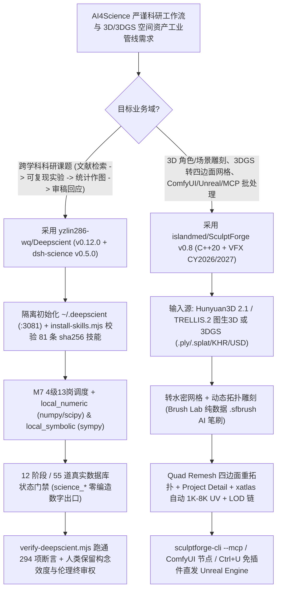

# 12 阶段 55 门可复现科研工作台（`yzlin286-wq/Deepscient`）与开源 C++20 3D 雕刻/高斯泼溅互转引擎（`islandmed/SculptForge` v0.8）选型 FAQ

> **文档定位**：本文是 **2026-11-11 夜班多轮深潜 Round 29（累计第 74 篇独立选型专题）**，严格对标 `ib-vs-ethernet-roce-selection-faq.md` 的「通俗大白话 + 第一性原理 + 可核算定量算例」标杆文风，为 AI4Science 科研基建与 3D 空间资产/游戏管线架构师深度拆解今日两款专业生产力重器：
> 1. **`yzlin286-wq/Deepscient`（`973★`，JavaScript，`v0.12.0` + `dsh-science v0.5.0`，MIT）**：把「选题 → 检索 → 实验 → 分析 → 作图 → 写作 → 投稿 → 审稿回应」拆解为 **12 个阶段、55 道基于真实落盘状态判定的门禁、36 个科研工具（`science_*` 零编造出口）与 98 条 Commit/SHA-256 锁定的技能**，内置 55 门学科统计规范、5,000+ 期刊情报与 **294 项活实例自动化验收断言**；
> 2. **`islandmed/SculptForge`（`668★`，C++20，GPL-3.0-or-later，`v0.8`，符合 VFX Reference Platform CY2026/CY2027）**：跨 Windows / macOS / Linux 的免费开源数字雕刻与 3D 生产管线——原生支持 **3D Gaussian Splatting（`.ply` / `.splat` / glTF `KHR_gaussian_splatting` / OpenUSD `ParticleField3DGaussianSplat`）与水密四边面网格（Quad Remesh + `xatlas` 自动 UV + LOD 链）双向互转**、纯数据配方 AI 笔刷工坊（`Brush Lab`）、双向 `ComfyUI-SculptForge` 节点包、免插件直发 Unreal Engine（`Ctrl+U`）以及无头 **`sculptforge-cli --mcp`**。
>
> **English Companion**: [deepscient-sculptforge-scientific-workbench-3d-sculpt-mcp-selection-faq.en.md](deepscient-sculptforge-scientific-workbench-3d-sculpt-mcp-selection-faq.en.md) · **架构总结图**: [`assets/github-ai-radar-2026-11-11-r29-deepscient-sculptforge.svg`](../../../assets/github-ai-radar-2026-11-11-r29-deepscient-sculptforge.svg)

---

## 📌 一、核心结论速览（Executive Summary）

1. **先用大白话讲透这两个项目到底解决了什么痛点？**
   - **AI 辅助科研“论文生成器瞎编实验数据、跨学科统计口径错乱、换台电脑根本复现不出图表”的痛点（`yzlin286-wq/Deepscient` 解决的问题）**：市面上很多“一键写论文 Agent”本质是聊天框套壳，模型觉得缺个 $p$ 值就自己顺手编一个，审稿人一查代码和原始数据就露馅。`DeepScient` 铁腕规定三件事：① **`science_*` 工具里彻底堵死“编造一个数字”的出口**，每条结论必须追到数据表，每张表必须追到带固定随机种子（Seed）、环境版本与 `local_numeric`（numpy/scipy）/ `local_symbolic`（sympy）落盘记录的可重跑实验；② **12 阶段 55 道门对着数据库真实状态判定**，绝不让模型“自己觉得可以过关了”；③ 将构念效度、创新性与伦理取舍严格留给人类拍板，并随包提供 **294 项活实例验收脚本（`verify-deepscient.mjs`）**，声明的每一项能力都有一行命令可验真！
   - **3D 资产与扫描重建管线“ZBrush 按席位高价订阅且无原生 Linux/MCP、手机扫出的 3D 高斯泼溅（3DGS）没法直接雕刻和进 Unreal 游戏引擎”的痛点（`islandmed/SculptForge` v0.8 解决的问题）**：无论是做具身智能仿真资产还是次世代游戏，用手机（Polycam/Luma）或前馈 3DGS（如 Round 15 的 `SplatAnything`）生成的 `.ply`/`.splat` 高斯点云虽然好看，但不能直接用笔刷修补局部细节、没有四边面拓扑（Quad Topology）、没有 UV 贴图和 LOD 减面链。`SculptForge v0.8` 用高性能原生 C++20（内存减半、巨型网格视口提速 `2×`）打通全链路：**直接打开 3DGS 高斯泼溅（含 glTF `KHR_gaussian_splatting` 与 OpenUSD `ParticleField3DGaussianSplat`）一键转为水密可雕刻网格（也能把雕刻模型反向转回高斯泼溅）**，内置免费 AI 笔刷工坊（`Brush Lab` 生成纯数据 `.sfbrush` 配方）与 `Hunyuan3D 2.1` / `TRELLIS.2` 图生 3D，完成 `Quad Remesh` + `xatlas` 自动展开 1K–8K UV + 一键 LOD 链后，按 `Ctrl+U` 免插件直传运行中的 Unreal Editor，或由 Coding Agent 通过 **`sculptforge-cli --mcp`** 全自动批处理！
2. **闭式 FinOps 核算结论（`CLAIM-20261111-R29-DEEPSCIENT-SCULPTFORGE`）**：
   - 在 **18 人科研与 3D 仿真/游戏资产团队每月推进 12 个跨学科计算实验课题 + 生产 200 个带 LOD/UV 与 3DGS 转网格的标准 3D 资产** 基准下（高级研究员/技术美术 TA 全包时薪 `$85.00/hr`；湿实验物理耗材与工作站显卡硬件折旧：`not_measured`）：
   - 从 **Path A（18 席商业雕刻软件与科研 SaaS 订阅 + 人工核查聊天框幻觉数据与手工重拓扑 3DGS，`$6,280.00/月`）** 升级至 **Path C（自托管 `Deepscient` 55 门可复现工作台 + `SculptForge v0.8` C++20 引擎、`ComfyUI-SculptForge` 与 `--mcp` 自动化管线，`$850.00/月`）**，每月净省 **`$5,430.00/月`（降幅 `-86.46%`，年化节省 `$65,160.00/年`）**，人工核对假数据与手工重拓扑/展 UV/压 LOD 的工时从 `48.0 小时/月` 降至 `6.0 小时/月`（**节省 `87.50%`**）。

---

## 🎯 二、三大灵魂拷问（Q1 / Q2 / Q3 Deep-Dive）

### Q1：`yzlin286-wq/Deepscient` 是如何通过「12 阶段 55 门 + M7 4 级 13 岗调度 + 294 项自检断言」杜绝科研幻觉与宿主机污染的？
- **第一性原理拆解**：
  1. **状态驱动的 55 道门禁与零编造工具链（`dsh-science v0.5.0`）**：
     - 传统科研 Agent 用 Prompt 问大模型“实验做完了吗？”，模型极易跳过验证直接写结论。`Deepscient` 的 55 道门直接检查项目数据库中的实验产物、随机种子、统计检验输出（内置 **55 门学科**各自的方法论、统计口径与报告规范，以及 **5,000+ 期刊**投稿格式库）是否真实存在；
     - 桌面版内置 `local_compute_devices`（自动探测 CUDA → MPS → CPU）、`local_numeric`（numpy/scipy）与 `local_symbolic`（sympy），配合 M7 调度层的 **4 级 13 岗编制（`science_org_chart` / `science_campaign_plan` / `run` / `status` / `report`）**，所有统计图表必须由真实脚本跑出。
  2. **98 条 Commit+SHA-256 锁定技能与独立 `~/.deepscient` 沙盒隔离**：
     - 除随包 17 条核心技能外，通过 `install-skills.mjs` 引入来自 `K-Dense-AI/scientific-agent-skills`（42 条）、`Aperivue/medsci-skills`（20 条）等 8 个 MIT 仓库的 **81 条第三方科研技能**——仓库内只存 Manifest，安装时按精确 Git Commit 拉取并強制校验 `sha256`；
     - 运行时数据严格写入独立的 `~/.deepscient`（端口自动绑定 `3081–3099`），绝不触碰或污染用户原有的 `~/.dsh` 配置，并提供 `verify-packaging.mjs`（20 项）、`verify-deepscient.mjs`（294 项活实例断言）与 `verify-portability.mjs`（78 个文件零本机路径泄漏检查）。

### Q2：`islandmed/SculptForge` v0.8 是如何把“AI 生成/手机扫描的粗糙 3D 高斯泼溅（3DGS）”变成“可直接进 Unreal Engine 的四边面带骨骼 Blend Shapes 游戏资产”的？
- **第一性原理拆解**：
  1. **双向 3DGS 标准互通与网格重建（`KHR_gaussian_splatting` & OpenUSD `ParticleField3DGaussianSplat`）**：
     - 支持直接导入 Polycam/Luma/Postshot 采集的 `.ply`（最高 3 阶球谐函数 SH degree 3）、`.splat`、glTF 扩展 `KHR_gaussian_splatting` 以及 OpenUSD `ParticleField3DGaussianSplat`，将其转化为水密三角网格（Watertight Mesh）；
     - 随后利用 v0.8 的 **Quad Remesh（支持引导线 Guides、按顶点色控制密度、保持对称与 Face Groups）+ Project Detail（将高模雕刻细节投射回新四边面拓扑）+ `xatlas` Auto-UV（1K–8K 纹理烘焙）+ 一键 LOD 链（保留每个层级的 Sculpt Layers / Blend Shapes）**，再通过 Khronos `gltf_validator` 与 OpenUSD `usdchecker` 校验导出，或按 `Ctrl+U` 免装插件直接热更新进局域网内运行中的 Unreal Editor！
  2. **纯数据 AI 笔刷（`Brush Lab`）+ 双向 ComfyUI + 无头 `sculptforge-cli --mcp`**：
     - **Brush Lab** 用免费内置的 `GPT-OSS 20B`（离线自动回退本地 Ollama，或接 Claude）根据文字描述生成 `.sfbrush` **纯数据配方（Data, Never Code，杜绝恶意脚本执行）**；
     - **双向 ComfyUI**：既能在 SculptForge 内调本机/工作室服务器的 ComfyUI 跑 `Hunyuan3D 2.1` / `TRELLIS.2` 图生 3D，也能在 ComfyUI 里装 `islandmed/ComfyUI-SculptForge` 节点包直接调体素重构、减面与多格式导出；
     - **`sculptforge-cli --mcp` 与 VFX CY2026/CY2027 工业底座**：支持 Claude Code 等 MCP 客户端直接发指令雕刻、转换与渲染转盘视频（`--demo ... --record`），并提供 `import sculptforge` Python API 与 Rez 包管理。

### Q3：架构师在部署这两套系统时有哪些必知的工程边界（Known Limitations）？
1. **`Deepscient` 的实事求是边界**：
   - 官方 README 明确标注：当前 Headless 模式不组合 Agent Preset（查看完整挂载技能数需在 `:3081` Web 会话中核验）；Windows 启动器 `bin/launch.ps1` 强制要求 UTF-8 with BOM（`verify-packaging.mjs` 会自动校验 `.ps1` BOM）；MCP 工具层（`$env:DSH_ENABLE_MCP = '1'`）目前默认按需开启，可用 `node deepscient/scripts/probe-mcp.mjs pubmed` 单独测试握手。
2. **`SculptForge` 的 GPL 工作室内部修改规则与管线集成**：
   - `SculptForge` 采用 `GPL-3.0-or-later` 协议，游戏与影视工作室可在内部自由修改 C++20 源码与 Python 脚本用于生产渲染农场而无需公开内部修改（仅在对外分发二进制时需开源），非常适合替代昂贵的商业按席位雕刻许可。

---

## 🧭 三、Mermaid 选型决策树与科研证据链 + 3D 资产自动化架构

---

## 📊 四、同类方案核心能力对比矩阵（Comparison Matrix）

| 评估维度 | Path A：商业雕刻订阅 + 套壳论文生成聊天框 | Path B：零散 Python 脚本 + 无 3DGS/MCP 的传统工具 | **Path C（推荐标杆）：`Deepscient` + `SculptForge` v0.8** |
| :--- | :--- | :--- | :--- |
| **科研数据真实性与可复现门禁** | 模型自由编造统计显著性与图表数值，无法复现 | 脚本散乱，无 55 门学科规范与 5,000+ 期刊格式约束 | **`science_*` 零编造出口 + 12 阶段 55 道真实状态门 + 294 项断言** |
| **第三方技能供应链安全** | 直接拉取未锁定分支的外部 Prompt，易遭投毒或漂移 | 手工复制粘贴提示词，无便携性与隐私泄漏扫描 | **81 条第三方技能严格锁定 Commit 与 `sha256` + 78 文件便携性扫描** |
| **3DGS 高斯泼溅与四边面游戏拓扑** | 商业雕刻软件不支持原生 `KHR_gaussian_splatting` 互转 | 需在 4 个工具间导来导去，丢失顶点色、Mask 与 Blend Shapes | **原生双向 3DGS 互转 + Quad Remesh + `xatlas` UV + 带 Blend Shape 的 LOD** |
| **AI Agent (`--mcp`) 与 ComfyUI/UE 联动** | 闭源软件无内置 MCP Server，Linux 渲染农场部署受限 | 需手写脆弱胶水插件，导出缺少 `gltf_validator`/`usdchecker` 门禁 | **内置 `sculptforge-cli --mcp` + 双向 ComfyUI 节点 + `Ctrl+U` 直发 Unreal** |
| **月度总拥有成本（12 课题+200 资产）** | **`$6,280.00 / 月`**（软件/云 `$2,200` + 人工 `$4,080`） | **`$3,160.00 / 月`**（算力 `$950` + 人工 `$2,210`） | **`$850.00 / 月`（净省 `$5,430.00/月`，降幅 `-86.46%`）** |

---

## 🧪 五、闭式定量 FinOps 算例与 7-Card 评测洞察（`CLAIM-20261111-R29-DEEPSCIENT-SCULPTFORGE`）

### 5.1 基准假设与边界声明
- **评测负载**：18 人科研与 3D 仿真/游戏资产团队每月推进 **12 个跨学科计算实验课题**，并生产 **200 个带四边面重拓扑、UV 与 LOD 链的 3D/3DGS 空间资产**。
- **单价基准**：商业 3D 雕刻软件订阅 **`$45.00 / 席 / 月`**（18 席 = `$810.00/月`）；高级研究员/技术美术（TA）全包时薪 **`$85.00 / hr`**。
- **显式边界声明（Scope Boundary）**：线下生化湿实验物理试剂耗材及本地工作站显卡硬件折旧标记为 **`not_measured`**。

### 5.2 三路径闭式成本核算表

| 成本构成项 | Path A：商业雕刻席位 + 幻觉论文核查 + 手工重拓扑 | Path B：零散实验脚本 + 手工跨软件导 3DGS/LOD | **Path C：`Deepscient` + `SculptForge` v0.8（推荐）** |
| :--- | :--- | :--- | :--- |
| **商业软件席位 / 云端 3D 与算力 Token** | `$810.00 + $1,390.00` = **`$2,200.00`** | **`$950.00`** | **`$340.00`**（0 席位费 + 本地/按需模型算力） |
| **实验数据核查与 3D 重拓扑/UV/LOD 工时（`$85/hr`）** | `48.0 hrs × $85.00` = **`$4,080.00`** | `26.0 hrs × $85.00` = **`$2,210.00`** | `6.0 hrs × $85.00` = **`$510.00`** |
| **月度总成本（Monthly Total）** | **`$6,280.00 / 月`** | **`$3,160.00 / 月`**（`-49.68%`） | **`$850.00 / 月`** |
| **相对 Path A 净节省（Savings）** | 基准线（Baseline） | 节省 `$3,120.00 / 月` | **净省 `$5,430.00 / 月`（`-86.46%` · 年省 `$65,160.00`）** |
| **湿实验物理耗材与工作站 GPU 折旧** | `not_measured` | `not_measured` | `not_measured` |

---

## 🛠️ 六、生产级落地核验 Checklist（SA Actionable Verification）

- [ ] **1. `Deepscient` 打包面、便携性与 294 项活实例自检**：部署后依次运行 `node tools/verify-packaging.mjs`（校验 20 项完整性与 `.ps1` BOM）、`node dsh-science/scripts/verify-portability.mjs`（78 文件零硬编码路径检查）以及 `node deepscient/scripts/verify-deepscient.mjs --token <token>`（294 项断言全绿）。
- [ ] **2. 81 条第三方科研技能 `sha256` 干跑与 MCP 探针**：先执行 `node deepscient/scripts/install-skills.mjs --plan` 审查技能来源再执行 `--apply`，并用 `node deepscient/scripts/probe-mcp.mjs pubmed` 验证文献 MCP 独立握手。
- [ ] **3. `SculptForge` 无头 MCP 与双向 ComfyUI 挂载**：将 `sculptforge-cli --mcp` 注册至 Claude Code / Desktop，并在 ComfyUI 中安装 `islandmed/ComfyUI-SculptForge` 节点包，打通 `Hunyuan3D 2.1` / `TRELLIS.2` 生成 → 体素重构 → Quad Remesh → LOD 链全自动流水线。
- [ ] **4. 3DGS 转水密网格与 `gltf_validator` / `usdchecker` 门禁**：测试导入 `.ply` / `.splat` / `KHR_gaussian_splatting` 资产转为水密四边面网格并经 `xatlas` 自动展开 UV，导出 GLB 与 OpenUSD（`UsdSkel` / `ParticleField3DGaussianSplat`）时强制跑通官方 Schema 校验器。
- [ ] **5. Blender 4.2+ Bridge 与 Unreal Engine `Ctrl+U` 联调**：在 Blender 4.2+ 中安装 `addons/blender` 验证带 Mask、Face Groups 与 Vertex Paint 的原地往返更新，并测试跨局域网免插件 `Send to Unreal` 静态/骨骼网格同步。
