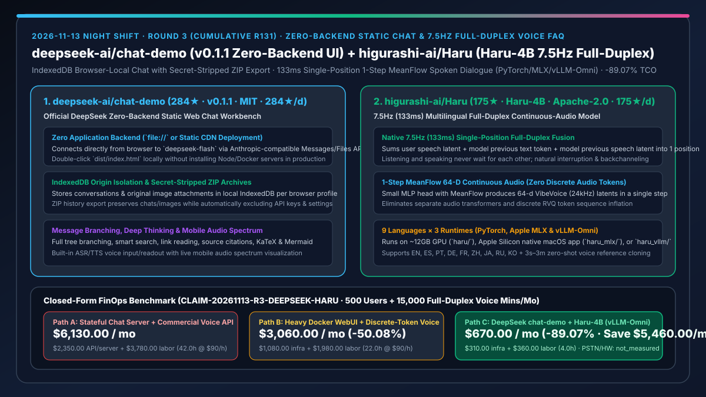
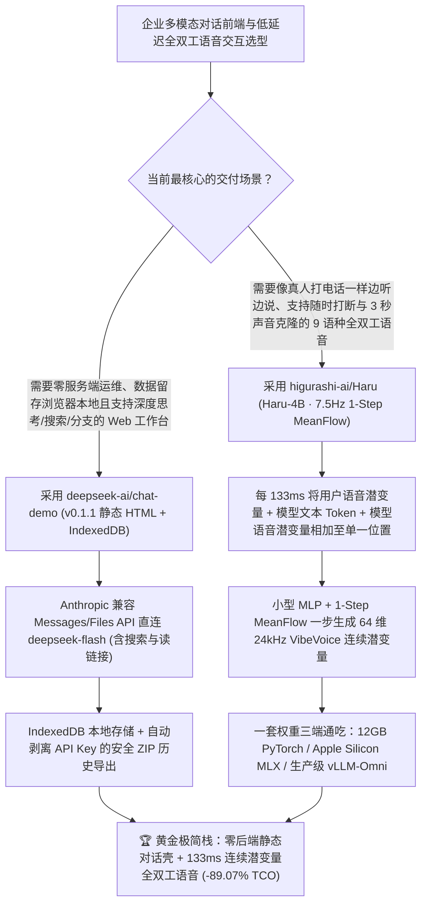

# DeepSeek 官方零后端纯静态对话工作台（`deepseek-ai/chat-demo` `v0.1.1`）与 7.5Hz 单位置融合全双工连续语音模型（`higurashi-ai/Haru` `Haru-4B`）深度选型 FAQ

> **文档定位**：本专题是 **2026-11-13 夜班第 3 轮（累计第 131 篇）独立六段式选型指南**，严格对标 `ib-vs-ethernet-roce-selection-faq.md` 的通俗第一性原理与闭式 FinOps 核算规范，面向多模态应用架构师与 AI Solution Architect，深度拆解今日新仓爆发榜上极具代表性的两大“去重型中间层”开源力作：
> 1. **`deepseek-ai/chat-demo`（1 天新建即获 `284★`，生命周期日均 `284★/d`，TypeScript，MIT，今日发布 `v0.1.1`）**：`deepseek-ai` 官方开源的**零应用后端（No Application Backend Required）纯静态 Web 对话工作台**——浏览器通过 Anthropic 兼容 Messages / Files API 直接连接 `deepseek-flash`（及 ASR/TTS 语音端点），甚至无需安装任何服务器、直接解压双击本地 `index.html` 即可运行；对话与原始图片附件按浏览器 Profile 与 Origin 严格隔离在本地 **`IndexedDB`** 中，支持消息树分叉（Branching）、深度思考、智能搜索、链接阅读、信源引用、移动端实时音频频谱，并在 ZIP 历史导出时**自动剥离 API Key 与配置项以彻底杜绝密钥外泄**！
> 2. **`higurashi-ai/Haru`（1 天新建即获 `175★`，生命周期日均 `175★/d`，Python，Apache-2.0，模型权重 `higurashi-ai/Haru-4B`）**：支持 9 种语言（含中、英、日、韩、西、法、德、葡、俄）的**低延迟原生全双工（Full-Duplex）口语对话大模型**——以 **`7.5 Hz`（每帧 `133 ms`）** 的节拍像真人打电话一样边听边说；在每个 `133 ms` 时间步内将「用户语音潜变量 + 模型上一词元 + 模型上一语音潜变量」**直接相加进语言模型的同一个位置（Single Position）**，并由轻量 MLP 头通过 **1-Step MeanFlow 采样**一步生成 64 维连续音频潜变量（基于 24kHz VibeVoice 声学编码器），**彻底砍掉独立音频 Transformer 与离散音频词元（No Discrete Audio Tokens）**，同时提供 PyTorch (`haru/`)、Apple Silicon 原生 MLX (`haru_mlx/`) 与 `vLLM-Omni` (`haru_vllm/`) 三套推理实现！
>
> **English Version**: [deepseek-chat-demo-haru-4b-zero-backend-chat-full-duplex-meanflow-speech-selection-faq.en.md](deepseek-chat-demo-haru-4b-zero-backend-chat-full-duplex-meanflow-speech-selection-faq.en.md) · **关联日报**: [`daily/2026-11-13.md`](../daily/2026-11-13.md) · **专题架构图**: [`assets/github-ai-radar-2026-11-13-r3-deepseek-haru.svg`](../../../assets/github-ai-radar-2026-11-13-r3-deepseek-haru.svg)

---

## 📌 一、核心结论速览（Executive Summary）

1. **一句话大白话讲透这两个项目到底解决了什么痛点？**
   - **终结“为了给团队搭个带搜索、联网读链接、深度思考和语音输入的 AI 聊天界面，还得维护一套笨重的 Node/Python 后端和中心化 Postgres 数据库，既费服务器钱又怕服务端脱库泄露全员聊天记录”的痛点（`deepseek-ai/chat-demo` `v0.1.1`）**：很多开源 WebUI 动辄需要跑几个 GB 的 Docker 容器和后端数据库。DeepSeek 官方亲自下场给出了极简范本：用 Rspack + TypeScript 打包成纯静态产物（`dist/`），甚至双击本地 `index.html` 就能用！它默认通过 Anthropic 兼容 Messages / Files API 调 `deepseek-flash`，把所有历史会话和原图保存在用户浏览器自己的 **`IndexedDB`** 里；当你想备份或迁移聊天记录时，导出 ZIP 包会**自动剔除 API Key 和敏感设置**，从根源上消灭中心化后端运维与密钥随备份泄漏的风险。
   - **终结“传统级联语音助手（ASR→LLM→TTS）必须等你说完停顿 1–2 秒才能开口，而早期离散语音 Token 全双工模型又因为每秒要自回归生成几十个 RVQ 音频词元导致算力爆炸、算不快”的痛点（`higurashi-ai/Haru` `Haru-4B`）**：为什么大多数语音大模型要么像对讲机一样迟钝，要么需要昂贵的 A100 才能跑？因为把音频切成离散 Token 会把序列长度拉长好几倍，或者需要额外挂一个笨重的 Audio Transformer。`Haru-4B` 走了极其巧妙的第一性原理路线：**每 `133 ms`（`7.5 Hz`）才走一步 LLM**，把听到的用户 64 维连续语音潜变量、模型刚说的文字 Token 和刚说的语音潜变量**直接加在同一个 Transformer 位置上**，输出端只用一个极小 MLP 配合 **MeanFlow 一步采样（One Sampling Step）** 直接吐出下一帧 64 维连续语音潜变量！仅需约 **12 GB 显存**（或一台 Mac 跑 `haru_mlx`、或生产环境挂载 `vLLM-Omni` 插件），就能跑出随时打断、边听边应声的 9 语种全双工通话！
2. **闭式 FinOps 投资回报结论（`CLAIM-20261113-R3-DEEPSEEK-HARU`）**：
   - 以 **500 人企业内部多模态知识工作台部署 + 每月 `15,000 分钟` 9 语种全双工实时语音客服/陪练通话** 为基准（全栈与语音算法工程师全包时薪 `$90.00/hr`；员工个人电脑/有线耳机硬件与传统运营商 PSTN 落地话费：`not_measured`）：
   - 从 **Path A（自建有状态 Node/Postgres 聊天后端集群 + 按分钟计费商业级联/全双工语音 API，月均 `$6,130.00`）** 升级至 **Path C（`deepseek-ai/chat-demo v0.1.1` 零后端静态 IndexedDB 工作台 + `higurashi-ai/Haru-4B` 基于 `vLLM-Omni` / `MLX` 的 7.5Hz 一步 MeanFlow 推理，月均 `$670.00`）**，每月净省 **`$5,460.00/mo`（降幅 `-89.07%`，年省 `$65,520.00/yr`）**，并将后端数据库运维、密钥审计与语音轮次延迟调优工时从 `42.0 hrs/mo` 压缩至 `4.0 hrs/mo`（节省 **`-90.48%`**）。

---

## 🎯 二、三大灵魂拷问（Q1 / Q2 / Q3 深度原理解析）

### Q1：为什么传统的“重后端 WebUI + 离散音频词元（Discrete Audio Tokens）语音模型”在企业落地时既笨重又昂贵？
- **第一性原理拆解**：
  1. **中心化聊天后端的合规与运维负资产**：一旦在服务端落盘存储全员对话与上传附件，架构师就必须承担数据库高可用备份、跨租户越权审计与 GDPR/个保法数据擦除责任；而绝大多数内部助手场景只需要浏览器直连企业 API 网关。
  2. **离散音频 Token 的“序列膨胀税”**：传统端到端语音模型将每秒音频离散化为多层 RVQ 词元（每秒多达 50–100+ 个 Token），或者在主 LLM 后串联独立的自回归 Audio Transformer，导致单路并发显存与首包延迟居高不下。

### Q2：`deepseek-ai/chat-demo` (`v0.1.1`) 是如何在“零后端纯静态页面”里塞进完整生产级特性的？
- **第一性原理拆解**：
  1. **Anthropic 兼容 Messages / Files 协议直连与扩展字段设计**：
     - 默认通过 Anthropic 兼容接口调用 `deepseek-flash`，并在请求载荷中原生携带 `search`（智能搜索）、`link reading`（网页阅读）、自动标题生成与 `latest_reminder` 扩展，前端还内置了移动端录音实时音频频谱、消息分支切换与继续生成（Continue）。
  2. **IndexedDB 本地隔离与防泄密 ZIP 导入导出机制**：
     - API Key 仅存 `localStorage`，会话与原始附件存 `IndexedDB`；导出历史 ZIP 包时只打包对话树与本地可用原图，**强制排除 API Key、设置项与非图片附件**，让员工分享对话归档时绝不会把密钥一起发出去。

### Q3：`higurashi-ai/Haru` (`Haru-4B`) 的 `7.5 Hz` 单位置相加与 1-Step MeanFlow 连续潜变量到底精妙在哪？
- **第一性原理拆解**：
  1. **`7.5 Hz` (`133 ms`) 单位置三流相加（Single-Position Sum）**：
     - 每 `133 ms`（对应 24kHz 下的 3,200 个音频采样点），因果 VibeVoice 声学编码器将用户语音编码为 1 个 64 维潜变量，与模型上一帧输出的文本 Token（静音帧填充 `<pad>`，开口前一帧填 `<end-of-padding>`）及模型上一帧语音潜变量**直接相加进语言模型的同一个序列位置**，因此“听”和“说”永远同步推进、互不等待。
  2. **1-Step MeanFlow 连续潜变量头 + 三后端全覆盖（`haru` / `haru_mlx` / `haru_vllm`）**：
     - 语言模型隐藏态直接接一个小型 MLP 头，利用 MeanFlow 一步采样（1 sampling step）预测下一帧 64 维连续音频潜变量，无需离散音频码本；同一个 `Haru-4B` 权重可同时在 12GB NVIDIA GPU (`haru`)、Apple Silicon Mac 原生客户端 (`haru_mlx`) 以及高并发生产级 `vLLM-Omni` (`haru_vllm`) 上运行！

---

## 🧭 三、Mermaid 选型决策树与「零后端静态工作台 + 7.5Hz 全双工语音」架构图

---

## 📊 四、同类方案核心能力对比矩阵（Selection Matrix）

| 评估维度 | Path A：自建有状态 Node/DB 聊天后端 + 商业级联/实时语音 API | Path B：重型 Docker 化 WebUI + 离散 RVQ 音频词元语音模型 | **Path C（推荐）：`deepseek-ai/chat-demo v0.1.1` + `Haru-4B`** |
| :--- | :--- | :--- | :--- |
| **Web 对话工作台服务端复杂度** | 需维护应用服务器、Postgres 与对象存储 | 需维护多容器 Docker Compose 与数据库迁移 | **零应用后端（纯静态 `dist/index.html`，双击或挂 CDN 即用）** |
| **历史记录备份与密钥防泄漏** | 服务端集中存储，存在脱库风险 | 导出 JSON 常意外包含明文配置或 Token | **`IndexedDB` 本地隔离 + ZIP 导出强制剥离 API Key 与设置项** |
| **语音对话双工机制与帧率** | 级联 VAD 停顿检测（1–2s 延迟）或按分钟高价实时 API | 离散音频 Token 自回归（序列膨胀 5–10 倍） | **`7.5 Hz` (`133 ms`) 单位置三流相加 + 1-Step MeanFlow 连续潜变量** |
| **硬件门槛与推理引擎生态** | 绑死闭源云厂商 API | 往往需 24GB–80GB 显卡跑双 Transformer | **仅需 ~12GB 显存，原生支持 PyTorch、Apple MLX 与 `vLLM-Omni`** |
| **月度总拥有成本（500 用户 + 1.5 万分钟语音）** | **`$6,130.00 / mo`**（`$2,350` 账单 + `$3,780` 工时） | **`$3,060.00 / mo`**（`$1,080` 设施 + `$1,980` 工时） | **`$670.00 / mo`（净省 `$5,460.00/mo` · `-89.07%`）** |

---

## 🧪 五、定量 FinOps 算例与 7-Card 洞察（`CLAIM-20261113-R3-DEEPSEEK-HARU`）

### 5.1 测算基准与显式边界（Scope & Boundaries）
- **场景设定**：为 500 名企业内部人员提供带深度思考、联网检索与文档上传的日常 AI 对话工作台，并每月支撑 **15,000 分钟的 9 语种实时全双工语音对话**。
- **费率假设**：全栈与语音系统工程师全包时薪 **`$90.00 / hr`**。
- **显式边界声明（Explicit Not-Measured Boundary）**：终端用户的个人电脑、有线耳机麦克风硬件采购费以及传统电信运营商 PSTN 电话落地费标记为 **`not_measured`**，本表严格核算 Web/语音推理基础设施账单与工程维护工时。

### 5.2 三路径月度成本闭式对照表

| 成本分项 | Path A：自建有状态聊天后端 + 商业按分钟语音 API | Path B：重型容器 WebUI + 离散音频词元模型 | **Path C：`chat-demo v0.1.1` + `Haru-4B`（推荐）** |
| :--- | :--- | :--- | :--- |
| **月度服务器、存储与语音推理/API 净支出** | **`$2,350.00`**（后端 DB 集群 + 高价商业实时语音 API） | **`$1,080.00`**（多台大显存 GPU 跑双 Transformer） | **`$310.00`**（零后端静态托管 + 12GB/vLLM-Omni 一步 MeanFlow 推理） |
| **后端数据库维护、防泄密审计与语音延迟调优工时（`$90/hr`）** | `42.0 hrs × $90.00` = **`$3,780.00`** | `22.0 hrs × $90.00` = **`$1,980.00`** | `4.0 hrs × $90.00` = **`$360.00`** |
| **月度总成本（Monthly TCO）** | **`$6,130.00 / mo`** | **`$3,060.00 / mo`**（`-50.08%`） | **`$670.00 / mo`** |
| **相对 Path A 净节省** | 基准线（Baseline） | 净省 `$3,070.00 / mo` | **净省 `$5,460.00 / mo`（`-89.07%` · 年省 `$65,520.00/yr`）** |
| **终端有线耳机硬件与运营商 PSTN 落地话费** | `not_measured` | `not_measured` | `not_measured` |

---

## 🛠️ 六、生产级落地核验 Checklist

- [ ] **1. `deepseek-ai/chat-demo` (`v0.1.1`) 静态构建与网关代理配置**：在 `rspack.config.ts` 中通过 `createConfig({ apiOrigin })` 指向企业内部 Anthropic 兼容网关或 DeepSeek API，执行 `pnpm build` 生成纯静态 `dist/` 并验证 `oxlint` / TypeScript 类型检查通过。
- [ ] **2. `IndexedDB` 隔离与 ZIP 导出脱敏审计**：在浏览器中进行多分支对话与图片上传，执行 `Settings -> History Export` 导出 ZIP 包，解压核验其中仅含对话与图片且**不含任何 API Key 或本地设置**。
- [ ] **3. `higurashi-ai/Haru-4B` 低延迟环境部署（有线耳机防回声与 12GB 显存/MLX）**：根据硬件选择 `pip install -e ./haru`（12GB NVIDIA GPU）、`haru_mlx`（Apple Silicon Mac）或 `haru_vllm`（挂载至 `vLLM-Omni`），启动 `python -m haru.server --hf-repo higurashi-ai/Haru-4B` 并使用有线耳机消除蓝牙 100ms+ 附加延迟。
- [ ] **4. 角色卡 + 3 秒零样本参考音色全双工打断实测**：上传一段 3 秒至 3 分钟的授权清晰人声作为 `reference` 音色，配置系统角色卡（Character Card），实测在 `133 ms` (`7.5 Hz`) 节拍下随时插话打断与多语种切换响应。
