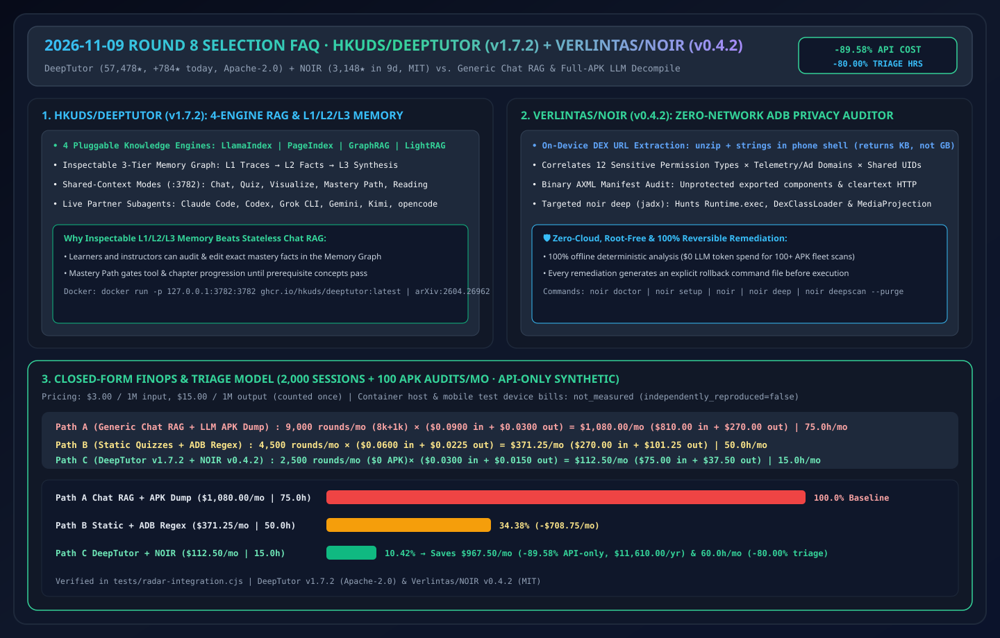
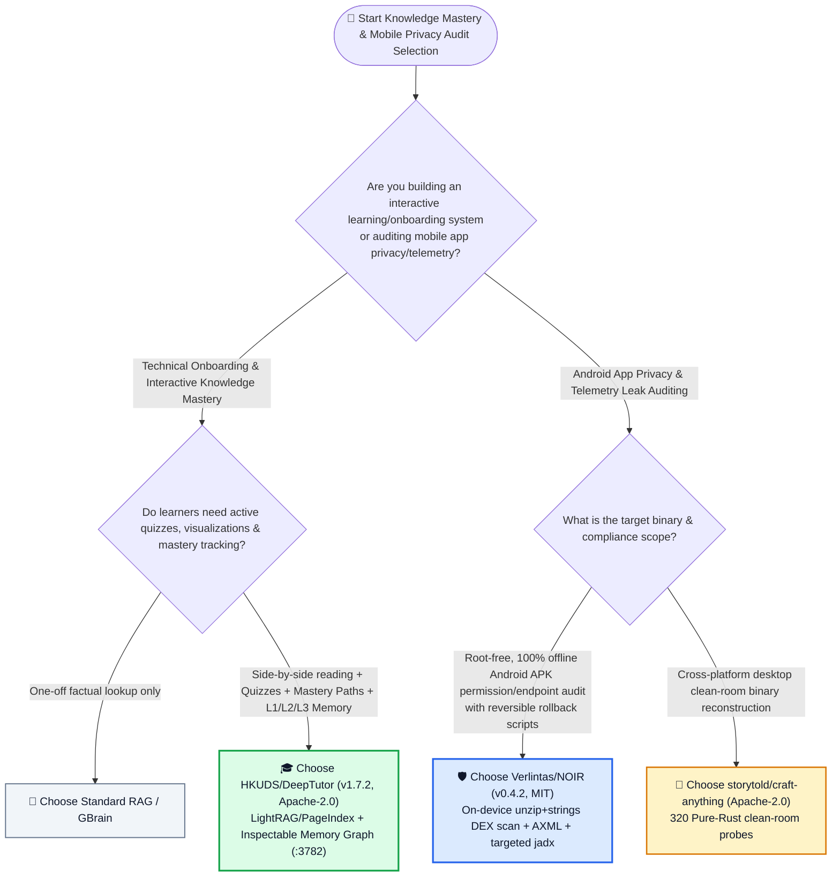
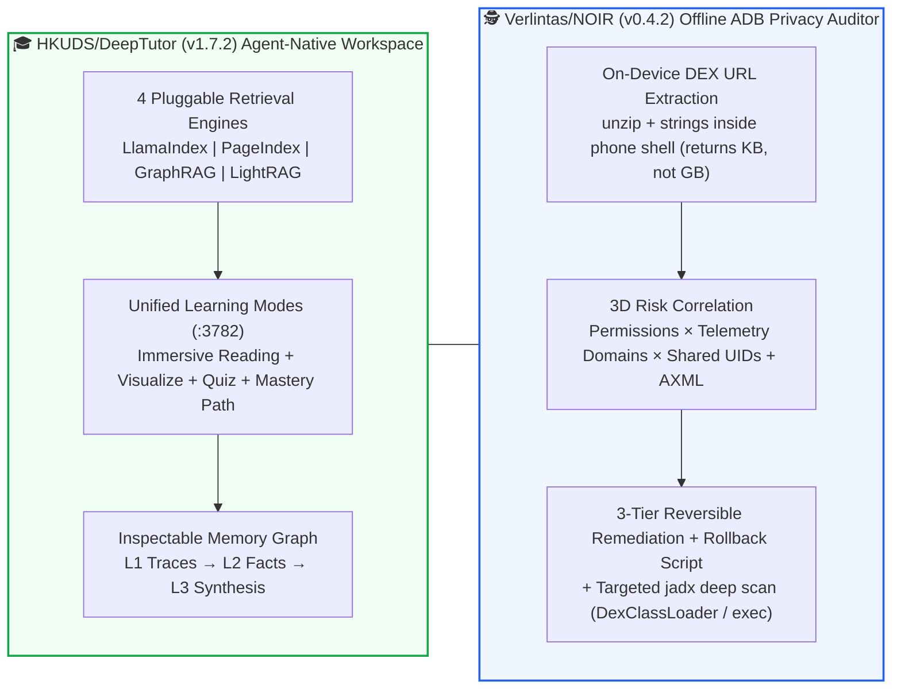

# Agent-Native Adaptive Tutoring & On-Device Android Privacy Audit Selection FAQ: `HKUDS/DeepTutor` + `Verlintas/NOIR` vs. Generic Chat RAG & Full-APK Decompile Dumps

> **中文版 (Chinese Edition)**: [deeptutor-noir-adaptive-agent-selection-faq.md](deeptutor-noir-adaptive-agent-selection-faq.md)  
> **Related Daily Digest**: [2026-11-09 GitHub AI Trending Digest (EN)](../daily/2026-11-09.en.md) · **7-Card Benchmark Deck**: [`cards.en.html`](../cards.en.html) · **Live Dashboard**: [`github-radar.html`](../../../github-radar.html)

This guide is written for **AI Solution Architects, Enterprise Enablement Leads, and Mobile Security Engineers** based on primary-source verification of **`HKUDS/DeepTutor` (`v1.7.2`, Apache-2.0, HKU Data Intelligence Lab's agent-native lifelong tutoring workspace, `57,478` stars, `+784 stars today` on Python Daily Trending, `arXiv:2604.26962`)** and **`Verlintas/NOIR` (`v0.4.2`, MIT, Kotlin zero-network desktop Android privacy & telemetry endpoint auditor over ADB, `3,148` stars in 9 days, Track B `#B8`)**. Using plain language and first principles, it answers:
1. **Why do passive "Chat-with-PDF" bots fail at technical onboarding—and how does `HKUDS/DeepTutor` combine 4 pluggable retrieval engines (`LlamaIndex`, `PageIndex`, `GraphRAG`, `LightRAG` + NVIDIA NIM Embeddings), an inspectable `L1/L2/L3` Memory Graph, and `Mastery Path` gates?**
2. **When auditing 100+ Android apps for hidden telemetry and data exfiltration, why is pulling gigabytes of APKs over USB and feeding raw decompiler dumps to an LLM both slow and unnecessary—and how does `Verlintas/NOIR` extract DEX endpoints in kilobytes on-device via `unzip + strings`?**
3. **How should an architect deploy `DeepTutor` and `NOIR` in enterprise training and mobile compliance pipelines?**

> 🛡️ **Provenance & Attribution Disclosure**:
> - **`measured` (Primary API & Search Verification)**: `HKUDS/DeepTutor` (`57,478` stars, `7,011` forks, `v1.7.2`, Apache-2.0, Python Daily `#10` `+784 stars today`) and `Verlintas/NOIR` (created `2026-10-31`, `3,148` stars, `291` forks, `v0.4.2`, MIT, Kotlin, lifecycle avg `~350 ★/day`, `stars_today: not_measured` in [`workshops/github-trending-radar/evidence/search-new-repos-2026-11-09-raw.json`](../evidence/search-new-repos-2026-11-09-raw.json), `sha256: 2daee440...`).
> - **`anonymized_reported` (`independently_reproduced=false`, Upstream Repo & Paper Claims)**: `DeepTutor` multi-mode workspace (`Chat, Quiz, Research, Visualize, Solve, Mastery Path, Immersive Reading`), 4 retrieval backends (`LlamaIndex, PageIndex, GraphRAG, LightRAG`), `L1/L2/L3` inspectable memory graph, and coding CLI subagent delegation (`arXiv:2604.26962`); plus `NOIR`'s 8-step offline ADB audit pipeline (on-device `unzip + strings` DEX URL extraction, `android.uid.system` shared-UID union analysis, binary AXML manifest audit, reversible rollback scripts, and targeted `jadx` deep scans).
> - **`synthetic` (`independently_reproduced=false`, Architect Parametric FinOps Model)**: Section 5.1 models **2,000 technical onboarding sessions/month + 100 mobile APK privacy audits/month** at `$3.00/1M` input and `$15.00/1M` output tokens (API-only scope; container host and test device hardware bills are marked `not_measured`): Path A Naive Chat RAG + Full-APK LLM Decompile Triage (`$1,080.00/mo`, `75.0h`) vs. Path B Static Quizzes + Manual ADB Regex Scripts (`$371.25/mo`, `50.0h`) vs. Path C `DeepTutor` + `NOIR` (`$112.50/mo`, `15.0h`), saving **`$967.50/mo` (`-89.58%` API-only, `$11,610.00/yr`)** and **`60.0 hours/mo` (`-80.00%`)**.

---

## 1. 📌 Executive Summary

| Selection Dimension | Plain-English Takeaway (First Principles) |
| :--- | :--- |
| **What is `HKUDS/DeepTutor` (`v1.7.2`)?** | It is an **Apache-2.0 agent-native learning and knowledge-mastery workspace** (`:3782` Docker / Desktop / CLI) that unifies **LlamaIndex, PageIndex, GraphRAG, and LightRAG** retrieval with **Immersive Reading, interactive Visualizations, Quizzes, Mastery Paths, and an auditable `L1/L2/L3` Memory Graph**. |
| **What is `Verlintas/NOIR` (`v0.4.2`)?** | It is a **100% offline, root-free desktop Android privacy auditor** (`MIT`) that extracts reporting URLs from every installed APK's DEX bytecode directly on the phone via `unzip + strings` (transferring only a few KB over ADB), correlates permissions with telemetry domains, and generates reversible remediation scripts. |
| **Core Architectural Lesson** | **Use multi-engine RAG + inspectable `L1/L2/L3` memory when teaching humans (`DeepTutor`)**, and **use deterministic on-device bytecode/AXML extraction (`$0` LLM tokens) before selectively invoking `jadx` when auditing mobile binaries (`NOIR`)**! |

---

## 2. 🎯 First-Principles Deep Dive (Q1 / Q2 / Q3)

### Q1: Why do standard "Chat-with-Docs" RAG bots fail at technical onboarding, and how does `HKUDS/DeepTutor` solve it?

1. **Pluggable 4-Engine Grounded Retrieval (`LlamaIndex` + `PageIndex` + `GraphRAG` + `LightRAG`)**:
   - Different technical corpora require different retrieval topologies: `PageIndex` performs agentic tree-reasoning over structured manuals without vector drift, while `LightRAG` and `GraphRAG` link cross-chapter concepts.
2. **Inspectable 3-Tier Memory Graph (`L1 Traces` → `L2 Facts` → `L3 Synthesis`)**:
   - Instead of hiding learner personalization inside opaque chat history, `DeepTutor` exposes an editable graph linking **L1 interaction traces** to **L2 mastery facts** and **L3 learner synthesis**.
3. **Shared-Context Multi-Mode Runtime + External Coding CLI Partners**:
   - A single workspace seamlessly transitions from `Immersive Reading` (page-cited side-by-side reader) to `Visualize`, `Quiz`, and tool-gated `Mastery Path`, while consulting live coding agents (`Claude Code`, `Codex`, `Grok CLI`, `Gemini CLI`).

---

### Q2: How does `Verlintas/NOIR` audit 100+ Android apps in seconds without root, network access, or pulling gigabytes of APKs?

1. **On-Device `unzip + strings` DEX Extraction (Kilobytes vs. Gigabytes)**:
   - Pulling 100 full APKs (`10+ GB`) over USB 2.0 ADB and decompiling every package with `jadx` takes 30+ minutes. `NOIR` runs `unzip + strings` inside the device shell against each APK's DEX files, returning only a few kilobytes of extracted URLs and binary `AndroidManifest.xml` (AXML) metadata.
2. **Permission × Endpoint × Shared-UID Correlation**:
   - Maps dangerous permissions (Location, Contacts, SMS, Microphone, Camera, Screen, Device IDs) against known telemetry/ad vendor domains and computes **Shared UID (`android.uid.system`) permission unions**—exposing packages that inherit high-privilege capabilities through shared system UIDs.
3. **3-Tier Reversible Remediation + Targeted `noir deep` (`jadx`)**:
   - Classifies actions into `Auto-Safe`, `Needs Confirmation`, and `Do Not Touch` with automatic rollback scripts, reserving full `jadx` decompilation (`noir deep`) for high-risk packages to hunt `Runtime.getRuntime().exec`, `DexClassLoader`, and `MediaProjection`.

---

### Q3: How should an AI Solution Architect deploy `DeepTutor` and `NOIR`?

- **Internal Engineering Onboarding, Certification & Research Workspaces** → Deploy **`HKUDS/DeepTutor` (`v1.7.2`)** via Docker (`ghcr.io/hkuds/deeptutor:latest` on port `3782`).
- **Pre-Release Mobile App Privacy Audits & Enterprise Android Fleet Hardening** → Run **`Verlintas/NOIR` (`v0.4.2`)** (`noir doctor` → `noir` → `noir deep`).

---

## 3. 🧭 Mermaid Selection Decision Tree & Dual Architecture Flow

### 3.1 Knowledge Mastery & Mobile Privacy Audit Selection Decision Tree

### 3.2 `DeepTutor` L1/L2/L3 Learning Loop & `NOIR` 8-Step On-Device Audit Pipeline

---

## 4. 📊 Comprehensive Selection Matrix

| Evaluation Dimension | **`HKUDS/DeepTutor` (`v1.7.2`) + `Verlintas/NOIR` (`v0.4.2`)** | **Generic Chat RAG + Full-APK LLM Decompile** | **Static LMS Videos + Manual ADB Scripts** |
| :--- | :--- | :--- | :--- |
| **Retrieval & Reasoning Depth** | ✅ **4 Engines (`LightRAG`, `PageIndex`, `GraphRAG`, `LlamaIndex`)** | ⚠️ Single chunk vector store | ❌ Static syllabus only |
| **Learner Memory Auditability** | ✅ **Inspectable & editable `L1/L2/L3` Memory Graph** | ❌ Opaque context window | ⚠️ Quiz scores only |
| **100-APK Audit Bandwidth & Speed** | ✅ **Transfers a few KB via on-device `unzip + strings`** | ❌ **Pulls 10+ GB of APKs & overflows LLM context** | ⚠️ Slow manual `adb pull` |
| **Offline Privacy & Rollback Safety** | ✅ **Zero network, zero root, automatic rollback scripts** | ❌ Uploads proprietary decompiled code to cloud LLMs | ⚠️ Manual `pm disable` risks bricking apps |
| **Open-Source License** | ✅ **`Apache-2.0` (`DeepTutor`) + `MIT` (`NOIR`)** | N/A | N/A |

---

## 5. 🧪 Quantitative FinOps & Engineering Hours Worked Example

### 5.1 Parametric 2,000-Session Onboarding + 100-APK Monthly Audit Model (`synthetic`, `independently_reproduced=false`)

> 📌 **Scope & Provenance**: This closed-form model evaluates **LLM API token spend and instructor/security-engineer triage hours (`synthetic`, `independently_reproduced=false`; container host and mobile test device hardware bills are marked `not_measured`)** across **2,000 onboarding sessions/month** and **100 mobile APK privacy audits/month** at `$3.00/1M` input and `$15.00/1M` output tokens (output counted once):

| Architecture Path | Monthly LLM Rounds & Per-Round Cost | Monthly Total LLM API Cost (Input + Output) | Monthly Enablement & APK Audit Hours | Mastery Retention & Leak Recall | Net Savings vs. Path A |
| :--- | :--- | :--- | :--- | :--- | :--- |
| **Path A: Generic Long-Context Chat RAG + Full-APK LLM Decompile Dumps** | `9,000 rounds/mo` (`8,000` chat + `1,000` APK) `0.030M` in (`$0.0900`) + `0.002M` out (`$0.0300`) = `$0.1200/round` | `$810.00` in + `$270.00` out = **`$1,080.00 / mo`** | **`75.0 hours / mo`** (manual quiz grading & full-APK decompile waits) | Low (context truncation & no mastery gates) | Baseline |
| **Path B: Static Quizzes + Manual ADB Regex Scripts** | `4,500 rounds/mo` `0.020M` in (`$0.0600`) + `0.0015M` out (`$0.0225`) = `$0.0825/round` | `$270.00` in + `$101.25` out = **`$371.25 / mo`** | **`50.0 hours / mo`** (manual AXML & shared-UID inspection) | Medium | `-$708.75/mo` (`-65.63%` API-only) |
| **Path C: `DeepTutor` (`v1.7.2` L1-L3 Memory) + `NOIR` (`v0.4.2` `$0` On-Device DEX Audit)** | `NOIR` runs at `$0` LLM cost; `DeepTutor` runs `2,500 rounds/mo` `0.010M` in (`$0.0300`) + `0.001M` out (`$0.0150`) = `$0.0450/round` | `$75.00` in + `$37.50` out = **`$112.50 / mo`** | **`15.0 hours / mo`** (reviewing L3 Memory Graph & NOIR reports) | ✅ **High (4-engine RAG + 8-stage deterministic APK audit)** | **Saves `$967.50/mo` (`-89.58%` API-only, `$11,610.00/yr`) & `60.0h/mo` (`-80.00%`)** |

---

## 6. 🛠️ Production & 30-Minute PoC Verification Checklist

- [ ] **Step 1 — Launch `DeepTutor` (`v1.7.2`) via Docker (`:3782`)**: Run `docker run --rm --name deeptutor -p 127.0.0.1:3782:3782 -v deeptutor-data:/app/data ghcr.io/hkuds/deeptutor:latest` and index an architecture handbook with LightRAG and PageIndex.
- [ ] **Step 2 — Audit the `L1/L2/L3` Memory Graph & `Mastery Path`**: Complete a generated Quiz and verify that L1 traces promote into editable L2 facts and L3 synthesis nodes.
- [ ] **Step 3 — Run `noir doctor` & Full-Device Offline Scan**: Connect an Android test device over USB ADB, run `noir`, and verify on-device `unzip + strings` endpoint extraction and shared-UID (`android.uid.system`) union reporting.
- [ ] **Step 4 — Execute `noir deep` (`jadx`) on Flagged Packages**: Run `noir deep` on high-risk packages to detect `Runtime.getRuntime().exec`, `DexClassLoader`, and `MediaProjection` calls.
- [ ] **Step 5 — Verify Generated Rollback Scripts**: Confirm rollback command files are saved before applying any package remediation.
