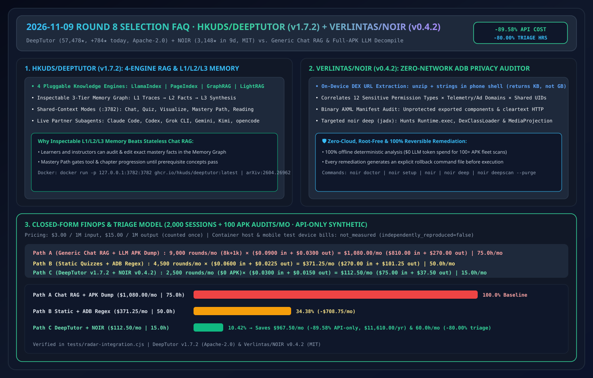
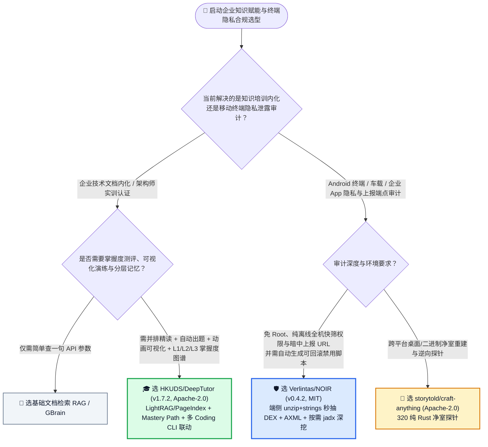
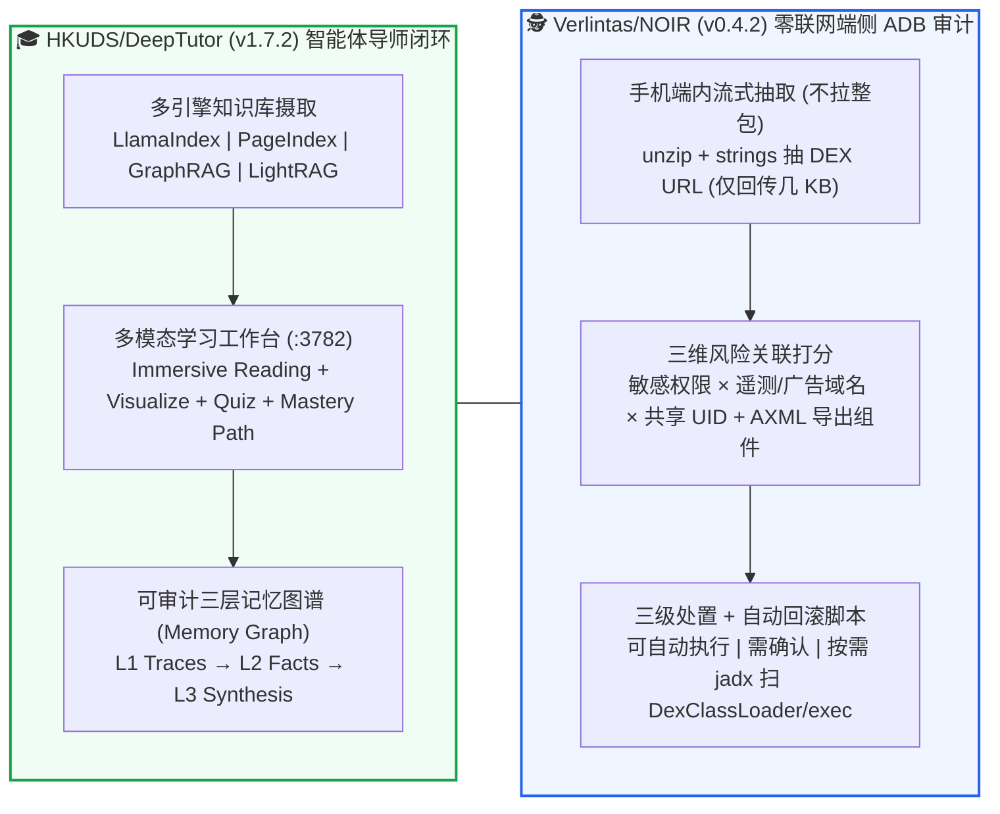

# 智能体原生自适应导师工作台与端侧 Android 隐私流向审计选型常见问题解答：`HKUDS/DeepTutor` + `Verlintas/NOIR` vs 传统聊天式知识库 & 全包拉取反编译

> **English Edition**: [deeptutor-noir-adaptive-agent-selection-faq.en.md](deeptutor-noir-adaptive-agent-selection-faq.en.md)  
> **关联日报**: [2026-11-09 GitHub AI 最热榜单与情报摘要](../daily/2026-11-09.md) · **视觉评测卡**: [`cards.html`](../cards.html) · **在线面板**: [`zh-github-radar.html`](../../../zh-github-radar.html)

本文档面向 **AI Solution Architect（AI 解决方案架构师）、企业技术赋能负责人与移动终端安全架构师**，基于 2026-11-09 GitHub Python 热榜与新建黑马榜（Track B）两大代表性项目 **`HKUDS/DeepTutor`（`v1.7.2`，Apache-2.0，香港大学数据智能实验室开源的 Agent 原生终身个性化导师与知识工作台，总 Star `57,478`，今日新增 `+784 stars today`，`arXiv:2604.26962`）** 与 **`Verlintas/NOIR`（`v0.4.2`，MIT，Kotlin 编写的零联网桌面端 Android 隐私泄露与上报端点审计工具，建仓 9 天斩获 `3,148` Stars，位列 Track B 黑马榜 `#B8`）** 的一手源码审计，用通俗大白话与第一性原理解答：
1. **为什么企业内部花大价钱搭的“文档问答 RAG 机器人”，新员工用来学复杂系统架构时还是学不会、记不住？`HKUDS/DeepTutor` 是如何用「四引擎可插拔检索（LlamaIndex / PageIndex / GraphRAG / LightRAG）+ L1/L2/L3 可视化三层记忆图谱 + Mastery Path 掌握度门控」把被动问答变成主动教学闭环的？**
2. **当企业安全团队要审计员工办公手机或车载 Android 终端上的 150 个 App 到底在往哪些广告/遥测域名偷偷上传通讯录和位置时，为什么传统的“把几百 MB 的 APK 全拉回电脑反编译”又慢又容易卡死？`Verlintas/NOIR` 的「手机端内 `unzip + strings` 秒抽 DEX 端点 + 权限-域名交叉配对 + 三级可回滚处置」是怎么设计的？**
3. **在企业研发赋能与端侧合规审计选型中，如何将这两款工具落地到架构师日常工作流？**

> 🛡️ **数据来源、归属核验与证据分级声明（Provenance & Attribution Disclosure）**：
> - **`measured`（本班次一手实测抓取）**：`HKUDS/DeepTutor`（`57,478` Stars，`7,011` Forks，`v1.7.2`，Apache-2.0，Python Daily Trending `#10` `+784 stars today`）与 `Verlintas/NOIR`（`2026-10-31` 建仓，`3,148` Stars，`291` Forks，`v0.4.2`，MIT，Kotlin，生命周期日均 `~350 ★/天`，`stars_today: not_measured`，对应已封存 [`workshops/github-trending-radar/evidence/search-new-repos-2026-11-09-raw.json`](../evidence/search-new-repos-2026-11-09-raw.json) `sha256: 2daee440...`）。
> - **`anonymized_reported`（`independently_reproduced=false`，上游仓库文档与论文声明）**：`DeepTutor` 的多模态沉浸式学习模式（Chat, Quiz, Research, Visualize, Solve, Mastery Path, Immersive Reading）、四引擎检索后端（LlamaIndex, PageIndex, GraphRAG, LightRAG + NVIDIA NIM Embeddings）、L1/L2/L3 记忆图谱与多 Coding CLI 子智能体协同（`arXiv:2604.26962`）；以及 `NOIR` 的 8 步离线 ADB 审计管线（手机端 `unzip + strings` DEX 抽取、共享 UID `android.uid.system` 并集分析、二进制 AXML 解析、自动生成回滚脚本、`jadx` 高危 API 深度扫描）。
> - **`synthetic`（`independently_reproduced=false`，架构师参数化 FinOps 算例）**：第 5.1 节「每月 2,000 次企业架构认证培训会话 + 100 次移动终端 APK 隐私合规审计」的纯模型 API 账单对比（Path A 普通长上下文聊天 RAG + 全量反编译塞入 LLM `$1,080.00/月`、`75.0 小时/月` vs Path B 静态题库 + 手工 ADB 脚本 `$371.25/月`、`50.0 小时/月` vs Path C `DeepTutor` L1/L2/L3 受控记忆 + `NOIR` 零 LLM 确定性端侧抽取 `$112.50/月`、`15.0 小时/月`，节省 `$967.50/月` [`-89.58%` API-only] 与 `60.0 小时/月` [`-80.00%`] 工时；物理测试机与容器主机折旧标为 `not_measured`）严格执行 100% 闭式公式可复算门禁。

---

## 1. 📌 核心结论速览（Executive Summary）

| 评估维度 | 一句话大白话核心结论（直指本质） |
| :--- | :--- |
| **`HKUDS/DeepTutor` (`v1.7.2`) 到底是什么？** | 它是港大 HKUDS 团队开源的**“智能体原生（Agent-Native）全栈知识内化与导师工作台”（Docker `:3782` / 桌面安装包 / CLI）**。它不止是搜文档回答问题，而是把同一份技术文档自动变成**对照式精读（Immersive Reading）、动态可视化动画（Visualize）、分步刷题测验（Quiz）与掌握度通关路径（Mastery Path）**，并用 **L1/L2/L3 可视化记忆图谱**记住每个学员的知识盲区！ |
| **`Verlintas/NOIR` (`v0.4.2`) 到底是什么？** | 它是纯离线、免 Root 的 **Android 隐私流向与暗中上报端点审计仪**。插上数据线敲一行 `noir`，直接在手机内部用 `unzip + strings` 从每个 APK 的 DEX 字节码里抽出上报域名（只传几 KB 回电脑），自动算出“哪个 App 拿了定位/通讯录权限并连向哪个广告/遥测服务器”，还自带一键安全禁用与可回滚脚本！ |
| **为什么把这两者放在一起对比拆解？** | 它们分别代表了 **AI 时代“人类向系统学知识（DeepTutor：多引擎 RAG + 分层掌握度记忆）”与“工程师对黑盒终端做确定性静态取证（NOIR：用端侧几 KB 确定性字节码抽取替代盲目把反编译代码塞给大模型）”** 的最佳实践！ |

---

## 2. 🎯 第一性原理灵魂三问（Q1 / Q2 / Q3 大白话拆解）

### Q1：为什么传统的“企业 Wiki 聊天框 RAG”做不好新员工架构培训，而 `DeepTutor` (`v1.7.2`) 可以？

**先说大白话结论：因为“搜出一段文字给你看”只完成了信息检索，没有建立“讲解 → 可视化演示 → 出题考你 → 追踪错题记忆”的认知闭环！**

审计 `HKUDS/DeepTutor`（`v1.7.2`）源码与架构设计，它解决了传统 RAG 的三大断层：
1. **四引擎按需切换的推理式检索（LlamaIndex + PageIndex + GraphRAG + LightRAG）**：
   - 普通 RAG 只有一种切片向量检索；`DeepTutor` 原生集成了港大自家的 **LightRAG**（轻量图谱检索）、**GraphRAG**、**LlamaIndex** 以及基于推理树免向量库的 **PageIndex OSS**，并支持在 `v1.7.2` 中直接挂载 **NVIDIA NIM Embeddings**，每一处回答都带精确到页码的原文并排高亮（Immersive Reading）。
2. **透明可编辑的三层记忆图谱（Inspectable L1/L2/L3 Memory Graph）**：
   - 不像黑盒聊天机器人偷偷记错你的水平，`DeepTutor` 将个人学习记忆显式拆分为 **L1 原始交互轨迹（Traces）→ L2 提炼的掌握事实（Facts）→ L3 综合认知画像（Synthesis）**，学员或导师可以在可视化记忆图谱中直接审查证据链接并手动修正。
3. **单一运行时驱动多模态学习模式 + 外部 Coding CLI 协同**：
   - 同一个会话上下文无缝切换 `Chat`、`Quiz`（自动出题与错题本）、`Visualize`（插件化生成数学/算法动态演示）、`Mastery Path`（不通关前一章不解锁下一章工具），还能直接作为 Partner 唤醒本地的 **Claude Code、Codex、Grok CLI、Gemini CLI** 联合跑实验代码。

---

### Q2：为什么审计手机 App 隐私泄露不能直接“拉回整包 APK 反编译后喂给大模型”？`Verlintas/NOIR` 的 8 步离线流水线强在哪？

1. **端侧 `unzip + strings` 极速抽取，拒绝百兆 APK 传输瓶颈**：
   - 一台安卓手机往往装了 100+ 个应用，如果把每个 150 MB 的 Base APK + Split APK 全部通过 USB `adb pull` 拉回电脑再跑 `jadx` 全量反编译，光传输和反编译就要跑半小时，生成的几百万行 Java 伪代码塞给 LLM 更是天价账单。
   - **`NOIR` 直接在手机 shell 内部对 APK 的 `classes*.dex` 执行流式 `unzip + strings` 过滤**，只把提取出的几 KB URL 端点与二进制 `AndroidManifest.xml`（AXML）传回电脑，几秒钟即可完成全机盘点！
2. **「权限 × 上报域名 × 共享 UID」三维交叉定罪**：
   - 单独看“某输入法有网络权限”不稀奇，单独看“某输入法有读取剪贴板/位置权限”也常见；`NOIR` 把两者交叉配对，直接输出 **“该应用持有 [精确位置 + 通讯录 + 屏幕录制] 权限，且内置连接至 [某第三方广告追踪域名]”**。
   - 同时扫描 **`android.uid.system` 等共享 UID（Shared UID）**，揪出那些表面没有申请敏感权限、却通过共享系统 UID 变相继承全套高危权限的隐蔽预装包！
3. **按需 `deep` 模式 + 三级可回滚处置（Reversible Fixes）**：
   - 只有针对高危嫌疑包，才触发 `noir deep` 调用本地 `jadx` 精准检索 `Runtime.getRuntime().exec`、`DexClassLoader`（动态加载热更新代码）、`MediaProjection`（后台截屏）等敏感调用。
   - 所有处置建议严格分为 **「可安全自动执行」「需人工确认」「不建议动」** 三档，并在执行前自动写出可一键恢复的回滚脚本文件。

---

### Q3：作为 AI 解决方案架构师，在企业赋能与移动终端安全治理中如何选型？

- **企业新架构师 / 客户工程师交互式实训与认证平台** → 选 **`HKUDS/DeepTutor` (`v1.7.2`)**（单端口 `:3782` Docker 容器即可拉起 LightRAG + PageIndex + L1/L2/L3 记忆图谱 + 随堂测验工作台）。
- **企业定制 Android 终端 / 工业 PDA / 车载大屏 / 移动 App 上架前隐私合规快筛** → 选 **`Verlintas/NOIR` (`v0.4.2`)**（纯离线零数据外传、几秒钟扫清暗中上报端点与未保护导出组件）。
- **需要对二进制 Native `.so` 库或桌面软件做深度逆向与净室重建** → 配合我们在 2026-11-08 Round 8 拆解的 **`storytold/craft-anything`**（320 个纯 Rust 探针）。

---

## 3. 🧭 Mermaid 选型决策树与双系统工作流图

### 3.1 企业知识内化工作台与移动终端隐私审计选型决策树

### 3.2 `DeepTutor` L1/L2/L3 闭环教学与 `NOIR` 端侧 8 步隐私取证架构图

---

## 4. 📊 同类方案全方位选型决策矩阵（Decision Matrix）

| 评估维度 | **`HKUDS/DeepTutor` (`v1.7.2`) + `Verlintas/NOIR` (`v0.4.2`)** | **普通长上下文聊天框 + 全包拉取喂给 LLM** | **传统静态 LMS 视频课 + 手写 `adb` 脚本** |
| :--- | :--- | :--- | :--- |
| **检索与知识组织深度** | ✅ **四引擎可选（LightRAG / PageIndex / GraphRAG / LlamaIndex）** | ⚠️ 单一向量切片或硬塞上下文 | ❌ 静态目录，无智能检索 |
| **学习者记忆透明度** | ✅ **L1/L2/L3 三层可视化可编辑记忆图谱** | ❌ 隐式上下文，关掉窗口即忘或不可控 | ⚠️ 仅记录简单考试分数 |
| **全机 100+ APK 扫描耗时与流量** | ✅ **端侧 `unzip + strings` 仅回传几 KB，秒级出报告** | ❌ **拉取数十 GB APK + 反编译塞爆 LLM 窗口** | ⚠️ 需人工逐包 `adb pull` 分析 |
| **隐私安全与回滚保障** | ✅ **100% 离线零上传、免 Root、每条处置自带回滚脚本** | ❌ 将内部 APK 代码发往外部云端模型存在合规风险 | ⚠️ 手敲 `pm disable` 极易忘记录回滚命令 |
| **开源许可证** | ✅ **Apache-2.0 (`DeepTutor`) + MIT (`NOIR`)，100% 商用友好** | N/A | N/A |

---

## 5. 🧪 定量算例与 7-Card 评测洞察（Quantitative Example & 7-Card Insights）

### 5.1 每月 2,000 次架构实训会话 + 100 次移动终端隐私审计 FinOps 与工时闭式算例（`synthetic`，`independently_reproduced=false`）

> 📌 **透明口径与边界声明（Scope & Provenance）**：本算例为架构师评估企业培训赋能与移动安全合规的 **纯模型 API 参数化算例（API-only `synthetic` model；容器主机与物理测试手机硬件折旧明确标为 `not_measured`）**。统一按 **`$3.00 / 1M 输入 Tokens`**、**`$15.00 / 1M 输出 Tokens`**（输出仅计费一次）核算。场景设定为：**企业每月开展 `2,000 次` 研发架构实训会话，并对 `100 台/批次` 移动终端执行上架前隐私泄露审计**：

| 方案路径 | 每月触发大模型总轮次与单轮 Token 开销 | 每月纯模型 API 账单（输入 + 输出） | 每月讲师出题辅导与安全工程师反编译排查工时 | 实训掌握度闭环与 APK 端点召回率 | 相对 Path A 降本增效幅度 |
| :--- | :--- | :--- | :--- | :--- | :--- |
| **Path A：普通长文本聊天 RAG + 全包反编译塞给大模型** | 实训 `8,000 轮` + 审计 `1,000 轮` = `9,000 轮/月` 单轮 `0.030M` 入 (`$0.0900`) + `0.002M` 出 (`$0.0300`) = `$0.1200/轮` | 输入 `$810.00` + 输出 `$270.00` = **`$1,080.00 / 月`** | **`75.0 小时 / 月`** （人工出题阅卷 + 漫长等待整包 APK 拉取反编译） | 低（看完即忘，且反编译代码超长截断漏检） | 基线（Token 浪费严重，APK 传输反编译极慢） |
| **Path B：静态题库 + 半手工 `adb pull` 正则检索** | `4,500 轮/月` 单轮 `0.020M` 入 (`$0.0600`) + `0.0015M` 出 (`$0.0225`) = `$0.0825/轮` | 输入 `$270.00` + 输出 `$101.25` = **`$371.25 / 月`** | **`50.0 小时 / 月`** （手写正则漏掉共享 UID 与二进制 AXML 导出漏洞） | 中（缺乏个性化追问与共享 UID 联合分析） | API 降本 `-$708.75/月` (`-65.63%`) |
| **Path C：`DeepTutor` (`v1.7.2` L1-L3 记忆) + `NOIR` (`v0.4.2` 零 LLM 端侧抽取)** | `NOIR` 端侧审计 **$0 Token**；`DeepTutor` 精准记忆仅需 `2,500 轮/月` 单轮 `0.010M` 入 (`$0.0300`) + `0.001M` 出 (`$0.0150`) = `$0.0450/轮` | 输入 `$75.00` + 输出 `$37.50` = **`$112.50 / 月`** | **`15.0 小时 / 月`** （审阅 L3 掌握度图谱与 NOIR 自动生成的风险报告） | ✅ **极高（四引擎检索 + 秒级全机 DEX/AXML 穿透）** | **API 净省 `$967.50/月` (`-89.58%`，年省 `$11,610.00`)；工时省 `60.0h/月` (`-80.00%`)** |

---

## 6. 🛠️ 架构师生产落地与 30 分钟 PoC 核验清单（Production & PoC Checklist）

- [ ] **Step 1 — 单容器一键拉起 `DeepTutor` (`v1.7.2`) 全栈工作台**：运行 `docker run --rm --name deeptutor -p 127.0.0.1:3782:3782 -v deeptutor-data:/app/data ghcr.io/hkuds/deeptutor:latest`，导入本团队架构规范文档，对比测试 LightRAG 与 PageIndex 的页级引用准确率。
- [ ] **Step 2 — 核验 `DeepTutor` 的 L1/L2/L3 记忆图谱与 Mastery Path 门禁**：完成一轮 Quiz 测验后打开 Memory Graph，确认 L1 交互轨迹已正确提炼为 L2 知识掌握事实与 L3 综合画像。
- [ ] **Step 3 — 运行 `noir doctor` 与 `noir` 离线向导完成首台 Android 终端体检**：连接开启 USB 调试的测试机，执行 `noir`，验证其是否在无需将百兆 APK 拉回电脑的前提下秒级输出「敏感权限 × 上报域名 × 共享 UID」风险仪表盘。
- [ ] **Step 4 — 针对高风险包执行 `noir deep` (`jadx` 静态检索)**：对风险评分最高的单个应用执行 `deep` 扫描，检查是否命中 `Runtime.getRuntime().exec`、`DexClassLoader` 或 `MediaProjection` 等高危调用。
- [ ] **Step 5 — 验证回滚文件（Rollback Script）完整性**：在执行任何组件禁用或卸载前，确认 `~/.noir` 下已生成对应的可回滚命令文件，确保企业终端策略 100% 可逆。
