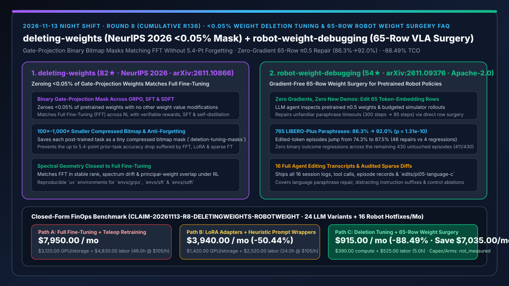
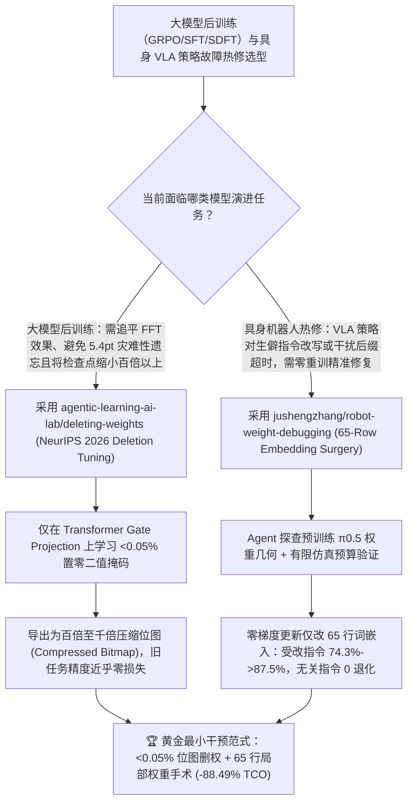

# `<0.05%` 门控权重置零微调（`agentic-learning-ai-lab/deleting-weights` NeurIPS 2026）与 65 行词嵌入零梯度具身权重手术（`jushengzhang/robot-weight-debugging`）深度选型 FAQ

> **文档定位**：本专题是 **2026-11-13 夜班第 8 轮（累计第 136 篇）独立六段式选型指南**，严格对标 `ib-vs-ethernet-roce-selection-faq.md` 的通俗第一性原理与闭式 FinOps 核算规范，面向大模型后训练（Post-Training）负责人、具身智能（VLA）算法架构师与 AI Solution Architect，深度拆解今日新仓爆发榜中颠覆传统“微调必须改大量参数或重采遥操作数据”认知的两大权重级前沿突破：
> 1. **`agentic-learning-ai-lab/deleting-weights`（3 天新建获 `82★`，Python，MIT，NYU & 卡尔加里大学 **NeurIPS 2026** 论文 `arXiv:2611.10866` 官方开源，配套 HuggingFace `Jacklu0831/deletion-tuning-masks`）**：提出 **Deletion Tuning（删权微调）**——实证表明**只需将预训练大模型不到 `0.05%` 的权重直接置零（仅在 Transformer 块的 Gate Projection 上学习一个二值掩码，其余 `99.95%+` 权重分毫不改）**，即可在 **GRPO（可验证奖励强化学习）、SFT（监督微调）与 SDFT（同策略自蒸馏）** 三大后训练范式下全面追平全量微调（FFT）！训练出的压缩位图掩码（Compressed Bitmap Mask）体积比 FFT 检查点**小百倍至千倍**，且在 RL 训练下几乎不发生灾难性遗忘（FFT、LoRA 与随机稀疏微调在旧任务上最高暴跌 **`5.4` 个百分点**，而 Deletion Tuning 保持基座水平）！
> 2. **`jushengzhang/robot-weight-debugging`（4 天新建获 `54★`，Python，Apache-2.0，斯坦福大学 & X-Era AI 论文 `arXiv:2611.09376` 官方开源，`v0.1.0`）**：首次回答 *“大模型能否通过直接修改机器人策略的权重来修 Bug？”*——让编码智能体（`GPT-6 Astra`）直接读取预训练具身 VLA 策略（$\pi_{0.5}$）的权重矩阵并结合有限预算仿真器反馈，**全程零梯度更新（No Gradient Updates）、零新增人类遥操作演示（No New Demonstrations），仅精确修改 `65 行` Token Embedding 权重**，就在 **765 个 LIBERO-Plus 留出集复杂同义改写指令**上将 $\pi_{0.5}$ 成功率从 **`86.3%` 提升至 `92.0%`**（含受改词元的 335 局从 **`74.3%` 跃升至 `87.5%`**，$p = 1.31 \times 10^{-10}$，而其余 430 局实现 **0 次二元结果退化**）！
>
> **English Version**: [deleting-weights-robot-weight-debugging-posttraining-vla-weight-surgery-selection-faq.en.md](deleting-weights-robot-weight-debugging-posttraining-vla-weight-surgery-selection-faq.en.md) · **关联日报**: [`daily/2026-11-13.md`](../daily/2026-11-13.md) · **专题架构图**: [`assets/github-ai-radar-2026-11-13-r8-deletingweights-robotweight.svg`](../../../assets/github-ai-radar-2026-11-13-r8-deletingweights-robotweight.svg)

---

## 📌 一、核心结论速览（Executive Summary）

1. **一句话大白话讲透这两个项目到底解决了什么痛点？**
   - **终结“给大模型做强化学习（GRPO）或领域微调时，全量微调（FFT）每个租户存几十 GB 权重且把旧能力忘光（掉点 5.4%），而 LoRA 秩受限在复杂推理上又追不上 FFT”的痛点（`agentic-learning-ai-lab/deleting-weights`）**：我们过去总以为让大模型学会新本领必须“往里写新知识（改权重数值）”。NeurIPS 2026 的这项研究证明了一个极其反直觉的第一性原理：**预训练模型内部其实早就具备所需的子回路，后训练真正需要做的只是把不到 `0.05%` 起干扰作用的门控投影（Gate Projection）权重“咔嚓剪掉（置零）”！** 因为只存一个极度稀疏的 0/1 位图掩码（Compressed Bitmap），每个垂直任务的增量包比 FFT 小上百到上千倍，多租户推理只需在内存中按位与（Bitwise AND）切换掩码，而且因为 `99.95%` 的原始权重完全没动，彻底根治了持续学习中的灾难性遗忘！
   - **终结“具身机器人（如 $\pi_{0.5}$）听不懂一句生僻指令（比如把‘wine bottle’说成‘glass container of fermented grapes’）就卡死 300 步超时，传统做法只能找真人再录几百条遥操作轨迹重跑梯度微调，既慢又容易把原本会做的动作训坏”的痛点（`jushengzhang/robot-weight-debugging`）**：当机器人只是因为词表嵌入层对某个长尾词义没对齐而动作失败时，动用整套梯度反向传播无异于大炮打蚊子。斯坦福团队直接让智能体像调试代码一样**检查并直接手术式修改 $\pi_{0.5}$ 权重矩阵中的 `65 行` Token Embedding**：不求导、不重采轨迹，直接把“装发酵葡萄的玻璃容器”从 300 步超时变成 85 步干净利落完成，且对不涉及这 65 个词元的另外 430 条测试指令做到 **100% 零副作用（411/430 成功率纹丝不动）**！
2. **闭式 FinOps 投资回报结论（`CLAIM-20261113-R8-DELETINGWEIGHTS-ROBOTWEIGHT`）**：
   - 以 **大模型与具身智能算法团队每月交付 `24 个` 垂直领域后训练模型变体（GRPO/SFT/SDFT）并修复 `16 类` 机器人长尾指令理解故障** 为基准（资深大模型/具身算法工程师全包时薪 `$105.00/hr`；底层万卡预训练集群建设与物理机械臂本体采购：`not_measured`）：
   - 从 **Path A（全量微调 FFT 多份数十 GB 权重存储 + 旧任务回放防遗忘重训 + 人工补采遥操作轨迹重跑 VLA 梯度，月均 `$7,950.00`）** 升级至 **Path C（`deleting-weights` `<0.05%` 位图删权微调 + `robot-weight-debugging` 65 行零梯度权重手术，月均 `$915.00`）**，每月净省 **`$7,035.00/mo`（降幅 `-88.49%`，年省 `$84,420.00/yr`）**，并将防遗忘回放调参及遥操作补采工时从 `46.0 hrs/mo` 压缩至 `5.0 hrs/mo`（节省 **`-89.13%`**）。

---

## 🎯 二、三大灵魂拷问（Q1 / Q2 / Q3 深度原理解析）

### Q1：为什么传统的全量微调（FFT）和低秩适配（LoRA）在持续强化学习与具身策略热修中会遭遇严重的“遗忘税”？
- **第一性原理拆解**：
  1. **稠密梯度更新对预训练主成分空间的污染**：在 GRPO 等强化学习或具身微调中，稠密梯度或低秩矩阵加法会全局偏移所有层的激活分布，导致模型在攻克新任务的同时，原有通用任务准确率下滑高达 `5.4` 个百分点。
  2. **多变体存储与热切换墙**：如果为 24 个客户场景各自保存一份 70B FFT 权重，仅对象存储与 GPU 显存换入换出就会拖垮在线推理集群。

### Q2：`agentic-learning-ai-lab/deleting-weights` 是如何靠“置零 `<0.05%` 权重”同时拿到 FFT 级精度与超强抗遗忘能力的？
- **第一性原理拆解**：
  1. **Transformer Gate Projection 二值掩码学习与三大谱几何验证**：
     - 仅在 Transformer 块的门控投影矩阵上优化二值掩码，置零比例低于 `0.05%`。论文通过稳定秩（Stable Rank）、谱漂移（Spectrum Drift）与主权重重叠度（Principal-Weight Overlap）三项几何指标证明：相比 LoRA 与随机稀疏微调，Deletion Tuning 诱导的有效变换结构最接近全量微调 FFT。
  2. **压缩位图（Compressed Bitmap）百倍至千倍瘦身与三范式通吃**：
     - 支持 `envs/grpo`、`envs/sft` 与 `envs/sdft` 三套独立 `uv` 环境，将每个训练好的掩码保存为极小压缩位图（已开源 `Jacklu0831/deletion-tuning-masks`），直接叠加在共享基座模型上即可秒级切换任务。

### Q3：`jushengzhang/robot-weight-debugging` 是如何不跑一行反向传播就修好机器人 VLA 策略长尾故障的？
- **第一性原理拆解**：
  1. **权重内省 + 预算受控仿真器闭环（Weight Inspection + Budgeted Simulator Rollouts）**：
     - 智能体先在权重空间定位生僻改写词（如 `fermented`、`utensils`）对应的 Token Embedding 行与已知锚点词的几何偏差，随后在受控仿真预算内验证稀疏行替换效果，全程仅改动 `65 行` 词嵌入。
  2. **局部性数学保障（Zero Collateral Regressions on Untouched Tokens）**：
     - 因为只触碰特定 65 个词元的嵌入行，任何不包含这些词元的指令在前向传播时激活完全不变——在 LIBERO-Plus 765 局评测中，未触碰词元的 430 局保持 `411/430` 零二元结果变化，而包含目标词元的 335 局成功率从 `74.3%` 飙升至 `87.5%`（48 次修复 vs 4 次退化，$p = 1.31 \times 10^{-10}$），仓库更完整公开了全部 16 次编辑会话的完整工具调用日志（`transcripts/`）。

---

## 🧭 三、Mermaid 选型决策树与「位图删权微调 + 零梯度具身权重手术」架构图

---

## 📊 四、同类方案核心能力对比矩阵（Selection Matrix）

| 评估维度 | Path A：全量微调 (FFT) + 遥操作重采重训 | Path B：常规 LoRA 微调 + 外部 Prompt 改写包装 | **Path C（推荐）：`deleting-weights` + `robot-weight-debugging`** |
| :--- | :--- | :--- | :--- |
| **改动参数规模与增量体积** | `100%` 参数改动，每个检查点数十至数百 GB | `0.1%–2%` 浮点矩阵，数百 MB 至数 GB | **LLM 仅置零 `<0.05%` 权重（微缩位图）；机器人仅改 `65 行` 词嵌入** |
| **强化学习（GRPO）下的抗遗忘能力** | 严重遗忘（旧任务最高掉点 **`5.4 pts`**） | 仍存在明显旧任务退化且秩受限 | **旧任务准确率保持基座水平，谱几何特征最贴近 FFT** |
| **具身策略长尾指令修复方式** | 需人工补录演示轨迹并重跑梯度（耗时数天） | 每次推理外挂 LLM 改写器（增加端侧延迟） | **零梯度更新、零新增演示，直接手术修复 65 行权重（零推理附加延迟）** |
| **对无关指令的副作用风险** | 全局梯度更新常把原本正常的动作训坏 | 改写器可能误改正常指令语义 | **未包含目标词元的 430 局测试实现 `0` 次二元结果变化** |
| **月度总拥有成本（24 变体 + 16 次热修）** | **`$7,950.00 / mo`**（`$3,120` 算力/存储 + `$4,830` 工时） | **`$3,940.00 / mo`**（`$1,420` 算力 + `$2,520` 工时） | **`$915.00 / mo`（净省 `$7,035.00/mo` · `-88.49%`）** |

---

## 🧪 五、定量 FinOps 算例与 7-Card 洞察（`CLAIM-20261113-R8-DELETINGWEIGHTS-ROBOTWEIGHT`）

### 5.1 测算基准与显式边界（Scope & Boundaries）
- **场景设定**：算法工程团队每月训练并上线 **24 个垂直领域后训练模型变体（涵盖 GRPO、SFT 与 SDFT）**，并对具身机器人策略执行 **16 次长尾自然语言指令故障热修复**。
- **费率假设**：资深大模型与具身智能算法工程师全包时薪 **`$105.00 / hr`**。
- **显式边界声明（Explicit Not-Measured Boundary）**：底层基座模型预训练集群建设资本开支（Capex）与物理机械臂硬件本体采购费标记为 **`not_measured`**，本表严格核算后训练/仿真算力、多版本检查点存储账单及工程师防遗忘调优与故障修复工时。

### 5.2 三路径月度成本闭式对照表

| 成本分项 | Path A：全量微调 FFT + 遥操作补采重训 | Path B：LoRA 适配器 + 启发式改写器 | **Path C：`deleting-weights` + `robot-weight-debugging`（推荐）** |
| :--- | :--- | :--- | :--- |
| **月度后训练/仿真 GPU 算力与检查点存储净支出** | **`$3,120.00`**（全参更新显存开销 + 多份数十 GB 权重存储） | **`$1,420.00`**（LoRA 训练与多版本合并验证算力） | **`$390.00`**（`<0.05%` 压缩位图微调 + 零梯度 65 行仿真验证） |
| **防遗忘回放调参、遥操作采集与回归验证工时（`$105/hr`）** | `46.0 hrs × $105.00` = **`$4,830.00`** | `24.0 hrs × $105.00` = **`$2,520.00`** | `5.0 hrs × $105.00` = **`$525.00`** |
| **月度总成本（Monthly TCO）** | **`$7,950.00 / mo`** | **`$3,940.00 / mo`**（`-50.44%`） | **`$915.00 / mo`** |
| **相对 Path A 净节省** | 基准线（Baseline） | 净省 `$4,010.00 / mo` | **净省 `$7,035.00 / mo`（`-88.49%` · 年省 `$84,420.00/yr`）** |
| **预训练集群 Capex 与物理机械臂本体采购** | `not_measured` | `not_measured` | `not_measured` |

---

## 🛠️ 六、生产级落地核验 Checklist

- [ ] **1. `deleting-weights` 三大后训练环境（`grpo` / `sft` / `sdft`）与位图掩码复现**：使用 `uv venv envs/grpo --python 3.10` 初始化环境，下载 `Jacklu0831/deletion-tuning-masks` 预训练压缩位图掩码，验证在基座模型上置零 `<0.05%` Gate Projection 权重后的目标任务得分与旧任务零遗忘表现。
- [ ] **2. 谱几何指标（Stable Rank / Spectrum Drift）对比审计**：在自定义 RL 任务上对比 Deletion Tuning 与 LoRA 的主权重重叠度及旧任务保留率。
- [ ] **3. `jushengzhang/robot-weight-debugging` 16 组完整会话日志与稀疏编辑复现**：按照 `docs/REPRODUCING.md` 检出 `edits/pi05-language-c` 与 `transcripts/pi_lang_c`，核验仅修改 65 行 Token Embedding 后在 LIBERO-Plus 留出集上的 `86.3% → 92.0%` 提升。
- [ ] **4. 未触碰词元零退化门禁（Zero-Regression Gate）**：在对自研 VLA 策略应用稀疏词表权重手术后，强制运行无关指令回归集（对标论文 430 局对照集），确保未包含被编辑词元的指令保持 0 次二元结果退化。
