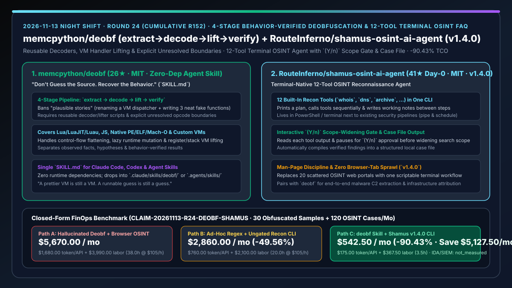
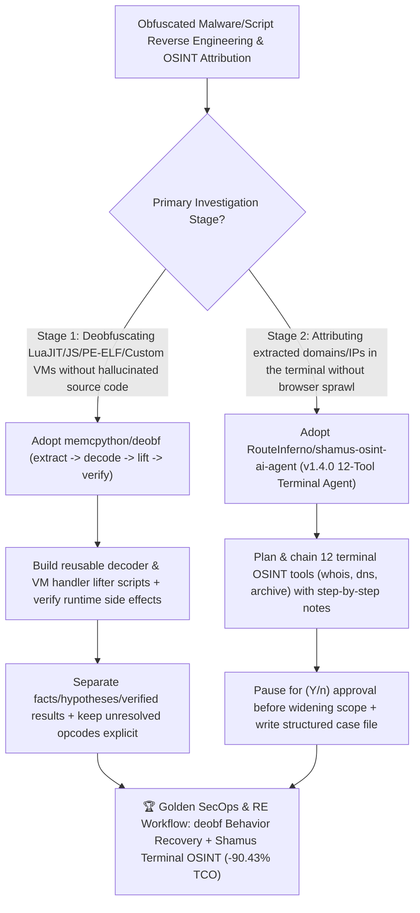

# 4-Stage Behavior-Verified Deobfuscation Skill (`memcpython/deobf`) & 12-Tool Scope-Gated Terminal OSINT Agent (`RouteInferno/shamus-osint-ai-agent`) Selection FAQ

> **Document Scope**: This is the **2026-11-13 Night Shift Round 24 (Cumulative #152) standalone 6-part selection guide**, modeled strictly after `ib-vs-ethernet-roce-selection-faq.md` with first-principles explanations and closed-form FinOps math. It is written for AI Solution Architects, Reverse Engineering Leads, and Threat Intelligence / SecOps Engineers evaluating two evidence-first security workflows:
> 1. **`memcpython/deobf` (`26★` in 2 days, MIT, zero-dependency `SKILL.md` for Claude Code, Codex & Agent Skills)**: Enforces **"Don't guess the source. Recover the behavior."** through a 4-stage pipeline (`extract → decode → lift → verify`) across **Lua / LuaJIT / Luau, JavaScript, native PE/ELF/Mach-O binaries, and custom virtual machines** — requiring reusable decoders/lifters, runtime behavior checks, and explicit unresolved boundaries instead of "plausible stories" or renamed VM dispatchers!
> 2. **`RouteInferno/shamus-osint-ai-agent` (`41★` on Day 0, JavaScript, MIT, `v1.4.0`)**: A terminal-native OSINT reconnaissance AI agent shipping with **12 built-in tools** (`whois`, `dns`, `archive`, etc.) that prints a reconnaissance plan, reads each tool's output, writes self-notes between steps, **stops to ask `(Y/n)` human confirmation before widening the search scope**, and compiles a scriptable case file!
>
> **中文版本**: [deobf-shamus-osint-behavior-verified-deobfuscation-terminal-osint-agent-selection-faq.md](deobf-shamus-osint-behavior-verified-deobfuscation-terminal-osint-agent-selection-faq.md) · **Daily Digest**: [`daily/2026-11-13.en.md`](../daily/2026-11-13.en.md) · **Topic SVG**: [`assets/github-ai-radar-2026-11-13-r24-deobf-shamus.svg`](../../../assets/github-ai-radar-2026-11-13-r24-deobf-shamus.svg)

---

## 📌 1. Executive Summary

1. **In plain English, what core pain points do these two repositories solve?**
   - **Ending "LLMs that decode one string, rename a VM dispatcher, hallucinate three neat-looking functions, and falsely claim an obfuscated LuaJIT/JS/VM binary is 'fully deobfuscated'" (`memcpython/deobf`)**: As `deobf` puts it: *"A prettier VM is still a VM. A runnable guess is still a guess."* Packaged as a single zero-dependency `SKILL.md` for Claude Code and Codex, `deobf` forces the agent through `extract → decode → lift → verify`: it must build reusable programmatic decoders and VM handler lifters, verify actual runtime behavior and side effects, separate **observed facts, hypotheses, and verified results**, and keep any unrecovered opcode **explicitly marked as unresolved** rather than inventing no-ops!
   - **Ending "juggling 20 browser tabs across Whois, DNS, and Wayback portals during an OSINT investigation — or running blind recon scripts that spiral out of scope" (`RouteInferno/shamus-osint-ai-agent`)**: `Shamus` (`v1.4.0`) lives directly in your terminal with **12 built-in OSINT tools**. From a single command, it prints an investigation plan, calls tools one by one, writes concise notes between steps, **pauses with a `(Y/n)` prompt before widening the reconnaissance scope**, and writes a structured case file!
2. **Closed-Form FinOps Conclusion (`CLAIM-20261113-R24-DEOBF-SHAMUS`)**:
   - Modeled for a **SecOps and reverse-engineering team analyzing `30 obfuscated samples (LuaJIT/JS/VM/PE-ELF) / month` and conducting `120 OSINT infrastructure investigations / month`** (fully loaded SecOps/RE analyst rate `$105.00/hr`; commercial IDA Pro / Binary Ninja licenses and SIEM storage: `not_measured`):
   - Switching from **Path A (unconstrained LLM "plausible story" deobfuscation + manual browser-tab OSINT, `$5,670.00/mo`)** to **Path C (`deobf` 4-stage behavior-verified pipeline + `Shamus v1.4.0` 12-tool `(Y/n)` terminal OSINT agent, `$542.50/mo`)** saves **`$5,127.50/mo` (`-90.43%`, or `$61,530.00/yr`)** and cuts hallucinated-decompilation debugging and manual case-file assembly from `38.0 hrs/mo` to `3.5 hrs/mo` (**`-90.79%`**).

---

## 🎯 2. Three First-Principles Deep-Dive Questions (Q1 / Q2 / Q3)

### Q1: Why do general-purpose LLMs produce dangerous "plausible stories" when asked to deobfuscate virtualized or control-flow-flattened code?
- **First-Principles Breakdown**:
  1. **Cosmetic Renaming vs. Semantic Handler Lifting**: Without strict constraints, models rename a bytecode dispatcher and fabricate clean high-level functions while dropping unknown opcodes or signed-integer coercion edge cases.
  2. **Blindness to Lazy Decoding & Runtime Mutation**: Dumping instructions once misses layered loaders and self-modifying state tables.

### Q2: How does `memcpython/deobf` enforce verifiable reverse engineering across LuaJIT, JS, native PE/ELF/Mach-O, and custom VMs?
- **First-Principles Breakdown**:
  1. **Four-Stage Contract (`extract → decode → lift → verify`)**:
     - Identifies containers and loaders (`extract`), writes reusable scripts to recover bytes/constants/prototypes (`decode`), lifts VM handlers and reconstructs control flow (`lift`), and tests runtime behavior and side effects (`verify`).
  2. **Explicit Unresolved Boundaries & Fact/Hypothesis Separation**:
     - Forbids pretending unknown opcodes are no-ops; every unrecovered instruction remains explicitly marked alongside separated observed facts, hypotheses, and verified outputs.

### Q3: How does `RouteInferno/shamus-osint-ai-agent` (`v1.4.0`) combine autonomous 12-tool planning with human scope control?
- **First-Principles Breakdown**:
  1. **Iterative Tool Chaining & Working Notes**:
     - Evaluates each output from its 12 built-in tools (`whois`, `dns`, `archive`, etc.) and logs intermediate notes before selecting the next probe.
  2. **`(Y/n)` Scope-Widening Gate & Case File Generation**:
     - Stops to request explicit `(Y/n)` human confirmation before expanding the search radius, then writes a reproducible terminal case file.

---

## 🧭 3. Mermaid Decision Tree & deobf + Shamus Threat Investigation Architecture

---

## 📊 4. Head-to-Head Selection Matrix

| Dimension | Path A: Raw Prompt Deobf + Browser-Tab OSINT | Path B: Ad-Hoc Regex Scripts + Ungated Recon | **Path C (Recommended): `memcpython/deobf` + `Shamus v1.4.0`** |
| :--- | :--- | :--- | :--- |
| **Deobfuscation Fidelity** | Fabricates neat "plausible stories" & renames dispatchers | Breaks on layered loaders or custom bytecode VMs | **4-stage `extract→decode→lift→verify` with reusable lifter scripts & behavior checks** |
| **Handling of Unknown VM Opcodes** | Silently drops or treats unknown opcodes as no-ops | Crashes or outputs unreadable dumps | **Keeps unresolved boundaries explicit; separates facts, hypotheses & verified results** |
| **OSINT Reconnaissance Workflow** | 20 manual browser tabs & copy-paste notes | Rigid batch script that cannot adapt to outputs | **12-tool terminal agent that adapts plans dynamically and logs intermediate notes** |
| **Scope Control & Case Documentation** | Manual note-taking; easy to miss steps | Unbounded pivot scans waste API quota | **`(Y/n)` human gate before widening search + automated structured case file** |
| **Monthly TCO (30 Samples + 120 Cases)** | **`$5,670.00 / mo`** (`$1,680` API + `$3,990` labor) | **`$2,860.00 / mo`** (`$760` API + `$2,100` labor) | **`$542.50 / mo` (Saves `$5,127.50/mo` · `-90.43%`)** |

---

## 🧪 5. Closed-Form FinOps Worked Example & 7-Card Insights (`CLAIM-20261113-R24-DEOBF-SHAMUS`)

### 5.1 Baseline Parameters & Explicit Scope Boundaries
- **Scenario**: A security reverse-engineering and threat-intelligence team analyzing **30 obfuscated scripts/binaries per month** (LuaJIT, JavaScript, custom VMs, packed PE/ELF) and running **120 OSINT reconnaissance investigations per month**.
- **Labor Rate**: Fully loaded SecOps and reverse-engineering analyst rate of **`$105.00 / hr`**.
- **Explicit Not-Measured Boundary**: Commercial disassembler licenses (IDA Pro / Binary Ninja) and enterprise SIEM storage contracts are marked **`not_measured`**. This model strictly accounts for LLM/recon API token spend and analyst hours spent debugging hallucinated decompilations and manually compiling OSINT case files.

### 5.2 Three-Path Monthly Cost Comparison

| Cost Component | Path A: Hallucinated Deobf + Browser OSINT | Path B: Ad-Hoc Regex + Ungated Recon CLI | **Path C: `deobf` Skill + `Shamus v1.4.0` (Recommended)** |
| :--- | :--- | :--- | :--- |
| **Monthly LLM Token & Recon API Spend** | **`$1,680.00`** (repeated full-dump prompts + noisy lookups) | **`$760.00`** (ungated recon sprawl) | **`$175.00`** (scripted decoders/lifters + `(Y/n)` scope-gated 12-tool recon) |
| **Deobf Verification & OSINT Case Assembly Labor (`$105/hr`)** | `38.0 hrs × $105.00` = **`$3,990.00`** | `20.0 hrs × $105.00` = **`$2,100.00`** | `3.5 hrs × $105.00` = **`$367.50`** |
| **Total Monthly TCO** | **`$5,670.00 / mo`** | **`$2,860.00 / mo`** (`-49.56%`) | **`$542.50 / mo`** |
| **Net Savings vs. Path A** | Baseline | Saves `$2,810.00 / mo` | **Saves `$5,127.50 / mo` (`-90.43%` · `$61,530.00/yr`)** |
| **Commercial IDA Pro Seats & SIEM Storage** | `not_measured` | `not_measured` | `not_measured` |

---

## 🛠️ 6. Production Adoption Checklist

- [ ] **1. `memcpython/deobf` Skill Installation**: Copy `SKILL.md` to `.claude/skills/deobf/SKILL.md` or `.agents/skills/deobf/SKILL.md` and start a fresh agent session.
- [ ] **2. 4-Stage Pipeline & Unresolved Boundary Audit**: Require reusable decoder/lifter scripts on obfuscated Lua/JS/VM samples and verify that unrecovered opcodes remain explicitly flagged rather than fabricated.
- [ ] **3. `RouteInferno/shamus-osint-ai-agent` (`v1.4.0`) Terminal Setup**: Deploy `Shamus` in PowerShell / terminal and test its 12 built-in reconnaissance tools (`whois`, `dns`, `archive`, etc.).
- [ ] **4. `(Y/n)` Scope Gate & Case File Archival**: Verify that `Shamus` pauses for `(Y/n)` confirmation before widening target scope and writes a complete case file at the end of each run.
