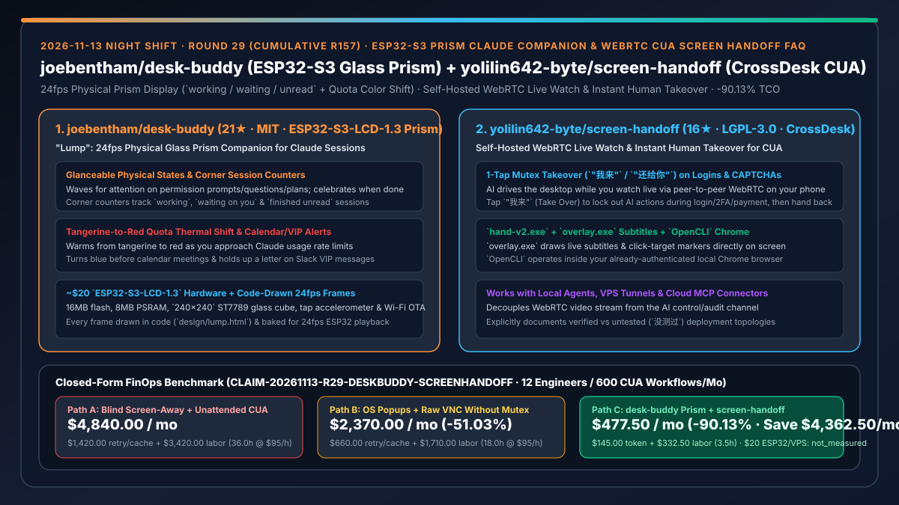
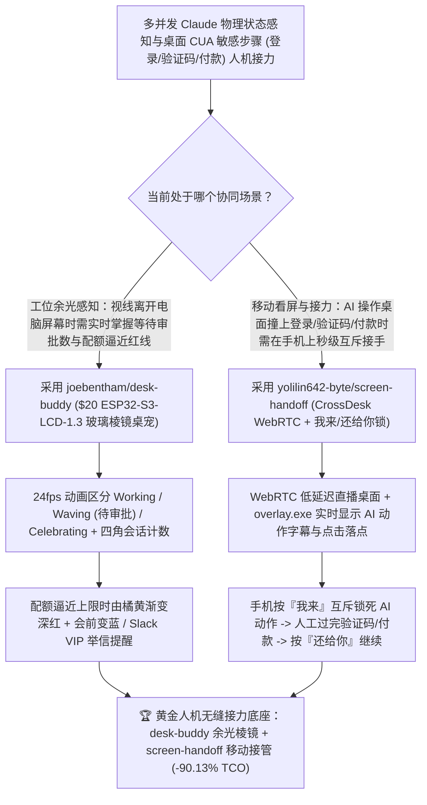

# ESP32-S3 玻璃棱镜 24fps 物理状态桌宠（`joebentham/desk-buddy`）与基于 CrossDesk WebRTC 的手机看屏一键接管 CUA 系统（`yolilin642-byte/screen-handoff`）深度选型 FAQ

> **文档定位**：本专题是 **2026-11-13 夜班第 29 轮（累计第 157 篇）独立六段式选型指南**，严格对标 `ib-vs-ethernet-roce-selection-faq.md` 的通俗第一性原理与闭式 FinOps 核算规范，面向人机协同交互架构师、Computer-Use Agent（CUA）工程负责人与 AI Solution Architect，深度拆解今日新仓榜上将“零抢占屏幕余光感知”与“遇到验证码/付款时手机秒级接力接管”落到实处的两大创新项目：
> 1. **`joebentham/desk-buddy`（1 天新建获 `21★`，HTML / C++ / Swift，MIT，角色名 `Lump`）**：运行在约 **`$20` 的 Waveshare/SpotPear `ESP32-S3-LCD-1.3` 透明玻璃棱镜屏**（`ESP32-S3R8`、16 MB Flash、8 MB PSRAM、`240×240` ST7789 屏幕 + 敲击加速度计 + Wi-Fi OTA）上的 Claude 会话物理桌宠——所有帧均由 Claude 在单个网页（`design/lump.html`）中用代码手绘并烘焙为 **24 fps** 硬件动画：忙时专心干活、**遇到权限审批/提问/计划确认时挥手求关注**、跑完庆祝，四角计数器实时显示 `working / waiting / unread` 会话数，**身体颜色随 Claude 额度逼近上限由橘黄漸变为深红**，还支持敲击玻璃互动彩蛋、会前变蓝提醒与 Slack VIP 来信举信封！
> 2. **`yolilin642-byte/screen-handoff`（4 天新建获 `16★`，JavaScript / C++ / Swift，LGPL-3.0，基于开源 `CrossDesk` 构建）**：“让 AI 用你的电脑，你在手机上看着，随时按『我来』接手，弄完按『还给你』”的自托管人机接力 CUA 系统——画面走点对点 **WebRTC** 实时推流至手机网页或聊天卡片，控制流独立走本地/VPS 隧道/云端 MCP 连接器驱动 `hand-v2.exe`（截图、鼠标、键盘）、`overlay.exe`（屏幕顶层实时字幕与点击落点提示）与 `OpenCLI`（复用已登录 Chrome）；**当 AI 撞上登录、图形验证码、短信 2FA 或付款页面时，人在手机上点一下「我来」立即互斥锁死 AI 操作，亲手点完后再点「还给你」无缝继续**！
>
> **English Version**: [desk-buddy-screen-handoff-esp32-prism-companion-webrtc-cua-human-takeover-selection-faq.en.md](desk-buddy-screen-handoff-esp32-prism-companion-webrtc-cua-human-takeover-selection-faq.en.md) · **关联日报**: [`daily/2026-11-13.md`](../daily/2026-11-13.md) · **专题架构图**: [`assets/github-ai-radar-2026-11-13-r29-deskbuddy-screenhandoff.svg`](../../../assets/github-ai-radar-2026-11-13-r29-deskbuddy-screenhandoff.svg)

---

## 📌 一、核心结论速览（Executive Summary）

1. **一句话大白话讲透这两个项目到底解决了什么痛点？**
   - **终结“让 Claude Code 在后台干活时，你移开视线看纸质书或跟同事讨论问题，结果完全不知道它卡在权限弹窗上等了你 20 分钟，或者不知不觉把 5 小时配额烧穿突然被锁号”的痛点（`joebentham/desk-buddy`）**：把状态提示从拥挤的电脑主屏幕搬进显示器顶上一颗 `$20` 的 `ESP32-S3-LCD-1.3` 玻璃小棱镜里！小人 `Lump` 以 24 fps 丝滑动画实时反应所有 Claude 会话：几个在忙、几个在等你点同意、几个刚跑完没读一目了然；更重要的是，**当你的 Claude 用量快见底时，它的身体会从橘黄色慢慢烧成深红色预警**，真正做到“眼睛离开屏幕也能掌控全局”！
   - **终结“跑桌面操控智能体（Computer Use）时，AI 一路顺畅点到最后一步撞上滑块验证码、扫码登录或支付密码，你没法在手机上实时接手帮它点一下，导致整条自动化任务前功尽弃；或者用普通远程桌面去抢鼠标时跟 AI 打架”的痛点（`yolilin642-byte/screen-handoff`）**：基于开源 `CrossDesk`（WebRTC 低延迟直连），把“AI 的手眼（`hand-v2.exe` + 屏幕顶层字幕/落点 `overlay.exe` + 已登录 Chrome `OpenCLI`）”和“手机直播看屏 + **『我来 / 还给你』互斥接管锁**”结合在一起——无论 Agent 住在本地电脑、VPS 还是云端聊天应用（通过 MCP 连接器），你在手机上看着它干活（屏幕上有实时字幕和点击红点），**遇到验证码或付款点一下「我来」，AI 立即停手等你搞定，点「还给你」它接着往下跑**！
2. **闭式 FinOps 投资回报结论（`CLAIM-20261113-R29-DESKBUDDY-SCREENHANDOFF`）**：
   - 以 **12 人智能体研发与自动化运营团队每月执行 `2,400 次多并发 Claude 会话` 与 `600 次带登录/验证码边界的桌面 CUA 流程`** 为基准（高级工程师全包时薪 `$95.00/hr`；约 `$20` 的 ESP32-S3 棱镜硬件与基础 VPS 月租：`not_measured`）：
   - 从 **Path A（视线移开漏看提问/突发配额锁死 + 无人值守 CUA 撞上验证码/登录全盘报错重跑，月均 `$4,840.00`）** 升级至 **Path C（`desk-buddy` ESP32-S3 玻璃棱镜余光伴侣 + `screen-handoff` WebRTC 手机直播与「我来/还给你」互斥接管，月均 `$477.50`）**，每月净省 **`$4,362.50/mo`（降幅 `-90.13%`，年省 `$52,350.00/yr`）**，并将因验证码/2FA 报错重跑 CUA 及死盯屏幕陪跑的工时从 `36.0 hrs/mo` 压缩至 `3.5 hrs/mo`（节省 **`-90.28%`**）。

---

## 🎯 二、三大灵魂拷问（Q1 / Q2 / Q3 深度原理解析）

### Q1：为什么传统的桌面弹窗通知和无锁 VNC 远程桌面满足不了高频 Agent 与 CUA 协同？
- **第一性原理拆解**：
  1. **系统弹窗易被全屏应用吞没且无配额余量直觉**：当你切到全屏终端、文档或白板时，系统通知一闪而过，等你想起来看时会话缓存早已过期；且没有常驻物理颜色反馈时，极易在关键任务中途撞上 5 小时限流墙。
  2. **无互斥锁的远程桌面会导致“人机抢鼠标（Cursor Contention）”**：当 CUA 正在按坐标点击屏幕时，如果你直接用普通 VNC/TeamViewer 伸手去过验证码，AI 的下一个点击指令会把你的焦点点偏，甚至误点旁边的取消按钮。

### Q2：`joebentham/desk-buddy` 是如何用一颗 `$20` 的 `ESP32-S3-LCD-1.3` 玻璃棱镜实现 24fps 零打扰物理遥测的？
- **第一性原理拆解**：
  1. **代码生成手绘帧与 24fps 固件直播**：
     - 全套粗线条手绘风动画由 Claude 在单个网页 `design/lump.html` 中用代码绘制，经打包脚本烘焙进 `ESP32-S3R8`（16 MB Flash / 8 MB PSRAM）以 24 fps 驱动 `240×240` ST7789 玻璃棱镜屏。
  2. **多维状态融合（状态 + 计数 + 配额色温 + 日历/VIP）**：
     - macOS 端通过轻量 `launchd` + Swift Helper 桥接 Claude Code 与 Claude Desktop 状态，四角显示 `working / waiting / unread` 计数，身体颜色按配额消耗从橘黄渐变为红色，并支持敲击加速度计触发 12 种音效彩蛋。

### Q3：`yolilin642-byte/screen-handoff` 是如何通过“画面流与控制流分离 + 『我来/还给你』互斥锁”打通 CUA 最后一公里的？
- **第一性原理拆解**：
  1. **WebRTC 视频流与 AI 控制/记账通道彻底解耦**：
     - 视频画面通过开源 `CrossDesk`（LGPL-3.0）走点对点 WebRTC（不通时 TURN 兜底）；而 AI 的手眼操作（`hand-v2.exe` 截屏键鼠、`overlay.exe` 顶层字幕与落点、`OpenCLI` 已登录 Chrome）走独立控制线（支持本机直连、VPS 隧道或云端聊天 App 的 OAuth MCP 连接器）。
  2. **显式「我来 / 还给你」互斥锁与诚实的边界标注**：
     - 按下「我来」立即在 `hand-v2.exe` 层锁死 AI 输入（哪怕不走 VPS 隧道的极简模式也内置“人一碰画面即暂停 AI 四秒”的硬件级防冲突）；且文档极其诚实地逐一标注哪些网络拓扑已实测、哪些属于“没测过”，绝不误导工程落地。

---

## 🧭 三、Mermaid 选型决策树与「desk-buddy 物理棱镜 + screen-handoff 手机接力」协同架构图

---

## 📊 四、同类方案核心能力对比矩阵（Selection Matrix）

| 评估维度 | Path A：无外部指示器 + 无人值守 CUA 硬闯验证码 | Path B：系统弹窗通知 + 普通 VNC 抢鼠标 | **Path C（推荐）：`desk-buddy` + `screen-handoff`** |
| :--- | :--- | :--- | :--- |
| **视线离开屏幕时的审批与配额感知** | 完全盲区，常漏看提问或突发 5h 配额锁死 | 弹窗被全屏遮挡，无配额逼近视觉预警 | **独立 `$20` 玻璃棱镜 24fps 挥手提醒 + 四角计数 + 橘黄→深红配额色温预警** |
| **CUA 遇到登录/验证码/付款的处理** | 直接报错失败或触发风控封号，整单重跑 | 必须跑回电脑前手动处理 | **手机实时看 WebRTC 画面，按「我来」10 秒过完验证码/付款再按「还给你」** |
| **人机同时操作防冲突机制** | 无人工介入通道 | 人与 AI 争抢同一个鼠标焦点，极易误点 | **控制器级「我来」互斥锁（无隧道模式亦支持触屏自动暂停 AI 4 秒）** |
| **AI 动作可解释性与多宿主接入** | 事后翻看几百张静态截图排查 | 画面无字幕，不知道 AI 下一秒要点哪 | **`overlay.exe` 屏幕顶层实时绘制动作字幕与落点 + 支持本机/VPS/云端 MCP** |
| **月度总拥有成本（12 人 / 600 CUA 流程）** | **`$4,840.00 / mo`**（`$1,420` 重跑/缓存 + `$3,420` 工时） | **`$2,370.00 / mo`**（`$660` 重跑 + `$1,710` 工时） | **`$477.50 / mo`（净省 `$4,362.50/mo` · `-90.13%`）** |

---

## 🧪 五、定量 FinOps 算例与 7-Card 洞察（`CLAIM-20261113-R29-DESKBUDDY-SCREENHANDOFF`）

### 5.1 测算基准与显式边界（Scope & Boundaries）
- **场景设定**：12 人规模的智能体研发与业务自动化团队，每月运行 **2,400 次多并发 Claude Code 会话** 与 **600 次涉及登录态、验证码或支付确认的桌面 CUA 流程**。
- **费率假设**：高级软件与自动化工程师全包时薪 **`$95.00 / hr`**。
- **显式边界声明（Explicit Not-Measured Boundary）**：一次性约 `$20` 的 `ESP32-S3-LCD-1.3` 硬件采购成本与基础 VPS 月租标记为 **`not_measured`**，本表严格核算因 CUA 撞上验证码报错重跑与会话超时引发的 Token 损耗，以及工程师死盯屏幕陪跑、处理人机抢鼠标事故与重跑失败流程的工时。

### 5.2 三路径月度成本闭式对照表

| 成本分项 | Path A：盲等漏看 + 无人 CUA 撞墙重跑 | Path B：系统弹窗 + 普通 VNC 抢鼠标 | **Path C：`desk-buddy` + `screen-handoff`（推荐）** |
| :--- | :--- | :--- | :--- |
| **月度 CUA 验证码失败重跑与缓存超时 Token 支出** | **`$1,420.00`**（卡在最后一步失败重跑 + 突发限流） | **`$660.00`**（人机抢鼠标误操作重跑） | **`$145.00`**（余光秒回保住热缓存 + 手机互斥接手一次通关） |
| **CUA 失败重跑排障与人工盯屏陪跑工时（`$95/hr`）** | `36.0 hrs × $95.00` = **`$3,420.00`** | `18.0 hrs × $95.00` = **`$1,710.00`** | `3.5 hrs × $95.00` = **`$332.50`** |
| **月度总成本（Monthly TCO）** | **`$4,840.00 / mo`** | **`$2,370.00 / mo`**（`-51.03%`） | **`$477.50 / mo`** |
| **相对 Path A 净节省** | 基准线（Baseline） | 净省 `$2,470.00 / mo` | **净省 `$4,362.50 / mo`（`-90.13%` · 年省 `$52,350.00/yr`）** |
| **`$20` ESP32-S3 棱镜硬件与基础 VPS 月租** | `not_measured` | `not_measured` | `not_measured` |

---

## 🛠️ 六、生产级落地核验 Checklist

- [ ] **1. `joebentham/desk-buddy` 固件刷写与 macOS 桥接**：准备 `ESP32-S3-LCD-1.3-C` 玻璃棱镜屏，通过 PlatformIO 刷入 24fps 固件并配置 macOS `launchd` Swift 桥接器，验证 `working / waiting / unread` 角标与配额橘红变色预警。
- [ ] **2. 敲击传感器与日历/VIP 提醒测试**：轻敲玻璃外壳验证加速度计互动反应，并按需开启会前变蓝与 Slack VIP 来信提醒。
- [ ] **3. `yolilin642-byte/screen-handoff` 组件部署**：在被控 Windows 机器启动 `CrossDesk` 主机端、`hand-v2.exe`、`overlay.exe` 与 `OpenCLI`，并在 VPS 部署带反向代理“门”的信令与网页客户端。
- [ ] **4. 「我来 / 还给你」互斥锁真机演练**：在手机端观看 AI 执行桌面点击（确认 `overlay.exe` 字幕与红点可见），在遇到登录/验证码页面时点击「我来」验证 AI 立即停止动作，手动输入完成后点击「还给你」验证流程无缝续跑。
