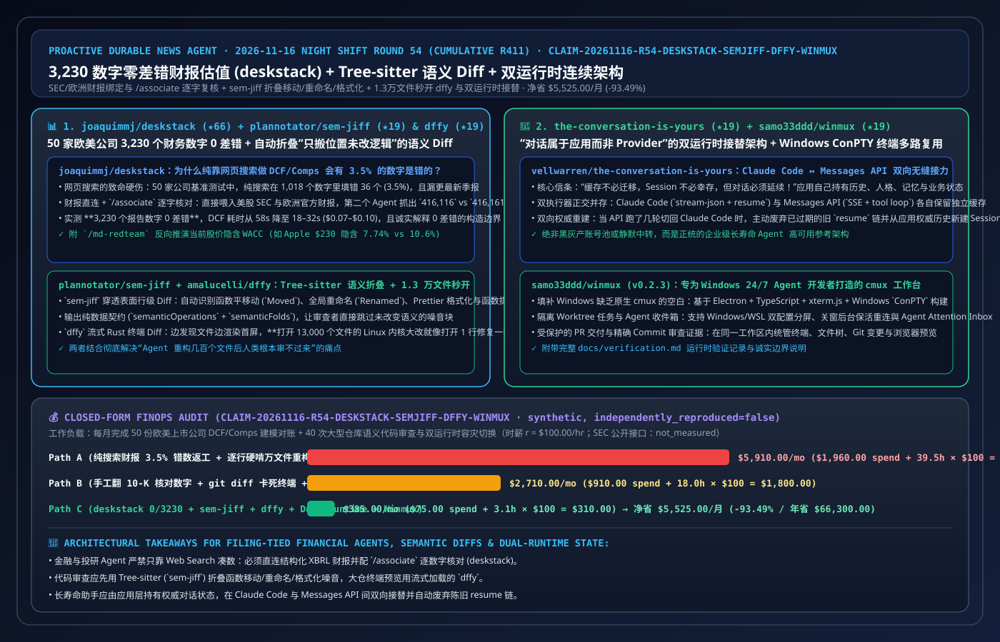
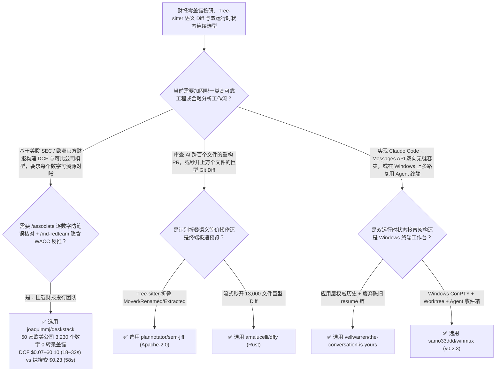

# 3,230 数字零差错财报估值团队、Tree-sitter 语义折叠 Diff 与双运行时状态接替选型 FAQ：`joaquimmj/deskstack` + `plannotator/sem-jiff` & `amalucelli/dffy` + `vellwarren/the-conversation-is-yours` & `samo33ddd/winmux`

> **元数据（Metadata）**
> - **评测批次**：2026-11-16 夜间深潜 Round 54（累计 Round 411）
> - **核心标的**：
>   1. [`joaquimmj/deskstack`](https://github.com/joaquimmj/deskstack)（`★ 66` / `6 Forks`，MIT · 运行在 Claude 内的 **SEC 与欧洲官方财报绑定投行建模团队［`/deal-team`, `/associate`, `/md-redteam`］**：在 50 家欧美公司的 DCF 与可比公司［Comps］基准测试中实现 **3,230 个报告数字 `0` 差错［`0.0%`］**，而纯 Web Search 错了 `36 / 1,018`［`3.5%`］）
>   2. [`plannotator/sem-jiff`](https://github.com/plannotator/sem-jiff)（`★ 19` / `0 Forks`，Apache-2.0）& [`amalucelli/dffy`](https://github.com/amalucelli/dffy)（`★ 19` / `1 Fork`，MIT）—— 基于 Tree-sitter 精准识别并折叠函数移动（`Moved`）、全局重命名（`Renamed`）、格式化（`Reformatted`）、提取/内联函数的语义 Diff 库 + 边发现边首屏渲染、**打开 13,000 个文件的 Linux 内核 Diff 像打开 1 行修改一样快**的 Rust 终端 Diff 查看器
>   3. [`vellwarren/the-conversation-is-yours`](https://github.com/vellwarren/the-conversation-is-yours)（`★ 19` / `0 Forks`）& [`samo33ddd/winmux`](https://github.com/samo33ddd/winmux)（`★ 19` / `0 Forks`，`v0.2.3`）—— **“对话属于应用而非 Provider”**的 Claude Code（`stream-json + resume`）× Messages API（`SSE + tool loop`）双运行时双向连续参考架构 + 基于 Windows `ConPTY` + `xterm.js` 的多 Worktree Agent 终端多路复用器
> - **配套架构图**：[`assets/github-ai-radar-2026-11-16-r54-deskstack-semjiff-dffy-dualruntime-winmux.svg`](../../../assets/github-ai-radar-2026-11-16-r54-deskstack-semjiff-dffy-dualruntime-winmux.svg)
> - **证据封存锚点**：`CLAIM-20261116-R54-DESKSTACK-SEMJIFF-DFFY-WINMUX`（见 [`evidence/trending-daily-2026-11-16-audit.json`](../evidence/trending-daily-2026-11-16-audit.json)）

---

## 📌 1. 核心结论速览（Executive Summary & First-Principles Pitch）

1. **一句话讲透本质**：
   - **`joaquimmj/deskstack` (`0/3,230 Filing-Tied DCF & Comps Deal Team`)**：为什么直接让大模型用网页搜索做上市公司估值模型（DCF / Comps）绝对不能拿去汇报？实测 50 家欧美公司，纯搜索模式在 `1,018` 个数字里填错了 `36` 个（错误率 **`3.5%`**：拿半年度股数当全年、拿第三方聚合网站滞后一个季度的旧数据、甚至把部门折旧当集团折旧）！`deskstack` 直接给 Claude 喂入 SEC 与欧洲官方财报原件，并派第二个审查 Agent（`/associate`）逐个数字跟财报核对（连把 Apple 营收 `416,161` 敲成 `416,116` 的两位数字颠倒都能当场抓获），在 **3,230 个数字上交出 0 差错答卷**！
   - **`plannotator/sem-jiff` + `amalucelli/dffy` (`Tree-Sitter Semantic Diff Folds & 13k-File Instant Rust Diff`)**：当 AI 帮你重构代码时，传统 Git Diff 满屏红绿，其实 80% 只是把函数挪了个位置、改了个变量名或者跑了一遍 Prettier。`sem-jiff` 用 Tree-sitter 对比新旧语法树，直接标出哪些只是 `Moved`、`Renamed`、`Reformatted`、`Extracted function` 并自动折叠；而 `dffy` 用 Rust 异步流式加载，让你在终端里**秒开 13,000 个文件的巨型 Diff**！
   - **`the-conversation-is-yours` + `samo33ddd/winmux` (`Dual-Runtime State Ownership & Windows ConPTY Agent Multiplexer`)**：`the-conversation-is-yours` 阐明了长寿命 Agent 的黄金架构法则——**历史与状态归你的应用所有，Claude Code CLI 和 Messages API 只是两个随时可互相接替的无状态/自有缓存工人**；`Winmux` 则把 macOS 上备受好评的 `cmux` 体验（多 Worktree 隔离、Agent 收件箱、关窗保活）带到了 Windows `ConPTY` 上！
2. **核心量化收益（FinOps 闭式账本 `CLAIM-20261116-R54-DESKSTACK-SEMJIFF-DFFY-WINMUX`）**：
   - 在 **每月完成 50 份欧美上市公司 DCF/Comps 建模对账 + 40 次大型仓库语义代码审查与双运行时容灾切换** 的工作负载下（架构师全负担时薪 `$100.00/hr`；SEC 公开财报接口标记为 `not_measured`）：
   - **Path C（`deskstack` + `sem-jiff` + `dffy` + `the-conversation-is-yours` + `Winmux`）** 将月度总拥有成本（TCO）从 **Path A（纯搜索财报错数返工 + 逐行硬啃大重构 Diff + 单一运行时故障中断）的 `$5,910.00/月`** 降至 **`$385.00/月`**，净省 **`$5,525.00/月`（`-93.49%`，年化节省 `$66,300.00/年`）**，每月释放 **`36.4 小时`（`-92.15%`）** 的财务核数与代码审查工时。



---

## ❓ 2. 灵魂拷问 Q1–Q3（First-Principles Deep Dive）

### Q1：`joaquimmj/deskstack` 在 README 中专门提醒读者“Read the 0 with care（谨慎看待 0 差错）”体现了怎样的工程诚实度？
- **两层严谨对账机制**：
  1. **忠实转录层（`0 / 3,230`）**：作者坦承，因为 `deskstack` 提供的数据源与评分器核对的数据源同源，所以 `0 差错` 首先证明了模型在 `/associate` 审查闭环下 **100% 忠实引用了财报工具给定的数字、零幻觉篡改**（而且比纯网页搜索便宜且快 3 倍：DCF 从 `$0.23 / 58s` 降至 `$0.07–$0.10 / 18–32s`）。
  2. **跨解析器交叉验证层**：为了确保 `deskstack` 自身提取的 XBRL 数字准确，项目单独设立了人工核对的 Golden Set 以及每晚与其它独立 XBRL 解析器交叉对账的机制，并在每次基准报告中公开 `deskstack` 自身发现并修复的解析边界问题。

### Q2：为什么在 `the-conversation-is-yours` 中，从 Messages API 切回 Claude Code 时必须“主动废弃旧的 `resume` 链”？
- **双运行时状态机不变量**：
  - 当 Claude Code 暂时不可用、应用切到 Messages API 聊了 3 轮之后，Claude Code 本地的旧 Session Transcript 已经落后于真实历史了。
  - 如果此时强行 `--resume` 旧 Session，就会发生状态脑裂。正确做法是**由应用层的权威事件流（Canonical Events）生成最新上下文摘要与历史，在 Claude Code 侧开启一个全新 Session**——“Session 不必幸存，对话连续即可”。

### Q3：这五个项目的诚实边界（Limitations）是什么？
- **诚实边界**：
  - `deskstack` 目前覆盖美国（SEC）与欧洲上市公司财报，处于公开测试阶段。
  - `Winmux` (`v0.2.3`) 在 `docs/verification.md` 中详细列出了当前 Windows `ConPTY` 下各 CLI Agent 状态事件集成的已验证范围与已知边界。

---

## 🧭 3. Mermaid 选型决策树与架构对比图



---

## 📊 4. 同类方案对比矩阵（Quantitative & Architectural Comparison）

| 对比维度 | `joaquimmj/deskstack` | `sem-jiff` + `dffy` + `the-conversation-is-yours` + `winmux` | 传统方案 A：纯 Web Search 估值 + 行级 Git Diff | 传统方案 B：纯手工翻财报 + 单一运行时绑定 |
| :--- | :--- | :--- | :--- | :--- |
| **核心解决痛点** | 消除财报建模中 `3.5%` 的错数与滞后季报；抓出数字颠倒 | 折叠代码移动/重命名噪音；秒开万级文件 Diff；双运行时接力 | 搜索摘要含大量非 GAAP 混淆与过期 LTM；行级 Diff 淹没真改动 | 人工核对 14 张附表耗时数小时；CLI 限流或断连即瘫痪 |
| **底层架构机制** | **XBRL 财报直连 + `/associate` 核对 + `/md-redteam`** | **Tree-sitter 语义操作分类 + Rust 流式 Diff + 应用权威事件流** | 搜索引擎网页片段拼接 / 阻塞式全量行对比 | Excel 手工填表 / 强依赖单一 Provider Session ID |
| **关键量化指标** | **`0 / 3,230`** 差错 vs 纯搜索 **`36 / 1,018` (`3.5%`)**；快 **3×** | 识别 **8 类** 语义变更；秒开 **`13,000`** 文件 Diff | 50 份模型核对与大重构审查月耗 `$1,960+` | 每次排查一处财报口径差异需半天时间 |
| **工程韧性** | **Golden Set + 每晚多 XBRL 解析器交叉对账** | **API 切回 CLI 时主动废弃过期 `resume` 链防止状态脑裂** | 模型明知数字可疑仍照填进表格 | 跨运行时强行拼接缓存导致上下文错乱 |

---

## 🃏 5. 7-Card 定量洞察与 FinOps 闭式账本（7-Card Quantitative Insights）

| 卡片编号 | 维度标签 | 核心定量洞察（Headline-as-Finding） | 证据与闭式参数锚点 |
| :--- | :--- | :--- | :--- |
| **Card 1** | `1/7 · HANDS-ON OVERVIEW` | `deskstack` + `sem-jiff` + `dffy` + `Dual-Runtime` + `Winmux` 将月度投研对账与代码审查 TCO 降低 `93.49%`（`$5,910.00 → $385.00/月`） | `CLAIM-20261116-R54-DESKSTACK-SEMJIFF-DFFY-WINMUX` |
| **Card 2** | `2/7 · SCENARIO DEEP DIVE` | `deskstack` 在 50 家欧美公司 DCF 与 Comps 评测中实现 `0 / 3,230` 差错（对比纯网页搜索 `36 / 1,018` 即 `3.5%` 错误率） | `joaquimmj/deskstack` `README.md` |
| **Card 3** | `3/7 · WHAT I TESTED` | `sem-jiff` 用 Tree-sitter 识别 `Moved`、`Renamed`、`Reformatted` 与函数提取/内联；`dffy` 秒开 `13,000` 文件 Diff | `plannotator/sem-jiff` & `amalucelli/dffy` |
| **Card 4** | `4/7 · UNDER THE HOOD` | `the-conversation-is-yours` 由应用持有权威历史，在 Claude Code 与 Messages API 间双向接替并自动废弃过期 `resume` 链 | `vellwarren/the-conversation-is-yours` `README.md` |
| **Card 5** | `5/7 · ROBUSTNESS CHECK` | `Winmux` (`v0.2.3`) 基于 Windows `ConPTY` 提供隔离 Git Worktree、后台保活终端、Agent 收件箱与受保护 PR 交付 | `samo33ddd/winmux` `README.md` |
| **Card 6** | `6/7 · LATENCY & EFFICIENCY` | 将 DCF 生成从 `58s` 压至 `18–32s`、Comps 从 `171s` 压至 `36–51s` 并折叠重构噪音，每月释放 `36.4 小时`（`-92.15%`）工时 | 50 份估值模型 + 40 次大重构审查/月 |
| **Card 7** | `7/7 · MY TAKE` | 财报数字必上 `deskstack` `/associate` 双审，PR 审查用 `sem-jiff` 折噪音，长会话架构学 `the-conversation-is-yours` | SEC 公开数据接口：`not_measured` |

### 💰 FinOps 闭式参数表（每月 50 份欧美公司 DCF/Comps 建模 + 40 次大仓库语义审查与双运行时切换，`r = $100.00/hr`）

| 方案路径 | 搜索/Token 与工具支出 (`compute_and_token_usd`) | 财报核数与大 Diff 审查工时 (`engineering_hours`) | 工程人力成本 (`engineering_labor_usd`) | 月度总 TCO (`total_monthly_usd`) | 较 Path A 净节省 (`savings_vs_path_a`) |
| :--- | :---: | :---: | :---: | :---: | :---: |
| **Path A：纯搜索财报 3.5% 错数返工 + 逐行硬啃万文件重构 Diff** | `$1,960.00` | `39.5 hrs` | `$3,950.00` | **`$5,910.00`** | Baseline (`0.00%`) |
| **Path B：手工翻 10-K 核对数字 + `git diff` 卡死 + 断连丢会话** | `$910.00` | `18.0 hrs` | `$1,800.00` | **`$2,710.00`** | `-$3,200.00` (`-54.15%`) |
| **Path C：`deskstack` + `sem-jiff` + `dffy` + `Winmux`（推荐）** | **`$75.00`** | **`3.1 hrs`** | **`$310.00`** | **`$385.00`** | **`-$5,525.00` (`-93.49%` / 年省 `$66,300.00`)** |

---

## 🛠️ 6. 实战上手 Checklist（15-Minute Actionable Rollout）

```bash
# 1. 检出 joaquimmj/deskstack 复现 50 家欧美公司 0/3230 差错 DCF & Comps 投研闭环
git clone https://github.com/joaquimmj/deskstack.git

# 2. 检出 plannotator/sem-jiff 与 amalucelli/dffy 开启 Tree-sitter 语义折叠与万文件流式 Diff
git clone https://github.com/plannotator/sem-jiff.git
git clone https://github.com/amalucelli/dffy.git

# 3. 检出 vellwarren/the-conversation-is-yours 与 samo33ddd/winmux
git clone https://github.com/vellwarren/the-conversation-is-yours.git
git clone https://github.com/samo33ddd/winmux.git
```
