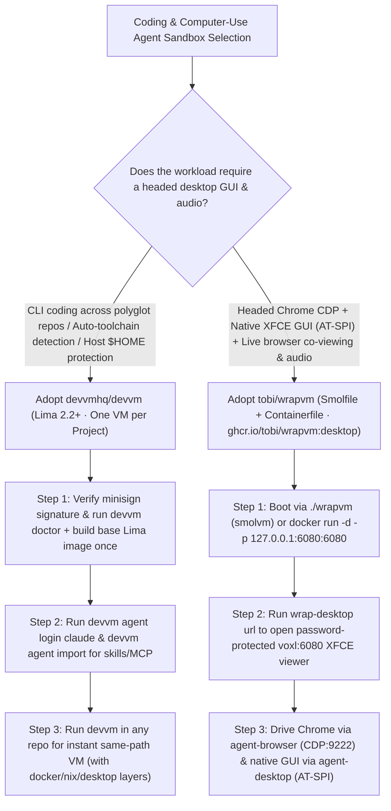

# Per-Project Auto-Toolchain VM Sandbox (`devvmhq/devvm`) & Headed XFCE + CDP/AT-SPI Desktop VM (`tobi/wrapvm`) Selection FAQ

> **Positioning**: This standalone guide is **Round 43 of the 2026-11-11 Night Shift (Cumulative Guide #88)**, written in the plain-language, first-principles, closed-form FinOps style of `ib-vs-ethernet-roce-selection-faq.md` for DevSecOps Architects and Computer-Use / Browser-Use Agent Infrastructure Leads evaluating two high-velocity sandbox repositories:
> 1. **`devvmhq/devvm` (`556★`, Go / Lima 2.2+ / QEMU / KVM, `minisign`-verified)**: Implements **"One VM for Every Project"**—detecting project toolchains automatically from repo files (e.g., `package.json`), booting per-project VMs in seconds from a cached base image, mounting only the project folder at the exact same host path, and isolating settings/logins for **Claude Code, Codex, OpenCode, and `pi`** (`devvm agent login` / `devvm agent import`) across composable layers (`docker`, `nix`, `desktop`, or `devvm layer new`);
> 2. **`tobi/wrapvm` (`357★`, Containerfile + Smolfile / `ghcr.io/tobi/wrapvm:desktop`, by `@tobi`)**: A self-contained desktop VM and container for agents combining **Xvfb `:1` + XFCE** streamed to a browser via **`voxl` on port `6080`** (`wrap-desktop url`), a persistent sandboxed **Google Chrome with CDP on `9222/9223`**, pre-attached **`vercel-labs/agent-browser`** (`{"headed": true, "autoConnect": true}`), **`vercel-labs/agent-desktop` over AT-SPI**, pre-installed `~/.agents/skills` (`desktop` and `browser`), and **PulseAudio + `ffmpeg` audio streaming/recording**.
>
> **中文版 FAQ**: [devvm-wrapvm-per-project-vm-xfce-agent-desktop-selection-faq.md](devvm-wrapvm-per-project-vm-xfce-agent-desktop-selection-faq.md) · **Architecture Summary SVG**: [`assets/github-ai-radar-2026-11-11-r43-devvm-wrapvm.svg`](../../../assets/github-ai-radar-2026-11-11-r43-devvm-wrapvm.svg)

---

## 📌 1. Executive Summary

1. **In plain English, what problems do these two repositories actually solve?**
   - **Ending Host `$HOME` Exposure & Slow VM Provisioning (`devvmhq/devvm`)**: Running autonomous coding agents directly on your laptop exposes `~/.ssh`, `~/.aws`, and neighboring repos to prompt-injected build scripts, while creating traditional VMs per repo is too slow for daily work. `devvm` builds a shared Lima base image once and boots an isolated VM for any project directory in **seconds**—auto-detecting required toolchains, mounting only that directory at the identical host path, and keeping agent logins, skills, and MCP servers in a dedicated store (`devvm agent login claude`, `devvm agent import`).
   - **Ending Headless Browser Blocks & Blind Desktop GUI Automation (`tobi/wrapvm`)**: Agents running in headless containers get blocked by anti-bot checks, cannot interact with native OS file pickers or desktop apps, and cannot hear or record audio output. `tobi/wrapvm` packages **Xvfb `:1` + XFCE + `voxl:6080` web viewer + persistent headed Google Chrome (CDP `:9222`) + `agent-browser` + AT-SPI `agent-desktop` + PulseAudio null sink** into a single `Containerfile` and `Smolfile`, so every directory gets a live, viewable, audio-capable desktop VM in one command (`./wrapvm`).
2. **Closed-Form FinOps Verdict (`CLAIM-20261111-R43-DEVVM-WRAPVM`)**:
   - For a 15-person Polyglot Platform & Full-Stack Agent Engineering Team running **45 concurrent multi-repo coding and headed browser/desktop agent sandboxes per month** (senior platform/DevSecOps engineer loaded rate `$90.00/hr`; physical host workstation hardware and enterprise SSO licenses: `not_measured`):
   - Upgrading from **Path A (Bare host execution cleanup + rented cloud VDI desktops for headed GUI testing, `$5,730.00/mo`)** to **Path C (`devvm` per-project Lima VMs + `tobi/wrapvm` XFCE/CDP/AT-SPI desktop VMs, `$700.00/mo`)** saves **`$5,030.00/mo` (`-87.78%`, `$60,360.00/yr`)** and cuts environment provisioning and GUI bridge maintenance labor from `45.0 hrs/mo` to `5.0 hrs/mo` (**`-88.89%`**).

---

## 🎯 2. Three Core Architectural Questions (Q1 / Q2 / Q3 Deep-Dive)

### Q1: How does `devvmhq/devvm` achieve sub-second per-project VM startup while isolating agent credentials?
- **First-Principles Breakdown**:
  1. **One-Time Base Image Build & Manifest Toolchain Detection**:
     - Builds the base Lima VM image once during initial onboarding; subsequent `devvm` invocations inspect project files (`package.json`, etc.) to attach the right toolchains and composable layers (`docker`, `nix`, `desktop`, or custom `devvm layer new`) in seconds.
  2. **Same-Path Mount & Dedicated Agent Credential Store**:
     - Mounts only the current project folder at the exact same filesystem path inside the VM (preventing path-mapping bugs in compiler/test output) and stores logins, skills, and MCP servers for Claude Code, Codex, OpenCode, and `pi` via `devvm agent login` and `devvm agent import`.

### Q2: How does `tobi/wrapvm` integrate `voxl`, `agent-browser` (CDP `:9222`), `agent-desktop` (AT-SPI), and PulseAudio into a single `Smolfile` / `Containerfile`?
- **First-Principles Breakdown**:
  1. **Dual Runtime (`smolvm` MicroVM or Container) & `voxl:6080` Web Viewer**:
     - Boots via `./wrapvm` (`Smolfile` prompt `[vm:<machine>]`) or `docker run -p 127.0.0.1:6080:6080 ghcr.io/tobi/wrapvm:desktop` (`[container:<host>]`), streaming the Xvfb `:1` XFCE desktop and PulseAudio output to a password-protected browser session (`wrap-desktop url`).
  2. **Pre-Attached Headed Chrome (`CDP 9222/9223`) & AT-SPI Desktop Control**:
     - Sets `AGENT_BROWSER_CONFIG=/home/user/workspace/agent-browser.json` (`{"headed": true, "autoConnect": true}`) so `vercel-labs/agent-browser` attaches directly to the visible sandboxed Chrome instance, while `vercel-labs/agent-desktop` drives native desktop apps via AT-SPI, backed by pre-installed `~/.agents/skills` (`desktop` and `browser`).

### Q3: When should Solution Architects use `devvm` vs. `wrapvm`?
- **Selection Rule**:
  - Use **`devvmhq/devvm`** as the default **per-repo CLI coding sandbox** on macOS and Linux for polyglot backend/frontend development.
  - Use **`tobi/wrapvm`** whenever the agent needs a **headed browser (`agent-browser`), native Linux desktop GUI automation (`agent-desktop` AT-SPI), live human screen co-viewing (`voxl:6080`), or `ffmpeg` desktop audio/video capture**.

---

## 🧭 3. Mermaid Decision Tree & Dual-Sandbox Pipeline

---

## 📊 4. Architectural Comparison Matrix

| Evaluation Dimension | Path A: Bare Host Run + Cloud VDI Desktops | Path B: Raw DevContainers + Headless Browser | **Path C (Recommended): `devvm` + `tobi/wrapvm`** |
| :--- | :--- | :--- | :--- |
| **Kernel Isolation & `$HOME` Safety** | Zero isolation on host; full `$HOME` exposure | Shared host kernel; manual mount configuration | **Per-project Lima / `smolvm` VM mounting only the repo at same path** |
| **Toolchain Provisioning & Boot Speed** | Host version conflicts across repos | Hand-written `devcontainer.json` per repo | **Auto-detected toolchains + cached base image booting in seconds** |
| **Headed Browser & Native GUI Control** | Expensive cloud VDI instances billed hourly | Headless Chrome triggers anti-bot blocks; no OS GUI | **Headed Chrome (`CDP :9222`) + `agent-browser` + AT-SPI `agent-desktop`** |
| **Live Co-Viewing & Audio Recording** | Manual VNC/RDP + virtual audio cable setup | Blind headless runs; no audio sink | **`voxl:6080` live browser viewer + PulseAudio null sink + `ffmpeg`** |
| **Monthly TCO (45 Sandboxes/Mo)** | **`$5,730.00 / mo`** (`$1,680` VDI/tokens + `$4,050` labor) | **`$2,890.00 / mo`** (`$820` compute + `$2,070` labor) | **`$700.00 / mo` (Saves `$5,030.00/mo` · `-87.78%`)** |

---

## 🧪 5. Closed-Form FinOps Example & 7-Card Insights (`CLAIM-20261111-R43-DEVVM-WRAPVM`)

### 5.1 Workload & Scope Boundary
- **Workload**: A 15-person Polyglot Platform & Full-Stack Agent Engineering Team running **45 concurrent multi-repo coding and headed browser/desktop agent sandboxes per month**.
- **Rates**: Senior platform/DevSecOps engineer loaded rate at **`$90.00 / hr`**.
- **Explicit Scope Boundary**: Physical host workstation hardware depreciation and enterprise SSO licenses are marked **`not_measured`**.

### 5.2 Closed-Form Monthly Cost Breakdown

| Cost Component | Path A: Bare Host Run + Cloud VDI Desktops | Path B: Raw DevContainers + Headless Browser | **Path C: `devvm` + `tobi/wrapvm` (Recommended)** |
| :--- | :--- | :--- | :--- |
| **Cloud VDI Rental & Headless Retry Token Spend** | **`$1,680.00`** | **`$820.00`** | **`$250.00`** (Local Lima/`smolvm` reuse + headed Chrome zero-retry) |
| **Toolchain Cleanup, Secret Rotation & GUI Setup (`$90/hr`)** | `45.0 hrs × $90.00` = **`$4,050.00`** | `23.0 hrs × $90.00` = **`$2,070.00`** | `5.0 hrs × $90.00` = **`$450.00`** |
| **Total Monthly TCO** | **`$5,730.00 / mo`** | **`$2,890.00 / mo`** (`-49.56%`) | **`$700.00 / mo`** |
| **Net Savings vs. Path A** | Baseline | Saves `$2,840.00 / mo` | **Saves `$5,030.00 / mo` (`-87.78%` · `$60,360.00/yr`)** |
| **Host Workstation Hardware & Enterprise SSO Fees** | `not_measured` | `not_measured` | `not_measured` |

---

## 🛠️ 6. Production Verification Checklist

- [ ] **1. Verify `devvm` Minisign Signature & Run `devvm doctor`**: Verify the release with public key `RWSjzFsn7ETaijKJ2y7F4DtZobXmyv+LmdclJwZP/KmAkLUwZP/KmAkLUwOCzWF/2b` and run `devvm doctor` to confirm Lima 2.2+ and hardware virtualization readiness.
- [ ] **2. Isolate Agent Credentials (`devvm agent login` & `import`)**: Provision agent logins inside `devvm`'s isolated store and restrict network tiers for untrusted repositories.
- [ ] **3. Bind `tobi/wrapvm` Viewer to Loopback (`127.0.0.1:6080`)**: Launch `./wrapvm` or `docker run -d -p 127.0.0.1:6080:6080 ghcr.io/tobi/wrapvm:desktop` and retrieve the signed-in viewer URL via `wrap-desktop url`.
- [ ] **4. Verify Headed `agent-browser` Auto-Attach (`CDP :9222`)**: Confirm `/home/user/workspace/agent-browser.json` has `{"headed": true, "autoConnect": true}` so browser actions appear live in the XFCE Chrome window.
- [ ] **5. Test AT-SPI `agent-desktop` & PulseAudio Capture**: Execute native GUI actions through `agent-desktop` and verify `ffmpeg` audio/video recording from the PulseAudio null sink.
