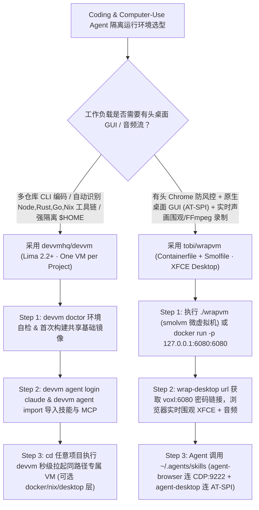

# “一项目一虚拟机”工具链自动探测沙箱（`devvmhq/devvm`）与带 AT-SPI/CDP 有头桌面 Agent 虚拟机（`tobi/wrapvm`）深度选型 FAQ

> **文档定位**：本专题是 **2026-11-11 夜班第 43 轮（累计第 88 篇）独立六段式选型指南**，严格对标 `ib-vs-ethernet-roce-selection-faq.md` 的通俗第一性原理与闭式 FinOps 核算规范，面向研发安全（DevSecOps）架构师与 Computer-Use / Browser-Use Agent 基础设施负责人，深度拆解今日在项目级 VM 硬件隔离与有头桌面（Headed Desktop）Agent 虚拟机赛道爆发的两大新锐开源仓：
> 1. **`devvmhq/devvm`（`556★`，Go / Lima 2.2+ / QEMU / KVM，minisign 签名校验）**：践行 **“One VM for Every Project（每个项目目录独享一台虚拟机）”** 理念——在任意项目目录输入 `devvm`，自动根据项目清单（如 `package.json`、`Cargo.toml`）探测所需工具链，基于只构建一次的共享基础镜像实现**秒级拉起独立 VM**；虚拟机内按与宿主机完全相同的路径只挂载当前项目目录，内置独立的 Agent 凭据与技能存储库（`devvm agent login claude` / `devvm agent import`，支持 Claude Code、Codex、opencode、pi）及可组合层（`docker`、`nix`、`desktop`）；
> 2. **`tobi/wrapvm`（`357★`，Containerfile + Smolfile / `ghcr.io/tobi/wrapvm:desktop`，Shopify CEO Tobi Lütke `@tobi` 出品）**：专为需要**同时操作浏览器与 Linux 桌面 GUI 应用（且还能录制声音）**的 Agent 打造的开箱即用桌面 VM——基于 `tobi/wrap` 构建，集成 **Xvfb `:1` + XFCE 桌面**（通过 **`voxl` 在 `6080` 端口**向浏览器实时流式传输画面与音频）、常驻沙箱化 **Google Chrome（暴露 CDP `9222/9223`）**、预绑定的 **`vercel-labs/agent-browser`**（默认 `{"headed": true, "autoConnect": true}`）与基于 **AT-SPI 无障碍树的 `vercel-labs/agent-desktop`**，并内置 `~/.agents/skills`（`desktop` 与 `browser` 技能）与 **PulseAudio + `ffmpeg` 音频录制**！
>
> **English Version**: [devvm-wrapvm-per-project-vm-xfce-agent-desktop-selection-faq.en.md](devvm-wrapvm-per-project-vm-xfce-agent-desktop-selection-faq.en.md) · **架构总结图**: [`assets/github-ai-radar-2026-11-11-r43-devvm-wrapvm.svg`](../../../assets/github-ai-radar-2026-11-11-r43-devvm-wrapvm.svg)

---

## 📌 一、核心结论速览（Executive Summary）

1. **一句话大白话讲透这两个项目到底解决了什么痛点？**
   - **终结“在宿主机裸跑 Coding Agent 随时可能误删其他项目或偷读 `~/.ssh`/`~/.aws`、而手工配虚拟机又太慢”的痛点（`devvmhq/devvm`）**：给 Claude Code 或 Codex 开自动执行权限时，如果在宿主机直接跑，一旦遇到恶意依赖中的 Prompt Injection，整个 `$HOME` 目录的私钥和所有其他仓库都会裸奔；而用传统虚拟机每个项目重装一遍 Node/Rust/Python 又慢得让人放弃。`devvm` 基于 Lima 2.2+ 在首次运行时一次性构建好带常用工具链与 Agent 的基础镜像，之后进任何项目目录敲一声 `devvm`，**几秒钟就能拉起一台只挂载当前项目文件夹、且路径与宿主机一模一样的专属 VM**，并通过 `devvm agent import` 安全导入你的技能与 MCP 配置！
   - **终结“Headless 浏览器常被风控拦截、且 Agent 遇到原生桌面弹窗/音频输出就变成瞎子和聋子”的痛点（`tobi/wrapvm`）**：很多网页和应用必须走真实有头（Headed）窗口才能正常渲染，甚至会调起系统级文件选择器（`xdg-open`）或播放声音。Shopify CEO `@tobi` 开源的 `wrapvm` 把 **XFCE 桌面 + `voxl:6080` 网页远程查看器 + 常驻有头 Chrome（CDP `:9222`）+ `agent-browser` + 基于 AT-SPI 的 `agent-desktop` + PulseAudio 虚拟声卡** 全部打包进一份可由 `smolvm`（`./wrapvm`）或 Docker/Podman 一键启动的镜像里，让 Agent 既能通过 CDP 控浏览器、又能通过 AT-SPI 控桌面 GUI、还能让你随时打开 `wrap-desktop url` 边听声音边实时围观接管！
2. **闭式 FinOps 投资回报结论（`CLAIM-20261111-R43-DEVVM-WRAPVM`）**：
   - 以 15 人多语言平台研发与全栈 GUI Agent 工程团队每月维护 **45 个并发跨项目代码沙箱与有头浏览器/桌面测试环境** 为基准（高级平台/DevSecOps 工程师含税费率 `$90.00/hr`；底层物理工作站硬件采购与企业 SSO 商业授权费：`not_measured`）：
   - 从 **Path A（宿主机裸跑污染修复 + 按需租用高价云端 VDI 远程桌面跑有头测试，月均 `$5,730.00`）** 升级至 **Path C（`devvm` 一项目一 Lima VM 秒级启动 + `tobi/wrapvm` 有头 XFCE/CDP/AT-SPI 桌面沙箱，月均 `$700.00`）**，每月净省 **`$5,030.00/mo`（降幅 `-87.78%`，年省 `$60,360.00/yr`）**，并将环境构建、凭据隔离与 GUI 桥接排障工时从 `45.0 hrs/mo` 压缩至 `5.0 hrs/mo`（节省 **`-88.89%`**）。

---

## 🎯 二、三大灵魂拷问（Q1 / Q2 / Q3 深度原理解析）

### Q1：`devvmhq/devvm` 是如何做到“首次构建一次、后续每个项目几秒拉起专属 VM”，并实现 Agent 登录态与宿主机路径无缝对齐的？
- **第一性原理拆解**：
  1. **基础镜像一次构建 + 项目清单工具链自动探测**：
     - 首次运行 `devvm` 时会通过交互向导构建一份包含默认大小、目标 Coding Agent（Claude Code / Codex / opencode / pi）与可选扩展层的基础镜像；此后在任意项目目录执行 `devvm`，它会自动扫描目录内的工程文件（如检测到 `package.json` 自动挂载 Node 工具链），基于写时复制（CoW）在数秒内启动该目录专属的 Lima VM。
  2. **同路径精准挂载（Same-Path Mount）与独立 Agent 凭据仓**：
     - 虚拟机内部创建的 Shell 工作目录路径与宿主机路径完全一致（提示符以 `(devvm)` 开头），解决了构建产物与错误堆栈路径映射错位的问题；
     - 通过 `devvm agent login claude` 与 `devvm agent import` 将 Agent 的登录 Token、Skills 与 MCP 配置保存在 `devvm` 专属加密/隔离存储区，既无需每次新建 VM 重新扫码登录，又绝不把宿主机整个 `$HOME` 暴露给虚拟机。
  3. **可组合镜像层（`docker` / `nix` / `desktop`）与 `minisign` 签名验证**：
     - 支持按项目按需叠加内置 `docker`、`nix`、`desktop` 层或通过 `devvm layer new` 自定义层，并支持网络层级（Network Tier）管控；所有发布包均使用 `minisign` 公钥签名校验。

### Q2：`tobi/wrapvm` 是如何把 `voxl`、`agent-browser`（CDP）与 `agent-desktop`（AT-SPI）融合成一体化的 Agent 桌面操作系统的？
- **第一性原理拆解**：
  1. **双栖启动形态（`Smolfile` 微虚拟机 vs `Containerfile` 容器）**：
     - 同一份 `ghcr.io/tobi/wrapvm:desktop` 镜像既可以通过 `./wrapvm` 在 `smolvm` 下按目录启动为强隔离微虚拟机（Shell 提示符显示 `[vm:<machine>]`），也可以通过 Docker/Podman 直接跑成轻量容器（显示 `[container:<host>]`）。
  2. **有头 Chrome（CDP `:9222`）+ `agent-browser` 自动附着**：
     - 在 Xvfb `:1` + XFCE 桌面内常驻运行开启沙箱的 Google Chrome（监听 `9222`，客机网卡转发 `9223`），并全局注入 `AGENT_BROWSER_CONFIG=/home/user/workspace/agent-browser.json`（自动写入 `{"headed": true, "autoConnect": true}`），使 `vercel-labs/agent-browser` 零配置直接附着到你在浏览器查看器（`voxl` 端口 `6080`）里看到的同一个 Chrome 窗口！
  3. **AT-SPI 无障碍树（`agent-desktop`）+ PulseAudio 音频流式录制**：
     - 对于脱离浏览器的原生 Linux 桌面窗口（如文件对话框、终端、Electron/GTK 应用），通过 `vercel-labs/agent-desktop` 直接走 Linux **AT-SPI 无障碍协议**精准读写控件；同时配置 PulseAudio `null sink`，不仅把桌面声音实时推流给 `6080` 网页查看器，还支持 Agent 直接调 `ffmpeg` 录制桌面音视频产物。

### Q3：AI 架构师如何区分 `devvm` 与 `wrapvm` 的适用边界并协同落地？
- **黄金组合落地范式**：
  - **纯命令行/后端/全栈多仓库日常编码（macOS Apple Silicon / Linux 开发机）** → 选 **`devvmhq/devvm`**（秒级拉起 Lima VM、自动识别语言工具链、`devvm agent import` 统一管理 Claude/Codex/opencode/pi）；
  - **需要有头浏览器防风控、操作原生桌面 GUI、录制声画 Demo 或跨容器/smolvm 自动化测试** → 选 **`tobi/wrapvm`**（`voxl:6080` 实时围观 + `agent-browser` CDP + `agent-desktop` AT-SPI）！

---

## 🧭 三、Mermaid 选型决策树与双沙箱架构流水线

---

## 📊 四、同类隔离环境核心能力对比矩阵（Selection Matrix）

| 评估维度 | Path A：宿主机裸跑 + 云端重型 VDI 桌面 | Path B：普通 Docker DevContainer + 无头浏览器 | **Path C（推荐）：`devvm` + `tobi/wrapvm`** |
| :--- | :--- | :--- | :--- |
| **内核级隔离与 `$HOME` 私钥保护** | 宿主机裸跑零隔离，恶意依赖可直接读取 `~/.ssh` | 容器共享宿主机内核，配置不当易逃逸或泄露挂载卷 | **Lima / `smolvm` 独立内核虚拟机，仅按相同路径挂载当前项目目录** |
| **多项目工具链配置与启动速度** | 宿主机多版本 Node/Python 互相污染 | 每个项目手写 `devcontainer.json`，首次构建慢 | **`devvm` 自动探测项目文件配齐工具链，共享基础镜像秒级启动** |
| **有头浏览器与桌面 GUI 操控** | 租用云端 Windows/Linux VDI 按小时计费极贵 | Headless Chrome 易被风控拦截，且无法点系统级弹窗 | **`wrapvm` 内置 XFCE + 有头 Chrome (`:9222`) + AT-SPI `agent-desktop`** |
| **人机同屏围观与音频录制** | 需手工配 VNC/RDP 与虚拟声卡路由 | 跑完才能看静态截图，无音频通道 | **`voxl:6080` 网页一键带声音围观 + PulseAudio/FFmpeg 音视频直录** |
| **月度总拥有成本（45 个沙箱环境/月）** | **`$5,730.00 / mo`**（`$1,680` VDI/Token + `$4,050` 人工） | **`$2,890.00 / mo`**（`$820` 算力 + `$2,070` 人工） | **`$700.00 / mo`（净省 `$5,030.00/mo` · `-87.78%`）** |

---

## 🧪 五、定量 FinOps 算例与 7-Card 洞察（`CLAIM-20261111-R43-DEVVM-WRAPVM`）

### 5.1 测算基准与显式边界（Scope & Boundaries）
- **场景设定**：15 人多语言平台与全栈 Agent 工程团队，每月并发运行 **45 个跨项目代码沙箱与有头浏览器/桌面 GUI 自动化测试环境**。
- **费率假设**：高级平台/DevSecOps 工程师全包时薪 **`$90.00 / hr`**。
- **显式边界声明（Explicit Not-Measured Boundary）**：底层开发机/物理服务器整机硬件折旧与企业级身份认证（SSO/IdP）年费标记为 **`not_measured`**，本表核算云端 VDI 租用/重试 Token 开销与工程师环境构建/排障工时。

### 5.2 三路径月度成本闭式对照表

| 成本分项 | Path A：宿主机裸跑 + 云端 VDI 远程桌面 | Path B：手写 DevContainer + 无头浏览器重试 | **Path C：`devvm` + `tobi/wrapvm`（推荐）** |
| :--- | :--- | :--- | :--- |
| **云端 VDI 桌面租用与无头风控重试 Token 开销** | **`$1,680.00`** | **`$820.00`** | **`$250.00`**（本地 Lima/`smolvm` 复用 + 有头 Chrome 零重试） |
| **工具链污染清理、凭据轮换与 CDP/GUI 桥接工时（`$90/hr`）** | `45.0 hrs × $90.00` = **`$4,050.00`** | `23.0 hrs × $90.00` = **`$2,070.00`** | `5.0 hrs × $90.00` = **`$450.00`** |
| **月度总成本（Monthly TCO）** | **`$5,730.00 / mo`** | **`$2,890.00 / mo`**（`-49.56%`） | **`$700.00 / mo`** |
| **相对 Path A 净节省** | 基准线（Baseline） | 净省 `$2,840.00 / mo` | **净省 `$5,030.00 / mo`（`-87.78%` · 年省 `$60,360.00/yr`）** |
| **物理宿主机硬件折旧与企业 SSO 授权费** | `not_measured` | `not_measured` | `not_measured` |

---

## 🛠️ 六、生产级落地核验 Checklist

- [ ] **1. `devvm` `minisign` 签名校验与 `devvm doctor` 预检**：安装前核验发布包 `minisign` 公钥（`RWSjzFsn7ETaijKJ2y7F4DtZobXmyv+LmdclJwZP/KmAkLUwOCzWF/2b`），运行 `devvm doctor` 确认 Lima 2.2+ 与虚拟化加速（Apple Silicon Virtualization / Linux `/dev/kvm`）就绪。
- [ ] **2. 独立 Agent 登录仓与网络分级配置**：执行 `devvm agent login claude` 与 `devvm agent import` 将宿主机已有 Skills/MCP 迁入 `devvm` 独立存储，并在不可信外包/第三方仓库中收紧 VM 的 Network Tier。
- [ ] **3. `tobi/wrapvm` 本地回环绑定与 `wrap-desktop url` 验证**：启动容器时强制绑定本机回环 `-p 127.0.0.1:6080:6080`（或使用 `./wrapvm` 启动 `smolvm`），执行 `wrap-desktop url` 获取带密码的 `voxl` 查看器地址。
- [ ] **4. 有头 `agent-browser` 自动附着核验**：确认 `/home/user/workspace/agent-browser.json` 包含 `{"headed": true, "autoConnect": true}`，验证 Agent 执行 `agent-browser` 命令时画面在 `6080` 端口的 XFCE Chrome 窗口中实时同步展现。
- [ ] **5. AT-SPI `agent-desktop` 与 PulseAudio 音视频取证**：测试 `~/.agents/skills` 中的 `desktop` 技能操控非浏览器窗口，并用 `ffmpeg` 录制 PulseAudio `null sink` 输出，生成完整的声画测试证据。
