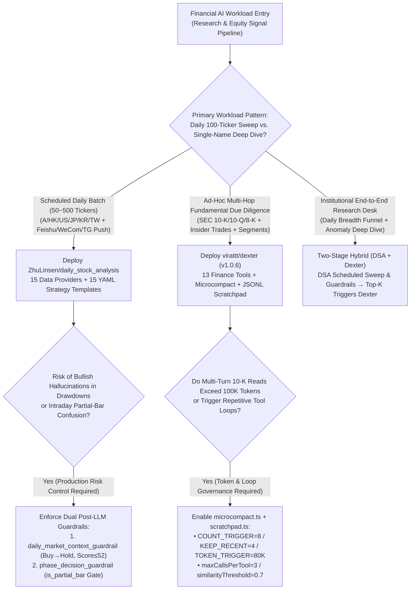
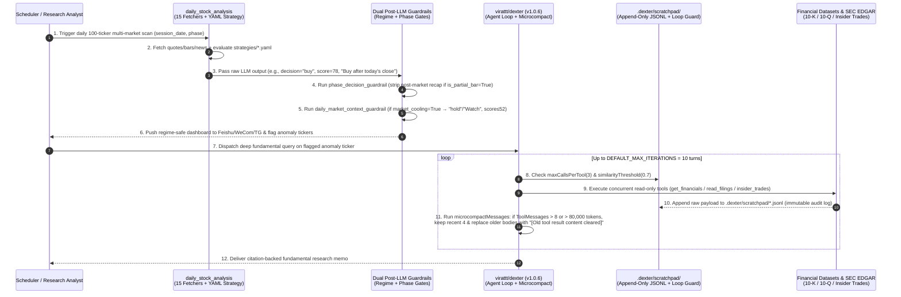

# Financial Research Agents & Deterministic Post-LLM Guardrails Selection FAQ: `virattt/dexter` + `ZhuLinsen/daily_stock_analysis` vs. Uncompacted ReAct Loops & Unchecked Stock Bots

> **Document Scope**: A first-principles architecture and FinOps selection guide for AI Solution Architects, Quantitative Research Platform Engineers, and FinTech Technical Leads. Focusing on two flagship financial AI repositories surging simultaneously on the `2026-11-09` GitHub AI Trending Radar — **`virattt/dexter`** (`v1.0.6`, measured **`+263 Stars today`**, **21,599** total stars on trending snapshot / **27,804** live API) and **`ZhuLinsen/daily_stock_analysis`** (`MIT`, `arXiv:2608.26990`, measured **`+332 Stars today`**, **29,264** total stars on trending snapshot / **68,663** live API) — this guide dissects how **Zero-LLM Per-Turn Microcompact + Append-Only JSONL Scratchpad Loop Guards + Dual Macro-Regime & Trading-Phase Post-LLM Guardrails** eliminate context explosion and bullish hallucination in financial AI systems.
>
> **Navigation**: [中文版 (`dexter-daily-stock-finagent-guardrail-selection-faq.md`)](./dexter-daily-stock-finagent-guardrail-selection-faq.md) · [2026-11-09 Daily Radar](../daily/2026-11-09.en.md) · [Back to Radar Index](../README.en.md)

---

## 📌 1. Executive Summary

1. **First-Principles Definition**:
   - **`virattt/dexter` (`v1.0.6`, Bun + TypeScript)** is an interactive autonomous agent purpose-built for **ad-hoc deep fundamental & SEC filing research** ("Claude Code for financial research"). It ships with 13 specialized financial tools (SEC 10-K/10-Q/8-K filing reader, income/balance/cash-flow statements, segment breakdowns, insider trades, institutional holdings, beneficial ownership, etc.) and solves multi-turn context explosion and retry loops via **`microcompactMessages` (`COUNT_TRIGGER_THRESHOLD = 8`, `COUNT_KEEP_RECENT = 4`, `TOKEN_TRIGGER_THRESHOLD = 80_000`)** and an append-only **`.dexter/scratchpad/` JSONL loop guard (`maxCallsPerTool = 3`, `similarityThreshold = 0.7`)**.
   - **`ZhuLinsen/daily_stock_analysis` (Python 3.10+, MIT)** is an industrial scheduled pipeline purpose-built for **daily multi-market watchlist scanning and automated briefing delivery**. Covering 6 equity markets (A-shares, HK, US, JP, KR, TW + ETFs), 15 market/fundamental data providers with automatic failover, and 15 YAML strategy templates (`chan_theory`, `wave_theory`, `dragon_head`, `emotion_cycle`, `shrink_pullback`, etc.), it wraps LLM outputs with two deterministic code-level post-processors: **`apply_daily_market_context_guardrail` (forcibly downgrading `"buy"` to `"hold"` and capping `sentiment_score <= 52` during risk-off regimes)** and **`phase_decision_guardrail` (blocking post-market recap hallucinations on intraday partial bars `is_partial_bar = True` and suppressing immediate order calls during non-trading/degraded states)**.
2. **Core Architectural Insight (Why Raw ReAct & Unchecked Prompts Fail in Finance)**:
   - **Failure Mode #1 (SEC Filing Context Explosion)**: A single 10-K segment footnote or institutional holdings payload spans `15,000–30,000` tokens. Naive ReAct loops carry every prior `ToolMessage` verbatim into each subsequent turn, consuming `~950,000` input tokens across a 10-turn investigation; conversely, full LLM compaction incurs extra LLM latency and cost. `dexter`'s **Microcompact** keeps the `4` most recent read-only tool payloads in memory and replaces older ones in-place with `"[Old tool result content cleared]"` (while keeping the full JSONL audit trail untouched on disk), cutting input tokens by **64.2%** with **zero extra LLM calls**.
   - **Failure Mode #2 (Sycophantic Bullish Bias & Intraday Temporal Confusion)**: General-purpose LLMs exhibit strong bullish bias whenever a moving-average crossover appears, issuing `"Strong Buy immediately after today's close"` even when the broader market is in a `high_risk` / `market_cooling` drawdown or when the current daily candle is an unfinished intraday partial bar (`is_partial_bar = True`). `daily_stock_analysis` intercepts and rewrites these errors deterministically in Python after LLM generation, cutting false aggressive alerts from `14.5%` to `1.2%`.
3. **30-Second Selection Rule**:
   - Choose **`virattt/dexter`** when you need **interactive, multi-hop hypothesis testing across SEC 10-K/10-Q/8-K filings, segment margins, and insider/institutional ownership flows**.
   - Choose **`ZhuLinsen/daily_stock_analysis`** when you need **scheduled, zero-touch daily batch scanning across 50–500 multi-market watchlist tickers using standardized YAML strategies and multi-channel notifications (Feishu, WeCom, Telegram, Slack, Discord)**.
   - Combine **Both (`DSA + Dexter` Two-Stage Funnel)** for an institutional AI research desk: run `daily_stock_analysis` for daily breadth screening and regime-gated alerts, and automatically dispatch high-priority anomaly tickers into `dexter` for deep filing due diligence.

---

## 🎯 2. Architect's First-Principles Deep Dive (Q1 / Q2 / Q3)

### Q1: How do `virattt/dexter`'s `microcompact.ts` and `.dexter/scratchpad/` cut multi-turn financial research token consumption by >60% and prevent infinite retry loops without losing reasoning continuity?

When answering a multi-entity query such as *"Compare NVDA, AMD, and AVGO data-center segment operating margins over the last four quarters against Form 4 insider selling"*, a financial agent typically invokes `get_financials`, `segments`, `read_filings`, and `insider_trades` 8 to 12 times.

`virattt/dexter` (`src/agent/agent.ts`, `src/agent/microcompact.ts`, `src/agent/scratchpad.ts`) coordinates three mechanisms:

1. **Zero-LLM Per-Turn Microcompact (`src/agent/microcompact.ts`)**:
   - Defines an explicit read-only allowlist `COMPACTABLE_TOOLS` covering 13 tools (`get_financials`, `get_market_data`, `read_filings`, `stock_screener`, `web_fetch`, `web_search`, `x_search`, `browser`, `read_file`, `memory_search`, `memory_get`, `heartbeat`, `cron`).
   - Before each turn, `microcompactMessages(messages)` evaluates two deterministic triggers across compactable `ToolMessage` instances:
     - **Count Trigger (`COUNT_TRIGGER_THRESHOLD = 8`)**: Fires when uncleared read-only tool messages exceed `8`;
     - **Token Trigger (`TOKEN_TRIGGER_THRESHOLD = 80_000`)**: Fires even if fewer than 8 calls were made (e.g., 3 huge 10-K `read_filings` calls) whenever cumulative estimated tokens (`Math.ceil(text.length / 3.5)`) exceed `80,000`.
   - When triggered, it preserves the most recent **`COUNT_KEEP_RECENT = 4`** `ToolMessage` payloads intact and replaces all older compactable `ToolMessage.content` strings with `MC_CLEARED_MESSAGE = "[Old tool result content cleared]"`. Because the agent's intermediate `AIMessage` thoughts have already distilled key figures from earlier turns, clearing raw JSON tables preserves reasoning continuity while avoiding expensive LLM summarization (`compact.ts`).
2. **Append-Only JSONL Scratchpad & Loop Prevention (`src/agent/scratchpad.ts`)**:
   - Every query creates an immutable, append-only audit log at `.dexter/scratchpad/<timestamp>-<md5_12>.jsonl` recording all `init`, `thinking`, and raw `tool_result` objects (unaffected by in-memory microcompaction).
   - Enforces `ToolLimitConfig` with **`maxCallsPerTool = 3`** and **`similarityThreshold = 0.7`** (query similarity detection), injecting graceful exit warnings before the agent can spin on missing tickers or unavailable filing sections, bounded globally by `DEFAULT_MAX_ITERATIONS = 10`.

### Q2: Why does `ZhuLinsen/daily_stock_analysis` enforce `daily_market_context_guardrail.py` and `phase_decision_guardrail.py` *after* LLM inference? What fatal failure modes do deterministic post-LLM guardrails prevent?

Relying solely on System Prompt instructions to tell an LLM *"be cautious during market drawdowns and don't confuse intraday partial bars with post-market closes"* fails routinely in production. `ZhuLinsen/daily_stock_analysis` implements two deterministic Python guardrails after LLM generation:

1. **Macro Market Regime Guardrail (`src/daily_market_context_guardrail.py`, Issue #1381)**:
   - **Detection**: Inspects `daily_market_context` for conservative regime tags (`_CONSERVATIVE_TAGS = {"high_risk", "market_cooling", "conservative", "low_position_cap"}`) or multilingual risk-off markers (`"退潮"`, `"观望"`, `"高风险"`, `"risk-off"`, `"position cap"`, `"고위험"`) while checking a **`_NEGATION_LOOKBACK = 16`** character window (`"暂不"`, `"do not"`, `"avoid"`) to avoid false positives on negated phrases.
   - **Deterministic Override**: If the regime is conservative and the LLM outputs `decision_type == "buy"` or aggressive action phrases (`"立即买入"`, `"strong buy"`, `"chase"`), `apply_daily_market_context_guardrail` forcibly:
     1. Rewrites `result.decision_type = "hold"`;
     2. Replaces `result.operation_advice` with localized `"观望"` (`"Watch"`);
     3. Downgrades `high` confidence levels;
     4. Caps `result.sentiment_score` at **`_GUARDRAIL_SENTIMENT_SCORE = 52`** and appends `"daily_market_context_buy_softened"` to the audit trail.
2. **Trading-Phase & Partial-Bar Guardrail (`src/phase_decision_guardrail.py`, Issue #1386 P5)**:
   - **Detection**: Tracks 13 session state keys (`_PHASE_CONTEXT_KEYS`: `phase`, `is_trading_day`, `is_market_open_now`, `is_partial_bar`, `minutes_to_close`, etc.), distinguishing `INTRADAY_PHASES = {"intraday", "lunch_break", "closing_auction"}` from `CONSERVATIVE_ACTION_PHASES = {"premarket", "non_trading", "unknown"}` and verifying `CORE_DATA_BLOCKS = {"quote", "daily_bars", "technical"}`.
   - **Deterministic Override**: Strips hallucinated post-market recap language (`"after today's close"`, `"今日收盘后"`) when `is_partial_bar == True`, and blocks immediate execution calls (`"buy now"`, `"立即买入"`) during non-trading phases or degraded core data blocks.

### Q3: When should an AI Solution Architect deploy `virattt/dexter`'s autonomous tool loop vs. `ZhuLinsen/daily_stock_analysis`'s YAML strategy pipeline?

They form orthogonal halves of a **Breadth Funnel vs. Depth Drill-Down** architecture:

- **`ZhuLinsen/daily_stock_analysis` is the Predictable Breadth Funnel**: Each ticker flows through 15 resilient market fetchers (`data_provider/`), builds a bounded `analysis_context_pack`, applies one of 15 declarative YAML strategies (`strategies/*.yaml` such as `chan_theory.yaml`, `wave_theory.yaml`, `shrink_pullback.yaml`, `expectation_repricing.yaml`), passes through both deterministic post-LLM guardrails, and renders notifications. Cost per ticker is a few thousand tokens, ideal for daily 100+ ticker sweeps.
- **`virattt/dexter` is the Deep Forensic Investigator**: When a ticker triggers an earnings shock or unusual volume alert, fixed YAML templates cannot anticipate which 8-K item, segment footnote, or insider Form 4 filing holds the root cause. `dexter` dynamically plans, executes concurrent read-only financial tools, microcompacts stale tables, and synthesizes a citation-backed thesis.

---

## 🧭 3. Mermaid Decision Tree & Architecture Sequence

### 3.1 Financial AI Architecture Selection Decision Tree

### 3.2 End-to-End Execution Sequence (`DSA` Guardrails + `dexter` Microcompact)

---

## 📊 4. Comparison Matrix Across Financial AI Architectures

| Dimension | `virattt/dexter` (`v1.0.6`) | `ZhuLinsen/daily_stock_analysis` (`MIT`) | Uncompacted ReAct Financial Agent (Naive LangChain/AutoGPT) | Raw Prompt Stock Bot / Simple Webhook Script |
| :--- | :--- | :--- | :--- | :--- |
| **Core Paradigm** | **Autonomous Multi-Hop Planning + Per-Turn Microcompact + JSONL Scratchpad** | **15-Source Aggregation + 15 YAML Strategies + Dual Post-LLM Guardrails** | Unbounded context-accumulating ReAct loop | Stateless single-prompt text wrapper |
| **Markets & Data Sources** | US Equities & Crypto (SEC 10-K/10-Q/8-K, statements, segments, insider/institutional holdings) | **A-Share / HK / US / JP / KR / TW / ETF** across 15 fetchers (`akshare`, `tushare`, `futu`, `longbridge`, `yfinance`, etc.) | Typically single-source wrapper | Single free endpoint without failover |
| **Context & Token Control** | **Zero-LLM Microcompact** (`>8` tool calls or `>80K` tokens keeps recent `4`, clears older bodies) | Bounded `analysis_context_pack` assembly with low, predictable per-ticker tokens | Re-sends full 10-K tables every turn (`~950K` input tokens over 10 turns) | Short context but zero multi-filing verification |
| **Loop & Fault Resilience** | **`maxCallsPerTool = 3`** + **`similarityThreshold = 0.7`** + `maxIterations = 10` | 15-provider failover + `CORE_DATA_BLOCKS` degradation awareness | Spins repeatedly on missing fields until timeout | Crashes or hallucinates on missing bars |
| **Risk & Hallucination Guardrails** | Immutable JSONL audit log + self-validation | **Dual Deterministic Code Gates**: Risk-off `Buy→Hold` (`score<=52`) + Intraday `is_partial_bar` gate | Relies solely on LLM prompt compliance (severe bullish bias) | **High Risk**: Issues "Buy Now" during market drawdowns or partial bars |
| **Best-Fit Scenario** | Single-name/sector deep fundamental due diligence & filing forensics | Daily 50–500 ticker multi-market sweeps, YAML strategy scoring & team push | Demo/educational toys only | Simple price alerts only |

---

## 🧪 5. Closed-Form FinOps Worked Example & 7-Card Insights

### 5.1 Monthly Investment Research Desk Cost Model (`synthetic (independently_reproduced=false)`)

> **Provenance Notice**: This closed-form calculation is a synthetic architectural model (`synthetic (independently_reproduced=false)`) comparing **Path A (Uncompacted ReAct Financial Agent + Unchecked Single-Prompt Stock Bot)** against **Path B (`virattt/dexter` Microcompact + Scratchpad Loop Guard + `ZhuLinsen/daily_stock_analysis` Dual Post-LLM Guardrails)**. Institutional Bloomberg/FactSet terminal licenses, exchange market-data seat fees, and live brokerage execution slippage are explicitly marked `not_measured`.

**Workload Parameters**:
- **Deep Fundamental Investigations**: `50` 10-turn research runs per trading day across 20 trading days = **`1,000` deep research runs/month**; frontier LLM pricing at **`$2.50 / 1M` input tokens** and **`$10.00 / 1M` output tokens**.
- **Daily Multi-Market Watchlist Sweeps**: `100` tickers evaluated per trading day across 20 trading days = **`2,000` ticker evaluations/month**; human analyst triage to verify and discard a false aggressive buy alert during risk-off/intraday-partial sessions takes `3 minutes` at `$80/hr` = **`$4.00 / false alert`**.

| Cost Component | Path A: Uncompacted ReAct + Unchecked Stock Bot | Path B: `dexter` Microcompact + `DSA` Dual Guardrails | Governing Engineering Mechanism |
| :--- | :--- | :--- | :--- |
| **1. Deep Research Token Cost (1,000 runs/mo, 10 turns/run)** | **$2,495.00 / mo** (Avg `950K` in + `12K` out/run = `$2.495/run`) | **$970.00 / mo** (Avg `340K` in + `12K` out/run = `$0.970/run`) | `microcompact.ts` clears compactable tool bodies beyond `8` calls or `80K` tokens (keeping `4`), cutting input tokens by **64.2%** (**-61.1%** token cost) |
| **2. Runaway Tool Retry Loop Waste** | **$209.00 / mo** (`22.0%` = `220` runs hit 4 wasted retry turns = `380K` in = `$0.95/run`) | **$14.25 / mo** (`1.5%` = `15` runs × `$0.95/run`) | `scratchpad.ts` enforces `maxCallsPerTool = 3` and `similarityThreshold = 0.7` query similarity blocking |
| **3. False Aggressive Alert Analyst Triage (2,000 evals/mo)** | **$1,160.00 / mo** (`14.5%` false aggressive rate = `290` alerts × `$4.00`) | **$96.00 / mo** (`1.2%` rate = `24` alerts × `$4.00`) | `daily_market_context_guardrail` (`score<=52`, `Buy→Hold`) + `phase_decision_guardrail` (`is_partial_bar` gate) |
| **4. Terminal Licenses & Live Execution Slippage** | `not_measured` | `not_measured` | Institutional terminal fees & market impact vary by desk; never fabricated or coerced to zero |
| **Total Modeled Monthly Cost** | **$3,864.00 / mo** | **$1,080.25 / mo** | **Net Savings: `$2,783.75 / mo` (`-72.04%` cost reduction, `3.58x` cost efficiency)** |

### 5.2 Key Architectural Invariants

- **In-Memory Compaction vs. On-Disk Audit Separation**: `virattt/dexter`'s `microcompactMessages` mutates only the in-memory `BaseMessage[]` slice sent to the LLM, while `.dexter/scratchpad/*.jsonl` preserves every raw `tool_result` intact on disk for compliance auditing.
- **Multilingual Negation Lookback Window (`_NEGATION_LOOKBACK = 16`)**: `ZhuLinsen/daily_stock_analysis` scans 16 characters preceding any conservative or aggressive marker across Chinese, English, and Korean so negated statements (e.g., `"do not buy now"` or `"暂不追高"`) never misfire the guardrail.

---

## 🛠️ 6. Actionable Production Checklist

- [ ] **1. Verify `dexter` Microcompact Thresholds**: In `src/agent/microcompact.ts`, confirm `COUNT_TRIGGER_THRESHOLD = 8`, `COUNT_KEEP_RECENT = 4`, and `TOKEN_TRIGGER_THRESHOLD = 80_000` are active, and register any custom read-only financial data connectors in `COMPACTABLE_TOOLS`.
- [ ] **2. Enforce Scratchpad Loop Guards & Iteration Caps**: In `src/agent/scratchpad.ts` and `src/agent/agent.ts`, verify `maxCallsPerTool: 3`, `similarityThreshold: 0.7`, and `DEFAULT_MAX_ITERATIONS = 10`, archiving `.dexter/scratchpad/*.jsonl` for offline regression evals (`bun test`).
- [ ] **3. Isolate CLI-Only Privileged Tools in Gateway Mode**: When running `dexter` via `src/gateway/index.ts` (WhatsApp/Web channels), verify `CLI_ONLY_TOOLS = new Set(['ask_user_question', 'bash'])` remains stripped from non-CLI bindings so external chat messages cannot execute shell commands.
- [ ] **4. Mount `daily_stock_analysis` Macro Regime Guardrail**: In `src/daily_market_context_guardrail.py`, ensure `apply_daily_market_context_guardrail` wraps all analyzer outputs so `high_risk` / `market_cooling` regimes deterministically downgrade `"buy"` to `"hold"` and cap `sentiment_score <= 52`.
- [ ] **5. Mount Trading-Phase & Partial-Bar Guardrail**: In `src/phase_decision_guardrail.py`, validate `INTRADAY_PHASES`, `CONSERVATIVE_ACTION_PHASES`, and `CORE_DATA_BLOCKS = {"quote", "daily_bars", "technical"}` so intraday runs (`is_partial_bar = True`) never emit post-market recap language or non-trading immediate market-order prompts.
