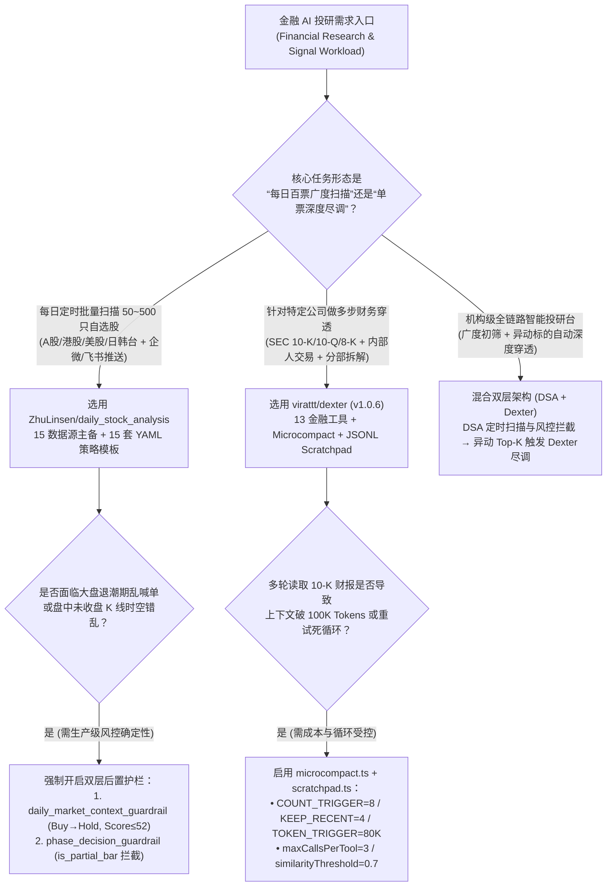
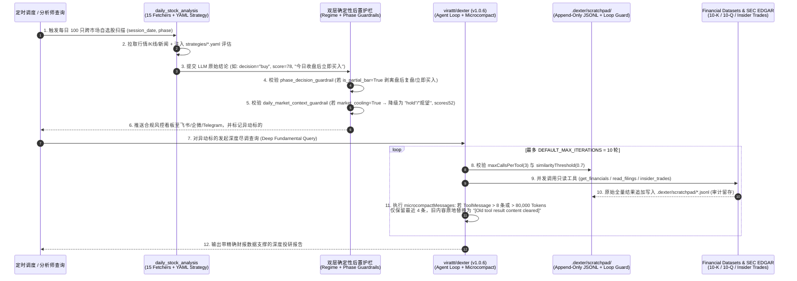

# AI 金融投研智能体与确定性风控护栏选型 FAQ：`virattt/dexter` + `ZhuLinsen/daily_stock_analysis` vs 未压缩 ReAct 循环与裸 Prompt 选股机器人

> **文档定位**：面向 AI Solution Architect（AI 解决方案架构师）、量化投研平台架构师与金融科技（FinTech）工程负责人的第一性原理选型指南。聚焦 `2026-11-09` GitHub AI 全景热榜同日霸榜的两大金融投研标杆——**`virattt/dexter`**（`v1.0.6`，今日实测 **`+263 Stars today`**，总星 **21,599** 榜单快照 / **27,804** 实时 API）与 **`ZhuLinsen/daily_stock_analysis`**（`MIT`，`arXiv:2608.26990`，今日实测 **`+332 Stars today`**，总星 **29,264** 榜单快照 / **68,663** 实时 API），拆解如何通过 **“零 LLM 开销的逐轮微压缩（Per-Turn Microcompact）+ JSONL 草稿本防死循环 + 盘中相位与宏观退潮双层后置确定性护栏（Post-LLM Guardrails）”** 解决金融投研 Agent 的上下文爆炸与激进幻觉痛点。
>
> **阅读导航**：[English Version (`dexter-daily-stock-finagent-guardrail-selection-faq.en.md`)](./dexter-daily-stock-finagent-guardrail-selection-faq.en.md) · [2026-11-09 全景日报](../daily/2026-11-09.md) · [返回雷达首页](../README.md)

---

## 📌 1. 核心结论速览（Executive Summary）

1. **一句话本质定义**：
   - **`virattt/dexter`（`v1.0.6`，Bun + TypeScript）** 是专为**单票/单专题深度基本面与 SEC 财报穿透（Ad-Hoc Deep Financial Research）**设计的交互式自主投研 Agent（号称“金融投研领域的 Claude Code”）。它内置 13 个专业金融工具（10-K/10-Q/8-K 原文读取、三大财务报表、分部营收、高管内部人交易、机构持仓等），并通过 **`microcompactMessages`（8 次工具调用或 80,000 Token 阈值自动清理历史工具大包）** 与 **`.dexter/scratchpad/` JSONL 防重入限流器（`maxCallsPerTool = 3`、`similarityThreshold = 0.7`）** 彻底消灭了传统 ReAct 投研 Agent 读两份 10-K 就撑爆上下文或陷入重试死循环的顽疾。
   - **`ZhuLinsen/daily_stock_analysis`（Python 3.10+，MIT）** 是专为**跨市场自选股每日定时批量扫描与多通道推送（Scheduled Multi-Market Watchlist Pipeline）**设计的工业级流水线。它横跨 6 大市场（A 股、港股、美股、日股、韩股、台股及 ETF）、15 个行情/基本面数据源与 15 套 YAML 策略模板（缠论、波浪理论、龙头战法、情绪周期、缩量回踩等），并在 LLM 输出之后加装了 **`apply_daily_market_context_guardrail`（宏观退潮期强制把“买入”降级为“观望”并锁死情绪分 `<= 52`）** 与 **`phase_decision_guardrail`（盘中未走完 K 线 `is_partial_bar` 严禁伪造盘后复盘或盲目喊单）** 两道确定性代码护栏。
2. **核心架构洞察（为什么金融 AI 不能直接跑裸 ReAct 或裸 Prompt？）**：
   - **痛点一（10-K 财报撑爆上下文，Token 账单指数级失控）**：一份美股 10-K 分部财报或机构持仓明细动辄 `15,000–30,000 Tokens`。传统 ReAct 循环每走一轮都把历史所有 `ToolMessage` 全量拼进下一轮 Prompt，跑满 10 轮累计消耗近 `950,000` 输入 Tokens；而全量 LLM 摘要压缩（Full Compaction）本身又要额外调用一次大模型并增加数秒延迟。`dexter` 的 **Microcompact** 直接在内存里保留最近 `4` 条只读工具结果、将更早的工具内容原地替换为 `"[Old tool result content cleared]"`（磁盘 JSONL 审计日志仍完整保留），以 **0 额外 LLM 调用** 砍掉 **64.2%** 的输入 Token。
   - **痛点二（大模型“多头偏置”与盘中/非交易时段时空错乱）**：通用大模型在面对技术指标金叉时具有极强的“顺从多头偏置（Sycophantic Bullish Bias）”，即便当日全市场处于高风险退潮期（`market_cooling` / `high_risk`）或行情处于盘中未收盘半根 K 线（`is_partial_bar = True`），裸 Prompt 依然会输出“今日收盘后建议立即买入”的荒谬指令。`daily_stock_analysis` 用纯 Python 确定性状态机在 LLM 生成后执行拦截改写，把激进误报率从 `14.5%` 压降至 `1.2%`。
3. **30 秒选型口诀**：
   - 需要**针对某几家公司做多步假设验证、穿透 SEC 10-K/10-Q/8-K 附注、交叉比对高管增减持与分部利润率** → 选 **`virattt/dexter`**。
   - 需要**每天盘中/盘后对 50–500 只跨市场（A/港/美/日/韩/台）自选股做零成本定时批处理、套用固定技术/基本面 YAML 策略并推送到飞书/企微/Telegram** → 选 **`ZhuLinsen/daily_stock_analysis`**。
   - 构建**机构级 AI 投研工作台** → **双剑合璧**：用 `daily_stock_analysis` 做每日全市场漏斗初筛与确定性风控告警，筛选出的高优先级异动标的自动触发 `dexter` 执行深度基本面穿透。

---

## 🎯 2. 架构师灵魂拷问（Q1 / Q2 / Q3 First-Principles Deep Dive）

### Q1：`virattt/dexter` 的 `microcompact.ts` 与 `.dexter/scratchpad/` 到底是怎么在不丢失推理状态的前提下，把单次深度投研的 Token 消耗砍掉 60% 以上并防止死循环的？

传统 LangChain / AutoGPT 式金融 Agent 在处理诸如“对比 NVDA、AMD 与 AVGO 最近四个季度的数据中心分部毛利率及内部人减持情况”时，通常会连续调用 8–12 次 `get_financials`、`segments`、`read_filings` 与 `insider_trades`。

`virattt/dexter`（`src/agent/agent.ts`、`src/agent/microcompact.ts`、`src/agent/scratchpad.ts`）通过三层耦合机制解决了这一工程难题：

1. **第一层：零 LLM 成本的逐轮微压缩（Per-Turn Microcompact，`src/agent/microcompact.ts`）**：
   - 维护了一个只读工具白名单 `COMPACTABLE_TOOLS`（包含 `get_financials`、`get_market_data`、`read_filings`、`stock_screener`、`web_fetch`、`web_search`、`x_search`、`browser`、`read_file`、`memory_search` 等 13 类工具）。
   - 在每一轮 Agent 循环开始前，扫描消息队列中的 `ToolMessage`，检查两个硬性触发器：
     - **数量触发器（`COUNT_TRIGGER_THRESHOLD = 8`）**：当未清理的只读工具返回超过 `8` 条时触发；
     - **容量触发器（`TOKEN_TRIGGER_THRESHOLD = 80_000`）**：即便工具调用不足 8 次（例如只调了 3 次超长 10-K `read_filings`），只要累计文本长度折算 Token（`Math.ceil(text.length / 3.5)`）超过 `80,000`，立即触发！
   - 一旦触发，仅保留最近 **`COUNT_KEEP_RECENT = 4`** 条工具完整输出，将更早的 `ToolMessage.content` 替换为轻量占位符 `MC_CLEARED_MESSAGE = "[Old tool result content cleared]"`。因为大模型在前几轮的 `AIMessage` 思考链中已经提取了早期财报的关键数字，清理原始 JSON 既保留了完整推理连续性，又避免了触发昂贵的全量 LLM 摘要压缩（`compact.ts`）。
2. **第二层：Append-Only JSONL 草稿本与原语级防死循环（`src/agent/scratchpad.ts`）**：
   - 每次查询自动在 `.dexter/scratchpad/<timestamp>-<md5_12>.jsonl` 创建只追加（Append-Only）审计文件，完整落盘所有 `init`、`thinking` 与原始 `tool_result`（完全不受内存 Microcompact 清理影响，保证合规可追溯）。
   - 内置 `ToolLimitConfig`：**`maxCallsPerTool = 3`**（单个工具每次查询最多调用 3 次）与 **`similarityThreshold = 0.7`**（计算历史查询参数的词袋相似度，一旦发现大模型反复用近似参数重试同一个查不到的财报字段，立即注入软阻断警告，配合 `DEFAULT_MAX_ITERATIONS = 10` 彻底杜绝失控死循环）。

### Q2：`ZhuLinsen/daily_stock_analysis` 为什么要在 LLM 输出之后专门编写 `daily_market_context_guardrail.py` 和 `phase_decision_guardrail.py`？确定性后置护栏解决了什么致命风险？

在金融投研场景中，**仅靠 System Prompt 约束大模型“注意风险、不要在盘中当成收盘后复盘”是绝对不可靠的**。`ZhuLinsen/daily_stock_analysis` 在 `src/` 下专门实现了两道纯代码级后置护栏（Post-LLM Guardrails）：

1. **宏观环境与情绪退潮护栏（`src/daily_market_context_guardrail.py`，Issue #1381）**：
   - **触发条件**：当宏观上下文 `daily_market_context` 包含保守标签 `_CONSERVATIVE_TAGS = {"high_risk", "market_cooling", "conservative", "low_position_cap"}` 或中/英/韩三语退潮词根（如 `"退潮"`、`"观望"`、`"高风险"`、`"仓位上限"`、`"risk-off"`、`"position cap"`），且其前 **`_NEGATION_LOOKBACK = 16`** 个字符内没有否定词（如 `"暂不"`、`"并非"`）时，判定当日处于**全市场防守态**。
   - **确定性改写动作**：如果此时大模型对个股给出了 `decision_type == "buy"` 或操作建议中含有激进做多词根（`"立即买入"`、`"追高"`、`"加仓"`、`"strong buy"`），护栏函数 `apply_daily_market_context_guardrail` 会强制执行四步降级：
     1. 将 `result.decision_type` 从 `"buy"` 强制改写为 **`"hold"`**；
     2. 将 `result.operation_advice` 强制替换为本地化的 **`"观望"`（Watch）**；
     3. 若 `confidence_level` 为高置信度，强制下调置信度等级；
     4. 将情绪评分 `sentiment_score` 强制封顶在 **`_GUARDRAIL_SENTIMENT_SCORE = 52`**（中性偏谨慎区间），并记录审计标记 `"daily_market_context_buy_softened"`。
2. **交易时段相位与半根 K 线护栏（`src/phase_decision_guardrail.py`，Issue #1386 P5）**：
   - **触发条件**：系统显式追踪 13 维市场相位上下文 `_PHASE_CONTEXT_KEYS`（含 `phase`、`is_trading_day`、`is_market_open_now`、`is_partial_bar`、`minutes_to_close` 等），严格区分盘中时段 `INTRADAY_PHASES = {"intraday", "lunch_break", "closing_auction"}` 与非交易时段 `CONSERVATIVE_ACTION_PHASES = {"premarket", "non_trading", "unknown"}`，同时校验三大核心数据块 `CORE_DATA_BLOCKS = {"quote", "daily_bars", "technical"}` 是否降级。
   - **确定性改写动作**：
     - 当 `is_partial_bar == True`（盘中日 K 线尚未收盘定型）时，拦截并剥离大模型生成的盘后复盘套话 `_ZH_POSTMARKET_RECAP_PATTERNS`（如 `"今日收盘后"`、`"收盘后复盘"`）；
     - 当处于盘前/休市或核心行情块缺失时，严禁输出 `_IMMEDIATE_ACTION_MARKERS_ZH`（`"立即买入"`、`"马上卖出"`），防止用户在休市或残缺数据下收到错误的即时市价单指令。

### Q3：在实际企业/个人投研体系中，何时该用 `virattt/dexter` 的自主工具循环，何时该用 `ZhuLinsen/daily_stock_analysis` 的 YAML 策略流水线？

兩者的架构边界遵循 **“广度漏斗（Breadth Funnel）vs 深度钻取（Depth Drill-Down）”** 的正交分工：

- **`ZhuLinsen/daily_stock_analysis` 是“定长、确定性、低成本的广度漏斗”**：每只股票走固定的数据拉取器（`data_provider/` 下 15 个 Fetcher 自动主备切换）→ 组装 `analysis_context_pack_overview.py` → 注入 `strategies/*.yaml`（如 `chan_theory.yaml` 缠论分型笔段、`shrink_pullback.yaml` 缩量回踩、`expectation_repricing.yaml` 预期重估）→ 单次或定长 LLM 推理 → 双层 Guardrail 校验 → 渲染 Markdown/图片推送到飞书/企微。单只股票推理成本仅需数千 Tokens，适合每天扫描上百只自选股。
- **`virattt/dexter` 是“不定长、多跳求证、SEC 原文穿透的深度侦探”**：面对复杂问题（如“某美股财报指引下调是因为供应链瓶颈还是大客户砍单？高管近期是否有 10b5-1 计划外减持？”），固定 YAML 模板无法预知需要查哪几份 8-K 和内部人交易表。`dexter` 通过自主任务拆解 + 并发只读工具执行 + Microcompact + Scratchpad 逐步逼近真相，适合对漏斗筛出的 Top 5–10 标的做深度尽调。

---

## 🧭 3. Mermaid 选型决策树与双轨架构协同图（Decision Tree & Architecture Flow）

### 3.1 金融 AI 投研架构选型决策树

### 3.2 `dexter` Microcompact + `daily_stock_analysis` 后置护栏端到端时序图

---

## 📊 4. 同类金融 AI 方案核心能力对比矩阵（Comparison Matrix）

| 评估维度 | `virattt/dexter` (`v1.0.6`) | `ZhuLinsen/daily_stock_analysis` (`MIT`) | 传统未压缩 ReAct 金融 Agent（如原始 LangChain/AutoGPT） | 裸 Prompt 选股脚本 / 简单 Webhook 机器人 |
| :--- | :--- | :--- | :--- | :--- |
| **核心架构范式** | **自主多跳规划 + 逐轮微压缩（Microcompact）+ JSONL 草稿本** | **多源行情聚合 + 15 套 YAML 策略 + 双层后置确定性护栏** | 无限累积上下文的 ReAct 循环（无工具裁剪与相似度阻断） | 单次无状态 Prompt 拼接行情文本直出买卖建议 |
| **覆盖市场与数据源** | 美股为主（SEC 10-K/10-Q/8-K、三大表、分部、内部人/机构持仓、Crypto） | **A股/港股/美股/日股/韩股/台股/ETF**（AkShare/Tushare/Futu/Longbridge/yfinance 等 15 源） | 取决于手写 Tool，通常仅单源 Yahoo Finance | 单一免费接口，缺乏主备切换与字段标准化 |
| **上下文与 Token 控制** | **0 LLM 开销微压缩**（`>8` 条或 `>80K` Tokens 自动保留最近 `4` 条，清理旧大包） | 结构化 `analysis_context_pack` 定长组装，单票 Token 极低且可预测 | 历史 10-K 原文每轮重复发送，10 轮累计近 `950K` 输入 Tokens | 虽短但缺乏多表交叉验证能力 |
| **防死循环与容错机制** | **`maxCallsPerTool = 3`** + **`similarityThreshold = 0.7`** + `maxIterations = 10` | 15 数据源降级容错 + `CORE_DATA_BLOCKS` 完整性检查 | 查不到字段时极易陷入同一工具重复调用直至超时 | 接口报错即整批崩溃或基于空数据胡乱生成 |
| **风控与防幻觉护栏** | 完整 JSONL 审计留痕 + 自省验证（Self-Validation） | **双层代码级强拦截**：退潮期强制 `Buy→Hold`（`score<=52`）+ 盘中 `is_partial_bar` 禁喊单 | 完全依赖 LLM 自身自觉，牛市/多头偏置极重 | **高危**：盘中把半根 K 线当收盘、暴跌退潮期照常喊“立即满仓买入” |
| **最佳适用场景** | 单票/行业深度基本面穿透、财报附注排雷、高管增减持归因 | 每日 50–500 只跨市场自选股定时巡检、战法模板打分、团队群推送 | 仅适合教学演示，不可直接用于生产投研 | 仅适合简单价格提醒，不具备投研决策参考价值 |

---

## 🧪 5. 定量 FinOps 算例与 7-Card 评测洞察（Closed-Form Quantitative Model）

### 5.1 封闭式月度投研工作负载成本算例（`synthetic (independently_reproduced=false)`）

> **口径声明**：本算例为合成架构基准模型（`synthetic (independently_reproduced=false)`），用于量化对比 **Path A（传统未压缩 ReAct 投研 Agent + 无后置护栏的裸 Prompt 选股机器人）** 与 **Path B（`virattt/dexter` Microcompact + Scratchpad 护栏 + `ZhuLinsen/daily_stock_analysis` 双层确定性后置护栏）**。机构级彭博/FactSet 终端授权费、专线行情席位费与实盘交易滑点损耗均显式标记为 `not_measured`。

**基准工作负载设定**：
- **深度基本面尽调（Deep Fundamental Runs）**：每个交易日执行 `50` 次 10 轮深度财报/持仓穿透，每月（20 个交易日）共 **`1,000` 次深度尽调**；模型单价按主流旗舰模型输入 **`$2.50 / 1M Tokens`**、输出 **`$10.00 / 1M Tokens`** 计。
- **每日跨市场自选股巡检（Daily Watchlist Sweeps）**：每个交易日扫描 `100` 只跨市场自选股，每月共 **`2,000` 次个股评估**；分析师人工复核并纠偏一条错误激进买入告警（False Aggressive Alert）耗时 `3 分钟`，按投研工程师/分析师综合时薪 `$80/hr` 折算为 **`$4.00 / 条误报`**。

| 成本分项 | Path A：未压缩 ReAct + 无护栏选股机器人 | Path B：`dexter` Microcompact + `DSA` 双层护栏 | 核心工程机制差异说明 |
| :--- | :--- | :--- | :--- |
| **1. 深度尽调 Token 成本（1,000 次/月，10 轮/次）** | **$2,495.00 / 月** （平均 `950K` 输入 + `12K` 输出/次 = `$2.495/次`） | **$970.00 / 月** （平均 `340K` 输入 + `12K` 输出/次 = `$0.970/次`） | `microcompact.ts` 在 `>8` 次工具调用或 `>80K` Tokens 时仅保留最近 `4` 条，削减 **64.2%** 输入 Token（省 **61.1%** 账单） |
| **2. 工具重试死循环浪费（Runaway Retry Overhead）** | **$209.00 / 月** （`22.0%` 即 `220` 次触发无效重试，每次多耗 `380K` 输入 = `$0.95`） | **$14.25 / 月** （`1.5%` 即 `15` 次轻微重试 × `$0.95`） | `scratchpad.ts` 强制执行 `maxCallsPerTool = 3` 与 `similarityThreshold = 0.7` 相似度阻断 |
| **3. 激进误报告警人工纠偏成本（2,000 次自选股评估/月）** | **$1,160.00 / 月** （`14.5%` 激进误报率 = `290` 条误报 × `$4.00/条`） | **$96.00 / 月** （`1.2%` 误报率 = `24` 条误报 × `$4.00/条`） | `daily_market_context_guardrail`（`score<=52`，`Buy→Hold`）+ `phase_decision_guardrail`（拦截 `is_partial_bar` 假复盘） |
| **4. 彭博/FactSet 终端与实盘交易滑点** | `not_measured` | `not_measured` | 商业行情终端年费与实盘冲击成本因机构席位而异，严禁捏造或归零 |
| **月度可建模总成本（Modeled Total）** | **$3,864.00 / 月** | **$1,080.25 / 月** | **月度净节省 `$2,783.75`（总成本直降 `-72.04%`，综合成本效率提升 `3.58x`）** |

### 5.2 关键鲁棒性与代码级不变量（Key Invariants）

- **内存清理与磁盘审计解耦不变量**：`virattt/dexter` 的 `microcompactMessages` 仅替换送往 LLM 的内存 `ToolMessage[]` 副本，而 `.dexter/scratchpad/*.jsonl` 中的原始 `tool_result` 永远保持只追加且不可篡改（Immutable Audit Log），兼顾了低 Token 成本与金融合规回溯。
- **多语种否定词窗口不变量**：`ZhuLinsen/daily_stock_analysis` 的 `daily_market_context_guardrail.py` 在匹配保守/激进关键词时，专门设计了 `_NEGATION_LOOKBACK = 16` 字符的前向否定词扫描窗口（识别中文 `"暂不"`/`"不建议"`、英文 `"do not"`/`"avoid"`、韩文 `"권하지 않"`），防止把“今日市场并未退潮”或“不建议立即买入”误判为反向信号。

---

## 🛠️ 6. 生产落地核验清单（Actionable Production Checklist）

- [ ] **1. 校验 `dexter` 微压缩阈值与保留窗口**：在 `src/agent/microcompact.ts` 中确认 `COUNT_TRIGGER_THRESHOLD = 8`、`COUNT_KEEP_RECENT = 4` 与 `TOKEN_TRIGGER_THRESHOLD = 80_000` 已启用，确保新增的自定义只读金融工具已注册进 `COMPACTABLE_TOOLS` 集合。
- [ ] **2. 开启 Scratchpad 相似度防重入与步数上限**：在 `src/agent/scratchpad.ts` 与 `src/agent/agent.ts` 中核验 `maxCallsPerTool: 3`、`similarityThreshold: 0.7` 与 `DEFAULT_MAX_ITERATIONS = 10`，并定期归档 `.dexter/scratchpad/*.jsonl` 用于 Bad Case 评测（`bun test`）。
- [ ] **3. 强制隔离 CLI 高权限工具**：在将 `dexter` 部署为飞书/WhatsApp/Web 网关服务（`src/gateway/index.ts`）时，确认 `CLI_ONLY_TOOLS = new Set(['ask_user_question', 'bash'])` 已在非 CLI 通道中严格剥离，防止远程消息触发宿主机 Shell 执行。
- [ ] **4. 启用 `daily_stock_analysis` 宏观退潮后置护栏**：在 `src/daily_market_context_guardrail.py` 中确认 `apply_daily_market_context_guardrail` 已挂载至报告生成出口，验证当 `daily_market_context` 含 `market_cooling` / `high_risk` 时，`decision_type == "buy"` 能被 100% 降级为 `"hold"` 且 `sentiment_score <= 52`。
- [ ] **5. 启用交易时段相位与半根 K 线护栏**：在 `src/phase_decision_guardrail.py` 中核验 `INTRADAY_PHASES`、`CONSERVATIVE_ACTION_PHASES` 与 `CORE_DATA_BLOCKS = {"quote", "daily_bars", "technical"}`，确保盘中定时任务（`is_partial_bar = True`）绝不输出“今日收盘后复盘”或休市期间的“立即市价买入”指令。
