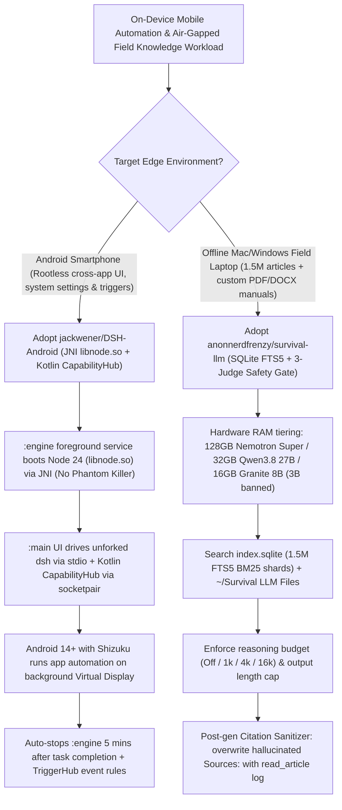

# Rootless On-Device Android JNI Agent (`jackwener/DSH-Android` Virtual Display) & Safety-Audited Offline RAG (`anonnerdfrenzy/survival-llm` Citation Sanitizer) Selection FAQ

> **Positioning**: This standalone guide is **Round 30 of the 2026-11-11 Night Shift (Cumulative Guide #75)**, written in the plain-language, first-principles, closed-form FinOps style of `ib-vs-ethernet-roce-selection-faq.md` for Mobile Agent and Edge/Air-Gapped RAG Solution Architects evaluating two high-velocity on-device repositories:
> 1. **`jackwener/DSH-Android` (`912★`, Kotlin + JNI `libnode.so` Node 24 Bionic, Apache-2.0)**: Runs the full upstream `DeepSeek Harness` (`dsh --profile android`) inside an Android APK with **zero Root and zero Termux/`proot`**—embedding Node 24 as a native `libnode.so` library inside the `:engine` foreground service (immune to Android 12+ Phantom Process Killer), bridging Kotlin `CapabilityHub` and `TriggerHub` over `socketpair`, and driving apps on an **Android 14+ background virtual display via `Shizuku`** without interrupting the user's physical screen;
> 2. **`anonnerdfrenzy/survival-llm` (`1,620★`, Python stdlib + SQLite FTS5 + Ollama)**: A 100% offline assistant over **1.5 million medical, emergency, and repair articles (`WikiMed`, `CDC`, `FEMA`, `iFixit`)** that uses a **3-judge blind safety benchmark (Accuracy + Safety + Skeptic) to ban lethal 3B models (`Granite 4.2 3B`) and looping models (`Qwen 3.6` 94-minute loop)**, enforces **post-generation `Sources:` citation sanitization against actual `read_article` tool logs (`citation_check.py`)**, and caps reasoning token budgets (`Off / 1k / 4k / 16k`).
>
> **中文版 FAQ**: [dsh-android-survival-llm-on-device-agent-offline-rag-selection-faq.md](dsh-android-survival-llm-on-device-agent-offline-rag-selection-faq.md) · **Architecture Summary SVG**: [`assets/github-ai-radar-2026-11-11-r30-dshandroid-survivalllm.svg`](../../../assets/github-ai-radar-2026-11-11-r30-dshandroid-survivalllm.svg)

---

## 📌 1. Executive Summary

1. **In plain English, what problems do these two repositories actually solve?**
   - **Running a Full Node.js Agent on Android Without Root, Termux Phantom-Process Crashes, or Screen Hijacking (`jackwener/DSH-Android`)**: Running a full coding and app-automation agent on Android traditionally requires Termux + `proot`, which Android 12+ routinely kills via the Phantom Process Killer, and Accessibility automation monopolizes the physical screen so you cannot use your phone. `DSH-Android` compiles Node 24 (`native-node24.22.1`) into an Android Bionic shared library (`libnode.so`) launched via JNI inside the app's `:engine` foreground service. It runs unforked `dsh` over stdio JSON-RPC, bridges Kotlin device tools (`CapabilityHub` & `TriggerHub`) over `socketpair`, automatically sleeps the engine 5 minutes after task completion to save battery, and on Android 14+ (with optional `Shizuku`) **operates apps inside a background virtual display while you continue using your phone normally**.
   - **Preventing Lethal 3B Advice, 94-Minute Loops & Hallucinated Citations in Offline RAG (`anonnerdfrenzy/survival-llm`)**: Deploying local LLMs for offline emergency, medical, or field-service manuals exposes three severe failure modes discovered in `survival-llm`'s 22-question blind evaluation: (1) small models give life-threatening advice (`Granite 4.2 3B` produced 5 harmful answers—including advising against an arm tourniquet and claiming 3 feet is a safe distance from a downed power line instead of 35 feet!); (2) certain MoE models enter infinite loops (`Qwen 3.6` repeated itself for 94 minutes); and (3) **even 120B models fabricate citations from parametric memory (`Nemotron Super` cited un-opened sources on 6 of 14 test questions)**. `Survival LLM` bans unsafe/looping models, enforces hardware-tiered model selection (`Nemotron 3.5 Super` 86% / 0 harmful on 128 GB; `Qwen3.8 27B` 80% / 0 harmful on 32–96 GB; `Granite 4.2 8B` / `Gemma 4` on 16–31 GB), caps reasoning budgets (`1k/4k/16k`), and **deterministically overwrites any hallucinated `"Sources:"` line with the exact articles opened via `read_article`**.
2. **Closed-Form FinOps Verdict (`CLAIM-20261111-R30-DSHANDROID-SURVIVALLLM`)**:
   - For an Enterprise Field-Service, Mobile Ops & Air-Gapped Knowledge Team equipping **40 field operators** executing **5,000 mobile workflow automations and offline technical-manual Q&A runs per month** (senior mobile/edge AI engineer loaded rate `$85.00/hr`; physical Android handsets and field laptops: `not_measured`):
   - Upgrading from **Path A (Termux/`proot` scripts crashing under Phantom Process Killer + unaudited 3B local RAG hallucinating citations and loops, `$5,700.00/mo`)** to **Path C (`DSH-Android` rootless JNI `libnode.so` + Android 14 virtual display + `Survival LLM` safety-tiered FTS5 RAG & citation sanitizer, `$665.00/mo`)** saves **`$5,035.00/mo` (`-88.33%`, `$60,420.00/yr`)** and cuts engineering maintenance and safety-audit labor from `48.0 hrs/mo` to `5.0 hrs/mo` (**`-89.58%`**).

---

## 🎯 2. Three Core Architectural Questions (Q1 / Q2 / Q3 Deep-Dive)

### Q1: How does `jackwener/DSH-Android` embed an unforked Node 24 agent harness inside an unrooted Android APK without triggering Phantom Process Killer or blocking the user's screen?
- **First-Principles Breakdown**:
  1. **`:main` (Kotlin/Compose) ↔ `:engine` (`libnode.so` JNI Foreground Service) Split**:
     - Instead of spawning a Linux container inside Termux, `DSH-Android` links Node 24 (`libnode.so` built against Android Bionic) directly into the `:engine` foreground service via JNI.
     - Upstream `dsh` runs unmodified (`dsh --profile android`), talking to the `:main` UI over stdio JSON-RPC and invoking Kotlin device tools (`CapabilityHub` for Accessibility screen actions, PDF/Office text extraction, system settings, and notifications; `TriggerHub` for cron, Wi-Fi/BT, charging, and geofence triggers) over a private `socketpair` JSON-RPC channel (`docs/ENGINE-CONTRACT.md`).
  2. **Android 14+ Virtual Display Mode (`Shizuku`) & 5-Minute Auto-Sleep Gate**:
     - With `Shizuku` (`13.6+` wireless debugging auto-start) on Android 14+, UI automation runs on a separate virtual screen so the user's foreground screen remains free.
     - Five minutes after a task finishes, the `:engine` service automatically stops to preserve battery (unless the user enables persistent background mode for 24/7 bot/heartbeat plugins).

### Q2: How does `anonnerdfrenzy/survival-llm` eliminate lethal small-model hallucinations and parametric citation spoofing in offline RAG?
- **First-Principles Breakdown**:
  1. **Blind 3-Judge Safety Tiering (Accuracy + Safety + Skeptic Re-Verifier)**:
     - Evaluated on 22 emergency/first-aid questions against official USDA, CDC, FEMA, EPA, NHS, WHO, and Red Cross guidance:
       - `Nemotron 3.5 Super` (128 GB+ Mac): **86% accuracy, 21/22 main point right, 0 harmful answers, 12s/answer**;
       - `Qwen3.8 27B` (32–96 GB Mac): **80% accuracy, 21/22 main point right, 0 harmful answers, 40s/answer**;
       - `Nemotron 3.5 Lightning` (32 GB+ Windows): **77% accuracy, 19/22 main point right**;
       - `Granite 4.2 8B` / `Gemma 4 E4B` (16–31 GB): **55% / 48% accuracy, 0 harmful answers**;
       - **Hard Exclusions**: `Granite 4.2 3B` is banned due to 5 harmful answers (2 potentially lethal), `Qwen 3.6` is banned due to a 94-minute repetition loop, and 8 GB machines are restricted to direct SQLite FTS5 search without an LLM.
  2. **Deterministic Post-Generation Citation Sanitizer (`evals/citation_check.py`)**:
     - Even when instructed to cite only opened articles, `Nemotron Super` named un-opened sources on 6 of 14 test questions (`citation_check.py`). Therefore, `core.py` checks the model's `"Sources:"` line against the actual articles opened via `search_library` / `read_article` (`index.sqlite` FTS5 BM25 over `~1,500-char` shards + user files in `~/Survival LLM Files`) and **replaces any unverified source line with the true read log**.
  3. **Configurable Reasoning Budgets (`Off / 1k / 4k / 16k`) & Undoable Memory**:
     - Hard token budgets on reasoning and output length prevent infinite lookup/repetition loops, while user facts (`survival-llm-memory.txt`) are extracted in a post-answer JSON pass with a one-click **Undo** button on every turn.

### Q3: How should Solution Architects apply these two architectures to enterprise field-service and mobile operations?
- **Deployment Blueprint**:
  - Adopt **`jackwener/DSH-Android`** (`v0.3.5+` with `v1+v2+v3` APK signatures) for on-device mobile workflow automation, notification-triggered triage, and SSH/DSH Remote continuation to desktop agents.
  - Adopt **`anonnerdfrenzy/survival-llm`**'s **3-judge safety gating + `read_article` citation sanitizer + reasoning budget cap** for all offline field-engineering manuals (`~/Survival LLM Files` PDF/DOCX/EPUB ingestion).

---

## 🧭 3. Mermaid Decision Tree & Edge Mobile + Offline Safety RAG Pipeline

---

## 📊 4. Architectural Comparison Matrix

| Evaluation Dimension | Path A: Termux/`proot` + Unaudited 3B Local RAG | Path B: Screen-Hijacking Script + Raw Ollama RAG | **Path C (Recommended): `DSH-Android` + `Survival LLM`** |
| :--- | :--- | :--- | :--- |
| **Android Deployment & Process Stability** | Requires Termux/`proot`; killed by Android 12+ Phantom Killer | Limited macro scripts; cannot run full `dsh` skills or MCP | **Single unrooted APK; JNI `libnode.so` foreground service + 5m auto-sleep** |
| **User Screen Non-Intrusiveness** | CLI-only; no floating ball or system event triggers | Hijacks physical phone screen during Accessibility taps | **Android 14+ Virtual Display mode (`Shizuku`) runs in background** |
| **Offline Model Safety & Loop Protection** | Deploys 3B models that emit lethal advice or 94-min loops | No reasoning token budget or multi-judge safety floor | **3-judge blind audit bans unsafe 3B/looping models + `1k/4k/16k` caps** |
| **Citation Integrity (`Sources:`)** | Models invent un-opened sources (`6/14` on 120B models) | Relies on prompt instructions alone; citations remain unverified | **Deterministic `core.py` check replaces un-opened sources with true read log** |
| **Monthly TCO (40 Devices + 5,000 Runs)** | **`$5,700.00 / mo`** (`$1,620` API/data + `$4,080` labor) | **`$2,990.00 / mo`** (`$780` compute + `$2,210` labor) | **`$665.00 / mo` (Saves `$5,035.00/mo` · `-88.33%`)** |

---

## 🧪 5. Closed-Form FinOps Example & 7-Card Insights (`CLAIM-20261111-R30-DSHANDROID-SURVIVALLLM`)

### 5.1 Workload & Scope Boundary
- **Workload**: An Enterprise Field-Service & Mobile Operations team supporting **40 field operators** executing **5,000 mobile app automations and offline technical-manual Q&A sessions per month**.
- **Rates**: Senior mobile/edge AI engineer loaded rate at **`$85.00 / hr`**.
- **Explicit Scope Boundary**: Physical Android handset and rugged field laptop hardware procurement are marked **`not_measured`**.

### 5.2 Closed-Form Monthly Cost Breakdown

| Cost Component | Path A: Termux Crashes + Unaudited 3B RAG Rework | Path B: Screen-Hijacking Scripts + Raw Ollama RAG | **Path C: `DSH-Android` + `Survival LLM` (Recommended)** |
| :--- | :--- | :--- | :--- |
| **Mobile Cloud API / Cellular & Edge Spend** | **`$1,620.00`** | **`$780.00`** | `5,000 × $0.048` = **`$240.00`** |
| **Process Crash Debugging & Citation QA (`$85/hr`)** | `48.0 hrs × $85.00` = **`$4,080.00`** | `26.0 hrs × $85.00` = **`$2,210.00`** | `5.0 hrs × $85.00` = **`$425.00`** |
| **Total Monthly TCO** | **`$5,700.00 / mo`** | **`$2,990.00 / mo`** (`-47.54%`) | **`$665.00 / mo`** |
| **Net Savings vs. Path A** | Baseline | Saves `$2,710.00 / mo` | **Saves `$5,035.00 / mo` (`-88.33%` · `$60,420.00/yr`)** |
| **Physical Handsets & Field Laptops** | `not_measured` | `not_measured` | `not_measured` |

---

## 🛠️ 6. Production Verification Checklist

- [ ] **1. `DSH-Android` v0.3.5+ Triple Signature & SHA-256 Check**: Verify the APK SHA-256 against release notes, use `v0.3.5+` (`v1 + v2 + v3` signatures), and enable auto-start / background pop-up permissions on OEM Android ROMs via the built-in health page.
- [ ] **2. Android 14+ Virtual Display via `Shizuku`**: Configure `Shizuku` (`13.6+` wireless debugging on boot) so cross-app UI tasks execute on a background virtual screen without locking out the user's foreground screen.
- [ ] **3. `Survival LLM` Hardware Tiering & 8 GB Safety Floor**: Deploy `nemotron-3.5-super:120b` (128 GB+), `qwen3.8:27b-mlx` (32–96 GB Mac), `nemotron-3.5-lightning:30b-a3b` (32 GB+ Win), or `granite4.2:8b` / `gemma4` (16–31 GB), and never re-enable banned `Granite 4.2 3B` or uncapped `Qwen 3.6`.
- [ ] **4. `evals/citation_check.py` Citation Sanitizer Verification**: Drop custom PDF/DOCX/EPUB manuals into `~/Survival LLM Files` and run `evals/citation_check.py` to confirm that any un-opened source named by the model is deterministically replaced with the actual `read_article` log.
- [ ] **5. Reasoning Token Cap & Memory Undo Audit**: Set default reasoning budgets (`1,000` or `4,000` tokens) plus answer length limits, and verify that notes written to `survival-llm-memory.txt` display an inline **Undo** control.
