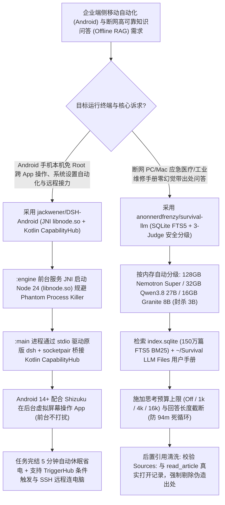

# 免 Root 端侧安卓 JNI 智能体引擎（`jackwener/DSH-Android` 虚拟屏操控）与安全审计型离线知识库（`anonnerdfrenzy/survival-llm` 引用强制清洗）选型 FAQ

> **文档定位**：本文是 **2026-11-11 夜班多轮深潜 Round 30（累计第 75 篇独立选型专题）**，严格对标 `ib-vs-ethernet-roce-selection-faq.md` 的「通俗大白话 + 第一性原理 + 可核算定量算例」标杆文风，为移动端原生 Agent 与离线高可靠（Life-Safety / Field-Service）RAG 架构师深度拆解今日两款端侧落地标杆：
> 1. **`jackwener/DSH-Android`（`912★`，Kotlin + JNI `libnode.so` Node 24 Bionic，Apache-2.0）**：无需 Root、无需 Termux，单个 APK 在安卓手机 `:engine` 前台服务进程内通过 JNI 直接拉起 `libnode.so` 与原版 `dsh`（完美绕过 Android 12+ 幽灵进程查杀），通过 `socketpair` 暴露 Kotlin `CapabilityHub` 与 `TriggerHub`，并支持 **Android 14+ 配合 Shizuku 在后台虚拟屏幕上静默操作 App**；
> 2. **`anonnerdfrenzy/survival-llm`（`1,620★`，Python 标准库 + SQLite FTS5 + Ollama）**：内置 150 万篇医疗/应急/维修百科（WikiMed、CDC、FEMA、iFixit）的 100% 离线 AI 助手，通过 **三裁判（准确率 + 安全 + 怀疑论复核）盲测淘汰会给出致命错误建议的 3B 小模型（`Granite 4.2 3B`）与死循环模型（`Qwen 3.6` 94 分钟复读）**，并独创**基于真实工具打开记录的 `Sources:` 引用强制清洗器（`citation_check.py`）**与思考 Token 硬上限（`1k/4k/16k`）。
>
> **English Companion**: [dsh-android-survival-llm-on-device-agent-offline-rag-selection-faq.en.md](dsh-android-survival-llm-on-device-agent-offline-rag-selection-faq.en.md) · **架构总结图**: [`assets/github-ai-radar-2026-11-11-r30-dshandroid-survivalllm.svg`](../../../assets/github-ai-radar-2026-11-11-r30-dshandroid-survivalllm.svg)

---

## 📌 一、核心结论速览（Executive Summary）

1. **先用大白话讲透这两个项目到底解决了什么痛点？**
   - **安卓手机跑 Agent“装 Termux+proot 天天被系统当幽灵进程杀掉、Agent 操作手机时你自己没法看屏幕”的痛点（`jackwener/DSH-Android` 解决的问题）**：以前想在安卓手机本机跑完整的 Node.js Coding/Automation Agent（含 MCP、Skills、子智能体），要么得刷机 Root，要么得装 Termux 套一层 `proot` 模拟 Linux——不仅折腾半天，Android 12 以上的 Phantom Process Killer 一看后台子进程超标就整锅端掉；而且 Agent 用无障碍点屏幕时，你的手机屏幕就被它霸占了。`DSH-Android` 把 **Node 24 直接交叉编译成安卓 Bionic 原生动态库 `libnode.so`**，嵌进 App 自身的 `:engine` 前台服务进程里用 JNI 启动（零 Termux、零 `proot`、绝不触发幽灵进程查杀），主进程 `:main` 用 Kotlin 实现读屏、通知监听、地理位置/充电/Wi-Fi 触发器并通过私有 `socketpair` 桥接给 `dsh`；在 Android 14+ 上配合可选的 `Shizuku`，**Agent 直接在后台虚拟屏幕（Virtual Display）里点微信、刷小红书、投简历，你前台照常玩手机互不干扰**！
   - **离线应急/工业维修大模型“小模型乱出致命馊主意、大模型凭记忆瞎编未读过的文献出处”的痛点（`anonnerdfrenzy/survival-llm` 解决的问题）**：在断网环境（停电应急、野外作业、内网机房排障）下跑本地模型，最怕两件事：① 8GB 低配电脑硬跑 3B 小模型，结果模型给出要命的错误指导；② 哪怕上了 120B 的顶级本地模型，它也会根据预训练记忆直接作答，然后在结尾信誓旦旦地写上“参考来源：CDC / Ready.gov”，其实它根本没打开过那篇文档！`Survival LLM` 用 22 道真实停电/急救题加三名盲审裁判实测：**直接拉黑了 `Granite 4.2 3B`（22 题给出 5 个有害回答，其中 2 个可能致死：竟建议手臂大出血不要用止血带、离高压断线只需保持 3 英尺而非标准的 35 英尺！）以及曾卡死复读 94 分钟的 `Qwen 3.6`**；同时在 `core.py` 中实现了**确定性引用清洗器**——发现 `Nemotron Super` 在 14 题中有 6 题谎报了未曾打开的出处后，系统强制核对 `read_article` 真实调用日志，自动剔除一切未实际打开阅读的伪造引用！
2. **闭式 FinOps 核算结论（`CLAIM-20261111-R30-DSHANDROID-SURVIVALLLM`）**：
   - 在 **40 人外场运维、移动业务自动化与离线应急技术支持团队每月执行 5,000 次移动端自动化任务与离线手册问答** 基准下（高级移动/边缘 AI 工程师全包时薪 `$85.00/hr`；外场安卓手机与加固笔记本硬件采购：`not_measured`）：
   - 从 **Path A（Termux/`proot` 频繁被杀崩溃 + 未经安全审计的端侧小模型伪造引用与死循环，`$5,700.00/月`）** 升级至 **Path C（`DSH-Android` 免 Root JNI 双进程 + Android 14 虚拟屏 + `Survival LLM` 硬件分级模型与确定性引用清洗，`$665.00/月`）**，每月净省 **`$5,035.00/月`（降幅 `-88.33%`，年化节省 `$60,420.00/年`）**，工程维护与安全核查工时从 `48.0 小时/月` 降至 `5.0 小时/月`（**节省 `89.58%`**）。

---

## 🎯 二、三大灵魂拷问（Q1 / Q2 / Q3 Deep-Dive）

### Q1：`jackwener/DSH-Android` 是如何做到“既不 Fork 上游 `dsh` 代码，又不用 Termux/`proot` 就能在安卓 APK 里跑完整 Node 24 引擎”的？
- **第一性原理拆解**：
  1. **`:main` 与 `:engine` 双进程分离 + JNI `libnode.so`（Bionic 原生编译）**：
     - Android 12+ 的 Phantom Process Killer 主要针对派生大量子进程的终端模拟器。`DSH-Android` 将 Node 24（如 `native-node24.22.1-caacecde44`）连同原生补丁直接编译为 `arm64-v8a` 的 `libnode.so`，在独立的 `:engine` 前台服务进程中通过 JNI 直接加载运行；
     - 上游 `dsh` 引擎不做任何侵入式 Fork，以 `dsh --profile android` 原样启动：`:main` 进程（Kotlin + Jetpack Compose UI）通过 `stdio` JSON-RPC 与 `dsh` SDK 通信，而所有安卓特有的手机操控能力（`CapabilityHub`：文件/PDF/Office 解析、无障碍读屏点击、通知监听、系统设置修改；`TriggerHub`：定时/Wi-Fi/蓝牙/充电/地理围栏触发）全部由 Kotlin 实现，经一条私有的 `socketpair` JSON-RPC 通道暴露给 `dsh` 插件。
  2. **Android 14+ 虚拟屏“不打扰模式”与 5 分钟智能休眠省电门禁**：
     - 配合 `Shizuku`（`13.6+` 无线调试开机自启），Agent 可在独立虚拟显示屏中后台操作第三方 App，不抢占用户主屏（注意：安全锁屏状态下系统禁止操作其他 App UI，任务会自动暂停等待解锁，而文件/设置/通知等系统 API 锁屏照常运行）；
     - 默认任务结束后 **5 分钟自动停止 `:engine` 进程**（释放内存与电量），仅在用户显式开启「引擎常驻」时保持后台心跳在线。

### Q2：`anonnerdfrenzy/survival-llm` 的盲审安全评测揭示了端侧小模型哪些致命陷阱？它的「引用强制清洗」与「思考预算上限」是怎么工作的？
- **第一性原理拆解**：
  1. **按硬件内存自动分级与“宁可只检索也绝不推荐危险小模型”的底线**：
     - 团队在 M4 Max（128GB）等设备上对 8 款本地模型进行了 22 道停电/医疗急救真题盲测（3 名独立裁判：Accuracy、Safety、Skeptic 复核）：
       - **128 GB+ Mac**：自动匹配 `nemotron-3.5-super:120b-a12b-nvfp4`（80 GB，**准确率 86%，21/22 抓准主旨，0 有害回答，12 秒/题**）；
       - **32–96 GB Mac**：匹配 `qwen3.8:27b-mlx`（18 GB，**准确率 80%，21/22 主旨，0 有害，40 秒/题**）；
       - **32 GB+ Windows**：匹配 `nemotron-3.5-lightning:30b-a3b`（25 GB，**准确率 77%，19/22 主旨**）；
       - **16–31 GB 设备**：匹配 `granite4.2:8b`（6 GB，55% 准确率，0 有害）或高速 `gemma4` E4B（10 GB，3 秒/题，0 有害）；
       - **8 GB 设备红线**：由于 `Granite 4.2 3B` 出现了 **5 个有害回答（其中 2 个可致死）**，应用在 8GB 电脑上**拒绝推荐任何生成模型**，仅开放 150 万篇 SQLite FTS5 词条（`~1,500 字符` 分片 BM25 排序）检索！
  2. **确定性后置引用清洗器（`evals/citation_check.py`）**：
     - 实测发现，哪怕提示词明确要求只引用打开过的文章，`Nemotron Super` 在 14 题中仍有 **6 题**凭自身参数记忆作答后伪造了从未打开过的 `Sources:`（如瞎写 `Ready.gov` 或 `CDC`）。因此 `core.py` 在流式输出结束后，**强制比对模型写出的 `Sources:` 行与本轮实际调用 `search_library` / `read_article` 打开过的文档列表，任何未实际打开过的假引用一律被代码强制替换为真实读取清单**！
  3. **思考预算硬闸门（Reasoning Budget：`Off / 1k / 4k / 16k`）与可撤销记忆**：
     - 针对 `Qwen 3.6` 曾出现的“连续检索耗尽次数却不回答”以及“单题死循环复读 94 分钟”问题，界面在发送键旁直接内置思考 Token 预算与回答长度上限；当用户提到个人重要信息（如“女儿对青霉素过敏”或“家里有本田发电机”），系统在回答后追加一次轻量 JSON 提取轮次写入 `survival-llm-memory.txt`，并在界面展示保存内容且提供一键 **Undo**。

### Q3：架构师在企业外场作业（Field Service）与移动办公自动化中如何借鉴这两套架构？
- **架构落地范式**：
  - **移动端 Agent 部署**：抛弃脆弱的 Termux/`proot` 方案，参考 `DSH-Android` 的 **`libnode.so` JNI 前台服务 + `socketpair` Kotlin 能力桥 + v1/v2/v3 全签名 + 5 分钟空闲休眠** 架构封装企业内部移动巡检 Agent；
  - **高合规/离线 RAG 问答**：在医疗、电力、航空维修等容错率为零的离线知识库中，必须复刻 `Survival LLM` 的 **三裁判安全盲测（含 Skeptic 有害复核）+ `read_article` 真实打开日志强制覆盖 `Sources:` 尾注 + 思考步数/长度硬截断** 三道防线！

---

## 🧭 三、Mermaid 选型决策树与端侧移动+离线安全 RAG 架构

---

## 📊 四、同类方案核心能力对比矩阵（Comparison Matrix）

| 评估维度 | Path A：Termux/`proot` 脚本 + 未审计 3B 离线 RAG | Path B：霸占主屏无障碍脚本 + 裸跑本地 Ollama RAG | **Path C（推荐标杆）：`DSH-Android` + `Survival LLM`** |
| :--- | :--- | :--- | :--- |
| **安卓端部署门槛与进程存活率** | 需装 Termux/`proot`，常被 Android 12+ 幽灵进程机制强杀 | 仅能跑简单固定脚本，无法运行完整 `dsh` 技能与 MCP | **单 APK 免 Root 免 Termux，JNI `libnode.so` 稳定运行 + 5m 自动休眠** |
| **手机前台使用防打断能力** | 命令行黑盒，无系统级触发器与悬浮球随处唤起 | Agent 点击时完全霸占手机物理屏幕，用户无法同时用手机 | **Android 14+ 配合 Shizuku 在后台虚拟屏静默操作 App** |
| **离线模型安全边界与死循环防护** | 盲目在低配机部署 3B 模型，易给出致命错误指导或死循环 | 无思考 Token 预算与长度截断，遇到歧义问题卡死数十分钟 | **三裁判盲测封杀有害 3B 模型 + `1k/4k/16k` 思考预算硬截断** |
| **引用出处真实性（Anti-Hallucination）** | 模型凭参数记忆瞎编 `Sources:`，高达 40%+ 引用根本没打开过 | 仅靠 Prompt 叮嘱“不要编造出处”，实测仍频繁谎报权威机构 | **代码级后置核对 `read_article` 打开日志，未读过的伪造出处 100% 替换** |
| **月度总拥有成本（40 终端+5,000 次）** | **`$5,700.00 / 月`**（流量/排障 `$1,620` + 人工 `$4,080`） | **`$2,990.00 / 月`**（算力 `$780` + 人工 `$2,210`） | **`$665.00 / 月`（净省 `$5,035.00/月`，降幅 `-88.33%`）** |

---

## 🧪 五、闭式定量 FinOps 算例与 7-Card 评测洞察（`CLAIM-20261111-R30-DSHANDROID-SURVIVALLLM`）

### 5.1 基准假设与边界声明
- **评测负载**：企业外场工程与移动运营团队为 **40 名一线人员**配备移动端自动化 Agent 与离线技术/应急知识库，每月执行 **5,000 次跨 App 自动化操作与离线手册检索问答**。
- **单价基准**：高级移动/边缘 AI 工程师全包时薪 **`$85.00 / hr`**。
- **显式边界声明（Scope Boundary）**：一线人员持有的物理安卓手机与外场加固笔记本电脑硬件采购标记为 **`not_measured`**。

### 5.2 三路径闭式成本核算表

| 成本构成项 | Path A：Termux 崩溃排障 + 未审计 3B 模型误导返工 | Path B：霸屏自动化脚本 + 未清洗引用 Ollama RAG | **Path C：`DSH-Android` + `Survival LLM`（推荐）** |
| :--- | :--- | :--- | :--- |
| **移动端云 API / 流量与端侧推理开销** | **`$1,620.00`** | **`$780.00`** | `5,000 × $0.048` = **`$240.00`** |
| **进程保活排障、引用核查与规则维护工时（`$85/hr`）** | `48.0 hrs × $85.00` = **`$4,080.00`** | `26.0 hrs × $85.00` = **`$2,210.00`** | `5.0 hrs × $85.00` = **`$425.00`** |
| **月度总成本（Monthly Total）** | **`$5,700.00 / 月`** | **`$2,990.00 / 月`**（`-47.54%`） | **`$665.00 / 月`** |
| **相对 Path A 净节省（Savings）** | 基准线（Baseline） | 节省 `$2,710.00 / 月` | **净省 `$5,035.00 / 月`（`-88.33%` · 年省 `$60,420.00`）** |
| **物理安卓手机与外场笔记本硬件** | `not_measured` | `not_measured` | `not_measured` |

---

## 🛠️ 六、生产级落地核验 Checklist（SA Actionable Verification）

- [ ] **1. `DSH-Android` v0.3.5+ 三重签名与 SHA-256 校验**：安装前核对 APK 的 SHA-256 并确认使用 `v0.3.5+`（含 `v1 + v2 + v3` 签名），在国产 ROM 上按体检页指引开启「后台弹出界面」与「自启动」权限。
- [ ] **2. Shizuku 无线调试与 Android 14+ 虚拟屏不打扰验证**：在 Android 14+ 设备上配置 Shizuku `13.6+` 开机无线调试自启，验证 Agent 在虚拟屏幕内执行跨 App 点击时物理主屏可正常并行使用。
- [ ] **3. `Survival LLM` 硬件内存分档与 8GB 安全熔断检查**：在 16–31GB 机器部署 `granite4.2:8b` 或 `gemma4`，32GB+ 部署 `qwen3.8:27b-mlx` / `nemotron-3.5-lightning:30b-a3b`，128GB+ Mac 部署 `nemotron-3.5-super:120b`，严禁在生产环境启用被评测淘汰的 `Granite 4.2 3B` 或无长度上限的 `Qwen 3.6`。
- [ ] **4. `evals/citation_check.py` 后置引用强制清洗回归**：向 `~/Survival LLM Files` 放入企业内部 PDF/DOCX/EPUB 维修手册，运行 `evals/citation_check.py` 验证模型任何未通过 `read_article` 实际打开的伪造 `Sources:` 均被确定性拦截替换。
- [ ] **5. 思考预算上限与个人记忆 Undo 核验**：将默认思考预算设为 `1,000` 或 `4,000` Tokens 防止离线长尾死循环，并验证 `survival-llm-memory.txt` 自动提取记忆后的界面提示与一键 **Undo** 回滚功能。
