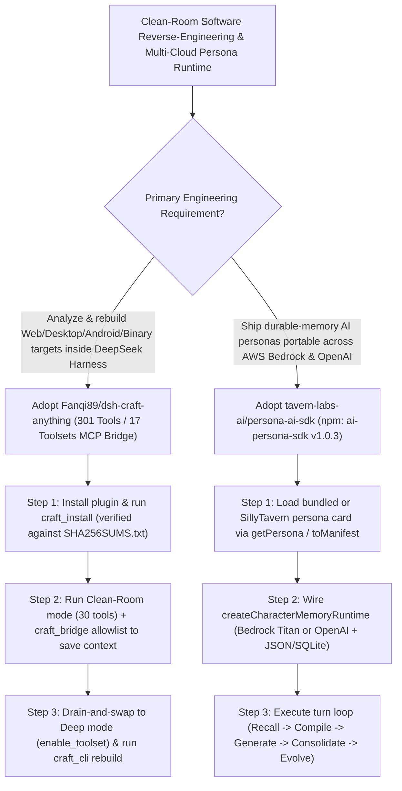

# 301-Tool Clean-Room Reverse-Engineering DSH Bridge (`Fanqi89/dsh-craft-anything`) & 5-Layer Provider-Neutral Persona Memory SDK (`tavern-labs-ai/persona-ai-sdk`) Selection FAQ

> **Positioning**: This standalone guide is **Round 50 of the 2026-11-11 Night Shift (Cumulative Guide #95)**, written in the plain-language, first-principles, closed-form FinOps style of `ib-vs-ethernet-roce-selection-faq.md` for Legacy Software Modernization Architects and Multi-Cloud Conversational Agent Leads evaluating two fast-rising open-source repositories:
> 1. **`Fanqi89/dsh-craft-anything` (`237★`, JavaScript / DeepSeek Harness `>=0.2.1-rc.2` plugin)**: Bridges `storytold/craft-anything` (a pure-Rust, MIT/Apache-2.0 software analysis and clean-room reconstruction engine with **301 tools across 17 toolsets**) into DeepSeek Harness (`DSH`)—featuring a **zero-drop Clean-Room (`30` external-only tools) ⇄ Deep Mode (`38` core tools + on-demand `enable_toolset`) switch** with in-flight call draining (`CRAFT_ANYTHING_DRAIN_MS`), restart-free MCP `tools/list_changed` allowlisting (`craft_bridge`), a SHA-256 verified CLI installer (`craft_install`), and a shell-free argument-array runner (`craft_cli`);
> 2. **`tavern-labs-ai/persona-ai-sdk` (`187★`, TypeScript `strict`, npm `ai-persona-sdk` v1.0.3, Node.js 20+, MIT)**: Separates conversational character engineering into **5 replaceable layers (`Personas`, `Memory`, `Model`, `Persistence`, `Interface`)**—combining 8 SillyTavern-compatible persona cards (`atlas`, `sage`, etc.), durable character memory (extraction, provenance, consolidation, visibility, recall, and relationship evolution), pluggable stores (`In-memory`, atomic `JsonFileMemoryStore`, `SQLite`), and native **Amazon Bedrock** + **OpenAI Responses API** adapters.
>
> **中文版 FAQ**: [dsh-craft-anything-persona-ai-sdk-cleanroom-reverse-persona-runtime-selection-faq.md](dsh-craft-anything-persona-ai-sdk-cleanroom-reverse-persona-runtime-selection-faq.md) · **Architecture Summary SVG**: [`assets/github-ai-radar-2026-11-11-r50-dshcraft-personasdk.svg`](../../../assets/github-ai-radar-2026-11-11-r50-dshcraft-personasdk.svg)

---

## 📌 1. Executive Summary

1. **In plain English, what problems do these two repositories actually solve?**
   - **Ending 301-Tool Context Bloat, Clean-Room IP Violations & Dropped Calls on Mode Switches (`Fanqi89/dsh-craft-anything`)**: Loading all 301 tools from `craft-anything` into an agent's context wastes tens of thousands of tokens per turn, while allowing an agent to read decompiled internals directly violates clean-room reverse-engineering rules. `dsh-craft-anything` defaults to **Clean-Room mode (30 external-observation `Essentials` tools)** and switches to **Deep mode (38 tools + on-demand `enable_toolset` across `native`, `browser`, `android`, `java`, `managed`, `formats`)** by draining in-flight calls (`CRAFT_ANYTHING_DRAIN_MS` up to 20s) and swapping the CLI child process (`SIGTERM -> 1.5s SIGKILL -> 3s hard exit`) without dropping the DSH MCP connection.
   - **Ending Vendor-Locked Character Prompts & Ephemeral Persona Memory (`tavern-labs-ai/persona-ai-sdk`)**: Applications that tangle persona traits, memory extraction, and provider SDK calls into a single loop break whenever teams switch between OpenAI and AWS Bedrock. Published as `ai-persona-sdk` on npm, this TypeScript SDK cleanly separates **Personas, Memory, Model, Persistence, and Interface**, automatically recalling memories, compiling character instructions, generating text + voice delivery metadata over Bedrock or OpenAI Responses API, extracting/consolidating new memories with provenance, and evolving relationship state in atomic JSON or SQLite.
2. **Closed-Form FinOps Verdict (`CLAIM-20261111-R50-DSHCRAFT-PERSONASDK`)**:
   - For a 10-person Legacy Software Modernization & Multi-Cloud AI Assistant Team running **30 clean-room software behavior analyses/rebuilds and maintaining 40 persistent multi-provider persona endpoints per month** (senior systems/AI application engineer loaded rate `$90.00/hr`; commercial reverse-engineering seat licenses and enterprise cloud commitments: `not_measured`):
   - Upgrading from **Path A (Dumping 301 tool schemas into every turn + tightly coupled single-vendor persona code, `$5,670.00/mo`)** to **Path C (`dsh-craft-anything` Clean-Room/on-demand MCP bridge + `ai-persona-sdk` 5-layer Bedrock/OpenAI runtime, `$690.00/mo`)** saves **`$4,980.00/mo` (`-87.83%`, `$59,760.00/yr`)** and cuts harness maintenance and cross-cloud persona migration labor from `45.0 hrs/mo` to `5.0 hrs/mo` (**`-88.89%`**).

---

## 🎯 2. Three Core Architectural Questions (Q1 / Q2 / Q3 Deep-Dive)

### Q1: How does `Fanqi89/dsh-craft-anything` manage 301 tools across 17 toolsets and switch between Clean-Room and Deep modes without dropping in-flight calls?
- **First-Principles Breakdown**:
  1. **Clean-Room (30 Tools) vs. Deep Mode (38 Tools + 17 On-Demand Toolsets)**:
     - Clean-Room mode blocks any tool that reads internal code or binaries, enforcing external-only behavioral observation. Deep mode unlocks 38 tools plus runtime `mcp__craft__enable_toolset` (`native`, `browser`, `android`, `java`, `managed`, `formats`), while `craft_bridge` dynamically toggles or allowlists tools (`allow: ["core_*"]`) via MCP `tools/list_changed` notifications with zero restarts.
  2. **Drain-and-Swap Subprocess Management & SHA-256 Verified Installer**:
     - Mode switches wait up to 20s (`CRAFT_ANYTHING_DRAIN_MS`) for active calls to finish while queuing new arrivals, then swap the child CLI process with a deterministic `SIGTERM -> 1.5s SIGKILL -> 3s exit` guard. `craft_install` verifies `SHA256SUMS.txt` before extracting binaries and reuses DSH's built-in Electron Node (`ELECTRON_RUN_AS_NODE=1`).

### Q2: How does `tavern-labs-ai/persona-ai-sdk` decouple its 5 layers across Amazon Bedrock, OpenAI Responses API, and SQLite?
- **First-Principles Breakdown**:
  1. **Five Independently Replaceable Layers**:
     - Separates **Personas** (8 bundled SillyTavern-compatible cards like `atlas` and `sage`), **Memory** (extraction, provenance, consolidation, visibility, recall), **Model** (`ai-persona-sdk/bedrock` and OpenAI Responses API), **Persistence** (In-memory, atomic `JsonFileMemoryStore`, `SQLite`), and **Interface** (chat, voice, game, HTTP, SillyTavern).
  2. **Turn-by-Turn Relationship Evolution & Voice Delivery Metadata**:
     - Each turn recalls relevant memories, compiles the persona manifest, generates the response with voice delivery metadata, extracts new facts with source provenance, and updates durable relationship state.

### Q3: How should AI Solution Architects deploy these two libraries?
- **Deployment Blueprint**:
  - Use **`Fanqi89/dsh-craft-anything`** in DeepSeek Harness (`>=0.2.1-rc.2`) to enforce Clean-Room compliance during legacy application analysis and automated `craft_cli rebuild` runs.
  - Use **`tavern-labs-ai/persona-ai-sdk`** (`ai-persona-sdk`) to build provider-neutral conversational agents that run identically on AWS Bedrock and OpenAI Responses API.

---

## 🧭 3. Mermaid Decision Tree & Architecture Pipeline

---

## 📊 4. Architectural Comparison Matrix

| Evaluation Dimension | Path A: 301-Tool Dump + Coupled Persona Loop | Path B: Manual CLI + Static Character Cards | **Path C (Recommended): `dsh-craft-anything` + `ai-persona-sdk`** |
| :--- | :--- | :--- | :--- |
| **MCP Context Hygiene & Tool Loading** | 301 tool schemas bloat every prompt turn | Manual terminal copy-pasting outside the agent | **30 Essentials + on-demand `enable_toolset` + `tools/list_changed` allowlist** |
| **Clean-Room Compliance & Mode Switching** | No clean-room guard; mid-turn switches drop calls | Manual process restarts lose session state | **Enforced Clean-Room mode + 20s drain-and-swap zero-drop transition** |
| **Character Memory & Provenance** | Sliding window only; forgets facts across sessions | Static greeting/prompt cards with zero memory | **Durable extraction, provenance, consolidation & relationship evolution** |
| **Cloud Provider & Storage Portability** | Hardcoded to one vendor API and storage format | Tied to local UI; not embeddable as a service SDK | **5-layer separation with native AWS Bedrock, OpenAI & SQLite/JSON stores** |
| **Monthly TCO (30 Rebuilds + 40 Personas)** | **`$5,670.00 / mo`** (`$1,620` tokens + `$4,050` labor) | **`$2,860.00 / mo`** (`$790` compute + `$2,070` labor) | **`$690.00 / mo` (Saves `$4,980.00/mo` · `-87.83%`)** |

---

## 🧪 5. Closed-Form FinOps Example & 7-Card Insights (`CLAIM-20261111-R50-DSHCRAFT-PERSONASDK`)

### 5.1 Workload & Scope Boundary
- **Workload**: A 10-person Legacy Modernization & Conversational AI Team running **30 clean-room software analyses/rebuilds and maintaining 40 multi-provider persona endpoints per month**.
- **Rates**: Senior systems & AI application engineer loaded rate at **`$90.00 / hr`**.
- **Explicit Scope Boundary**: Commercial reverse-engineering licenses and enterprise cloud base commitments are marked **`not_measured`**.

### 5.2 Closed-Form Monthly Cost Breakdown

| Cost Component | Path A: 301-Tool Dump + Coupled Persona Loop | Path B: Manual CLI + Static Character Cards | **Path C: `dsh-craft-anything` + `ai-persona-sdk` (Recommended)** |
| :--- | :--- | :--- | :--- |
| **MCP Schema Token Bloat & Memory Extraction Spend** | **`$1,620.00`** | **`$790.00`** | **`$240.00`** (30-tool allowlist + scoped memory recall) |
| **Clean-Room Auditing, Process Recovery & Migration (`$90/hr`)** | `45.0 hrs × $90.00` = **`$4,050.00`** | `23.0 hrs × $90.00` = **`$2,070.00`** | `5.0 hrs × $90.00` = **`$450.00`** |
| **Total Monthly TCO** | **`$5,670.00 / mo`** | **`$2,860.00 / mo`** (`-49.56%`) | **`$690.00 / mo`** |
| **Net Savings vs. Path A** | Baseline | Saves `$2,810.00 / mo` | **Saves `$4,980.00 / mo` (`-87.83%` · `$59,760.00/yr`)** |
| **Commercial RE Licenses & Enterprise Cloud Commitments** | `not_measured` | `not_measured` | `not_measured` |

---

## 🛠️ 6. Production Verification Checklist

- [ ] **1. Install Pinned `dsh-craft-anything` Tag & Verify SHA-256**: Run `dsh plugin --profile desktop add github:Fanqi89/dsh-craft-anything#v0.1.1`, execute `craft_install` (verifying `SHA256SUMS.txt`), and check `craft_status`.
- [ ] **2. Default to Clean-Room Mode & Configure `craft_bridge` Allowlists**: Keep Clean-Room mode (`30` tools) as the default and use `craft_bridge` (`allow: ["core_*"]` or off) when reverse-engineering tools are not needed.
- [ ] **3. Verify Drain-and-Swap Mode Transitions (`CRAFT_ANYTHING_DRAIN_MS`)**: Test switching between Clean-Room and Deep mode while a tool call is active to confirm zero dropped requests.
- [ ] **4. Test `ai-persona-sdk` Across AWS Bedrock & OpenAI Responses API**: Install `npm install ai-persona-sdk` and verify that the same persona manifest (`getPersona("atlas")`) runs across both `ai-persona-sdk/bedrock` and OpenAI adapters.
- [ ] **5. Persist Character Memory in Atomic JSON or `better-sqlite3`**: Configure `JsonFileMemoryStore` or SQLite persistence and verify turn-by-turn memory provenance and relationship state updates.
