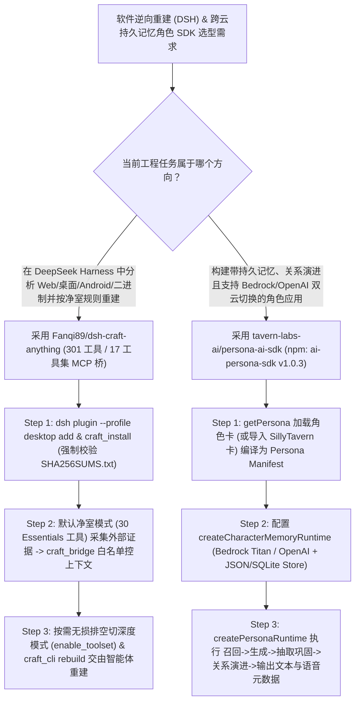

# 301 工具净室/深度逆向工程 DSH 桥（`Fanqi89/dsh-craft-anything`）与五层解耦角色持久记忆 SDK（`tavern-labs-ai/persona-ai-sdk`）深度选型 FAQ

> **文档定位**：本专题是 **2026-11-11 夜班第 50 轮（累计第 95 篇）独立六段式选型指南**，严格对标 `ib-vs-ethernet-roce-selection-faq.md` 的通俗第一性原理与闭式 FinOps 核算规范，面向软件逆向重构（Clean-Room Modernization）架构师与多云角色智能体（Persona Agent）研发负责人，深度拆解今日在 DeepSeek Harness（DSH）生态与 TypeScript 角色运行时赛道爆发的两大新锐开源仓：
> 1. **`Fanqi89/dsh-craft-anything`（`237★`，JavaScript，DeepSeek Harness `>=0.2.1-rc.2` 插件）**：将纯 Rust 编写的开源软件逆向与重建引擎 `storytold/craft-anything`（涵盖 Web、桌面、Android、Java、托管代码、固件与文件格式的 **17 个工具集 / 301 个引擎工具**）无缝接入 DSH——提供**「净室模式（30 个黑盒外部观测工具）⇄ 深度模式（38 个核心工具 + 按需加载 `enable_toolset`）」在途请求排空无损切换**、基于 MCP `tools/list_changed` 的免重启工具白名单（`craft_bridge`）、解压前 **SHA-256 签名校验安装器（`craft_install`）** 以及免 Shell 注入风险的参数数组执行器（`craft_cli`）；
> 2. **`tavern-labs-ai/persona-ai-sdk`（`187★`，TypeScript `strict`，npm 包 `ai-persona-sdk` v1.0.3，MIT）**：将角色设定（8 张内置 SillyTavern 兼容角色卡）、持久角色记忆（抽取、溯源、巩固、可见性、召回与关系状态演进）、大模型生成（原生支持 **Amazon Bedrock** 与 **OpenAI Responses API**）、持久化存储（内存、原子 JSON 文件 `JsonFileMemoryStore`、SQLite）与交互界面（聊天/语音/游戏）拆解为**完全可替换的五层正交架构**，同步输出文本回复与语音演绎元数据！
>
> **English Version**: [dsh-craft-anything-persona-ai-sdk-cleanroom-reverse-persona-runtime-selection-faq.en.md](dsh-craft-anything-persona-ai-sdk-cleanroom-reverse-persona-runtime-selection-faq.en.md) · **架构总结图**: [`assets/github-ai-radar-2026-11-11-r50-dshcraft-personasdk.svg`](../../../assets/github-ai-radar-2026-11-11-r50-dshcraft-personasdk.svg)

---

## 📌 一、核心结论速览（Executive Summary）

1. **一句话大白话讲透这两个项目到底解决了什么痛点？**
   - **终结“301 个逆向工具一次性塞爆上下文、切换净室/深度模式导致在途任务报错中断、以及无合规边界误读竞品源码”的痛点（`Fanqi89/dsh-craft-anything`）**：让 AI 帮研究一个现有软件并重写一套时，如果直接允许 Agent 读目标二进制反编译源码，往往会违反企业**净室重构（Clean-Room Reverse Engineering）**的知识产权合规红线；而如果把 `craft-anything` 的 301 个工具全挂进 MCP，每轮对话光工具 Schema 就要吃掉数万 Token。`dsh-craft-anything` 默认只暴露 **30 个 `Essentials` 净室工具**（只准从外部观察行为，严禁读取内部代码），需要深入底层时可通过左下角开关或 `craft_mode` 切到**深度模式**并按需调用 `mcp__craft__enable_toolset`；更厉害的是，v0.5.0+ 在切换模式时会在桥进程内**先排空在途调用（最多等 20 秒 `CRAFT_ANYTHING_DRAIN_MS`）、排队新请求、再以 `SIGTERM -> 1.5s SIGKILL -> 3s 强退` 替换底层 CLI 子进程并触发 `tools/list_changed` 热同步**，全程不断连、不掉单！
   - **终结“角色人设、长期记忆和特定云厂商 API 死死绑在一团面条代码里，从 OpenAI 切到 AWS Bedrock 就失忆变味”的痛点（`tavern-labs-ai/persona-ai-sdk`）**：开发游戏 NPC、品牌数字人或伴随式语音助手时，很多团队把提示词拼接、记忆写入和 OpenAI 接口硬编码在一起，一旦企业客户要求切换到 AWS Bedrock 或把 JSON 存储升级为 SQLite，整个角色就会“人设崩塌”。`ai-persona-sdk` 将系统严格解耦为 **Personas / Memory / Model / Persistence / Interface 五层**，每轮自动执行“召回相关记忆 → 编译角色指令 → 调 Bedrock/OpenAI 生成 → 抽取新记忆并更新亲密度/关系状态 → 返回文本与语音语气元数据”！
2. **闭式 FinOps 投资回报结论（`CLAIM-20261111-R50-DSHCRAFT-PERSONASDK`）**：
   - 以 10 人遗留系统逆向现代化与多云智能角色研发团队每月执行 **30 项软件净室行为分析/重建任务** 与维护 **40 个跨 OpenAI / AWS Bedrock 部署的持久记忆角色服务端点** 为基准（高级系统与 AI 应用工程师含税费率 `$90.00/hr`；商业反编译软件授权费与云厂商企业级保底消费合同：`not_measured`）：
   - 从 **Path A（301 工具全量注入撑爆 Token + 角色记忆与单一模型 API 紧耦合重构返工，月均 `$5,670.00`）** 升级至 **Path C（`dsh-craft-anything` 净室/按需工具集与无损排空桥 + `ai-persona-sdk` 五层解耦多云记忆运行时，月均 `$690.00`）**，每月净省 **`$4,980.00/mo`（降幅 `-87.83%`，年省 `$59,760.00/yr`）**，并将逆向工具链排障与跨云角色迁移工时从 `45.0 hrs/mo` 压缩至 `5.0 hrs/mo`（节省 **`-88.89%`**）。

---

## 🎯 二、三大灵魂拷问（Q1 / Q2 / Q3 深度原理解析）

### Q1：`Fanqi89/dsh-craft-anything` 是如何实现“净室 ⇄ 深度”在途排空切换、MCP 动态白名单与免 Node 独立安装的？
- **第一性原理拆解**：
  1. **净室模式（30 工具）vs 深度模式（38 核心 + 17 工具集按需开启）**：
     - **净室模式（Clean-Room，默认）**：只开放从外部观测目标行为的工具，任何试图读取目标内部源码、打包资源或反汇编指令的调用都会被拦截并给出明确合规提示；
     - **深度模式（Deep Mode）**：开放 38 个核心工具，并允许运行时通过 `mcp__craft__list_toolsets` / `mcp__craft__enable_toolset` 动态挂载 `native`、`browser`、`android`、`java`、`managed`、`formats` 等 17 个专业工具集；同时支持 `craft_bridge` 的 `allow` 白名单（如只留 `core_*`），通过 MCP 标准 `tools/list_changed` 通知立即从上下文中增删工具，**零进程重启**！
  2. **20 秒在途排空（Drain）+ 三级信号兜底防挂死**：
     - 切换模式时，桥进程先等待当前正在执行的工具调用自然结束（`CRAFT_ANYTHING_DRAIN_MS` 默认最多 20 秒），期间新到达的调用自动进队列暂存；随后对旧 CLI 进程执行 **`SIGTERM → 1.5 秒 SIGKILL → 3 秒强制退出`** 三级保底清理并拉起新子进程，DSH 主界面无需重连且在途请求零失败。
  3. **复用 Electron 内置 Node 与 SHA-256 强制验签**：
     - 通过 `command: process.execPath` + `ELECTRON_RUN_AS_NODE=1` 直接复用 DSH 桌面端自带的 Node 运行时；`craft_install` 在解压官方 `craft-anything-cli` 前强制比对 GitHub Release 的 `SHA256SUMS.txt`，并提供 Chromium、Ghidra、Java 21+、GDB 一键环境补齐卡片。

### Q2：`tavern-labs-ai/persona-ai-sdk`（`ai-persona-sdk`）的五层可替换架构是如何保持角色长期一致性与跨云可移植性的？
- **第一性原理拆解**：
  1. **五层关注点彻底正交（5 Replaceable Layers）**：
     - **Personas 层**：内置 `atlas`、`sage` 等 8 张标准角色卡（含提示词、性格特质、开场白、初始记忆种子，兼容 SillyTavern）；
     - **Memory 层**：负责事实抽取（Extraction）、出处溯源（Provenance）、记忆巩固（Consolidation）、可见性范围（Visibility）与相关性召回（Recall）；
     - **Model 层**：提供原生的 `ai-persona-sdk/bedrock`（Amazon Bedrock 生成 + Titan Embeddings）与 OpenAI Responses API 适配器；
     - **Persistence 层**：支持 `In-memory`、原子写入 `JsonFileMemoryStore` 与基于 `better-sqlite3` 的 `SQLite` 存储；
     - **Interface 层**：对接文本聊天、语音合成（返回语音演绎元数据）、游戏引擎或 SillyTavern 前端。

### Q3：AI 架构师如何将这两个工具应用到企业级研发与产品集成中？
- **黄金组合落地范式**：
  - 在使用 **DeepSeek Harness (`dsh`) 做竞品分析、遗留系统迁移或安全逆向**时，安装 **`Fanqi89/dsh-craft-anything`**，默认锁定**净室模式**采集外部行为证据并生成 `.cany` 审计工程与 Markdown 报告；
  - 在构建对外服务的**多模态智能客服、游戏 NPC 或专家数字分身**时，引入 **`ai-persona-sdk`**，实现一套角色卡与 SQLite/JSON 记忆库在 OpenAI 与 AWS Bedrock 之间的零代码无缝切换！

---

## 🧭 三、Mermaid 选型决策树与“净室逆向 + 角色运行时”流水线

---

## 📊 四、同类方案核心能力对比矩阵（Selection Matrix）

| 评估维度 | Path A：全量挂载 301 工具 + 紧耦合单云角色代码 | Path B：手工跑命令行逆向工具 + 静态 SillyTavern 卡片 | **Path C（推荐）：`dsh-craft-anything` + `ai-persona-sdk`** |
| :--- | :--- | :--- | :--- |
| **逆向工具上下文开销与动态加载** | 301 个工具 Schema 常驻上下文，每轮白烧上万 Token | 需人工在终端敲命令再把输出复制回聊天框 | **默认 30 工具 + `enable_toolset` 按需加载 + `tools/list_changed` 免重启过滤** |
| **净室合规边界与模式切换稳定性** | 无净室拦截，Agent 直接读反编译源码引发合规风险 | 切换配置需手动杀进程重启，在途任务全部报错中断 | **净室模式硬性拦截内部读取 + 20s 在途排空（Drain）无损切换** |
| **角色记忆生命周期与溯源** | 仅靠滑动窗口或简单向量检索，无记忆巩固与关系演进 | 只有静态开场白与设定，跨会话即失忆 | **完整抽取、溯源、巩固、可见性管控与每轮关系状态演进** |
| **多云模型与存储后端可移植性** | 绑死单一厂商 SDK，切 AWS Bedrock 需重写整套逻辑 | 绑死特定本地前端 UI，无法作为微服务 SDK 调用 | **五层正交解耦，原生含 Bedrock / OpenAI Responses API 与 SQLite/JSON** |
| **月度总拥有成本（30 重建 + 40 端点）** | **`$5,670.00 / mo`**（`$1,620` Token + `$4,050` 人工） | **`$2,860.00 / mo`**（`$790` 算力 + `$2,070` 人工） | **`$690.00 / mo`（净省 `$4,980.00/mo` · `-87.83%`）** |

---

## 🧪 五、定量 FinOps 算例与 7-Card 洞察（`CLAIM-20261111-R50-DSHCRAFT-PERSONASDK`）

### 5.1 测算基准与显式边界（Scope & Boundaries）
- **场景设定**：10 人遗留软件现代化与智能角色应用团队，每月执行 **30 项软件净室分析/重建任务**，并维护 **40 个跨 OpenAI 与 AWS Bedrock 的持久记忆角色服务端点**。
- **费率假设**：高级系统与 AI 应用工程师全包时薪 **`$90.00 / hr`**。
- **显式边界声明（Explicit Not-Measured Boundary）**：第三方商业逆向工具（如商业版 IDA Pro）席位费与 AWS/OpenAI 企业级保底承诺金标记为 **`not_measured`**，本表核算 MCP Schema 上下文开销、记忆抽取 Token 与工程师排障/迁移工时。

### 5.2 三路径月度成本闭式对照表

| 成本分项 | Path A：301 工具常驻 + 单云紧耦合角色代码 | Path B：手工 CLI 脚本 + 静态角色卡 | **Path C：`dsh-craft-anything` + `ai-persona-sdk`（推荐）** |
| :--- | :--- | :--- | :--- |
| **MCP 工具 Schema 膨胀与记忆抽取/生成 Token** | **`$1,620.00`** | **`$790.00`** | **`$240.00`**（30 工具精简白名单 + 结构化按需记忆召回） |
| **净室合规审计、僵尸进程清理与跨云重写工时（`$90/hr`）** | `45.0 hrs × $90.00` = **`$4,050.00`** | `23.0 hrs × $90.00` = **`$2,070.00`** | `5.0 hrs × $90.00` = **`$450.00`** |
| **月度总成本（Monthly TCO）** | **`$5,670.00 / mo`** | **`$2,860.00 / mo`**（`-49.56%`） | **`$690.00 / mo`** |
| **相对 Path A 净节省** | 基准线（Baseline） | 净省 `$2,810.00 / mo` | **净省 `$4,980.00 / mo`（`-87.83%` · 年省 `$59,760.00/yr`）** |
| **商业逆向软件席位与云厂商保底合同** | `not_measured` | `not_measured` | `not_measured` |

---

## 🛠️ 六、生产级落地核验 Checklist

- [ ] **1. `dsh-craft-anything` 固定语义化版本安装与 SHA-256 验签**：在 DSH `>=0.2.1-rc.2` 中执行 `dsh plugin --profile desktop add github:Fanqi89/dsh-craft-anything#v0.1.1`，运行 `craft_install` 验证 `SHA256SUMS.txt` 校验通过，并通过 `craft_status` 确认引擎就绪。
- [ ] **2. 净室模式默认门禁与 `craft_bridge` 白名单收敛**：默认保持「净室模式」（30 个外部观测工具），在无需逆向工具的轮次使用 `craft_bridge` 一键关闭或设置 `allow: ["core_*"]` 释放上下文窗口。
- [ ] **3. `CRAFT_ANYTHING_DRAIN_MS` 在途排空与无 Shell `craft_cli` 验证**：测试在工具执行中途切换净室/深度模式，确认在途请求正常排空完成且超时任务由 `SIGTERM -> SIGKILL` 干净回收。
- [ ] **4. `ai-persona-sdk` 五层组装与 Bedrock/OpenAI 双适配器测试**：通过 `npm install ai-persona-sdk` 引入 SDK，测试同一张角色卡（如 `getPersona("atlas")`）在 `ai-persona-sdk/bedrock` 与 OpenAI Responses API 下的零改写切换。
- [ ] **5. 原子 JSON / SQLite 持久记忆与语音元数据核验**：生产环境配置 `JsonFileMemoryStore` 或 `better-sqlite3` 存储，验证多轮对话后的记忆溯源（Provenance）、关系状态更新与语音演绎元数据输出。
