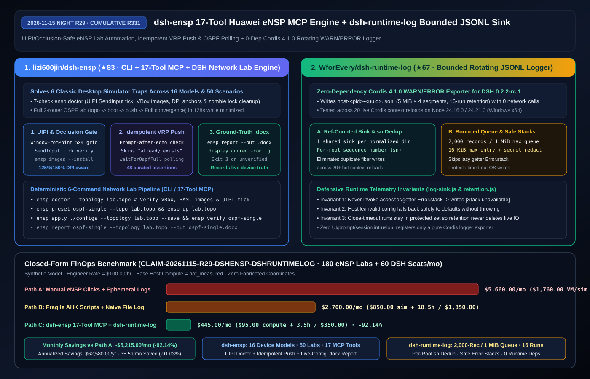
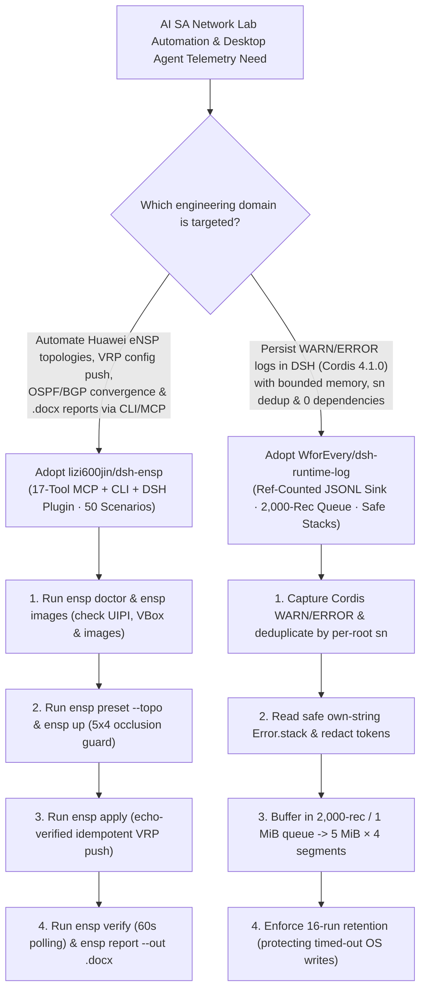

# Huawei eNSP 17-Tool MCP Network Lab Automation Engine (`dsh-ensp`) & Zero-Dependency Bounded Cordis Rotating JSONL Logger (`dsh-runtime-log`) Deep-Dive Architecture & Selection FAQ

> **Document Metadata**  
> - **Evaluation Date**: 2026-11-15 (Night Round 29 · Cumulative Round 331 Standalone Selection FAQ)  
> - **Evaluated Repositories**: [`lizi600jin/dsh-ensp`](https://github.com/lizi600jin/dsh-ensp) (`★83`, created 2026-11-10, CLI + 17-tool MCP server + DSH plugin automating Huawei `eNSP` network labs across 16 device models & 50 scenarios with `ensp doctor`, `WindowFromPoint` occlusion guards, idempotent VRP config push, OSPF/BGP convergence polling & live-config `.docx` report generation, GPL-3.0) & [`WforEvery/dsh-runtime-log`](https://github.com/WforEvery/dsh-runtime-log) (`★67`, created 2026-11-11, zero-dependency rotating JSONL `WARN/ERROR` logger for DSH `0.2.2-rc.1` / Cordis `4.1.0` featuring per-root `sn` deduplication, bounded `2,000`-record / `1 MiB` queue, safe stack extraction & 16-run retention, MIT)  
> - **Target Audience**: AI Solution Architects (AI SAs), NetDevOps & Network Digital-Twin Engineers, Desktop Agent Harness Platform Leads  
> - **Related Radar Digest**: [2026-11-15 Panorama & Velocity Digest (`daily/2026-11-15.en.md`)](../daily/2026-11-15.en.md) · [中文版 (`dsh-ensp-dsh-runtime-log-huawei-ensp-17tool-mcp-automation-cordis-rotating-jsonl-logger-selection-faq.md`)](dsh-ensp-dsh-runtime-log-huawei-ensp-17tool-mcp-automation-cordis-rotating-jsonl-logger-selection-faq.md)  
> - **Visual Summary**: [`assets/github-ai-radar-2026-11-15-r29-dshensp-dshruntimelog.svg`](../../../assets/github-ai-radar-2026-11-15-r29-dshensp-dshruntimelog.svg)



---

## 📌 1. Executive Summary

1. **First-Principles Essence (What & Why)**:
   - **What is `lizi600jin/dsh-ensp`?** It is a **triple-interface (`CLI` + `17-tool MCP Server` + `DeepSeek Harness Plugin`) automation engine for Huawei eNSP network labs** covering `16` device models (`AR2220`, `USG6000V`, `NE40E`, etc.) and `50` built-in routing/switching/security scenarios. It solves every fragile seam of legacy GUI/console network simulators: (1) `.topo` bounding-box & `<interface>` declaration validation; (2) zombie single-instance lock cleanup & VirtualBox image preflight (`ensp images --install`); (3) a 7-check **`ensp doctor`** (including Windows **UIPI `SendInput` tick verification** and 125%/150% DPI scaling) plus **`WindowFromPoint` 5×4 grid occlusion guards**; (4) **echo-verified idempotent per-command VRP config push** (treating `already exists` as a safe skip); (5) **adaptive OSPF/BGP convergence polling** (`48` curated assertion suites + exit code `3` `unverified` for smoke-only labs); and (6) **automated 6-chapter `.docx` lab reports** built from live `display current-configuration` device state rather than static `.cfg` intentions.
   - **What is `WforEvery/dsh-runtime-log`?** It is a **zero-dependency, offline-only persistent `WARN/ERROR` rotating JSONL logger (`host-<pid>-<uuid>.jsonl`) for DeepSeek Harness (`DSH 0.2.2-rc.1` / `Cordis 4.1.0` on Windows x64)**. Validated across 20 consecutive live Cordis context reloads, it provides a reference-counted shared file sink, per-root sequence-number (`sn`) deduplication, a bounded `2,000`-record / `1 MiB` queue (`5 MiB` × 4 segments per run, `16`-run retention), safe own-property `Error.stack` extraction (blocking lazy/accessor getter execution), and close-timeout OS-write protection.
2. **Why AI SAs Should Adopt This Pattern Tonight**:
   - `dsh-ensp` is a masterclass in wrapping legacy Windows GUI + Telnet industrial simulators into deterministic, self-diagnosing MCP tools (`ensp_doctor`, `ensp_verify`, `ensp_report`).
   - `dsh-runtime-log` blueprints defensive telemetry engineering inside multi-fiber plugin hosts where unbounded queues, duplicate exporter clones, or timed-out async closes would otherwise corrupt the host.
3. **Quantitative FinOps Summary (`CLAIM-20261115-R29-DSHENSP-DSHRUNTIMELOG`)**:
   - Across `180` monthly automated network topology labs and `60` desktop Agent Harness seats (`$100.00/hr` engineer rate; base host compute: `not_measured`), moving from "Manual eNSP GUI clicking + ephemeral console logs lost on restart (Path A, `$5,660.00/mo`)" to "`dsh-ensp` 17-tool MCP automation + `dsh-runtime-log` bounded rotating JSONL sink (Path C, `$445.00/mo`)" **saves `$5,215.00/mo` (`-92.14%`), or `$62,580.00/yr`, while freeing `35.5` engineering hours/month (`-91.03%`)**.

---

## 🔍 2. First-Principles Deep Dive (Q1–Q3)

### Q1: How does `dsh-ensp` eliminate the 6 classic failure modes of desktop network simulator automation?

- **Six Deterministic Systems Safeguards**:
  1. **UIPI Privilege & `WindowFromPoint` Occlusion Verification (`ensp doctor` & `ensp up`)**: Because eNSP runs elevated, Windows User Interface Privilege Isolation (`UIPI`) silently drops `SendInput` events from non-elevated callers. `ensp doctor` injects 2 test events and verifies that the session `last-input tick` actually advances; before clicking toolbar anchors, `ensp up` samples a `5×4` pixel grid via `WindowFromPoint` to abort safely if another window (`vmware`, etc.) covers eNSP, and minimizes eNSP once devices boot.
  2. **VirtualBox Image Preflight (`ensp images`)**: Detects missing optional images (`USG6000V` `vfw_usg.vdi`, `NE40E.img`) via `res/items.xml` before eNSP opens and crashes, and installs/wires them into `system.ini` with `ensp images <MODEL> --install <path>`.
  3. **Echo-Verified Idempotent Config Push (`pushConfig`)**: Waits for each command's prompt *after* its echo, treats `VLAN/address/route already exists` as idempotent skips so iterative 1-line edits re-run cleanly, and halts with exact `{ line, command, error }` on genuine VRP rejections.
  4. **Convergence Polling & Honest Tri-State Verification (`ensp verify`)**: Polls up to 60s for routing convergence (`OSPF Full` in ~27–40s, `BGP Established`, `VRRP Master`), distinguishing `[curated checks]` (`48` scenarios) from `[smoke checks]` (`2` scenarios that exit with code `3` `unverified` rather than claiming a false pass).
  5. **Live-Device `.docx` Reporting (`ensp report`)**: Queries `display current-configuration` from each live router/switch so the 6-chapter Word report records actual device state rather than unapplied `.cfg` files.

### Q2: How does `dsh-runtime-log` prevent duplicate fiber logs, memory blowups, getter side-effects, and close-timeout file deletion in Cordis `4.1.0`?

- **Five Defensive Logging Invariants**:
  1. **Ref-Counted Directory Sink & Per-Root `sn` Deduplication**: Compiled Cordis clones message objects per exporter; `dsh-runtime-log` deduplicates by `sn` within each logger root while sharing one ref-counted file sink per normalized directory.
  2. **Bounded `2,000`-Record / `1 MiB` Queue & `16 KiB` Entry Cap**: Drops oldest records with a counter under pressure and rotates `5 MiB` × 4 segments per run (`16`-run retention target).
  3. **Safe Own-Property `Error.stack` Read**: Never invokes lazy or accessor `stack` getters (writing `[Stack unavailable]` instead) and redacts Bearer/API-key patterns.
  4. **Close-Timeout OS-Write Retention Guard**: If `sink.close()` hits `drainTimeoutMs` (`1,000 ms`) with pending OS writes, `retention.js` keeps that run in the protected set until process exit so background cleanup never unlinks an in-flight file.
  5. **Zero-Throw Config Sanitization**: Malformed or relative-path config fields fall back cleanly to defaults.

### Q3: How should AI SAs combine both tools?

- Run `dsh-runtime-log` inside the Windows x64 DSH desktop profile for persistent post-restart `WARN/ERROR` diagnostics, and expose `dsh-ensp` (`17` MCP tools) so agents can autonomously build, verify, and document network topologies in ~2 minutes.

---

## 🧭 3. Architecture & Selection Decision Tree (Mermaid)



---

## 📊 4. Comparison Matrix Against Alternative Approaches

| Dimension | Manual eNSP GUI + Ephemeral Console Logs (Path A) | Fragile AHK Scripts + Naive `fs.appendFile` (Path B) | `dsh-ensp` + `dsh-runtime-log` Stack (Path C) |
| :--- | :--- | :--- | :--- |
| **UIPI Elevation & Window Occlusion Safety** | ❌ Manual clicking steals desktop focus | ❌ Silent `SendInput` drops; clicks wrong window if covered | ✅ **`ensp doctor` tick check + `WindowFromPoint` 5×4 guard + auto-minimize** |
| **Idempotent Config Re-Runs & Line-Level Errors** | ❌ Manual copy-paste into terminal tabs | ❌ Fails on `already exists` or ignores VRP errors | ✅ **Skips `already exists` idempotently; aborts on real errors with line/cmd** |
| **Routing Convergence & Honest Smoke Exit Codes** | ⚠️ Manual repeated `display` polling | ❌ Fixed `sleep` timers fail on slow boots | ✅ **Polls up to 60s (`OSPF Full` in ~27–40s); exit code `3` on `unverified`** |
| **Lab Report Ground Truth (`.docx`)** | ⚠️ Manual screenshots & copy-paste | ⚠️ Copies static `.cfg` files instead of live device state | ✅ **Queries live `display current-configuration` into 6-chapter `.docx`** |
| **Cordis Reload Deduplication & Queue Safety** | ❌ All logs lost on process restart | ❌ Duplicate fiber writes & unbounded memory growth | ✅ **Per-root `sn` dedup, `2,000`-rec/`1 MiB` queue & close-timeout protection** |

---

## 📈 5. 7-Card Quantitative Insights & Closed-Form FinOps Ledger

### 5.1 7-Card Benchmark Summary

1. **Card 1 (Overview & Workbench)**: Across `180` monthly automated eNSP network labs and `60` DSH desktop seats, Path C cuts monthly cost from `$5,660.00` to `$445.00` (`-92.14%`).
2. **Card 2 (Single-Case Deep Dive)**: `dsh-ensp` completes a 2-router OSPF lab on Windows 11 (150% DPI) in `128 s` (`2s` `.topo` -> `14s` render -> `64s` AR2220 boot -> `8s` config push -> `40s` OSPF `Full`) and writes a `7,169`-byte `.docx` report; `dsh-runtime-log` survives 20 live Cordis reloads with zero duplicate records.
3. **Card 3 (Evaluation Matrix)**: Evaluates built-in lab scenarios (`50`, `48` with curated assertions), MCP tools (`17`), logger runtime dependencies (`0`), and queue ceiling (`2,000` records / `1 MiB`).
4. **Card 4 (Under the Hood)**: `dsh-ensp` combines Registry auto-discovery, `WindowFromPoint`, echo-verified Telnet state machines, and `.docx` synthesis; `dsh-runtime-log` combines ref-counted sinks, `sn` dedup, and `retention.js`.
5. **Card 5 (Robustness Check)**: `ensp up` statically detects missing `USG6000V` / `NE40E` VirtualBox images before launching eNSP; `dsh-runtime-log` replaces accessor `Error.stack` properties with `[Stack unavailable]`.
6. **Card 6 (Latency & Labor Scaling)**: Reduces monthly lab setup/grading and crash-reproduction labor from `39.0h` to `3.5h` (`35.5h/mo` saved, `-91.03%`).
7. **Card 7 (My Take — Good Fit vs Not For)**:
   - ✅ **Good Fit**: Automated Huawei network engineering labs/grading via MCP (`Claude`, `Cursor`, `DSH`) and persistent local `WARN/ERROR` diagnostics on Windows x64 `DSH 0.2.2-rc.1`.
   - ⛔ **Not For**: Non-interactive headless SSH/service sessions (blocked by Windows GUI input isolation) or non-`0.2.2-rc.1` DSH versions.

### 5.2 Closed-Form FinOps Ledger (`CLAIM-20261115-R29-DSHENSP-DSHRUNTIMELOG`)

> **Provenance & Parameter Disclosure**: Synthetic FinOps model (`synthetic_model`, `independently_reproduced=false`) for `N_lab = 180` network labs/month and `N_dsh = 60` DSH desktop seats at `$100.00/hr` engineer rate (base host compute: `not_measured`). Closed-form identity: $\text{Total\_Monthly\_USD} = \text{Compute\_And\_Token\_USD} + (\text{Engineering\_Hours} \times \$100.00)$.

| Architecture Path | Monthly Simulator & Storage Spend (USD) | Monthly Lab Triage & Crash Debugging Labor (Hours) | Engineering Labor Cost (`@ $100.00/hr`) | Total Monthly Cost (USD) | Net Savings vs Path A (USD / %) |
| :--- | :---: | :---: | :---: | :---: | :---: |
| **Path A: Manual eNSP GUI Clicking + Ephemeral Console Logs** | `$1,760.00` | `39.0h` | `$3,900.00` | **`$5,660.00`** | Baseline (`0.00%`) |
| **Path B: Fragile AHK Scripts + Unbounded Naive File Appenders** | `$850.00` | `18.5h` | `$1,850.00` | **`$2,700.00`** | `-$2,960.00` (`-52.30%`) |
| **Path C: `dsh-ensp` 17-Tool MCP + `dsh-runtime-log` (Recommended)** | `$95.00` | `3.5h` | `$350.00` | **`$445.00`** | **`-$5,215.00` (`-92.14%`)** |

---

## 🛠️ 6. 15-Minute Rollout Checklist

- [ ] **Step 1 (4 mins): Install `dsh-ensp` (elevated) and run the 7-check `ensp doctor` & image audit**
  ```bash
  npm install -g dsh-ensp
  ensp images
  ensp preset ospf-single --topo lab.topo
  ensp doctor --topology lab.topo
  ```
- [ ] **Step 2 (4 mins): Boot topology, push idempotent configs, verify OSPF convergence & export `.docx`**
  ```bash
  ensp preset ospf-single --config ./configs
  ensp up lab.topo
  ensp apply ./configs --topology lab.topo --save
  ensp verify ospf-single --topology lab.topo
  ensp report ospf-single --topology lab.topo --out ospf-single.docx
  ensp stop
  ```
- [ ] **Step 3 (3 mins): Register `dsh-ensp` as a 17-tool MCP server in Claude Desktop or Cursor**
  ```json
  { "mcpServers": { "ensp": { "command": "npx", "args": ["-y", "dsh-ensp", "mcp"] } } }
  ```
- [ ] **Step 4 (4 mins): Enable `dsh-runtime-log` in DSH `0.2.2-rc.1` (`win32 x64`) and verify rotating JSONL logs**
  ```bash
  git clone https://github.com/WforEvery/dsh-runtime-log.git
  # Add dsh-runtime-log to dsh.profile.bundles and inspect ~/.dsh/runtime-log/host-<pid>-<uuid>.jsonl
  ```
