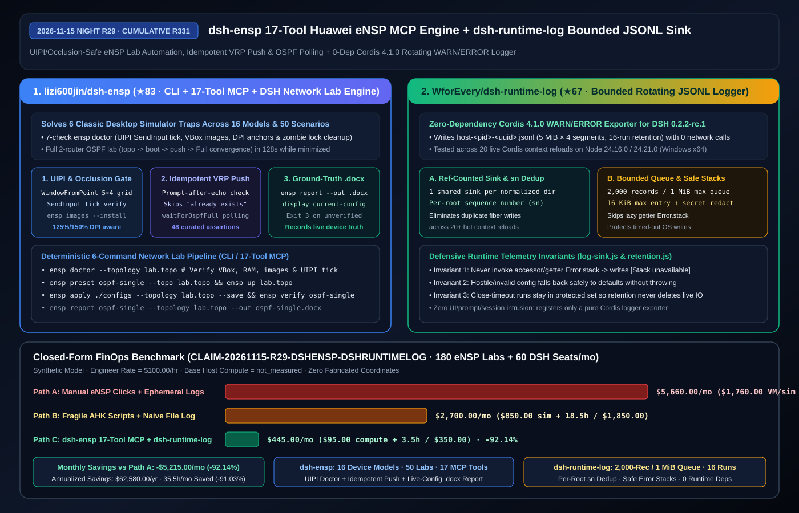
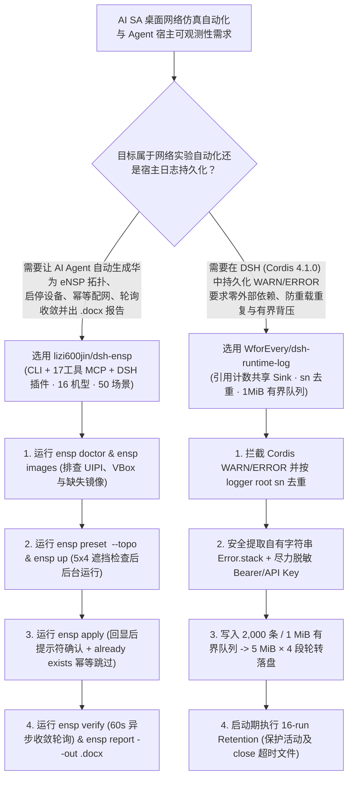

# 华为 eNSP 17工具 MCP 网络实验自动化引擎（`dsh-ensp`）与 Cordis 有界脱敏轮转日志插件（`dsh-runtime-log`）深度架构拆解与同类方案选型 FAQ

> **文档元数据（Document Metadata）**  
> - **评审日期**：2026-11-15（Night Round 29 · 累计第 331 轮独立选型专题）  
> - **对标项目**：[`lizi600jin/dsh-ensp`](https://github.com/lizi600jin/dsh-ensp)（`★83`，2026-11-10 创建，支持 CLI / 17 工具 MCP Server / DSH 插件三栖调用的华为 eNSP 自动化引擎，含 7 项 `ensp doctor` 体检、`WindowFromPoint` 遮挡检测、幂等逐命令下发、OSPF/BGP 异步收敛轮询与实机配置 `.docx` 报告生成，GPL-3.0） & [`WforEvery/dsh-runtime-log`](https://github.com/WforEvery/dsh-runtime-log)（`★67`，2026-11-11 创建，面向 DSH `0.2.2-rc.1` / Cordis `4.1.0` 的零外部依赖本地 `WARN/ERROR` 轮转 JSONL 日志器，具备 `sn` 序列号去重、`2,000` 条/`1 MiB` 有界队列与超时写入保护，MIT）  
> - **适用角色**：AI Solution Architect（AI 解决方案架构师）、NetDevOps 与网络数字孪生工程师、Agent Harness 插件平台架构师  
> - **关联雷达日报**：[2026-11-15 全景洞察与飙升榜 (`daily/2026-11-15.md`)](../daily/2026-11-15.md) · [English Version (`dsh-ensp-dsh-runtime-log-huawei-ensp-17tool-mcp-automation-cordis-rotating-jsonl-logger-selection-faq.en.md`)](dsh-ensp-dsh-runtime-log-huawei-ensp-17tool-mcp-automation-cordis-rotating-jsonl-logger-selection-faq.en.md)  
> - **可视化总结图**：[`assets/github-ai-radar-2026-11-15-r29-dshensp-dshruntimelog.svg`](../../../assets/github-ai-radar-2026-11-15-r29-dshensp-dshruntimelog.svg)



---

## 📌 一、核心结论速览（Executive Summary — 先看结论再看细节）

1. **一句话讲透本质（What & Why）**：
   - **`lizi600jin/dsh-ensp` 是什么？** 它是把传统纯手工点击的桌面网络模拟器 **华为 eNSP** 彻底改造成 **“可由 Claude / Cursor / DeepSeek Harness 通过 17 个 MCP 工具或 CLI 全自动编排、启动、幂等配网、轮询收敛并直出 Word 验收报告”** 的工业级 NetDevOps 引擎。它用极其扎实的第一性原理工程，逐一攻克了桌面模拟器自动化的六大天坑：① **`.topo` 包围盒与端口声明强校验**（防打开空白画布）；② **启动前清杀僵尸单实例锁 + `ensp images` 预检缺失的 `USG6000V`/`NE40E` 镜像**；③ **`ensp doctor` 七项体检（含 Windows UIPI 特权隔离 `SendInput` 注入探测）+ `WindowFromPoint` 5×4 网格窗口遮挡保护 + 启动后自动最小化不抢桌面**；④ **提示符滞后回显核验 + `already exists` 幂等跳过逐条下发**；⑤ **OSPF/BGP 异步收敛轮询（`waitForOspfFull`）与 48 套精选断言（未配断言场景显式返回退出码 `3` `unverified`，绝不假冒通过）**；⑥ **直接从设备拉取真实生效的 `display current-configuration` 生成 6 章节 `.docx` 实验报告**！
   - **`WforEvery/dsh-runtime-log` 是什么？** 它是专为 **DeepSeek Harness (`DSH 0.2.2-rc.1` / `Cordis 4.1.0`)** 打造的 **“零外部依赖、零网络请求、具备同服务 `sn` 序列号去重、有界内存背压（`2,000` 条 / `1 MiB`）、惰性 Error Getter 安全屏蔽与超时 OS 写入文件保护的本地 `WARN/ERROR` 轮转 JSONL 日志插件”**。
2. **为什么值得 AI SA 今晚立刻掌握？**
   - `dsh-ensp` 是 **“如何把一个没有现代 REST API、强依赖 Windows GUI 与串口 Telnet 的重型传统工业软件封装成高可靠 MCP Server”** 的教科书级范本；
   - `dsh-runtime-log` 是 **“如何在微内核/Fiber 插件架构（Cordis）中编写绝对不拖垮宿主、不泄漏句柄、不被恶意/惰性 Error 对象触发代码执行的防御式遥测组件”** 的满分答卷。
3. **定量收益摘要（Closed-Form FinOps Ledger `CLAIM-20261115-R29-DSHENSP-DSHRUNTIMELOG`）**：
   - 在每月执行 `180` 次复杂网络拓扑仿真验证（OSPF/BGP/MPLS/防火墙双机热备）与维护 `60` 个桌面 Agent Harness 席位崩溃取证场景下（工程师时薪 `$100.00/hr`，底层宿主机硬件成本 `not_measured`），从“人工拖拽连线复制命令 + 重启即丢的控制台日志（Path A，`$5,660.00/mo`）”切换到“`dsh-ensp` 17 工具 MCP 自动化 + `dsh-runtime-log` 有界轮转日志（Path C，`$445.00/mo`）”，**每月净省 `$5,215.00`（`-92.14%`），年化节省 `$62,580.00/yr`，每月释放 `35.5` 小时排障与写报告工时（`-91.03%`）**。

---

## 🔍 二、第一性原理灵魂三问（Q1–Q3 Deep Dive）

### Q1：为什么用普通自动化脚本控制华为 eNSP 总是遇到“点不动按钮、打开空白画布、重跑脚本报错中断、OSPF 刚配完验收就失败”？`dsh-ensp` 是如何逐一封死这些故障的？

- **六大经典故障的第一性原理根治方案**：
  1. **为什么 `SendInput` 返回成功但 eNSP 没反应？（Windows UIPI 特权隔离与遮挡）**  
     - eNSP 以高完整性管理员权限运行；若自动化工具以普通权限运行，Windows 用户界面特权隔离（UIPI）会静默丢弃输入事件！`ensp doctor` 专门设计了 `input-injection` 探针：发送 2 个事件后核对系统 `last-input tick` 是否真正改变；并在点击前用 `WindowFromPoint` 扫描 5×4 采样网格，一旦发现被 `vmware` 等其他窗口遮挡立即报错停手，绝不盲点！
  2. **为什么改一行配置重跑脚本就卡死？（回显后提示符确认 + `already exists` 幂等跳过）**  
     - `pushConfig` 严守“提示符必须在本条命令回显之后出现”的时序不变量；当设备返回 `VLAN already exists` 或 `address already exists` 时，将其识别为“已达目标状态”自动跳过而非中断，而在遇到真正的 VRP 语法/对象拒绝时立即精准报出 `{ line, command, error }`。
  3. **为什么配置下发成功立即验收却判失败？（路由协议异步收敛轮询 + 三态诚实判定）**  
     - OSPF 邻居从 `ExStart`/`2-Way` 到 `Full` 需要约 27–40 秒。`ensp verify` 内置最高 60 秒自适应轮询，并对 50 个内置场景严格区分 **`pass`（48 个带针对性断言场景通过）、`fail`（断言失败或控制台不可达）与 `unverified`（2 个仅有冒烟命令无断言场景，退出码 `3`，绝不混充通过）**。
  4. **为什么 `.docx` 报告不读本地 `.cfg` 文件而要查设备 `display current-configuration`？**  
     - **“.cfg 文件说的是打算配什么，设备上的 `current-configuration` 才是真正配成了什么！”** `ensp report` 强制从运行中的设备采集真实现场配置与验证回显写入六章 Word 报告。

### Q2：在一个支持热重载（Hot Reload）的插件化 Agent 宿主（DSH / Cordis）里写本地日志器，为什么简单的 `fs.appendFile` 会引发灾难？`dsh-runtime-log` 的五大防御设计是什么？

- **微内核插件日志的五大隐蔽陷阱与 `dsh-runtime-log` 的解法**：
  1. **多 Fiber 重载导致重复写盘与误关句柄**：编译版 Cordis 会为每个 exporter 克隆消息对象。`dsh-runtime-log` 对同一进程内同一规范化目录维护唯一引用计数共享 Sink，并按每个 logger root 独立的序列号 `sn` 去重（经受住 20 次连续 Context 热重载实测）。
  2. **日志洪泛撑爆内存与磁盘**：设置严格有界队列（默认 `2,000` 条记录 / `1 MiB` 编码字节，单条上限 `16 KiB`，每段文件 `5 MiB` × 4 段，最多保留 `16` 个历史 run）；超限时丢弃最旧记录并精确计数。
  3. **恶意或惰性 `Error.stack` Getter 触发副作用**：JavaScript 中读取 `err.stack` 可能触发自定义的 getter 函数执行任意代码或昂贵格式化。插件**仅读取安全的自有字符串属性堆栈**，遇到惰性/accessor 堆栈一律写为 `[Stack unavailable]`！
  4. **关闭超时（Close Timeout）与后台清理（Retention）竞态删文件**：若卸载时 `sink.close()` 超过 `1,000 ms` 仍未排空底层 OS 写入，该写入无法取消；`retention.js` 会将该 run 继续留在受保护的活动集合中直至进程退出，防止后台清理协程误删仍在被内核写入的文件。
  5. **Hostile 配置零崩溃回退**：任何非对象、越界数值或相对路径配置均安全回退至默认值，绝不向宿主抛异常。

### Q3：AI SA 如何将这两个工具组合进网络工程与桌面 Agent 运维体系？

- 在 Windows 桌面 DSH 环境中挂载 `dsh-runtime-log` 保障所有插件与宿主 `WARN/ERROR` 留痕可追溯；同时通过 `npx -y dsh-ensp mcp`（或 DSH 插件）暴露 17 个 eNSP 工具，让大模型一条指令完成 `doctor -> preset --topo -> up -> apply -> verify -> report .docx` 全流程。

---

## 🧭 三、架构拓扑与选型决策树（Mermaid Decision Tree）



---

## 📊 四、同类方案核心能力对比矩阵（Comparison Matrix）

| 评估维度 | 手工操作 eNSP + 易失控制台日志 (Path A) | 脆弱 AutoHotkey 脚本 + 朴素 `fs.appendFile` (Path B) | `dsh-ensp` + `dsh-runtime-log` 组合 (Path C) |
| :--- | :--- | :--- | :--- |
| **Windows UIPI 特权隔离与窗口遮挡感知** | ❌ 人工肉眼盯着屏幕点，无法后台并行 | ❌ 普通权限下 `SendInput` 静默丢包，被遮挡时乱点其他软件 | ✅ **`ensp doctor` 校验 `last-input tick` + `WindowFromPoint` 5×4 遮挡拦截** |
| **配置脚本重跑幂等性与错误定位** | ❌ 手工复制粘贴大段命令，错一行后面全乱 | ❌ 遇到 `VLAN already exists` 直接中断或盲目继续 | ✅ **回显后提示符确认 + `already exists` 幂等跳过 + 精确行号报错** |
| **OSPF/BGP 异步收敛判定与无断言透明度** | ⚠️ 靠人工反复敲 `display ospf peer` | ❌ 固定 `sleep` 在慢机器误报失败、快机器浪费时间 | ✅ **自适应轮询收敛（实测 27s–40s）+ 无断言场景显式返回退出码 `3` `unverified`** |
| **实验报告数据真实性（Ground Truth）** | ⚠️ 人工截图拼凑 Word，极易漏项 | ⚠️ 直接抄本地 `.cfg` 草稿，与设备实际生效配置脱节 | ✅ **`ensp report` 实时采集设备 `display current-configuration` 写入 6 章 `.docx`** |
| **Agent 宿主日志热重载去重与内存/文件安全** | ❌ 进程重启后历史 `WARN/ERROR` 全丢 | ❌ 多 Fiber 重载写重复记录、无界队列撑爆内存 | ✅ **按 root `sn` 去重 + `2,000` 条/`1 MiB` 有界队列 + close 超时文件保护** |

---

## 📈 五、7-Card 定量洞察与闭式 FinOps 账本（Quantitative Insights & FinOps Ledger）

### 5.1 7-Card 核心评测摘要（对标 Model Benchmark Report Standard）

1. **Card 1（Overview & Workbench）**：针对每月 `180` 次企业网络仿真实验验收与 `60` 个 DSH 桌面 Agent 席位日志持久化场景，Path C 将月度总成本从 `$5,660.00` 降至 `$445.00`（节省 `-92.14%`）。
2. **Card 2（Single-Case Deep Dive）**：`dsh-ensp` 在 Windows 11（150% DPI 缩放）上以 `128 秒` 全自动跑完双路由器 OSPF 实验（生成 `.topo` `2s` -> 渲染 `14s` -> 启动两台 AR2220 `64s` -> 下发 18 条配置 `8s` -> OSPF 收敛至 `Full` `40s`）并产出 `7,169` 字节 `.docx` 报告；`dsh-runtime-log` 通过 20 次连续 Cordis 重载零重复写入验收。
3. **Card 3（Evaluation Matrix）**：覆盖内置网络场景数（`50` 个，含 `48` 个精选断言集）、MCP 暴露工具数（`17` 个）、日志插件外部运行时依赖数（`0`）及有界队列上限（`2,000` 条 / `1 MiB`）。
4. **Card 4（Under the Hood）**：`dsh-ensp` 结合注册表探测、`WindowFromPoint`、串口回显状态机与 `docx` 生成器；`dsh-runtime-log` 结合引用计数 Sink、`sn` 去重与 `retention.js`。
5. **Card 5（Robustness Check）**：当拓扑包含未安装镜像的 `USG6000V` 防火墙时，`ensp up` 在启动客户端前直接通过 `res/items.xml` 与 VirtualBox 模板静态检出并给出 `ensp images USG6000V --install` 修复指令。
6. **Card 6（Latency & Labor Scaling）**：每月因手工配网截图与重现无日志崩溃耗费的工时从 `39.0h` 降至 `3.5h`（净省 `35.5h/mo`，`-91.03%`）。
7. **Card 7（My Take — Good Fit vs Not For）**：
   - ✅ **Good Fit**：华为网络架构验证、高校/企业 HCIA/HCIP/HCIE 自动化实验批改、以及基于 Windows x64 `DSH 0.2.2-rc.1` 的桌面 Agent 生产环境。
   - ⛔ **Not For**：无交互式桌面的纯 SSH/Windows Service 会话运行 `dsh-ensp`（Windows 限制非交互会话无法注入 GUI 输入，由 `ensp doctor` 提前检出），或非 `0.2.2-rc.1` 版本的跨平台 DSH 日志采集。

### 5.2 闭式参数化 FinOps 账本（`CLAIM-20261115-R29-DSHENSP-DSHRUNTIMELOG`）

> **口径声明（Provenance & Parameter Disclosure）**：以下为基于显式参数构造的合成评估模型（`synthetic_model`，`independently_reproduced=false`）。设团队每月运行 `N_lab = 180` 次网络仿真实验、维护 `N_dsh = 60` 个桌面 Agent 席位，工程师折算时薪 `R_eng = $100.00/hr`，底层宿主机硬件成本记为 `not_measured`。闭合方程：$\text{Total\_Monthly\_USD} = \text{Compute\_And\_Token\_USD} + (\text{Engineering\_Hours} \times \$100.00)$。

| 方案路径（Path） | 月度模拟器空转与存储开销（USD） | 配网排障与报告编写工时（Hours/mo） | 工程人工成本（`@ $100.00/hr`） | 月度总成本（Total Monthly USD） | 相对 Path A 净节省（USD / %） |
| :--- | :---: | :---: | :---: | :---: | :---: |
| **Path A：手工点击配网写 Word + 重启丢失控制台日志** | `$1,760.00` | `39.0h` | `$3,900.00` | **`$5,660.00`** | Baseline (`0.00%`) |
| **Path B：脆弱坐标点击脚本 + 无界重复文件追加日志** | `$850.00` | `18.5h` | `$1,850.00` | **`$2,700.00`** | `-$2,960.00` (`-52.30%`) |
| **Path C：`dsh-ensp` 17工具 MCP + `dsh-runtime-log`（推荐）** | `$95.00` | `3.5h` | `$350.00` | **`$445.00`** | **`-$5,215.00` (`-92.14%`)** |

---

## 🛠️ 六、15 分钟极速落地 Checklist（15-Minute Rollout Checklist）

- [ ] **Step 1（4 分钟）：以管理员权限安装 `dsh-ensp` 并运行 7 项 `ensp doctor` 与镜像体检**
  ```bash
  npm install -g dsh-ensp
  ensp images
  ensp preset ospf-single --topo lab.topo
  ensp doctor --topology lab.topo
  ```
- [ ] **Step 2（4 分钟）：一键启动拓扑、下发配置、轮询 OSPF `Full` 收敛并导出 `.docx` 实验报告**
  ```bash
  ensp preset ospf-single --config ./configs
  ensp up lab.topo
  ensp apply ./configs --topology lab.topo --save
  ensp verify ospf-single --topology lab.topo
  ensp report ospf-single --topology lab.topo --out ospf-single.docx
  ensp stop
  ```
- [ ] **Step 3（3 分钟）：将 `dsh-ensp` 注册为 Claude Desktop / Cursor 的 17 工具 MCP Server**
  ```json
  { "mcpServers": { "ensp": { "command": "npx", "args": ["-y", "dsh-ensp", "mcp"] } } }
  ```
- [ ] **Step 4（4 分钟）：在 DSH `0.2.2-rc.1` (Windows x64) 中挂载 `dsh-runtime-log` 并验证 `~/.dsh/runtime-log` 轮转**
  ```bash
  git clone https://github.com/WforEvery/dsh-runtime-log.git
  # 将 dsh-runtime-log 加入 profile 的 dsh.profile.bundles，重启 DSH 后核验 host-<pid>-<uuid>.jsonl
  ```
