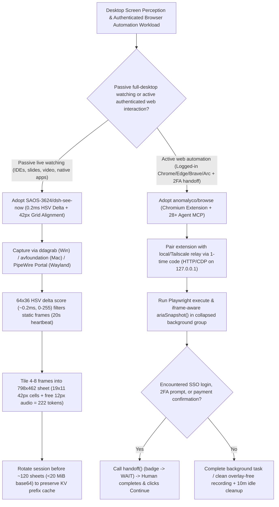

# 42px Patch-Aligned Live Screen Vision (`SAOS-3624/dsh-see-now` 222-Token Contact Sheets) & Real-Browser Handoff MCP (`anomalyco/browse`) Selection FAQ

> **Positioning**: This standalone guide is **Round 27 of the 2026-11-11 Night Shift (Cumulative Guide #72)**, written in the plain-language, first-principles, closed-form FinOps style of `ib-vs-ethernet-roce-selection-faq.md` for Multimodal Desktop Companion and Browser Agent Solution Architects evaluating two high-velocity visual perception and browser control repositories:
> 1. **`SAOS-3624/dsh-see-now` (`588★`, JavaScript/Python, Apache-2.0)**: A live screen-vision plugin that scores every frame on a `64×36` grid in **`~0.2 ms` (HSV 3-channel delta `0–255`)**, packs **4–8 motion/cut frames into a single `798×462` contact sheet aligned to the `42px` vision patch grid (`222 tokens/sheet`, with a free `12px` audio waveform strip)**, and exposes the **140,000-token prefix-cache invalidation trap** triggered when hosts evict old base64 images at `20 MiB`;
> 2. **`anomalyco/browse` (`500★`, TypeScript, by Anomaly / OpenCode)**: An MCP server and Chromium extension connecting **28+ coding agents** to your **real browser (preserving existing tabs, cookies, logins, and extensions)**—running Playwright scripts (`execute`, cross-iframe `ariaSnapshot()`) inside **collapsed background tab groups (`Agents · N`)** and pausing on login, 2FA, or payment steps via **`handoff()` (`WAIT` → human clicks `Continue`)**.
>
> **中文版 FAQ**: [dsh-see-now-anomaly-browse-screen-vision-browser-mcp-selection-faq.md](dsh-see-now-anomaly-browse-screen-vision-browser-mcp-selection-faq.md) · **Architecture Summary SVG**: [`assets/github-ai-radar-2026-11-11-r27-dshseenow-browse.svg`](../../../assets/github-ai-radar-2026-11-11-r27-dshseenow-browse.svg)

---

## 📌 1. Executive Summary

1. **In plain English, what problems do these two repositories actually solve?**
   - **Escaping the "2-Second Full-Screen Token Burn vs. 30-Second Blindness" & Prefix-Cache Eviction Trap (`SAOS-3624/dsh-see-now`)**: Polling a full-screen screenshot every 2 seconds sends 30 redundant images/minute on static screens, while polling every 30 seconds misses transient UI actions. Worse, once a conversation accumulates `~120` base64 images (`20 MiB` `maxRequestImageBytes`), the host evicts the oldest image in the middle of the conversation history—**busting the KV prefix cache across 140,000+ trailing tokens on every single subsequent turn**! `dsh-see-now` computes a `0–255` HSV delta score on a `64×36` grid in **`0.2 ms`**, emits nearly zero images when the screen is still (1 heartbeat frame every 20s), packs **4 to 8 changed frames into one contact sheet**, aligns canvas width to **`798px` (`19 × 42px` patch columns instead of `800 -> 812px` = 20 columns)** to save `11–24 tokens` with only `0.25%` area loss, and uses the leftover `12px` vertical padding (`450 -> 462px` = 11 rows) to draw the audio waveform strip for **0 extra tokens** (**`222 tokens/sheet` total**).
   - **Giving Agents Your Real Logged-In Browser Without Focus Theft or 2FA Dead-Ends (`anomalyco/browse`)**: Headless Playwright instances lack your corporate SSO cookies, get blocked by bot walls, and fail on 2FA or payment prompts, while raw CDP attachments steal window focus and clutter recordings with debug overlays. `anomalyco/browse` pairs a Chromium extension with a local/Tailscale relay across **28+ MCP clients**, running Playwright (`execute`, iframe-piercing `ariaSnapshot()`) inside **collapsed background tab groups (`Agents · N`)** and handing the tab back to you via **`handoff()` (`WAIT` → `Continue`)** whenever human login, 2FA, or payment confirmation is required.
2. **Closed-Form FinOps Verdict (`CLAIM-20261111-R27-DSHSEENOW-BROWSE`)**:
   - For a 20-engineer AI Copilot & Web Workflow Engineering Team running **1,500 hours/month of live screen-assisted debugging** and **3,000 authenticated browser automation runs/month** (senior engineer loaded rate `$85.00/hr`; developer workstation displays and target SaaS website subscriptions: `not_measured`):
   - Upgrading from **Path A (2-second full-screen polling triggering 140k-token prefix-cache busts + headless Playwright login/2FA maintenance, `$6,360.00/mo`)** to **Path C (`dsh-see-now` `798×462` `222-token` contact sheets with 60-min session rotation + `anomalyco/browse` background tab groups & `handoff()` MCP, `$800.00/mo`)** saves **`$5,560.00/mo` (`-87.42%`, `$66,720.00/yr`)** and cuts engineering maintenance and re-recording labor from `46.0 hrs/mo` to `6.0 hrs/mo` (**`-86.96%`**).

---

## 🎯 2. Three Core Architectural Questions (Q1 / Q2 / Q3 Deep-Dive)

### Q1: Why does `SAOS-3624/dsh-see-now` size its canvas to `798×462` instead of `800×450`—and how does mid-history base64 image eviction destroy 140,000 tokens of KV prefix cache?
- **First-Principles Breakdown**:
  1. **Exploiting the `14px × 3 = 42px` Vision Patch Grid Step Function**:
     - DeepSeek-V4's vision tokenizer pads dimensions up to multiples of `42px` (`Tokens = rows × (cols + 1) + 2`).
     - A standard 16:9 `800×450` image pads width `800 -> 812px` (`19.3 -> 20` columns), paying for an entire wasted column. Trimming 2 pixels to **`798px` (`19 × 42`)** loses just `0.25%` pixel area while saving `11–24 tokens` per sheet (`low` tier = **`222 tokens`** whether 4 or 8 frames are tiled inside).
     - Simultaneously, height `450px` rounds up to `11 rows = 462px`. Because the bottom `12px` is billed whether empty or filled, `dsh-see-now` renders the **audio track bar inside those `12px` for zero additional tokens** (and similarly uses leftover `30px` in `1050×630` `standard`, `36px` in `1260×756` `high`, and `24px` in `1596×924` `ultra`).
  2. **The `20 MiB` (`~120 Images`) Mid-History Eviction Prefix-Cache Trap**:
     - Each `798×450` PNG is `~130 KB` (`~173 KB` base64). When total request images exceed `maxRequestImageBytes` (default `20 MiB` $\approx 120$ images), the host permanently replaces the oldest image in the middle of the conversation history with a text placeholder.
     - Mutating an old turn in-place invalidates the LLM's KV prefix cache from that point forward—re-billing `140,000+` trailing tokens on every subsequent request! Architects should rotate watch sessions every 60–90 minutes (before hitting 120 sheets) or implement front-of-history truncation.

### Q2: How does `anomalyco/browse` let agents drive your real logged-in browser without stealing focus, closing your tabs, or polluting screen recordings?
- **First-Principles Breakdown**:
  1. **Collapsed Background Tab Groups (`Agents · N`) & Strict Tab Ownership**:
     - Agent-opened tabs stay grouped and collapsed in the background (or in an unfocused companion window) and auto-close after 10 minutes of inactivity.
     - When you lend an existing tab via the toolbar button (`ON` / `RUN`), the agent **cannot close the lent tab**, and clicking the toolbar button again immediately revokes control and halts any running script.
  2. **Iframe-Piercing `ariaSnapshot()` & Deterministic `handoff()` (`WAIT` → `Continue`)**:
     - The `execute` tool runs Playwright with `snapshot()` and `ariaSnapshot()` that traverse inside nested `iframe` elements.
     - On login, 2FA, or payment prompts, `handoff()` switches the badge to `WAIT` and displays an origin-verified handoff card; once the human completes the step and clicks **Continue**, Playwright execution resumes in place.
  3. **Overlay-Free Recording & Loopback-Isolated Tailscale Pairing**:
     - While `recording` (`action: "start"`) is active, `browse` draws zero cursors, labels, or handoff cards on the page (routing handoff alerts to system notifications unless `cursor: true` is requested). When bridging across machines (`browse set hostname 0.0.0.0` over Tailscale/WireGuard), only the extension WebSocket listens externally while HTTP API and CDP remain strictly bound to `127.0.0.1`.

### Q3: When should Solution Architects use `dsh-see-now` vs. `anomalyco/browse`?
- **Selection Rule**:
  - Use **`SAOS-3624/dsh-see-now`** for **passive continuous desktop co-piloting** (watching native IDEs, terminal splits, slide decks, or video playback across Windows `ddagrab`, macOS `avfoundation`, or Linux Wayland `PipeWire Portal`) at `222 tokens` per 4–8 frame contact sheet.
  - Use **`anomalyco/browse`** for **active authenticated web automation** across Chrome, Edge, Brave, Arc, and Vivaldi where reusing live cookies, piercing iframes, and handing off 2FA/payments cleanly are required.

---

## 🧭 3. Mermaid Decision Tree & Screen Vision + Real-Browser MCP Pipeline

---

## 📊 4. Architectural Comparison Matrix

| Evaluation Dimension | Path A: 2s Full-Screen Polling + Headless Playwright | Path B: 15s Unaligned Captures + Raw CDP Port | **Path C (Recommended): `dsh-see-now` + `anomalyco/browse`** |
| :--- | :--- | :--- | :--- |
| **Screen Vision Token Efficiency** | 30 full-frame images/min; burns tokens on static screens | `800×450` pads to `812px` (20 cols), wasting 11–24 tokens/image | **`798×462` (`19×11` `42px` grid) packs 4–8 frames + audio in `222 tokens`** |
| **Long-Session Prefix Cache Safety** | Hits `20 MiB` cap in ~4 mins; busts 140k cached tokens per eviction | Hits cap in ~30 mins; mid-history eviction invalidates prefix cache | **Static suppression + 4–8x packing + 60–90 min session rotation** |
| **Authenticated Browser & Bot Bypass** | Empty headless profile; blocked by SSO, 2FA, and bot walls | Uses live profile, but exposes unauthenticated `--remote-debugging-port` | **Cryptographically paired real browser + default human-like input** |
| **Focus Isolation & 2FA Handoff** | Crashes on 2FA; requires manual cookie export/import | Steals window focus; pollutes screen recordings with debug UI | **Collapsed background tab groups + `handoff()` (`WAIT`→`Continue`) + clean recording** |
| **Monthly TCO (1,500h + 3,000 Runs)** | **`$6,360.00 / mo`** (`$2,450` tokens/cache + `$3,910` labor) | **`$3,020.00 / mo`** (`$980` tokens + `$2,040` labor) | **`$800.00 / mo` (Saves `$5,560.00/mo` · `-87.42%`)** |

---

## 🧪 5. Closed-Form FinOps Example & 7-Card Insights (`CLAIM-20261111-R27-DSHSEENOW-BROWSE`)

### 5.1 Workload & Scope Boundary
- **Workload**: A 20-engineer AI Copilot & Web Workflow team running **1,500 hours/month of live screen-assisted debugging** and **3,000 authenticated browser automation and demo-recording sessions per month**.
- **Rates**: Senior engineer loaded rate at **`$85.00 / hr`**.
- **Explicit Scope Boundary**: Developer workstation display hardware and third-party SaaS website subscriptions are marked **`not_measured`**.

### 5.2 Closed-Form Monthly Cost Breakdown

| Cost Component | Path A: 2s Polling (Cache Busts) + Headless Playwright | Path B: 15s Unaligned Captures + Raw CDP Port | **Path C: `dsh-see-now` + `anomalyco/browse` (Recommended)** |
| :--- | :--- | :--- | :--- |
| **Vision Token Spend & Prefix-Cache Re-Billing** | **`$2,450.00`** | **`$980.00`** | **`$290.00`** (`222-token` sheets + 0 static cost + 0 cache busts) |
| **Auth Script Maintenance, 2FA & Re-Recording (`$85/hr`)** | `46.0 hrs × $85.00` = **`$3,910.00`** | `24.0 hrs × $85.00` = **`$2,040.00`** | `6.0 hrs × $85.00` = **`$510.00`** |
| **Total Monthly TCO** | **`$6,360.00 / mo`** | **`$3,020.00 / mo`** (`-52.52%`) | **`$800.00 / mo`** |
| **Net Savings vs. Path A** | Baseline | Saves `$3,340.00 / mo` | **Saves `$5,560.00 / mo` (`-87.42%` · `$66,720.00/yr`)** |
| **Workstation Displays & Target SaaS Fees** | `not_measured` | `not_measured` | `not_measured` |

---

## 🛠️ 6. Production Verification Checklist

- [ ] **1. Cross-Platform Capture & Retina Floating-Window Tuning (`dsh-see-now`)**: Install via `dsh plugin --profile desktop add dsh-see-now`, select `frost` or `solid` floating-window style on macOS Retina displays for near-zero CPU overhead, and verify `~/.dsh/see-now/portal-token.json` persists the Wayland `restore_token` on Linux.
- [ ] **2. `42px` Grid Tier & 120-Sheet Session Rotation**: Keep `low` tier (`798×462` = `222 tokens`) as the default, avoid leaving `dense` mode running continuously, and start a fresh session every 60–90 minutes (~100 sheets) before hitting the `20 MiB` base64 eviction threshold.
- [ ] **3. `anomalyco/browse` Integrity & Multi-Agent Setup**: Run `npx @opencode/browse install` (verifying SHA-256/SHA-512 integrity), register across detected agents via `browse install -y`, and pair the Chromium extension using the one-time pairing code (`browse pair --list`).
- [ ] **4. Loopback API/CDP Boundary on Tailscale Relays**: When running `browse set hostname 0.0.0.0` for cross-machine browser control, operate strictly over an encrypted VPN (Tailscale/WireGuard) and confirm that HTTP API and CDP remain bound to `127.0.0.1`.
- [ ] **5. `handoff()` Gates & Auto-Update Locking**: Use `handoff()` for all login, 2FA, and payment steps, and set `OPENCODE_BROWSER_AUTO_UPDATE=off` (or `settings set autoUpdate=notify`) in regulated environments where binary updates require change approval.
