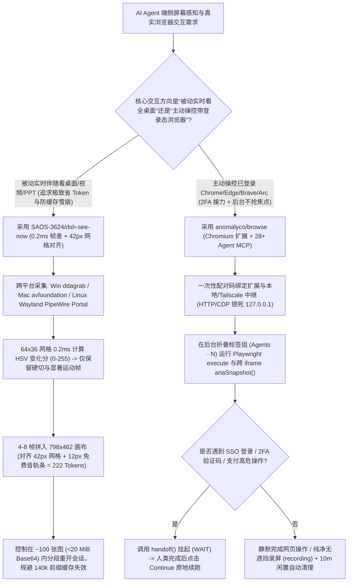

# 42px Patch 对齐实时屏幕拼图视觉（`SAOS-3624/dsh-see-now` 222-Token 帧差过滤）与真实浏览器协同接力 MCP（`anomalyco/browse`）选型 FAQ

> **文档定位**：本文是 **2026-11-11 夜班多轮深潜 Round 27（累计第 72 篇独立选型专题）**，严格对标 `ib-vs-ethernet-roce-selection-faq.md` 的「通俗大白话 + 第一性原理 + 可核算定量算例」标杆文风，为多模态桌面伴侣与浏览器自动化 Agent 架构师拆解今日两款极具工程巧思的端侧感知与操控标杆：
> 1. **`SAOS-3624/dsh-see-now`（`588★`，JavaScript/Python，Apache-2.0）**：让 AI 实时看见你屏幕的帧差拼图视觉插件——先在 `64×36` 网格上以 **`~0.2 ms` 计算 HSV 三通道变化分（`0–255`）**，将筛选出的 `4～8 帧` 拼入一张**严格对齐 `42px` 视觉 Patch 网格（`798×462` 仅耗 `222 Tokens`，利用阶梯余量免费塞入 `12px` 音轨条）**的合成图，并深度揭示了长会话 `20 MiB` 历史图片剔除导致 **14 万 Token 前缀缓存（Prefix Cache）雪崩**的底层机制；
> 2. **`anomalyco/browse`（`500★`，TypeScript，OpenCode / Anomaly 出品）**：通过本地/Tailscale 中继与 Chromium 扩展将你正在使用的**真实浏览器（保留全部已登录 Cookie、插件与会话）**接入 **28+ 款主流 Coding Agent**——Agent 在后台折叠标签组（`Agents · N`）中静默执行跨 iframe Playwright 脚本（`execute` / `ariaSnapshot()`），遇到登录、2FA 或支付时通过 **`handoff()`（`WAIT` → 人类点击 `Continue`）** 无缝交接控制权。
>
> **English Companion**: [dsh-see-now-anomaly-browse-screen-vision-browser-mcp-selection-faq.en.md](dsh-see-now-anomaly-browse-screen-vision-browser-mcp-selection-faq.en.md) · **架构总结图**: [`assets/github-ai-radar-2026-11-11-r27-dshseenow-browse.svg`](../../../assets/github-ai-radar-2026-11-11-r27-dshseenow-browse.svg)

---

## 📌 一、核心结论速览（Executive Summary）

1. **先用大白话讲透这两个项目到底解决了什么痛点？**
   - **AI 实时看屏幕“要么每 2 秒截全屏把 Token 烧穿、要么每 30 秒截一张漏掉所有关键动作”的死结（`SAOS-3624/dsh-see-now` 解决的问题）**：想让大模型陪你写代码、看视频或调 Bug，最蠢的办法就是定时全屏截图——屏幕静止时发一堆一模一样的废图，更可怕的是当会话里累积超过约 120 张图（默认 `20 MiB` Base64 上限）时，宿主从历史中间删掉最老的一张图会导致后面 **14 万+ Token 的 Prefix Cache 全部失效重新计费**！`dsh-see-now` 先花 `0.2 ms` 给每帧算一个 `0–255` 的 HSV 变化分（静止屏幕 20 秒才给一张兜底帧，几乎零成本），只有硬切翻页或累积运动量达标时才留帧，并把 **4～8 帧拼进同一张大图**；更绝的是，它精准针对视觉编码器的 `42px` 网格阶梯函数，把宽度从 `800` 微调为 **`798`（正好 19 列，面积仅少 `0.25%` 却白省一整列 Token）**，把高度 `450` 向上对齐到 `462` 后**白嫖多出来的 `12px` 空行画音轨条**，做到一张含 4～8 帧+音轨的拼图仅消耗 **`222 Tokens`**！
   - **AI 操控浏览器“无头 Playwright 没登录态被反爬拦截、抢当前窗口焦点打断人类工作”的痛点（`anomalyco/browse` 解决的问题）**：让 Agent 开一个全新的无头 Chromium 去跑自动化，一上来就卡在公司 SSO 登录、短信 2FA 验证码和 Cloudflare 盾上；如果用普通 CDP 挂接你的主浏览器，Agent 又会乱切你的活动标签页、弹窗抢焦点。`anomalyco/browse` 用一个轻量扩展 + 本地/Tailscale 中继（支持一键配置 OpenCode、Claude Code、Codex、Cursor、Copilot 等 28+ 客户端），让 Agent 在你真实浏览器的**后台折叠标签组（`Agents · 3`）**里静默干活（绝不抢夺前台窗口焦点，10 分钟闲置自动关标签），一旦遇到 2FA、登录或付款，调一句 `handoff()` 就在页面右上角挂出带域名校验的 **`WAIT` 卡片**，等你点完验证码按一下 **Continue** 立即原地续跑！
2. **闭式 FinOps 核算结论（`CLAIM-20261111-R27-DSHSEENOW-BROWSE`）**：
   - 在 **20 人研发与自动化工程团队每月开展 1,500 小时实时屏幕伴随排障 + 执行 3,000 次带登录态浏览器自动化任务** 基准下（高级工程师全包时薪 `$85.00/hr`；显示器硬件与目标业务 SaaS 网站本身订阅费：`not_measured`）：
   - 从 **Path A（每 2 秒定时全屏截图触发前缀缓存雪崩 + 无头 Playwright 反复重写真人登录/2FA 脚本，`$6,360.00/月`）** 升级至 **Path C（`dsh-see-now` `798×462` `222-Token` 帧差拼图与分段会话 + `anomalyco/browse` 后台折叠标签组与 `handoff()` 接力，`$800.00/月`）**，每月净省 **`$5,560.00/月`（降幅 `-87.42%`，年化节省 `$66,720.00/年`）**，工程师处理登录失效、焦点冲突与录屏重制的工时从 `46.0 小时/月` 降至 `6.0 小时/月`（**节省 `86.96%`**）。

---

## 🎯 二、三大灵魂拷问（Q1 / Q2 / Q3 Deep-Dive）

### Q1：`SAOS-3624/dsh-see-now` 为什么把画布尺寸定为看似古怪的 `798×462`（而非 `800×450`）？它揭示的“第 120 张图前缀缓存雪崩”是怎么回事？
- **第一性原理拆解**：
  1. **卡准 `14px × 3 = 42px` 视觉 Patch 网格阶梯函数（零代价降本 + 免费音轨条）**：
     - 宿主多模态模型（如 DeepSeek-V4）按 `14px` Patch 向上对齐并以 `42px` 为一格计算视觉 Token：`Tokens = rows × (cols + 1) + 2`。
     - 如果用常规 16:9 的 `800×450`：宽度 `800` 会被向上 Padding 到 `812`（`19.3 → 20` 列），白白多付一整列 Token！将其缩减 2 个像素到 **`798`（`19 × 42`）**，画面面积仅损失 **`0.25%`**，每张图立省 `11～24 Tokens`；
     - 高度 `450` 占 `10.7` 行，向上取整到 `11 行 = 462px`——意味着底下的 **`12px` 哪怕留白也是要付钱的**！`dsh-see-now` 直接把这 `12px` 拿来绘制实时音轨条（`standard` `1050×630` 余 `30px`、`high` `1260×756` 余 `36px`、`ultra` `1596×924` 余 `24px` 同理），实现**音轨入图零额外 Token**，且在 `798×462` 画布内拼入 4 帧或 8 帧的编码成本恒为 **`222 Tokens`**！
  2. **为什么陪看超过 1 小时必须主动开新会话？（`20 MiB` Base64 历史挖洞陷阱）**：
     - 单张 `798×450` PNG 约 `130 KB`，Base64 编码后约 `173 KB`。当单次请求累计图片超过 `maxRequestImageBytes`（默认 `20 MiB`，约 `20 MiB ÷ 173 KB ≈ 120 张图`）时，宿主会把历史中**最老的一张图永久替换为占位文字**；
     - 因为修改发生在会话历史中间（如第 43 万 Token 处），从该位置往后的 **14 万+ Token 前缀缓存（Prefix Cache）瞬间失配**，导致每新发一张图都要为后面 14 万 Token 重新按未命中全价计费！因此最佳工程实践是：**陪看 60～90 分钟主动切一次新会话，或推动宿主改为从头部整段截断**。

### Q2：`anomalyco/browse` 是如何做到“既复用你真实浏览器的登录态，又不打断你当前看网页，还能录出没有任何 AI 辅助线污染的纯净演示视频”的？
- **第一性原理拆解**：
  1. **后台折叠标签组（Collapsed Background Tab Groups）与借还所有权边界**：
     - Agent 新开的页面默认全部收拢在浏览器标签栏最左侧的折叠组（如 `Agents · 3`）或独立的失焦副窗口中，严禁调用前置激活抢夺人类焦点，且 10 分钟无脚本/无录制/无等待自动回收；
     - 当人类点击工具栏按钮把当前已打开的标签页借给 Agent（徽章变 `ON` / `RUN`）时，**Agent 绝不能关闭人类借出的标签页**，人类随时再次点击按钮即可强行收回控制权并中止正在运行的脚本。
  2. **跨 iframe `ariaSnapshot()` 与确定性 `handoff()` 人工接力**：
     - `execute` 工具允许 Agent 直接运行 Playwright 脚本，内置的 `snapshot()` 与 `ariaSnapshot()` 能够穿透多层嵌套 `iframe` 并生成可直接引用的节点 Ref；
     - 遇到验证码、2FA 或支付确认时，脚本调用 `handoff()`，标签页徽章变为 `WAIT` 并弹出展示当前真实域名（Origin）的接力卡，人类操作完点击 **Continue** 后 Playwright 上下文无缝继续往下走。
  3. **纯净录屏（Clean Recording）与一次性配对密钥安全模型**：
     - 开启 `recording`（`action: "start"`）时，扩展自动隐藏所有 Agent 虚拟光标、元素标签和网页内 Handoff 卡片（改为触发系统桌面通知），确保录出的产品视频 100% 纯净（仅在显式传 `cursor: true` 时绘制演示用幽灵光标）；
     - 跨机器（如通过 Tailscale 访问远端浏览器）时，`browse set hostname 0.0.0.0` 仅暴露扩展配对通道（HTTP API 与 CDP 依然严格锁死在 `127.0.0.1`），且通过 10 分钟有效的一次性配对码交换持久专属密钥。

### Q3：架构师在什么场景下选 `dsh-see-now`，什么场景下选 `anomalyco/browse`？
- **黄金选型分工**：
  - **被动伴随式全桌面感知（跨原生 IDE、终端、PPT、视频播放器的实时陪看与语音点评）**：采用 **`SAOS-3624/dsh-see-now`**（Windows `ddagrab` / macOS `avfoundation` / Linux Wayland `PipeWire Portal`），用 `222 Tokens/张` 的帧差拼图实现超低成本全屏感知；
  - **主动交互式网页自动化（需复用企业 SSO 登录态、跨 iframe 填表、抓取网络请求与 2FA 人机接力）**：采用 **`anomalyco/browse`**，一行 `browse install -y` 挂载至全部本地 Coding Agent。

---

## 🧭 三、Mermaid 选型决策树与端侧感知+真实浏览器操控架构

---

## 📊 四、同类方案核心能力对比矩阵（Comparison Matrix）

| 评估维度 | Path A：每 2s 全屏截图 + 无头 Playwright | Path B：每 15s 未对齐截图 + 裸开 CDP 调试端口 | **Path C（推荐标杆）：`dsh-see-now` + `anomalyco/browse`** |
| :--- | :--- | :--- | :--- |
| **屏幕视觉单图 Token 与帧效率** | 每分钟 30 张单帧大图，静止画面照样烧钱 | `800×450` 触发 `812px` 跨列 Padding，单帧浪费 11–24 Tokens | **`798×462` 精准卡 19×11 格，单图塞 4–8 帧+音轨仅 `222 Tokens`** |
| **长会话 Prefix Cache 保护** | 约 4 分钟即撞上 `20 MiB` 上限，每次淘汰重算 14 万 Token | 约 30 分钟撞线，历史中间挖洞导致缓存雪崩 | **静止零出图 + 帧差拼图大幅延缓体积增长 + 明确分段会话准则** |
| **浏览器登录态复用与反爬通过率** | 无头浏览器无 Cookie，频繁死于 Cloudflare 与 SSO | 虽有 Cookie，但全局开放 `--remote-debugging-port` 极不安全 | **一次性密钥配对真实浏览器，默认开启 Human-Like 拟人输入** |
| **工作流防打断与 2FA 人机交接** | 失败直接抛异常退出，需人工复制 Cookie 重跑 | Agent 乱切前台标签页抢夺鼠标焦点，录屏充满调试框 | **后台折叠标签组零打扰 + `handoff()` 一键接力 + 纯净无框录屏** |
| **月度总拥有成本（1,500h+3,000 次）** | **`$6,360.00 / 月`**（Token/缓存 `$2,450` + 人工 `$3,910`） | **`$3,020.00 / 月`**（Token `$980` + 人工 `$2,040`） | **`$800.00 / 月`（净省 `$5,560.00/月`，降幅 `-87.42%`）** |

---

## 🧪 五、闭式定量 FinOps 算例与 7-Card 评测洞察（`CLAIM-20261111-R27-DSHSEENOW-BROWSE`）

### 5.1 基准假设与边界声明
- **评测负载**：20 人研发与自动化工程团队每月累计运行 **1,500 小时实时屏幕视觉辅助排障** 与 **3,000 次需要复杂登录态的网页自动化/录屏任务**。
- **单价基准**：高级工程师全包时薪 **`$85.00 / hr`**。
- **显式边界声明（Scope Boundary）**：开发者本地显示器硬件折旧及被访问的第三方业务 SaaS 网站本身订阅费标记为 **`not_measured`**。

### 5.2 三路径闭式成本核算表

| 成本构成项 | Path A：2s 全屏轮询（触发缓存雪崩）+ 无头浏览器 | Path B：15s 未对齐截图 + 裸 CDP 端口（抢焦点） | **Path C：`dsh-see-now` + `anomalyco/browse`（推荐）** |
| :--- | :--- | :--- | :--- |
| **多模态视觉 Token 与缓存失效重算费** | **`$2,450.00`** | **`$980.00`** | **`$290.00`**（`222-Token` 拼图 + 静止零消耗 + 零雪崩） |
| **登录脚本维护、2FA 救火与重录工时（`$85/hr`）** | `46.0 hrs × $85.00` = **`$3,910.00`** | `24.0 hrs × $85.00` = **`$2,040.00`** | `6.0 hrs × $85.00` = **`$510.00`** |
| **月度总成本（Monthly Total）** | **`$6,360.00 / 月`** | **`$3,020.00 / 月`**（`-52.52%`） | **`$800.00 / 月`** |
| **相对 Path A 净节省（Savings）** | 基准线（Baseline） | 节省 `$3,340.00 / 月` | **净省 `$5,560.00 / 月`（`-87.42%` · 年省 `$66,720.00`）** |
| **显示器硬件与目标 SaaS 网站订阅** | `not_measured` | `not_measured` | `not_measured` |

---

## 🛠️ 六、生产级落地核验 Checklist（SA Actionable Verification）

- [ ] **1. `dsh-see-now` 跨平台采集与 Retina 悬浮窗调优**：安装 `dsh plugin --profile desktop add dsh-see-now`，在 macOS/Retina 屏上将悬浮窗样式设为 `frost`（静态磨砂）或 `solid`（纯色）以实现接近 0% 的额外 CPU 占用，并在 Linux Wayland 下确认 `~/.dsh/see-now/portal-token.json` 已持久化 `restore_token`。
- [ ] **2. `42px` 网格档位与 60 分钟分段会话纪律**：日常代码陪看默认保持 `low` 档（`798×462` = `222 Tokens`），避免长时间挂 `dense` 档，并在连续陪看累计接近 100 张拼图（约 60～90 分钟）前主动新建会话，彻底规避 `20 MiB` 历史图片淘汰引发的 14 万 Token 前缀缓存重算。
- [ ] **3. `anomalyco/browse` 完整性校验与一键多 Agent 注册**：通过 `npx @opencode/browse install` 安装并核验二进制 SHA-256，使用 `browse install -y`（或指定 `-a claude cursor codex copilot`）注入 MCP 配置并完成浏览器扩展一次性配对码绑定。
- [ ] **4. 远端 Tailscale 中继的回环隔离检查**：若跨机器执行 `browse set hostname 0.0.0.0`，务必确认通信跑在加密 Tailscale / WireGuard 私网内，且核验 HTTP API 与 CDP 依然严格仅监听 `127.0.0.1`。
- [ ] **5. `handoff()` 接力与自动更新锁控**：在涉及 2FA 或支付的 Playwright 脚本中强制使用 `handoff()` 交由人类确认，并在生产稳定期通过 `OPENCODE_BROWSER_AUTO_UPDATE=off` 或扩展设置中的 `Only tell me` 锁定经过审计的二进制版本。
